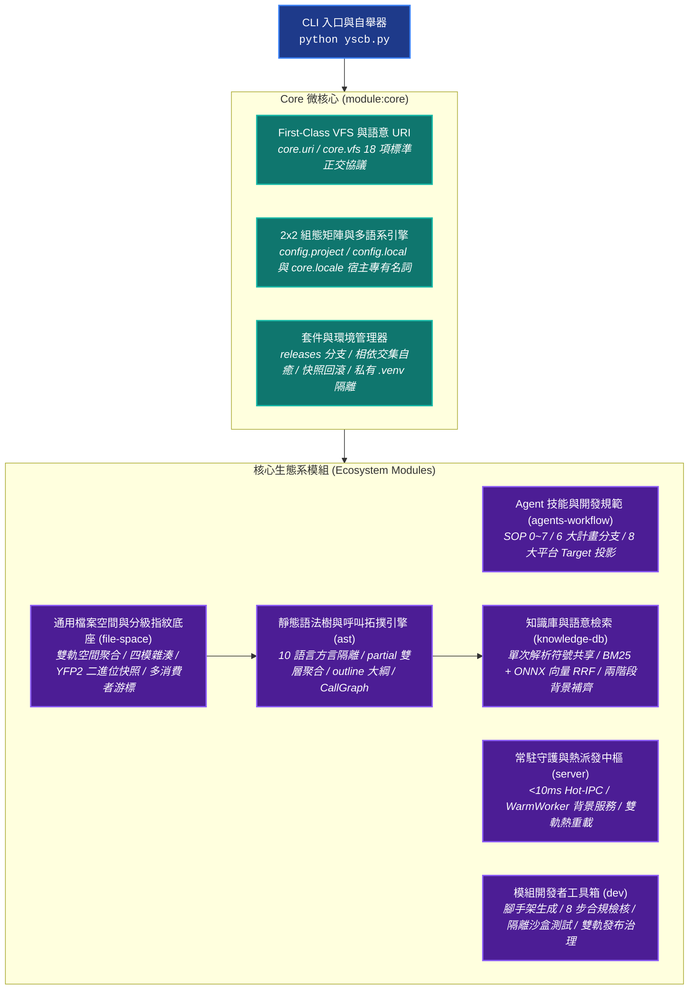

# YS-Codebase (`ys-codebase`)

> 面向 AI Agent 協同開發之微核心架構與模組化工具庫。使用 100% Python 標準庫打造微內核，零核心第三方依賴，支援一鍵單檔自舉與模組化生態擴充。

> [!IMPORTANT]
> ### [AI Agent Onboarding] 給 AI Agent 的安裝與初始化指引
> 若需將本工具庫或擴充模組導入目標專案環境，請直接參閱下方 **[3. 安裝與 5 分鐘快速上手指南 (Quickstart & Setup Guide)](#3-安裝與-5-分鐘快速上手指南-quickstart--setup-guide)**，並嚴格遵守各模組的 **Pre-flight Check**（在執行設定寫入前先向開發者確認路徑與目標 IDE）。安裝完成後，開發者亦可隨時透過互動式教練技能 **`/how-to-config-yscb`**（組態體檢與空間對齊）與 **`/how-to-yscb`**（工作流與工具互動導覽）快速掌握最佳實踐。

---

## 1. 系統架構全景 (Architecture Overview)

系統由超薄宿主入口腳本 (`yscb.py`)、微內核 (`core`) 與六大生態系擴充模組組成（含 `file-space` $\to$ `ast` $\to$ `knowledge-db` 三階單向無環圖）：



---

## 2. 七大核心模組清單 (Ecosystem Modules)

| 模組名稱 | 模組標識 | 職責定位與核心價值 | 隨包手冊語意位置 (安裝後) | 系統知識庫手冊 (本倉) |
| :--- | :--- | :--- | :--- | :--- |
| **Core** | `module:core` | **微核心基礎設施**：套件生命週期管理（對接單層 `releases` 分支、`index.json` 雙軌版本帳本與相依交集自檢自癒）、First-Class VFS (`core.vfs`) 與 Scheme B 正交語意 URI (`core.uri`)、2x2 組態矩陣、多語系與宿主專有名詞引擎 (`core.locale`)、CLI 飛行紀錄器 (`core.telemetry`)、私有微環境 (`PipManager`) 與四段式 SemVer 引擎。 | `module://core/README.md`<br/>*(預設：`.yscb/.modules/core/README.md`)* | [docs/core/README.md](./docs/core/README.md) |
| **Agents-Workflow** | `module:agents-workflow` | **AI Agent 技能與工作流引擎**：SOP 0~7 開發流程、6 大計畫分支拓撲、6 大中央工程與子代理標準、8 大主流 AI 平台 `release_target` 投影、19 個內建工作流與領域 Skills（全生態系共 22 個 Skills），以及 `plan` / `roadmap` / `todo` / `session-trace` 管理工具鏈。 | `module://agents-workflow/README.md`<br/>*(預設：`.yscb/.modules/agents-workflow/README.md`)* | [docs/agents-workflow/README.md](./docs/agents-workflow/README.md) |
| **File-Space** | `module:file-space` | **通用檔案空間與指紋底座 (Layer 1)**：雙軌空間定義聚合（`config/file-space/contribute.json` 與模組貢獻）、雙階段四模分級雜湊 (`adaptive`/`full_hash`/`stat_only`/`lazy_stabilized`)、`YFP2` 單調世代二進位快照、多消費者獨立水位線與 `file-space-watcher` 常駐監聽。 | `module://file-space/README.md`<br/>*(預設：`.yscb/.modules/file-space/README.md`)* | [docs/file-space/README.md](./docs/file-space/README.md) |
| **AST** | `module:ast` | **靜態語法樹與呼叫拓撲引擎 (Layer 2)**：10 大語言宣告式 AST / Tree-sitter 方言隔離解析 (`dialects/<lang>`)、C# `partial class` 雙層無損聚合、確定性同名異載群組定址、單檔結構化大綱 (`outline` 三維度正交過濾) 與跨檔案呼叫圖譜 (`callers`/`callees`/`impact`)。 | `module://ast/README.md`<br/>*(預設：`.yscb/.modules/ast/README.md`)* | [docs/ast/README.md](./docs/ast/README.md) |
| **Knowledge-DB** | `module:knowledge-db` | **知識庫與混合語意檢索引擎 (Layer 3)**：透過單次解析符號共享直接消費 `module:ast` 快照、宣告式空間權重 (`space_weights`)、BM25 + FastEmbed ONNX 雙軌向量 RRF 複合檢索、`KnowledgeDBServiceWorker` 兩階段背景向量補齊與毫秒級動態降級。 | `module://knowledge-db/README.md`<br/>*(預設：`.yscb/.modules/knowledge-db/README.md`)* | [docs/knowledge-db/README.md](./docs/knowledge-db/README.md) |
| **Server** | `module:server` | **常駐守護與背景服務中樞**：Master/WarmWorker 雙進程隔離、`<10ms` 極速 Hot-IPC 派發、`.modules/` 雙軌自動熱重載、背景服務託管 (`ServiceManager`) 與即時 Flush 滾動日誌。 | `module://server/README.md`<br/>*(預設：`.yscb/.modules/server/README.md`)* | [docs/server/README.md](./docs/server/README.md) |
| **Dev** | `module:dev` | **模組開發工具箱**：擴充模組腳手架生成 (`create`)、8 步靜態合規檢查 (`check`)、隔離沙盒平行跑測 (`test`)、3-Gate 發布預檢 (`release-check`)、雙軌元數據打包發布 (`build`/`release`/`release-git`) 與事後索引修補 (`index-patch`)。 | `module://dev/README.md`<br/>*(預設：`.yscb/.modules/dev/README.md`)* | [docs/dev/README.md](./docs/dev/README.md) |

> **提示**：隨時可透過 `python yscb.py uri resolve module://<mod>/README.md` 取得任一已安裝模組隨包手冊的實體絕對路徑。

---

## 3. 安裝與 5 分鐘快速上手指南 (Quickstart & Setup Guide)

### 3.1 步驟一：基礎環境自舉與宿主綁定 (`core`)

1. **環境需求**：Python 3.9+（核心僅使用 Python 標準庫，無需預裝第三方套件）。
2. **一鍵自舉初始化**：
   從 YSCB 發布倉庫取得單一入口檔案 `yscb.py` 放入您的專案根目錄，執行 `init` 自動自官方線上 `releases` 分支拉取並解壓最新 `core` 模組與生成錨點檔 `yscb.config.json`：
   ```bash
   # 全新初始化工作區 (預設建立 .yscb 工具目錄並自動寫入 yscb.config.json)
   python yscb.py init

   # [既有工作區自癒 / Clone 後環境還原] 檢修修復 core 或依 yscb.config.json 還原全套模組
   python yscb.py init --fix
   python yscb.py restore
   ```
3. **綁定宿主專案根目錄並驗證**：
   ```bash
   # 設定 project_root (路徑為相對於 yscb.py 所在目錄之相對路徑)
   python yscb.py config set core project_root ./

   # 檢查語意 URI 狀態 (確認 project:// 等核心協議為 OK)
   python yscb.py uri check
   ```
4. **初始化後之宿主目錄結構對照**：
   ```text
   my-project/                  <-- project:// (宿主專案根目錄)
   ├── yscb.py                  <-- yscb.host:// (單檔 CLI 入口腳本)
   ├── yscb.config.json         <-- init 自動生成的錨點與鎖定檔 (紀錄工具目錄位置與模組版本鎖定)
   └── .yscb/                   <-- yscb:// (YSCB 工具與運行根目錄；自舉母倉自訂為 ys_codebase/)
       ├── .modules/            <-- module:// (已安裝模組運行空間，如 .yscb/.modules/core/)
       ├── .mirror/             <-- module.mirror:// (不可變套件快取與離線索引鏡像)
       ├── .venv/               <-- yscb.venv:// (Wheel-Only 私有隔離微環境，按需自動建立)
       ├── config/              <-- config:// (2x2 組態矩陣：config.project.json 與 config.local.json)
       └── source/              <-- module.source:// (執行 dev create 時建立自訂擴充模組源碼之位置)
   ```

---

### 3.2 步驟二：`agents-workflow` 技能與開發規範設定

`agents-workflow` 提供 AI Agent 協同開發所需的 **SOP 0~7 生命週期**（含 `P{XX}-05_auto.md` 單檔連續推進與 Review Gate 結案審查）、**6 大計畫分支**（Full Track、Fast Track、Umbrella、Revision、Research、Roadmap/Todo 雙層儲備）與 **純 Skill 技能包體系**。

#### 安裝與設定步驟

1. **安裝模組**：
   ```bash
   python yscb.py install agents-workflow
   ```

> [!CAUTION]
> ### [Pre-flight Check] 給 AI Agent 的初始化確認提示
> 在執行一鍵初始化與設定 Release Target 前，**Agent 必須先向開發者確認以下兩點**：
> 1. **目錄配置**：確認是否使用預設路徑（`plans/`、`docs/`、`plans/archived/`、`plans/roadmap/`），或需自訂路徑？
> 2. **目標環境 (IDE Target)**：詢問開發者使用的 AI 開發環境（支援 `antigravity`、`claude`、`codex`、`cursor`、`copilot`、`windsurf`、`opencode`、`roo` 共 8 大平台），確認要啟用哪一個或哪幾個 Target？

2. **一鍵初始化工作流目錄與語意協議 (`init --default`)**：
   ```bash
   # 自動建立並綁定 plans/, docs/, plans/archived/, plans/roadmap/
   python yscb.py agents-workflow init --default -y
   ```
   *(若需自訂路徑，可透過 `python yscb.py config set agents-workflow paths.plans project://my_plans` 個別設定)*

3. **設定目標開發環境 (Release Target) 並自動發布規範**：
   ```bash
   # 查看支援的 8 大目標環境清單與啟用狀態 (預設啟用 antigravity)
   python yscb.py agents-workflow release-target --list

   # 啟用目標環境 (--proj 代表寫入專案共享設定，執行時會自動觸發完整原子發布！)
   python yscb.py agents-workflow release-target --add claude --proj

   # (選用) 若僅使用單一環境 (如純 Claude Code)，可移除預設的 antigravity 並自動清理其舊檔：
   python yscb.py agents-workflow release-target --remove antigravity --proj

   # (選用) 日後若手動修改了組態或規範模板，可隨時手動觸發重新編譯與發布：
   python yscb.py agents-workflow release
   ```

   **8 大內建目標環境 (Release Target) 物化產物對照表**：
   | Target 名稱 | 適用 AI 開發環境 | 規範入口檔 (`agents_md`) | Skills 投影目錄 | 模板與標準參考目錄 |
   | :--- | :--- | :--- | :--- | :--- |
   | `antigravity` | Google Antigravity IDE | `AGENTS.md` | `.agents/skills/<name>/SKILL.md` | `.agents/.yscb/{templates,standards}/` |
   | `claude` | Anthropic Claude Code | `CLAUDE.md` | `.claude/skills/<name>/SKILL.md` | `.claude/.yscb/{templates,standards}/` |
   | `codex` | OpenAI Codex CLI / IDE | `AGENTS.md` | `.agents/skills/<name>/SKILL.md` | `.agents/.yscb/{templates,standards}/` |
   | `cursor` | Cursor IDE | `AGENTS.md` | `.cursor/skills/<name>/SKILL.md` | `.cursor/.yscb/{templates,standards}/` |
   | `copilot` | GitHub Copilot | `.github/copilot-instructions.md` | `.github/skills/<name>/SKILL.md` | `.github/.yscb/{templates,standards}/` |
   | `windsurf` | Windsurf IDE | `AGENTS.md` | `.windsurf/skills/<name>/SKILL.md` | `.windsurf/.yscb/{templates,standards}/` |
   | `opencode` | OpenCode CLI / IDE | `AGENTS.md` | `.opencode/skills/<name>/SKILL.md` | `.opencode/.yscb/{templates,standards}/` |
   | `roo` | Roo Code | `AGENTS.md` | `.roo/skills/<name>/SKILL.md` | `.roo/.yscb/{templates,standards}/` |

   *(註：當同時啟用多個共用 `AGENTS.md` 的 Target 時，編譯器會自動將宿主專有名詞與技能相對路徑去重並以 `" / "` 並聯渲染，同時支援執行期環境變數自動嗅探)*

4. **驗證工作流狀態**：
   ```bash
   python yscb.py agents-workflow plan status
   python yscb.py agents-workflow list
   ```

---

### 3.3 步驟三：`file-space`、`ast` 與 `knowledge-db` 三階知識檢索設定

知識庫體系採用 `file-space`（檔案空間與指紋底座）$\to$ `ast`（靜態語法樹、單檔大綱 `outline` 與呼叫圖譜 `callers/callees/impact`）$\to$ `knowledge-db`（BM25 詞彙 + FastEmbed ONNX 向量雙軌 RRF 複合語意檢索）三階架構。

#### 安裝與設定步驟

1. **安裝模組**（安裝 `knowledge-db` 時會自動連帶解析並安裝底層相依模組 `file-space` 與 `ast`、在 `yscb.venv://` 配置 Wheel 依賴，並向 `agents-workflow` 導出 `knowledge-db-search` 技能）：
   ```bash
   python yscb.py install knowledge-db
   ```

> [!CAUTION]
> ### [Pre-flight Check] 給 AI Agent 的檢索空間與模型確認提示
> 安裝完成後、初次建立索引前，**Agent 必須先向開發者確認以下兩點**：
> 1. **源碼掃描目錄 (`spaces`)**：詢問專案中需要納入檢索的原始碼目錄（例如 `src/`、`lib/`、`app/`）與檔案格式？
> 2. **向量檢索模式**：詢問是否要下載本地 ONNX 向量模型（`model download`，約 130MB，支援語意混合檢索），或關閉向量檢索改用輕量極速之純 BM25 詞彙模式？

2. **設定專案源碼掃描空間 (`config/file-space/contribute.json`) 與檢索權重 (`config/knowledge-db/contribute.json`)**：
   在 `config/file-space/contribute.json` 設定專案原始碼掃描範圍與分級雜湊策略（若檔案不存在可直接建立）：
   ```json
   {
     "spaces": {
       "source": {
         "description": "專案核心原始碼空間",
         "include": ["project://src", "project://lib"],
         "exclude": ["**/__pycache__/**", "**/node_modules/**"],
         "file_patterns": ["*.py", "*.cpp", "*.h", "*.cs", "*.ts", "*.js"],
         "hash_policy": "adaptive",
         "watch": true,
         "weight": 1.0
       }
     }
   }
   ```
   *(註：空間幾何定義統一由 `config/file-space/contribute.json` 託管；若需在 `knowledge-db` 覆寫各空間檢索排序權重，可於 `config/knowledge-db/contribute.json` 設定 `{"space_weights": {"source": 1.2}}`)*

3. **配置向量模型（二選一）**：
   ```bash
   # 方案 A (推薦)：預載本地 ONNX 向量模型，啟用 BM25 + 向量語意 RRF 混合檢索
   python yscb.py knowledge-db model download

   # 方案 B (輕量極速)：免下載向量模型，使用純 BM25 詞彙檢索
   python yscb.py config set knowledge-db enable_vector_search false
   ```

4. **一鍵建立全管線索引並驗證 AST 導航與語意檢索**：
   ```bash
   # 一鍵執行：增量指紋掃描 (file-space) -> AST 符號與呼叫圖譜 (ast) -> BM25 倒排與向量特徵建置 (knowledge-db)
   python yscb.py knowledge-db index

   # 檢查檔案空間、AST 拓撲與知識庫索引就緒狀態
   python yscb.py file-space status
   python yscb.py ast status
   python yscb.py knowledge-db status

   # Stage 1 未知座標語意檢索 -> Stage 1.5 單檔結構大綱導航 -> 呼叫拓撲追蹤
   python yscb.py knowledge-db search "核心關鍵字" -s
   python yscb.py ast outline src/main.py --public --methods
   python yscb.py ast callers TargetSymbol -s
   ```

---

### 3.4 步驟四：`server` 常駐加速與背景守護設定 (推薦安裝)

`server` 模組透過常駐預熱 `WarmWorker` 將 CLI 調用延遲由冷啟動 ~1s 降至 **<10ms**，並自動託管 `knowledge-db` 背景檔案監聽（`KnowledgeDBServiceWorker`，存檔 500ms 防抖自動差量熱修補索引）與 `.modules/` 雙軌熱重載。

```bash
# 1. 安裝模組
python yscb.py install server

# 2. 在一般終端環境啟動背景常駐守護進程 (輸出結構化啟動參數橫幅)
python yscb.py server start

# [IDE Agent 環境專用] 在受限的沙盒終端中，請透過 IDE 背景任務 (Background/Daemon Task) 執行：
python yscb.py server start --console

# 3. 查看運行狀態、Uptime、監聽目錄與託管背景服務清冊
python yscb.py server status

# 4. 優雅停止服務並檢視本次運行統計總結報告 (Uptime / Tasks Handled / Archived Log)
python yscb.py server stop
```
> **沙盒環境防呆提示**：由於 `server` 預設啟用 `auto_spawn=true`（一般 CLI 執行時若發現 Server 未啟動會自動嘗試於背景拉起 Master 進程），若您處於**不支援背景常駐任務的受限沙盒終端**，請先執行 `python yscb.py config set server auto_spawn false --local` 切換為純冷派發模式，避免受限沙盒回收背景子進程。

---

### 3.5 步驟五：`dev` 擴充模組開發工具箱 (供插件/模組開發者)

若您希望在專案中開發自訂的 YS-Codebase 擴充模組（安裝 `dev` 後會自動導出 `yscb-module-dev` 與 `/bump-revision` 技能）：

```bash
# 1. 安裝開發者工具箱
python yscb.py install dev

# 2. 一鍵生成標準模組骨架 (自動建立於 module.source://<name>，即預設 .yscb/source/my-plugin/)
python yscb.py dev create my-plugin --desc="自訂業務擴充模組"

# 查詢新模組源碼的實體絕對路徑以便編輯代碼
python yscb.py uri resolve module.source://my-plugin

# 3. 執行 8 步靜態合規檢查與隔離沙盒測試 (支援 -q 節流與 --sync 通過後自動熱安裝 @build)
python yscb.py dev check my-plugin
python yscb.py dev test my-plugin -q --sync

# 4. 或手動執行本地 @build 通道熱安裝試用
python yscb.py install my-plugin@build --force
```
> **提示**：對於僅供單一專案內部使用之小範圍特化自建模組，**建議長期維持以 `@build` 版自部署使用**，免去版本號遞增與 `release/` 釋出維護問題（跨機 `git clone` 後執行 `restore` 或任意指令時，系統亦會自動從 `source/<name>` 無感打包還原 `@build` 模組）。

---

## 4. 常用 CLI 指令速查表 (CLI Cheat Sheet)

```bash
# ── 宿主自舉、套件與組態 (Host & Core) ─────────────────────────
python yscb.py init [--fix]                              # 初始化工作區或自癒修復 core 模組
python yscb.py self-update                               # 升級宿主起手腳本 yscb.py
python yscb.py restore [--force]                         # 依 yscb.config.json 鎖定清單一鍵還原所有模組
python yscb.py list [--remote]                           # 查看已安裝或遠端可用模組清單
python yscb.py status                                    # 查看模組健康度與更新狀態
python yscb.py install <module>[@ver] [--force]          # 安裝模組 (完成後自動輸出 Next Steps)
python yscb.py update [<module>]                         # 更新指定或全部已安裝模組
python yscb.py rollback [snapshot_id]                    # 回滾至指定雙層組態與模組快照
python yscb.py config list [--mod=<module>] [--local]    # 列出模組組態 (專案層級與本機覆蓋)
python yscb.py uri list / uri check                      # 列出或檢查全系統 Scheme B 語意 URI 協議
python yscb.py contributes list / contributes check      # 列出或校驗全系統 Contributes 擴充點契約

# ── AI Agent 技能與計畫管理 (Agents-Workflow) ──────────────────
python yscb.py agents-workflow init --default [-y]       # 一鍵初始化工作流目錄與協議
python yscb.py agents-workflow release [--force]         # 編譯並原子發布 AGENTS.md 與 Skills
python yscb.py agents-workflow release-target --list     # 查看 8 大 AI 開發環境 Target 啟用狀態
python yscb.py agents-workflow plan status [--resume]    # 查詢進行中計畫狀態矩陣或提取斷點恢復膠囊
python yscb.py agents-workflow plan verify [plan_name]   # 稽核計畫結構、追溯差集或免讀追加 changelog (--log)
python yscb.py agents-workflow plan search "<kw>" [--dr] # 跨活躍與封存計畫檢索全文或 DR (--full / --json)
python yscb.py agents-workflow plan archive <plan_name>  # 安全歸檔已完成計畫 (4 重守門檢查)
python yscb.py agents-workflow roadmap [list|promote]    # 檢視宏觀技術路線圖儲備或晉升立項
python yscb.py agents-workflow todo [list|add|promote]   # 免讀追加、查詢或打包提取 TODO.md 輕量待辦
python yscb.py agents-workflow session-trace [--json]    # 提取當前對話之三級摩擦軌跡供 /session-audit 診斷

# ── 檔案空間與增量指紋底座 (File-Space) ────────────────────────
python yscb.py file-space status [--space=<s_name>]      # 查看已註冊檔案空間、世代水位與消費者游標
python yscb.py file-space scan [--space=<s_name>]        # 執行雙階段增量指紋掃描並更新 YFP2 快照
python yscb.py file-space files [--space=<s_name>]       # 列出空間內納管之有效檔案清單
python yscb.py file-space diff --consumer=<id> [--ack]   # 檢視特定消費者相對於最新快照之增量差異
python yscb.py file-space clean [--consumer=<id>]        # 清理指紋快照或重置特定消費者游標

# ── 靜態語法樹與呼叫拓撲引擎 (AST) ─────────────────────────────
python yscb.py ast outline <file> [--public|--methods]   # 單檔結構化大綱與起訖行號 (支援三維度過濾與 --merged)
python yscb.py ast callers <symbol> [-s] [--json]        # 追蹤誰調用了該符號 (支援同型別 Overload 自動群組展開)
python yscb.py ast callees <symbol> [-s] [--json]        # 追蹤該符號內部調用了誰 (下游被調用方)
python yscb.py ast impact <symbol> --depth=2 [--json]    # 評估符號修改之多階擴散影響半徑
python yscb.py ast status / clean                        # 查看 AST 快照世代、已註冊方言或清除 AST 索引快取

# ── 知識庫與混合語意檢索 (Knowledge-DB) ────────────────────────
python yscb.py knowledge-db index [--all]                # 一鍵全管線建立/更新索引
python yscb.py knowledge-db status [--scan]              # 查看後台服務、三大索引覆蓋率與空間水位狀態
python yscb.py knowledge-db search "<query>" --json -s   # 帶 AST 代碼切片之複合語意檢索 (支援 --ftype / --space)
python yscb.py knowledge-db model status / download      # 檢查或下載本地 ONNX 向量嵌入模型
python yscb.py knowledge-db clean [--all]                # 清理知識庫索引快取

# ── 常駐加速與守護服務 (Server) ────────────────────────────────
python yscb.py server start [--console|--daemon]         # 啟動常駐守護進程並輸出參數橫幅
python yscb.py server status                             # 查看 Master/Worker PID、Uptime 與服務狀態
python yscb.py server reload                             # 手動熱重載 Worker 子進程
python yscb.py server stop [--force]                     # 優雅停止服務並輸出運行統計總結報告

# ── 擴充模組開發與測試 (Dev) ───────────────────────────────────
python yscb.py dev create <name> [--desc="..."]          # 建立自訂模組標準骨架
python yscb.py dev check [<name> | --all] [--json]       # 執行 8 步靜態架構與契約合規檢查
python yscb.py dev test [<name> | --all] [-q] [--sync]   # 執行隔離沙盒平行測試 (支援通過後直裝 @build)
python yscb.py dev bump-[major|minor|patch|revision] <m> # 單向遞增模組 manifest.json 四段式版號
python yscb.py dev release-check [<name> | --all]        # 執行發布前 3-Gate 就緒預檢
python yscb.py dev release <name> [--type=...]           # 打包純淨發布包至 release/ 並寫入雙軌元數據
python yscb.py dev index-patch <name> --ver=<v> [...]    # 免重打包事後修補歷史版本依賴與狀態元數據
```
