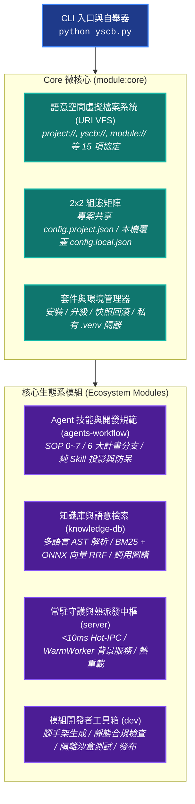

# YS-Codebase (`ys-codebase`)

> 面向 AI Agent 協同開發之微核心架構與模組化工具庫。使用 100% Python 標準庫打造微內核，零核心第三方依賴，支援一鍵單檔自舉與模組化生態擴充。

> [!IMPORTANT]
> ### [AI Agent Onboarding] 給 AI Agent 的安裝與初始化指引
> 若需將本工具庫或擴充模組導入目標專案環境，請直接參閱下方 **[3. 安裝與 5 分鐘快速上手指南 (Quickstart & Setup Guide)](#3-安裝與-5-分鐘快速上手指南-quickstart--setup-guide)**，並嚴格遵守各模組的 **Pre-flight Check**（在執行設定寫入前先向開發者確認路徑與目標 IDE）。

---

## 1. 系統架構全景 (Architecture Overview)

系統由超薄宿主入口腳本 (`yscb.py`)、微內核 (`core`) 與四大生態系擴充模組組成：



---

## 2. 五大核心模組清單 (Ecosystem Modules)

| 模組名稱 | 模組標識 | 職責定位與核心價值 | 隨包手冊語意位置 (安裝後) |
| :--- | :--- | :--- | :--- |
| **Core** | `module:core` | **微核心基礎設施**：套件生命週期管理、語意空間協議 VFS、2x2 組態矩陣、CLI 調度、私有微環境 (`PipManager`) 與 SemVer 引擎。 | `module://core/README.md`<br/>*(實體預設：`.yscb/.modules/core/README.md`)* |
| **Agents-Workflow** | `module:agents-workflow` | **AI Agent 技能與工作流引擎**：SOP 0~7 開發流程、6 大計畫分支拓撲、行為準則防呆、12 大領域與工作流 Skills（`.agents/skills/` 或 `.claude/skills/`）及 `plans` 管理工具鏈。 | `module://agents-workflow/README.md`<br/>*(實體預設：`.yscb/.modules/agents-workflow/README.md`)* |
| **Knowledge-DB** | `module:knowledge-db` | **知識庫與符號檢索引擎**：多語言 AST 符號解析 (Python/C/C++/C#/JS/TS/MD)、BM25 + FastEmbed ONNX 雙軌向量檢索、調用圖譜 (`callers`/`callees`/`impact`) 與代碼切片。 | `module://knowledge-db/README.md`<br/>*(實體預設：`.yscb/.modules/knowledge-db/README.md`)* |
| **Server** | `module:server` | **常駐守護與背景服務中樞**：Master/WarmWorker 雙進程隔離、`<10ms` 極速熱派發、`.modules/` 雙軌熱重載、背景服務託管 (`ServiceManager`) 與即時滾動日誌。 | `module://server/README.md`<br/>*(實體預設：`.yscb/.modules/server/README.md`)* |
| **Dev** | `module:dev` | **模組開發工具箱**：擴充模組腳手架生成 (`create`)、8 步靜態合規檢查 (`check`)、隔離沙盒並行跑測 (`test`) 與雙軌打包發布 (`build`/`release`)。 | `module://dev/README.md`<br/>*(實體預設：`.yscb/.modules/dev/README.md`)* |

> **提示**：隨時可透過 `python yscb.py uri resolve module://<mod>/README.md` 取得任一已安裝模組隨包手冊的實體絕對路徑。

---

## 3. 安裝與 5 分鐘快速上手指南 (Quickstart & Setup Guide)

### 3.1 步驟一：基礎環境自舉與宿主綁定 (`core`)

1. **環境需求**：Python 3.9+（核心僅使用 Python 標準庫，無需預裝第三方套件）。
2. **一鍵自舉初始化**：
   從 YSCB 發布倉庫取得單一入口檔案 `yscb.py` 放入您的專案根目錄，執行 `init` 自動自官方線上來源拉取並解壓最新 `core` 模組與生成錨點檔 `yscb.config.json`：
   ```bash
   # 全新初始化工作區 (預設建立 .yscb 工具目錄並自動寫入 yscb.config.json)
   python yscb.py init

   # [既有工作區自癒] 檢修或強制修復 core 模組
   python yscb.py init --fix
   ```
3. **綁定宿主專案根目錄並驗證**：
   ```bash
   # 設定 project_root (路徑為相對於 yscb.py 所在目錄之相對路徑)
   python yscb.py config set core project_root ./

   # 檢查語意 URI 狀態 (確認 project:// 等核心協議為 OK)
   python yscb.py uri check
   ```
4. **初始化後之宿主目錄結構對照**：
   ```text
   my-project/                  <-- project:// (宿主專案根目錄)
   ├── yscb.py                  <-- yscb.host:// (單檔 CLI 入口腳本)
   ├── yscb.config.json         <-- init 自動生成的錨點檔 (紀錄工具目錄位置，預設指向 .yscb)
   └── .yscb/                   <-- yscb:// (YSCB 工具與運行根目錄；自舉倉庫亦可自訂為 ys_codebase/)
       ├── .modules/            <-- module:// (已安裝模組運行空間，如 .yscb/.modules/core/)
       ├── config/              <-- config:// (2x2 組態矩陣：config.project.json 與 config.local.json)
       └── source/              <-- module.source:// (執行 dev create 時建立自訂擴充模組源碼之位置)
   ```

---

### 3.2 步驟二：`agents-workflow` 技能與開發規範設定

`agents-workflow` 提供 AI Agent 協同開發所需的 **SOP 0~7 生命週期**（含 Review Gate 結案審查）、**6 大計畫分支**（Fast Track、Full Track、Umbrella、Revision、Research、Roadmap）與 **純 Skill 技能包體系**。

#### 安裝與設定步驟

1. **安裝模組**：
   ```bash
   python yscb.py install agents-workflow
   ```

> [!CAUTION]
> ### [Pre-flight Check] 給 AI Agent 的初始化確認提示
> 在執行一鍵初始化與設定 Release Target 前，**Agent 必須先向開發者確認以下兩點**：
> 1. **目錄配置**：確認是否使用預設路徑（`plans/`、`docs/`、`plans/archived/`、`plans/roadmap/`），或需自訂路徑？
> 2. **目標環境 (IDE Target)**：詢問開發者使用的 AI 開發環境（`antigravity`、`claude` 或 `codex`），確認要啟用哪一個 Target？

2. **一鍵初始化工作流目錄與語意協議 (`init --default`)**：
   ```bash
   # 自動建立並綁定 plans/, docs/, plans/archived/, plans/roadmap/
   python yscb.py agents-workflow init --default -y
   ```
   *(若需自訂路徑，可透過 `python yscb.py config set agents-workflow paths.plans project://my_plans` 個別設定)*

3. **設定目標開發環境 (Release Target) 並自動發布規範**：
   ```bash
   # 查看支援的目標環境清單與啟用狀態 (預設啟用 antigravity)
   python yscb.py agents-workflow release-target --list

   # 啟用目標環境 (--proj 代表寫入專案共享設定，執行時會自動觸發完整原子發布！)
   python yscb.py agents-workflow release-target --add claude --proj

   # (選用) 若僅使用單一環境 (如純 Claude Code)，可移除預設的 antigravity 並自動清理其舊檔：
   python yscb.py agents-workflow release-target --remove antigravity --proj

   # (選用) 日後若手動修改了組態或規範模板，可隨時手動觸發重新編譯與發布：
   python yscb.py agents-workflow release
   ```

   **各目標環境 (Release Target) 物化產物對照表**：
   | Target 名稱 | 適用 AI 開發環境 | 根目錄規範入口檔 | Skills 投影目錄 | 模板與標準參考目錄 |
   | :--- | :--- | :--- | :--- | :--- |
   | `antigravity` | Google Antigravity IDE | `AGENTS.md` | `.agents/skills/<name>/SKILL.md` | `.agents/.yscb/{templates,standards}/` |
   | `claude` | Anthropic Claude Code | `CLAUDE.md` | `.claude/skills/<name>/SKILL.md` | `.claude/.yscb/{templates,standards}/` |
   | `codex` | OpenAI Codex CLI / IDE | `AGENTS.md` | `.agents/skills/<name>/SKILL.md` | `.agents/.yscb/{templates,standards}/` |

4. **驗證工作流狀態**：
   ```bash
   python yscb.py agents-workflow plan status
   python yscb.py agents-workflow list
   ```

---

### 3.3 步驟三：`knowledge-db` 知識庫與語意檢索設定

`knowledge-db` 提供多語言 AST 符號解析、BM25 詞彙 + FastEmbed ONNX 向量雙軌複合檢索、調用圖譜追蹤（`callers` / `callees` / `impact`）與 AST 代碼切片預覽。

#### 安裝與設定步驟

1. **安裝模組**（安裝時會自動在 `yscb://.venv/` 隔離微環境配置 `tree-sitter` 與 `fastembed` 等依賴）：
   ```bash
   python yscb.py install knowledge-db
   ```

> [!CAUTION]
> ### [Pre-flight Check] 給 AI Agent 的檢索空間與模型確認提示
> 安裝完成後、初次建立索引前，**Agent 必須先向開發者確認以下兩點**：
> 1. **源碼掃描目錄 (`spaces`)**：詢問專案中需要納入檢索的原始碼目錄（例如 `src/`、`lib/`、`app/`）與檔案格式？
> 2. **向量檢索模式**：詢問是否要下載本地 ONNX 向量模型（`model download`，約 130MB，支援語意混合檢索），或關閉向量檢索改用輕量極速之純 BM25 詞彙模式？

2. **設定專案源碼掃描空間 (`spaces.source`)**：
   ```bash
   # [Linux / macOS (bash/zsh)] 設定源碼包含目錄 (注意鍵名為 include)：
   python yscb.py config set knowledge-db spaces.source.include '["project://src", "project://lib"]'

   # [Windows (PowerShell / CMD)] 請使用雙引號搭配反斜線跳脫內層雙引號：
   python yscb.py config set knowledge-db spaces.source.include "[\"project://src\", \"project://lib\"]"

   # (選用) 設定排除規則與副檔名過濾
   python yscb.py config set knowledge-db spaces.source.exclude '["**/__pycache__/**", "**/node_modules/**"]'
   python yscb.py config set knowledge-db spaces.source.file_patterns '["*.py", "*.cpp", "*.h", "*.ts", "*.js"]'
   ```

3. **配置向量模型（二選一）**：
   ```bash
   # 方案 A (推薦)：預載本地 ONNX 向量模型，啟用 BM25 + 向量語意 RRF 混合檢索
   python yscb.py knowledge-db model download

   # 方案 B (輕量極速)：免下載向量模型，使用純 BM25 詞彙檢索
   python yscb.py config set knowledge-db enable_vector_search false
   ```

4. **一鍵建立全管線索引並驗證檢索**：
   ```bash
   # 一鍵執行：增量指紋掃描 -> AST 符號提取 -> BM25 倒排索引 -> 向量特徵建置
   python yscb.py knowledge-db index

   # 檢查知識庫空間、索引與模型就緒狀態
   python yscb.py knowledge-db status

   # 執行帶 AST 代碼切片之高密度檢索 (AI Agent 探索首選)
   python yscb.py knowledge-db search "核心關鍵字" --json -s
   ```

---

### 3.4 步驟四：`server` 常駐加速與背景守護設定 (推薦安裝)

`server` 模組透過常駐預熱 `WarmWorker` 將 CLI 調用延遲由冷啟動 ~1s 降至 **<10ms**，並自動託管 `knowledge-db` 背景檔案監聽（存檔即自動增量修補索引）與 `.modules/` 熱重載。

```bash
# 1. 安裝模組
python yscb.py install server

# 2. 在一般終端環境啟動背景常駐守護進程 (輸出結構化啟動參數橫幅)
python yscb.py server start

# [IDE Agent 環境專用] 在受限的沙盒終端中，請透過 IDE 背景任務 (Background/Daemon Task) 執行：
python yscb.py server start --console

# 3. 查看運行狀態、Uptime、監聽目錄與託管背景服務清冊
python yscb.py server status

# 4. 優雅停止服務並檢視本次運行統計總結報告 (Uptime / Tasks Handled / Archived Log)
python yscb.py server stop
```
> **沙盒環境防呆提示**：由於 `server` 預設啟用 `auto_spawn=true`（一般 CLI 執行時若發現 Server 未啟動會自動嘗試於背景拉起 Master 進程），若您處於**不支援背景常駐任務的受限沙盒終端**，請先執行 `python yscb.py config set server auto_spawn false --local` 切換為純冷派發模式，避免受限沙盒回收背景子進程。

---

### 3.5 步驟五：`dev` 擴充模組開發工具箱 (供插件/模組開發者)

若您希望在專案中開發自訂的 YS-Codebase 擴充模組：

```bash
# 1. 安裝開發者工具箱
python yscb.py install dev

# 2. 一鍵生成標準模組骨架 (自動建立於 module.source://<name>，即預設 .yscb/source/my-plugin/)
python yscb.py dev create my-plugin --desc="自訂業務擴充模組"

# 查詢新模組源碼的實體絕對路徑以便編輯代碼
python yscb.py uri resolve module.source://my-plugin

# 3. 執行靜態合規檢查與隔離沙盒測試
python yscb.py dev check my-plugin
python yscb.py dev test my-plugin

# 4. 本地 @build 通道熱安裝試用
python yscb.py install my-plugin@build --force
```

---

## 4. 常用 CLI 指令速查表 (CLI Cheat Sheet)

```bash
# ── 宿主自舉、套件與組態 (Host & Core) ─────────────────────────
python yscb.py init [--fix]                              # 初始化工作區或自癒修復 core 模組
python yscb.py self-update                               # 升級宿主起手腳本 yscb.py
python yscb.py list                                      # 查看已安裝模組清單
python yscb.py status                                    # 查看模組健康度與更新狀態
python yscb.py install <module> [--force]                # 安裝模組 (完成後自動輸出 Next Steps)
python yscb.py config list [--mod=<module>]              # 列出模組組態 (專案層級與本機覆蓋)
python yscb.py uri list / uri check                      # 列出或檢查全系統語意 URI 協議

# ── AI Agent 技能與計畫管理 (Agents-Workflow) ──────────────────
python yscb.py agents-workflow init --default [-y]       # 一鍵初始化工作流目錄與協議
python yscb.py agents-workflow release [--force]         # 編譯並原子發布 AGENTS.md 與 Skills
python yscb.py agents-workflow plan status               # 查詢進行中開發計畫狀態矩陣
python yscb.py agents-workflow plan verify [plan_name]   # 稽核計畫結構、Header 與模板標題合規性
python yscb.py agents-workflow plan search "<kw>" [--dr] # 跨活躍與封存計畫檢索全文或 DR 決策紀錄
python yscb.py agents-workflow plan archive <plan_name>  # 安全歸檔已完成計畫 (4 重守門檢查)

# ── 知識庫與調用圖譜檢索 (Knowledge-DB 8 大標準指令) ───────────
python yscb.py knowledge-db index [--export <path>]      # 一鍵全管線建立/更新索引
python yscb.py knowledge-db status [--scan]              # 查看空間、索引與模型狀態
python yscb.py knowledge-db search "<query>" --json -s   # 帶 AST 代碼切片之複合語意檢索
python yscb.py knowledge-db callers <symbol> --json -s   # 追蹤誰調用了該符號 (上游調用方)
python yscb.py knowledge-db callees <symbol> --json -s   # 追蹤該符號內部調用了誰 (下游被調用方)
python yscb.py knowledge-db impact <symbol> --depth=2    # 評估符號修改之多階擴散影響半徑
python yscb.py knowledge-db model status / download      # 檢查或下載本地 ONNX 向量嵌入模型
python yscb.py knowledge-db clean [--all]                # 清理知識庫索引快取

# ── 常駐加速與守護服務 (Server) ────────────────────────────────
python yscb.py server start [--console] [--ttl 900]      # 啟動常駐守護進程並輸出參數橫幅
python yscb.py server status                             # 查看 Master/Worker PID、Uptime 與服務狀態
python yscb.py server reload                             # 手動熱重載 Worker 子進程
python yscb.py server stop [--force]                     # 優雅停止服務並輸出運行統計總結報告

# ── 擴充模組開發與測試 (Dev) ───────────────────────────────────
python yscb.py dev create <name> --desc="..."            # 建立自訂模組標準骨架
python yscb.py dev check [<name> | --all]                # 執行 8 步靜態架構與契約合規檢查
python yscb.py dev test [<name> | --all] [--quiet]       # 執行隔離沙盒單元與自動契約測試
python yscb.py dev release-check [<name> | --all]        # 執行發布前 3-Gate 就緒預檢
python yscb.py dev release <name>                        # 打包純淨發布包至 release/
```
