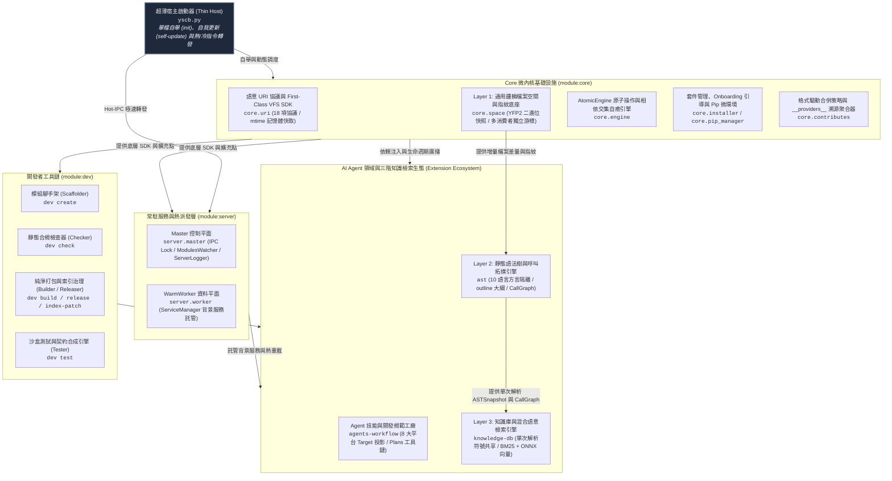

# YS-Codebase 系統架構與全域知識地圖 (System Overview & Architecture Map)

> 歡迎查閱 **YS-Codebase** 核心架構知識庫！  
> 本專案為 100% Python 標準庫打造微內核、支援隔離微環境擴充之現代化模組化 AI Agent 協同開發系統。

---

## 1. 系統宏觀分層架構 (High-Level Architecture)

---

## 2. 全域知識庫導覽地圖 (Knowledge Base Index)

| 核心維度 | 知識手冊路徑 | 說明 |
| :--- | :--- | :--- |
| **維度 1：快速入門** | [根目錄 README.md](../README.md) | 下游專案 5 分鐘快速安裝上手、`yscb.py init` 自舉與 AI Agent Pre-flight Check 指引 |
| **維度 2：核心規範** | [STANDARDS.md](./_project/STANDARDS.md) | 全專案語意空間協議、2x2 組態邊界、Dogfooding 自引用三層空間與標準閉環流水線 |
| **維度 2：核心內核** | [core/README.md](./core/README.md) | Core 微內核架構、`core.space` 邏輯檔案空間、AtomicEngine 原子操作、First-Class VFS SDK 與套件管理 |
| **維度 3：專題手冊** | [core/uri_protocols.md](./core/uri_protocols.md) | 語意 URI 協議規範、`project://` 零 Fallback 阻斷與 `!undefined` 自癒提示機制 |
| **維度 3：專題手冊** | [core/contributes_architecture.md](./core/contributes_architecture.md) | Contributes 雙階拓撲聚合、`__providers__` 溯源、`__modules__` 分桶與 `core.validator` Schema 驗證引擎 |
| **維度 3：專題手冊** | [core/lifecycle_and_hooks.md](./core/lifecycle_and_hooks.md) | 命名空間 Hook 對接規範 (`hook.{emit_module}.py`)、`ExecutionContext` 介面與例外隔離 |
| **維度 5：工程妥協** | [core/DESIGN_NOTES.md](./core/DESIGN_NOTES.md) | Core 微內核關鍵工程妥協與防坑守則 (`DN-01` ~ `DN-16`) |
| **維度 2：常駐中樞** | [server/README.md](./server/README.md) | Server Master/WarmWorker 雙進程架構、啟動參數橫幅、Console 回顯與停機統計總結 |
| **維度 3：專題手冊** | [server/daemon_architecture.md](./server/daemon_architecture.md) | Master-Worker 雙進程模型、崩潰自癒、500ms 防抖串流協議與預熱事件廣播 |
| **維度 3：專題手冊** | [server/hot_reload_and_services.md](./server/hot_reload_and_services.md) | 雙軌模組熱重載、WarmWorker `ServiceManager` 背景服務託管與 IPC 協調機制 |
| **維度 3：專題手冊** | [server/realtime_logging.md](./server/realtime_logging.md) | `ServerLogger` 即時 Flush 日誌、異常中斷自癒與 5 代歷史滾動規格 |
| **維度 5：工程妥協** | [server/DESIGN_NOTES.md](./server/DESIGN_NOTES.md) | Server 常駐模組關鍵工程妥協與防坑守則 (`DN-01` ~ `DN-04`) |
| **維度 2：檔案空間** | [file-space/README.md](./file-space/README.md) | File-Space 向下相容轉發殼層與遷移指引（核心能力已內聚至 `core.space`） |
| **維度 5：工程妥協** | [file-space/DESIGN_NOTES.md](./file-space/DESIGN_NOTES.md) | File-Space 關鍵工程妥協與防坑守則 (`DN-SP-01` ~ `DN-SP-03`) |
| **維度 2：語法拓撲** | [ast/README.md](./ast/README.md) | AST (Layer 2) 靜態語法樹、10 語言方言隔離、雙層分部符號、`outline` 大綱與呼叫圖譜 |
| **維度 5：工程妥協** | [ast/DESIGN_NOTES.md](./ast/DESIGN_NOTES.md) | AST 引擎關鍵工程妥協與防坑守則 (`DN-AST-01` ~ `DN-AST-04`) |
| **維度 2：知識檢索** | [knowledge-db/README.md](./knowledge-db/README.md) | Knowledge-DB (Layer 3) 單次解析符號共享、BM25 + ONNX 向量混合檢索與兩階段背景補齊 |
| **維度 3：專題手冊** | [knowledge-db/architecture.md](./knowledge-db/architecture.md) | 全系統三階 DAG 分層、`UnifiedSymbol` 模型與 `acked_ast_generation` 雙水位線自癒 |
| **維度 3：專題手冊** | [knowledge-db/retrieval.md](./knowledge-db/retrieval.md) | 混合檢索引擎、8,000 字元動態預算裁切、前置空間過濾與三級複雜度輸出矩陣 |
| **維度 3：專題手冊** | [knowledge-db/incremental_hot_reload.md](./knowledge-db/incremental_hot_reload.md) | `KnowledgeDBServiceWorker` 兩階段背景向量補齊、`is_worker_busy()` 毫秒探針與動態降級 |
| **維度 5：工程妥協** | [knowledge-db/DESIGN_NOTES.md](./knowledge-db/DESIGN_NOTES.md) | Knowledge-DB 關鍵工程妥協與防坑守則 (`DN-01` ~ `DN-30`) |
| **維度 2：工作流規範** | [agents-workflow/README.md](./agents-workflow/README.md) | 通用 Agent 技能與工作流框架、純 Skill 資產架構、6 大計畫分支與 8 大平台 Release Target 投影 |
| **維度 3：專題手冊** | [agents-workflow/user_guide.md](./agents-workflow/user_guide.md) | Dev Plans 工具鏈完整操作手冊（`status`, `search`, `verify`, `archive`, `session-trace`）與 Target 管理 |
| **維度 3：專題手冊** | [agents-workflow/FACTORY_PIPELINE.md](./agents-workflow/FACTORY_PIPELINE.md) | 協議產物工廠化、Stage 0 Stat-First 快照、兩階段 6 步語意管線與雙軌 Manifest 原子交易 |
| **維度 5：工程妥協** | [agents-workflow/DESIGN_NOTES.md](./agents-workflow/DESIGN_NOTES.md) | Agents-Workflow 關鍵工程妥協與防坑守則 (`DN-AW-01` ~ `DN-AW-18`) |
| **維度 2：開發工具** | [dev/README.md](./dev/README.md) | Dev 工具鏈架構、Scaffold 模組建立、Checker 規範檢驗、Builder 純淨打包與沙盒測試 |
| **維度 3：專題手冊** | [dev/architecture.md](./dev/architecture.md) | Checker 8 步靜態合規檢核管線、3-Gate 發布守門、滑動窗口與 Contributes 雙向擴充 |
| **維度 3：專題手冊** | [dev/testing_guide.md](./dev/testing_guide.md) | `YSCBTestCase` 隔離沙盒生命週期、Auto-Contract 自動契約合成與多進程並行跑測 |
| **維度 5：工程妥協** | [dev/DESIGN_NOTES.md](./dev/DESIGN_NOTES.md) | Dev 開發者工具鏈關鍵工程妥協與防坑守則 (`DN-DEV-01` ~ `DN-DEV-05`) |

---

## 3. 核心與擴充模組生態總覽 (Module Registry)

| 模組名稱 | 職責定位 | 隨包手冊 (`module://<mod>/README.md`) | 主要 CLI 進入點 |
| :--- | :--- | :--- | :--- |
| **`core`** | 系統微內核、語意 VFS、Layer 1 邏輯檔案空間與指紋底座 (`core.space`)、套件生命週期、依賴注入與 Hook 派發 | [source/core/README.md](../ys_codebase/source/core/README.md) | `.modules/core/scripts/cli.py` |
| **`agents-workflow`** | 通用 Agent 技能與工作流框架、SOP 0~7 規範治理、Plans 工具鏈與 8 大平台投影 | [source/agents-workflow/README.md](../ys_codebase/source/agents-workflow/README.md) | `.modules/agents-workflow/scripts/cli.py` |
| **`file-space`** | `[Deprecated]` 向下相容 `core.space` 轉發殼層（升級 `core >= 1.2.8.0` 後建議執行 `python yscb.py remove file-space`） | [source/file-space/README.md](../ys_codebase/source/file-space/README.md) | `.modules/file-space/scripts/cli.py` |
| **`ast`** | Layer 2 靜態語法樹、10 語言方言隔離、跨檔案確定性符號連結、`outline`/`slice`/`traverse` 與呼叫拓撲 | [source/ast/README.md](../ys_codebase/source/ast/README.md) | `.modules/ast/scripts/cli.py` |
| **`knowledge-db`** | Layer 3 單次解析符號共享、BM25 + ONNX 向量混合檢索與兩階段背景向量補齊 | [source/knowledge-db/README.md](../ys_codebase/source/knowledge-db/README.md) | `.modules/knowledge-db/scripts/cli.py` |
| **`server`** | 常駐預熱守護中樞、`<10ms` Hot-IPC、雙軌模組熱重載與背景服務託管 (`core-space-watcher`) | [source/server/README.md](../ys_codebase/source/server/README.md) | `.modules/server/scripts/cli.py` |
| **`dev`** | 開發者工具箱：腳手架、靜態合規檢查、純淨套件打包、雙軌索引治理與隔離沙盒並行測試引擎 | [source/dev/README.md](../ys_codebase/source/dev/README.md) | `.modules/dev/scripts/cli.py` |
