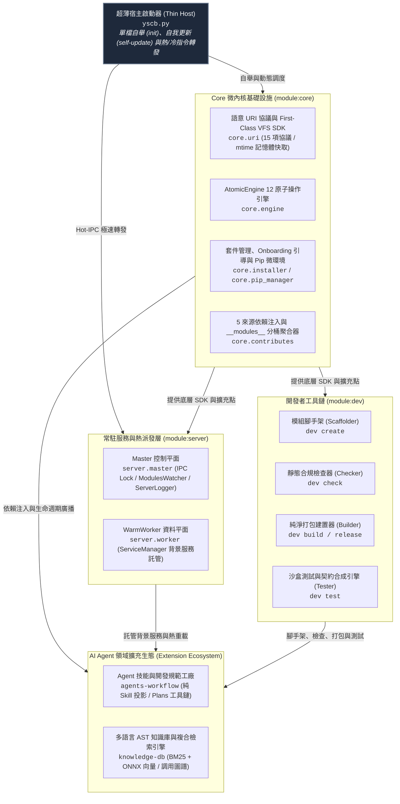

# YS-Codebase 系統架構與全域知識地圖 (System Overview & Architecture Map)

> 歡迎查閱 **YS-Codebase** 核心架構知識庫！  
> 本專案為 100% Python 標準庫打造微內核、支援隔離微環境擴充之現代化模組化 AI Agent 協同開發系統。

---

## 1. 系統宏觀分層架構 (High-Level Architecture)

---

## 2. 全域知識庫導覽地圖 (Knowledge Base Index)

| 核心維度 | 知識手冊路徑 | 說明 |
| :--- | :--- | :--- |
| **維度 1：快速入門** | [根目錄 README.md](../README.md) | 下游專案 5 分鐘快速安裝上手、`yscb.py init` 自舉與 AI Agent Pre-flight Check 指引 |
| **維度 2：核心規範** | [STANDARDS.md](./_project/STANDARDS.md) | 全專案 15 項語意空間協議、2x2 組態邊界、Dogfooding 自引用三層空間與標準閉環流水線 |
| **維度 2：核心內核** | [core/README.md](./core/README.md) | Core 微內核架構、AtomicEngine 12 原子操作、First-Class VFS SDK 與套件管理 |
| **維度 3：專題手冊** | [core/uri_protocols.md](./core/uri_protocols.md) | 語意 URI 協議規範、`project://` 零 Fallback 阻斷與 `!undefined` 自癒提示機制 |
| **維度 3：專題手冊** | [core/lifecycle_and_hooks.md](./core/lifecycle_and_hooks.md) | 命名空間 Hook 對接規範 (`hook.{emit_module}.py`)、`ExecutionContext` 介面與例外隔離 |
| **維度 5：工程妥協** | [core/DESIGN_NOTES.md](./core/DESIGN_NOTES.md) | Core 微內核關鍵工程決策與設計註記 (`DN-01` ~ `DN-27`) |
| **維度 2：常駐中樞** | [server/README.md](./server/README.md) | Server Master/WarmWorker 雙進程架構、啟動參數橫幅、Console 回顯與停機統計總結 |
| **維度 3：專題手冊** | [server/hot_reload_architecture_migration.md](./server/hot_reload_architecture_migration.md) | 雙軌模組熱重載、WarmWorker `ServiceManager` 背景服務託管與 IPC 協調機制 |
| **維度 3：專題手冊** | [server/realtime_logging.md](./server/realtime_logging.md) | `ServerLogger` 即時 Flush 日誌、異常中斷自癒與 5 代歷史滾動規格 |
| **維度 5：工程妥協** | [server/DESIGN_NOTES.md](./server/DESIGN_NOTES.md) | Server 常駐模組關鍵設計決策與註記 (`DN-01` ~ `DN-12`) |
| **維度 2：知識檢索** | [knowledge-db/README.md](./knowledge-db/README.md) | Knowledge-DB 8 大標準指令、多語言 AST 解析、BM25 + ONNX 向量混合檢索與調用圖譜 |
| **維度 3：專題手冊** | [knowledge-db/retrieval.md](./knowledge-db/retrieval.md) | 混合檢索引擎、前置空間過濾、離線模型探針與三級複雜度輸出矩陣 |
| **維度 5：工程妥協** | [knowledge-db/DESIGN_NOTES.md](./knowledge-db/DESIGN_NOTES.md) | Knowledge-DB 關鍵設計決策與註記 (`DN-01` ~ `DN-26`) |
| **維度 2：工作流規範** | [agents-workflow/README.md](./agents-workflow/README.md) | 通用 Agent 技能與工作流框架、純 Skill 資產架構、佔位符語法與 Release Target 投影 |
| **維度 3：專題手冊** | [agents-workflow/user_guide.md](./agents-workflow/user_guide.md) | Dev Plans 工具鏈完整操作手冊（`status`, `search`, `verify`, `archive`）與 Target 管理 |
| **維度 3：專題手冊** | [agents-workflow/FACTORY_PIPELINE.md](./agents-workflow/FACTORY_PIPELINE.md) | 協議產物工廠化、兩階段 6 步語意管線與雙軌 Manifest 原子交易 |
| **維度 5：工程妥協** | [agents-workflow/DESIGN_NOTES.md](./agents-workflow/DESIGN_NOTES.md) | Agents-Workflow 關鍵設計決策與註記 (`DN-AW-01` ~ `DN-AW-14`) |
| **維度 2：開發工具** | [dev/README.md](./dev/README.md) | Dev 工具鏈架構、Scaffold 模組建立、Checker 規範檢驗、Builder 純淨打包與沙盒測試 |
| **維度 3：專題手冊** | [dev/testing_guide.md](./dev/testing_guide.md) | `YSCBTestCase` 隔離沙盒生命週期、Auto-Contract 自動契約合成與多進程並行跑測 |
| **維度 5：工程妥協** | [dev/DESIGN_NOTES.md](./dev/DESIGN_NOTES.md) | Dev 開發者工具鏈關鍵設計決策與註記 (`DN-DEV-01` ~ `DN-DEV-03`) |

---

## 3. 五大模組生態總覽 (Module Registry)

| 模組名稱 | 職責定位 | 隨包手冊 (`module://<mod>/README.md`) | 主要 CLI 進入點 |
| :--- | :--- | :--- | :--- |
| **`core`** | 系統微內核、語意 VFS、套件生命週期、依賴注入與 Hook 派發 | [source/core/README.md](../ys_codebase/source/core/README.md) | `.modules/core/scripts/cli.py` |
| **`agents-workflow`** | 通用 Agent 技能與工作流框架、SOP 0~7 規範治理、Plans 工具鏈與 IDE 投影 | [source/agents-workflow/README.md](../ys_codebase/source/agents-workflow/README.md) | `.modules/agents-workflow/scripts/cli.py` |
| **`knowledge-db`** | 多語言 AST 符號解析、BM25 + ONNX 向量混合檢索、調用圖譜與代碼切片 | [source/knowledge-db/README.md](../ys_codebase/source/knowledge-db/README.md) | `.modules/knowledge-db/scripts/cli.py` |
| **`server`** | 常駐預熱守護中樞、`<10ms` Hot-IPC、雙軌模組熱重載與背景服務託管 | [source/server/README.md](../ys_codebase/source/server/README.md) | `.modules/server/scripts/cli.py` |
| **`dev`** | 開發者工具箱：腳手架、靜態合規檢查、純淨套件打包、隔離沙盒並行測試引擎 | [source/dev/README.md](../ys_codebase/source/dev/README.md) | `.modules/dev/scripts/cli.py` |
