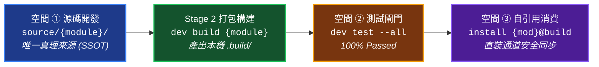

# 全專案核心工程規範與邊界架構 (Project Standards & Boundary Architecture)

> 本文件為 YS-Codebase 全專案的最高工程規範與架構準則，定義空間協議、組態矩陣與開發防呆邊界。

---

## 1. 語意空間協議清單 (Semantic Space Protocols)

系統嚴格劃分核心空間、模組空間與工作流協議，杜絕脆弱的相對路徑與環境漂移（SSOT 唯一真理來源為 `python yscb.py uri list`）：

| 語意 URI 協議 | 提供者 | 實體解析路徑 | 空間定義與職責 | Git 追蹤政策 |
| :--- | :---: | :--- | :--- | :---: |
| **`project://`** | `core` | 由 `config/core/config.project.json` 之 `project_root` 解算 | **宿主專案根目錄**（被管理之專案工作空間） | 專案自行管理 |
| **`yscb://`** | `core` | 由 `yscb.config.json` 之 `yscb_root` 定位 | **YS-Codebase 核心程式庫目錄** (`ys_codebase/`) | ✅ 受追蹤 |
| **`yscb.host://`** | `core` | 由 `yscb.config.json` 之 `yscb_host` 定位 | **YS-Codebase 宿主環境根目錄** | ✅ 受追蹤 |
| **`module://`** | `core` | `yscb://.modules/` | **本機模組運行端目錄** | 🚫 忽略 |
| **`module.mirror://`** | `core` | `yscb://.mirror/` | **本機端模組鏡像庫（版本化快照備份）** | 🚫 忽略 |
| **`config://`** | `core` | `yscb://config/` | **全域與模組設定檔根目錄** | ✅ 受追蹤 |
| **`cache://`** | `core` | `yscb://.cache/` | **全域與模組編譯快取與中介產物根目錄** | 🚫 忽略 |
| **`storage://`** | `core` | `yscb://storage/` | **跨環境共享持久化資料空間** | ✅ 受追蹤 |
| **`snapshot://`** | `core` | `yscb://.snapshots/` | **組態快照備份目錄（用於災難恢復與回滾）** | 🚫 忽略 |
| **`yscb.venv://`** | `core` | `yscb://.venv/` | **YSCB 私有微虛擬環境空間根目錄** | 🚫 忽略 |
| **`module.source://`** | `dev` | `yscb://source/` | **模組原始碼開發空間（SSOT 源碼）** | ✅ 受追蹤 |
| **`module.build://`** | `dev` | `yscb://.build/` | **本地開發完整建置產物空間** | 🚫 忽略 |
| **`module.release://`** | `dev` | `yscb://release/` | **本機發布產物準備空間** | ✅ 受追蹤 |
| **`knowledge.storage://`** | `knowledge-db` | `cache://knowledge-db/` | **知識庫 AST 與向量快取專用空間** | 🚫 忽略 |
| **`workflow.plans://`** | `agents-workflow` | `project://plans/` | **工作流開發與推進計畫空間** | 專案自行管理 |
| **`workflow.docs://`** | `agents-workflow` | `project://docs/` | **專案知識庫與架構文檔空間** | 專案自行管理 |
| **`workflow.roadmap://`** | `agents-workflow` | `project://plans/roadmap/` | **長期演進藍圖與策略主題空間** | 專案自行管理 |
| **`workflow.archived://`** | `agents-workflow` | `project://plans/archived/` | **歷史歸檔計畫空間** | 專案自行管理 |

---

## 2. 2x2 組態矩陣邊界規範 (Configuration Matrix)

全系統設定檔嚴格依據「專案 vs 本地」與「全域 vs 模組」進行 2x2 邊界劃分：

| 範圍維度 | 專案層級 (`config.project.json`) ✅ **受 Git 追蹤 (Team Shared)** | 本地個人層級 (`config.local.json`) 🚫 **Git 忽略 (Machine Specific)** |
| :--- | :--- | :--- |
| **全域層級** | `yscb.config.json`：宣告 `yscb_root`、預設 `default_provider` 與 `installed_modules` 清冊。 | `yscb.config.local.json`：本機覆蓋設定。 |
| **模組層級** | `yscb://config/{module}/config.project.json`：模組專案層級設定（如 `core` 的 `project_root`）。 | `yscb://config/{module}/config.local.json`：模組本機層級覆蓋。 |

### 🛡️ 組態管理與打包物化四項鐵律
1. **SSOT 原則**：模組預設組態模板宣告於 `source/{module}/configurable/`（或 `contribute.json`），專案層級覆蓋於 `config.project.json`，個人特化於 `config.local.json`。
2. **Git 政策防護**：`config.local.json` 嚴禁入庫；`config.project.json` 必須入庫共享。
3. **無損寫入保證**：透過 `core.config` 修改組態時，自動執行原子備份快照至 `snapshot://`。
4. **模組組態遞迴原地增量補齊與產物驗證（原 `DN-03`）**：
   - 當模組版本更新並在組態模板中新增欄位時，安裝或 `reload` 流程（`AtomicEngine._deep_infill_dict`）會對 `config://{module}/` 執行遞迴比對，**僅自動補齊缺失鍵，使用者已修改之既有設定值 100% 原地保留不覆蓋**。
   - 打包與安裝產物驗證：單檔 Zip 下載與物化時強制驗證 Archive CRC 完整性與 Zip Slip 路徑邊界；組態部署完成後無條件從 `module://{module}/` 物理剝除組態模板與 `.yscbignore`。

---

## 3. 模組開發與 Dogfooding 閉環流程 (Dogfooding Cycle)

### 🚨 三大空間隔離禁令
1. **源碼空間 (`source/`) 為唯一 SSOT**：所有功能修改 100% 必須在 `source/` 進行。
2. **禁止直接修改運行端 (`.modules/`)**：`.modules/` 視為編譯與部署產物，嚴禁手動直接修改。
3. **測試未通過嚴禁發布**：實機測試未 100% 通過前，嚴禁將 `.build/` 產物同步至 `.modules/`。

---

## 4. 核心設計意圖與架構取捨 (Architecture Decision Records)

本章節記錄 YS-Codebase 核心架構之關鍵設計邊界與取捨理由（ADR），供團隊成員、下游消費者與 AI 代理遵循，避免重複爭論。

### ADR-01：為何自建專案級模組與環境管理，而非直接使用 `pip` / `uv` / `NuGet`？

- **背景問題**：
  市面上的標準套件管理器（如 `pip`, `npm`, `NuGet`）本質上皆為「User-level 或單一環境的函式庫（Library）安裝器」，僅負責將程式碼下載至 `site-packages`。它們無法解決跨專案、跨開發者的「AI 工作流規則、語法解析器與多維度工具鏈的正交合成（Workspace Composition）」需求。
- **設計決策**：
  由 [`core`](../core/README.md) 微內核提供輕量級的 `venv.py`、`pip_manager.py`、`installer.py` 與 `contributes` 註冊體系，以此串聯公開核心模組（`core`, `dev`, `server`, `knowledge-db`, `agents-workflow`）與內部專案專屬私有模組。
- **取捨與理由（Trade-offs）**：
  1. **雙向正交注入需求**：模組安裝後，必須能透過宣告式 `contributes/*.json` 自動向 `knowledge-db` 注入特定語言（如 SPICE）解析規則、向 `agents-workflow` 注入 Prompt Tokens 與 Skills、並向 `yscb.py` 掛載 CLI 路由。這是應用層的插件合成，標準套件管理器無法代勞。
  2. **零前置依賴（Zero-Prerequisite）**：底層套件下載與環境建立仍透過 `subprocess` 委派給 Python 內建的 `venv` 與官方 `pip`；自建代碼專注於「模組級隔離目錄調度與 `.staging_*` 原子替換」、「跨進程鎖（`.yscb.lock`）」與「狀態指紋檢查（Stat Gate）」。這確保了任何下游專案只需具備基礎 Python 環境即可單檔啟動（`python yscb.py`），無須強制所有開發者與 CI/CD 環境額外安裝、設定 `uv` 或 Nix 等外部二進位執行檔。

### ADR-02：為何堅持 P00~P07 八階段分檔 SOP，而非單一滾動狀態檔？

- **背景問題**：
  在長週期的 AI 輔助開發中，單靠 `git log` 僅能得知「程式碼改了什麼（What）」，無法反推「當時為何這樣設計、排除過哪些錯誤方案（Why & Negative Paths）」。此外，當 AI 代理執行長任務觸發系統上下文壓縮（Context Compaction）時，極易發生工作記憶喪失。
- **設計決策**：
  確立**「留檔決策脈絡的價值高於短期編碼速度」**之工程原則。將開發生命週期按軟體工程關注點分離（SoC）切分為 `P00`（討論與動機）至 `P07`（驗收）獨立檔案，並搭配兩階段 JIT 模板讀取與 `DRY Spec Reference & Signature-Only` 上下文裁剪紀律。
- **取捨與理由（Trade-offs）**：
  1. **結構化注意力路由（Structured Attention Routing）**：若將需求、架構、API 與除錯日誌全部塞入單一大檔案，極易引發 LLM 的「中段遺忘（Lost in the Middle）」與語義混淆。物理分檔配合按階段聚焦讀取與 `DRY` 簽名引用，能確保單次 Context Window 永遠維持最高資訊密度。
  2. **故障爆炸半徑（Blast Radius）快速定位**：階段分檔直接作為日後問題排查的索引——設計意圖不明查 `P00`、功能行為怪異查 `P01`、架構拓撲查 `P02`、介面契約不符查 `P03`、實作邏輯錯誤查 `P04`。若單一檔案無法解釋問題，即代表該問題跨階段輻射，需啟動 [`/discuss`](../../.agents/skills/discuss/SKILL.md) 深度排查。
  3. **嚴格的 Token 成本控制与按需子代理分工**：考量個人開發者與小團隊的 API / 訂閱額度限制，系統拒絕採用高成本的「常駐背景旁路監控子代理（Background LLM Summarizer）」，全面以本地零 API 成本的 Python CLI 工具鏈（`plan verify`、`plan status`）管理計畫狀態推進；子代理僅限於邊界明確的「三支柱按需委派」（唯讀探索、達閾值之獨立模組實作、結案前 Fresh-Eyes 盲審）。

### ADR-03：`core.uri` 與 `core.vfs` 的真實定位——跨專案語義路由與安全護欄

- **背景問題**：
  YSCB 作為上游核心框架，無法預知下游消費端專案的實體目錄結構（各專案存放計畫、設定檔與源碼的相對位置不一）；同時必須防範 AI 代理在自動執行任務時發生越權寫入（Path Traversal）或污染受保護目錄。
- **設計決策**：
  所有跨模組路徑統一使用自訂語義化 URI（如 `project://`、`workflow.plans://`、`workflow.roadmap://`、`storage://`、`cache://`、`module://`），並透過 `core.vfs` 進行檔案操作封裝。
- **取捨與理由（Trade-offs）**：
  1. **契約式路徑解耦（Contractual Pathing）**：核心模組與 `SKILL.md` 提示詞僅需針對固定語義 URI（或 `__${...}__` 佔位符）編寫邏輯，下游專案透過各自的 `config.project.json` 將不定實體路徑掛載（Mount）至固定語義路由，實現對下游專案結構的「零假設與零侵入」。
  2. **集中式權限守衛與本地實體檔案代理（Access Guard & Local OS Proxy）**：由於系統涉及大量 `subprocess` 呼叫（沙盒測試、Git、Pip、Server Worker）、Tree-sitter C-extension 以及本地模型載入，在物理上依賴作業系統實體檔案描述符（OS File Descriptors）。因此 `core.vfs` 明確定位為**「具備 `guard.py` 權限守衛、原子寫入與跨平台路徑正規化的本地實體檔案代理層」**（不追求純記憶體 In-Memory VFS 攔截子進程）。

### ADR-04：為何採用「四段式版號（4-Digit SemVer）」與「人機雙軌 CLI 設計」？

- **背景問題**：
  AI Agent 驅動的開發流與傳統人類開發流具有截然不同的迭代顆粒度（Granularity）與終端機互動需求。
- **設計決策**：
  採用 `Major.Minor.Patch.Revision` 四段式版號（參見 [模組規範](../core/ZIP_PACKAGE_SPEC.md)）；CLI 輸出與配置語法全面採 Agent-First（ACI - Agent-Computer Interface）雙軌設計（參見 [CLI 規範](./CLI_SPECIFICATION.md)）。
- **取捨與理由（Trade-offs）**：
  1. **隔離 AI 高頻非功能性微調（Revision）**：Agent 開發流在日常演進中，會頻繁產生「Prompt 措辭優化、SKILL 觸發微調、測試套件淨化、Docstring 對齊」等完全不影響外部 API 契約與實際功能行為的修改。若沿用傳統三段式版號，會導致 `Patch` 版號瞬間暴增，使下游誤判升級風險。引入第 4 碼 `Revision` 專門承載此類內部品質打磨，能讓前 3 碼維持純粹的功能語義。
  2. **AI 仲介上手（AI-Mediated Onboarding）與雙軌 UX**：系統內部的 `contributes` Schema、Token 注入語法與驗證規則並非設計給人類死背，而是由載入了專屬 Skills（如 `how-to-yscb`、`how-to-config-yscb`、`yscb-module-dev`）的 AI 代理負責操作與自我修正；給人類呼叫的指令（如 `status`, `update`）則維持視覺化排版優化，給 Agent 呼叫的指令則實施純 ASCII 淨化與輸出節流（Throttle Output）。
