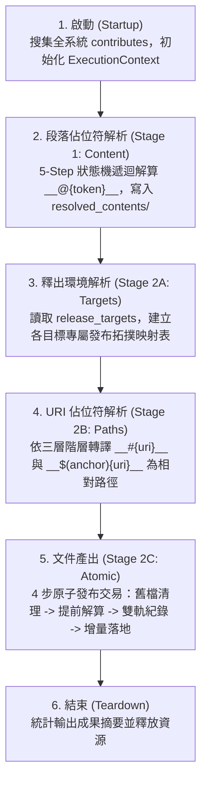
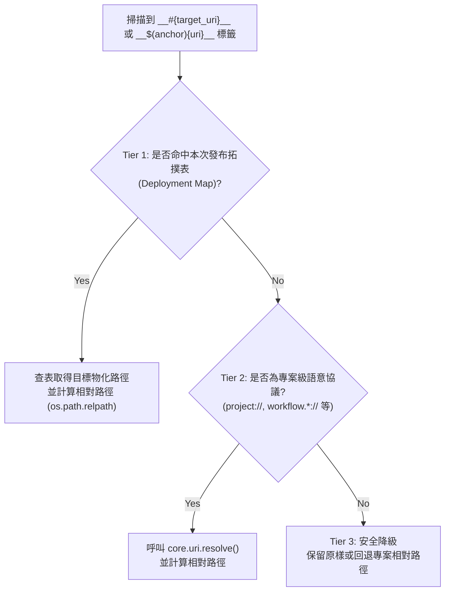

# 協議產物工廠流水線規範 (Factory Pipeline Specification)

> 適用模組：`agents-workflow`  
> 核心組件：`ArtifactCompiler` (`compiler.py`), `ReleasePublisher` (`publisher.py`)  
> 規範版本：v2.1 (純 Skill 兩階段 6 步語意編譯發布管線)

---

## 1. 兩階段 6 步語意流水線概觀

| 階段序號 | 階段名稱 | 核心職責 | 產出/落地位置 |
| :---: | :--- | :--- | :--- |
| **階段 1** | **啟動 (Startup)** | 搜集全系統 contributes（`export`、`insert`、`token`、`release_target`），初始化 `ExecutionContext`。 | 記憶體狀態機 |
| **階段 2** | **段落佔位符解析 (Stage 1)** | 5-Step 狀態機多輪遞迴解算 `__@{token}__`（支援 `const`, `uri`, `computed`），清除錨點標籤行。 | `cache://agents-workflow/resolved_contents/` |
| **階段 3** | **釋出環境解析 (Stage 2A)** | 讀取 `config.project.json` 與 `config.local.json` 之 `release_targets: []`，為各啟用目標建立專屬發布拓撲映射表 (Deployment Manifest Map)。 | 記憶體發布計畫表 |
| **階段 4** | **URI 佔位符解析 (Stage 2B)** | 讀取中繼產物，依階層將 `__#{uri}__` (自身相對路徑) 與 `__${uri}__` / `__$(起始錨點){uri}__` (錨點相對路徑) 動態轉譯為本機實體相對路徑 (`os.path.relpath`)。 | 記憶體渲染文本 |
| **階段 5** | **文件產出 (Stage 2C)** | 執行 4 步原子發布交易：過往與舊版目錄清理 $\to$ 提前解算 $\to$ 持久紀錄 $\to$ 目錄落地與 `AGENTS.md` 軟合併。 | 實體專案目錄（如 `.agents/skills/`） |
| **階段 6** | **結束 (Teardown)** | 統計輸出成果摘要並釋放暫存資源。 | 終端日誌與正常退出 |

---

## 2. 三層 URI 重映射演算機制 (3-Tier URI Resolution)

### 2.1 語法語意精確分流 (`#` vs `$`)
1. **`__#{uri}__`（自身相對路徑佔位符）**：
   - 轉譯為相對於**目前生成目標檔案所在目錄** (`cur_dir`) 之相對路徑。
   - 專為 Markdown 內部檔案超連結跳轉（如 `[Link](`__#{uri}__`)`）設計。
2. **`__${uri}__` / `__$(起始錨點){uri}__`（錨點相對路徑佔位符）**：
   - **預設形式 (`__${uri}__`)**：相對於**專案根目錄** (`project://`)，專為終端命令列（如 `python __${project://yscb.py}__ run`）與專案根層級參照設計。
   - **擴充錨點語法 (`__$(起始錨點){uri}__`)**：動態指定相對路徑之起始基準點。起始錨點可為目錄路徑、檔案路徑（自動取其所在目錄）或語意協議（如 `__$(module.source://){uri}__`、`__$(project://docs){uri}__`），解算目標 `uri` 相對於該起始錨點之相對路徑；若給予空括號 `__$(){uri}__` 則退化為預設 `project://` 映射。

當 Stage 2 掃描到路徑標籤時，依以下優先級執行路徑轉譯：

### 2.2 佔位符二分法解析 (Standalone vs. Inline)
- **純佔位符 (Standalone)**：當 `` `...` `` 代碼塊內部字串為單一完整之 `__#{uri}__`、`__${uri}__` 或 `__$(起始錨點){uri}__` 時，判定為純路徑求值，解算後**完全替代並吞噬外層反引號**（如 `[Link](`__#{uri}__`)` $\to$ `[Link](../path.md)`、`[Doc](`__$(.agents){uri}__`)` $\to$ `[Doc](skills/auto/SKILL.md)`）。
- **穿插代碼 (Inline)**：當 code span 內部包含指令或其他前後綴（如 `` `python __${yscb.host://yscb.py}__ run` `` 或 `` `run __$(.agents){uri}__` ``），解算內部佔位符後**維持外層代碼反引號**（$\to$ `` `python yscb.py run` ``）。

> [!CAUTION]
> 根據合約 `FT-14`，任何**未被反引號包裹**的裸露佔位符（例如直接書寫於 Markdown 連結括號內但未加反引號）將不會被替換，編譯器會原樣保留並輸出 `[compiler:warning]` 警示。撰寫超連結時務必使用 `` [文字](`__#{uri}__`) `` 格式。

---

## 3. 雙軌 Manifest 與原子發布交易語意 (Dual-Track Manifest & Atomic Release)

為防止無效 File I/O 頻繁衝擊磁碟、中途崩潰導致孤立檔案污染，以及跨機器協作時絕對路徑污染 Git 版本庫，發布引擎採用分流雙軌 Manifest 與 4 步原子交易保證：

### 3.1 雙軌空間與路徑分流架構
1. **Project 軌 (Tier 2，團隊共享 Targets)**：
   - **儲存空間**：`cache://agents-workflow/project_release_manifest.json`（本地快取隔離、不入 Git 追蹤；舊版曾存於 `storage://agents-workflow/release_manifest.json`，現已統一由快取隔離並自動遷移舊版紀錄）。
   - **路徑格式**：100% 使用 `project://` 語意協議路徑（例如 `project://.agents/skills/auto/SKILL.md`），徹底消除本機絕對路徑外溢與 Git dirty diff。
2. **Local 軌 (Tier 1，個人私有 Targets)**：
   - **儲存空間**：`cache://agents-workflow/release_manifest.json`（受 Git 忽略）。
   - **路徑格式**：使用本機實體絕對路徑。

### 3.2 4 步原子發布交易流水線
0. **階段 0 (來源端 Stat-First 雙階快照比對與指紋短路 - Stage 0)**：
   - **Stat-First 雙階快照 (`source_sha1_cache.json`)**：基於檔案元數據 `(st_mtime_ns, st_size)` 建立跨進程持久化快取（`cache://agents-workflow/source_sha1_cache.json`），僅當檔案元數據變動時才重新讀取內容計算 SHA-1（目錄型 Skill 資產則遞迴排序遍歷內部檔案計算聚合 SHA-1），並於單次執行週期內透過 `_get_sources_digest()` 快取綜合摘要。
   - **零 I/O 極速短路**：綜合來源資產、`manifest.json`、專案組態與 Target 規則產出 SHA-256 指紋。若 `force=False` 且雙軌指紋相符且各軌落地檔案皆完好存在，**立即提前返回 (0 檔案內容讀取，耗時 < 0.2ms)**。
1. **步驟 1 (孤兒拔除、舊版目錄清理與規範軟剝離 - Pruning & Soft-Unmerge)**：
   - **孤兒資產拔除与舊目錄清理**：分別讀取 Project 與 Local 歷史 Manifest 紀錄，對比新解算之目標檔案集合，精確拔除已停用 Target 或已移除資產之孤兒實體檔案，並自動清理除役之 `.agents/workflows/` 與 `.claude/commands/` 殘留目錄。
   - **根目錄規範入口檔軟剝離 (`_soft_unmerge_agents_text`)**：當停用或切換 Target 導致 `AGENTS.md` / `CLAUDE.md` 被列入待移除集合時，**嚴禁無差別執行 `os.remove()`**。引擎會先執行非破壞性軟剝離，僅移除 `<!-- YSCB_AGENTS_BEGIN --> ... <!-- YSCB_AGENTS_END -->` 系統託管區塊：若剝離後仍存有開發者自訂規範內容，則將乾淨的自訂內容寫回原檔並解除託管；唯有剩餘內容為空或僅含未修改之預設佔位樣板時，方安全執行物理刪除。
2. **步驟 2 (提前解算新清單與分流集合)**：對所有已啟用的 Release Targets 提前完整解算目標檔案映射，並標註 Project 軌與 Local 軌歸屬清冊。
3. **步驟 3 (原子寫入雙軌 Manifest)**：分別將 Project 軌 (`project://` 格式) 寫入 `cache://agents-workflow/project_release_manifest.json`，將 Local 軌 (絕對路徑格式) 寫入 `cache://agents-workflow/release_manifest.json`。
4. **步驟 4 (物理落地與增量軟合併)**：比對磁碟現有內容執行增量寫入；所有檔案寫入顯式傳入 `newline="\n"`，與根目錄 `.gitattributes` 配合確保全專案純 LF 換行；若 `enable_agents_md: true`，對目標規範入口檔（`AGENTS.md` / `CLAUDE.md`）執行 `_soft_merge_agents_text` 無損軟合併（管理區塊由中央標準庫單向覆寫注入以杜絕過期技能殘留，外部專案特化章節 100% 保留；專案特化技能擴充請透過 `config/agents-workflow/contribute.json` 宣告注入）。
