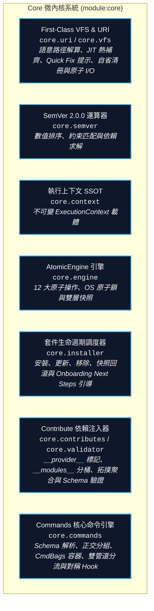

# Core 微內核架構手冊 (Core Microkernel Overview)

> 模組名稱：`core`  
> 模組版本：`1.1.0`  
> 職責定位：YS-Codebase 系統微內核基礎設施、套件生命週期、VFS 檔案系統、語意 URI 系統、SemVer 運算與依賴注入引擎。

---

## 1. Core 微內核架構設計與專題導航 (Microkernel Architecture & Topic Navigation)

`core` 模組由七大核心子系統組成：



### 1.1 中觀專題手冊與知識庫導航 (Topic Documentation Map)

| 專題手冊 / 規範文件 | 知識維度 | 核心涵蓋內容 |
| :--- | :---: | :--- |
| [Contributes 依賴注入與 Schema 驗證手冊](./contributes_architecture.md) | 維度 ③ | 雙階拓撲聚合、`__provider__` 溯源、`__modules__` 分桶、`core.validator` 輕量 Schema DSL 與 `_manifest.md` 雙向契約 |
| [語意 URI 協議與動態解析專題手冊](./uri_protocols.md) | 維度 ③ | Scheme B 正交協議清單、`@/` 當前模組自省、`yscb.host://` Fast-path 與 `project://` 零 Fallback 規範 |
| [統一虛擬檔案系統手冊 (VFS)](./vfs.md) | 維度 ③ | `core.vfs` 單向相依架構、`VirtualPath`、同目錄原子寫入與防逃逸沙盒邊界 |
| [Core Commands 架構與 CLI 派發合約手冊](./cli_commands_architecture.md) | 維度 ③ | `yscb.py` Thin Host 職責邊界、同構遞迴指令樹、正交選項分組與強型別 `CmdBags` 合約 |
| [命名空間 Hook 與生命週期事件手冊](./lifecycle_and_hooks.md) | 維度 ③ | `core.events` 獨立事件總線、`scripts/hook.{emit_module}.py` 對接與模組資料 `--purge` 治理 |
| [Zip 套件規格與同構自舉管線手冊](./ZIP_PACKAGE_SPEC.md) | 維度 ③ | 明文空間二分法、4-Stage Atomic Reload 管線、組態遞迴增量補齊與安裝產物驗證 |
| [雙層組態快照與原子回滾手冊](./SNAPSHOT_AND_ROLLBACK.md) | 維度 ③ | 不可變鏡像庫與 `snapshot://` 雙層原子快照還原機制 |
| [模組增量資料遷移與階梯調用手冊](./MIGRATION_LADDER.md) | 維度 ③ | 跨 Minor 版本 `scripts/migrations/{major}.{minor}.x.py` 階梯調用與回滾保護 |
| [四段式版本規範說明書 (SemVer v4)](./SEMVER.md) | 維度 ③ | `major.minor.patch.revision` 四段式排序、比較規則與同 Major 升級鎖定 |
| [符號解析與動態模組載入機制](./symbol_resolution.md) | 維度 ③ | `code.func://` 協議語法與雙軌動態載入器 (`core.symbols`) |
| [Core Platform 跨平台底層原語手冊](./platform.md) | 維度 ③ | 背景脫鉤進程管理 (`spawn_detached`、`kill_process_tree`) 與跨平台進程鎖 (`InterProcessLock`) |
| [Core 模組 API 規格手冊](./API_REFERENCE.md) | 維度 ④ | `core` 公開子模組 API 簽名與回傳契約速查 |
| [Core 微內核設計決策與工程註記](./DESIGN_NOTES.md) | 維度 ⑤ | 12 項關鍵反直覺工程妥協、防坑不變量與 `[!CAUTION]` 紅線 (`DN-01 ~ DN-12`) |

---

## 2. 語意 URI 協定與 First-Class VFS SDK (`core.uri` & `core.vfs`)

YS-Codebase 透過 `core.uri` 與 `core.vfs` 提供標準化虛擬檔案系統介面，全面採用 **Scheme B（全量 Root 化正交命名 + `@/` 自省語法）**，徹底廢除舊版 `*.root://` 與 `temp://`：

### 2.1 標準核心空間語意協議表 (Scheme B)
| 空間類型 | 標準正交協議 (Canonical Root) | 當前模組自省語法 (`@/`) | 跨模組顯式尋址範例 | 實體預設位置 |
| :--- | :--- | :--- | :--- | :--- |
| **工具庫核心** | `yscb://` | - | `yscb://config/` | 工具庫安裝根目錄 (`{yscb_root}`) |
| **宿主工程根** | `yscb.host://` | - | `yscb.host://yscb.py` | 宿主 `yscb.py` 與 `yscb.config.json` 所在目錄 |
| **目標專案根** | `project://` | - | `project://AGENTS.md` | `config://core/config.project.json` (`project_root`) |
| **運行端空間** | `module://` *(別名相容 `module.install://`)* | `module://@/` | `module://core/manifest.json` | `yscb://.modules/{module}/` |
| **源碼端空間** | `module.source://` | `module.source://@/` | `module.source://core/core/uri.py` | `yscb://source/{module}/` |
| **建置端空間** | `module.build://` | `module.build://@/` | `module.build://core/1.0.0.build.zip` | `yscb://.build/{module}/` |
| **發布端空間** | `module.release://` | `module.release://@/` | `module.release://core/index.json` | `yscb://release/{module}/` |
| **鏡像端空間** | `module.mirror://` | `module.mirror://@/` | `module.mirror://core/1.0.0.0.zip` | `yscb://.mirror/{module}/` |
| **組態空間** | `config://` | `config://@/` | `config://core/config.project.json` | `yscb://config/{module}/` |
| **快取與暫存** | `cache://` *(全面取代舊 `temp://`)* | `cache://@/` | `cache://core/contributes.merged.json` | `yscb://.cache/{module}/` |
| **持久儲存** | `storage://` | `storage://@/` | `storage://dev/state.json` | `yscb://storage/{module}/` |
| **原子快照** | `snapshot://` | - | `snapshot://snap_1724578900/` | `yscb://.snapshots/` |
| **私有微環境** | `yscb.venv://` | - | `yscb.venv://py310/` | `yscb://.venv/` (Git 忽略) |

### 2.2 JIT `!undefined` 熱更新補齊與可操作自癒提示 (`format_undefined_uri_hint`)
當 `uri.resolve()` 遇到未配置或為 `!undefined` 的協議時，會在互動 TTY 環境自動彈出熱補齊選單：
- `-y <path>`：輸入路徑（以 `yscb://` 為相對基準，支援 `../` 或語意協議），自動原子寫回 `config.project.json` 並熱刷新快取繼續運行。
- `-n`：安全終止操作。
- `--help`：展開全系統可用協議清冊與狀態。
- **非 TTY / 靜態檢查與可操作自癒提示**：直接拋出結構化 `UndefinedURIError`，並透過 `format_undefined_uri_hint()` 自動附帶精確的 `Quick fix: <cli_cmd>` 修復指令（例如 `project://` 提示 `python yscb.py config set core project_root ./`、`workflow.*://` 提示 `python yscb.py agents-workflow init --default`）；`python yscb.py uri check` 亦同步輸出 `[Quick Fix]` 修復指令區塊。

---

## 3. 微內核 Contribute 依賴注入與查詢 SDK (`core.contributes`)

> 詳細聚合機制、`_format.json` 型別簽名 DSL 與 `_manifest.md` 契約規範請參閱專題手冊：[Contributes 依賴注入、拓撲聚合與宣告式 Schema 驗證手冊](./contributes_architecture.md)。

### 3.1 `__provider__` 拓撲聚合與 `__modules__` 同名指令分桶
在微內核搜集 donor 模組 contributes 時，自動為 Dict 與 List[Dict] 項目注入 `"__provider__": donor_name`，依模組安裝之拓撲排序有序合併，並於 `commands["__modules__"][donor]` 建立分桶隔離，防範跨模組同名指令覆蓋。

### 3.2 標準查詢 SDK
```python
from core import contributes, uri

# 1. 查詢特定目標模組之已合併 Contributes
all_contribs = contributes.get("core")
schemes = contributes.get("core", "uri_schemes", default=[])

# 2. 自動在當前 module_scope 下查詢本模組 Contributes
with uri.module_scope("core"):
    my_contribs = contributes.get_for_current_module()
```

### 3.3 JIT 變更嗅探與熱自愈 (JIT Freshness Gate)
`core.contributes.get()` 內建 $< 2\text{ms}$ 檔案指紋嗅探閘門。當任何模組的 `contributes/<target>.json` 或專案級 `config/<target>/contribute.json` 被編輯修改時，下次調用 `get()` 會自動感知 dirty 並原地重新執行 `scan_and_inject()`，徹底消除手動執行 `python yscb.py reload` 的負擔。

### 3.4 安裝來源 12 小時節流版本探測 (`core.update_checker`)
微內核提供 `UpdateChecker` 服務，維護 `cache://core/update_check.json`。每隔 12 小時以 2 秒短超時輕量檢查一次 Provider 端之版本資訊；當有新版本可用時，在 CLI 執行完畢時輸出非阻塞友善提示，支援 `YSCB_NO_UPDATE_CHECK=1` 停用。

---

## 4. CLI 指令速查

```bash
# 1. 語意 URI 清冊自省與解析
python yscb.py uri list                     # 列出全系統已註冊語意協議清冊 (含原始設定與解析路徑)
python yscb.py uri resolve <path_or_uri>    # 解析特定語意 URI 為實體絕對路徑
python yscb.py uri to-uri <abs_path>        # 將實體路徑反查轉換為語意 URI
python yscb.py uri check                    # 全量語意協議健康檢查

# 2. Contributes 擴充點自省與剛性校驗
python yscb.py contributes list             # 列出全系統開放之擴充點清冊 (_format.json)
python yscb.py contributes check [module]   # 校驗模組 contributes 宣告是否符合目標 Schema

# 3. 套件生命週期管理
python yscb.py install <module>[@version] [--provider="<source>"] [--force]
python yscb.py update [<module>] [--provider="<source>"]
python yscb.py remove <module> [--clean] [--purge]
python yscb.py list [--remote] [--provider="<source>"]
python yscb.py status
python yscb.py rollback [snapshot_id]
python yscb.py reload

# 4. 組態管理與自省 (Config CLI)
python yscb.py config list [--local] [--mod=<module>] [--json]
python yscb.py config get <module> [key] [--json]
python yscb.py config set <module> <key> <val> [--local]
python yscb.py config inspect <module> <key> [--json]
python yscb.py config unset <module> <key> [--local]
python yscb.py config reload [module]
```

---

## 5. YSCB 私有微虛擬環境治理體系 (Private Venv Architecture)

針對生態系中需引入高效硬體加速或第三方套件之模組，`core` 提供私有微虛擬環境隔離基礎設施：

### 5.1 剛性隔離與 Wheel-Only 保證 (`core.pip_manager`)
- **隔離目錄**：管理 `yscb.venv://`（即 `yscb://.venv/`），依當前 Python 大小版本（`py{major}{minor}`）分層隔離，設定 `include-system-site-packages = false`，達成零全域污染。
- **Wheel-Only 安全安裝**：呼叫 `pip` 安裝時強制附加 `--only-binary=:all:` 與 `--no-warn-script-location`，任何缺乏預編譯 Wheel 之依賴在嘗試編譯前即被安全攔截，消除本機編譯崩潰風險。

### 5.2 宿主前置嗅探與動態注入 (`yscb.py`)
- `yscb.py` 在分發任何命令前，前置執行 $< 0.05\text{ms}$ 極速嗅探；若微環境之 `site-packages` 存在且未注入，自動安全插入 `sys.path` 前端，模組代碼可直接無感 `import`。

### 5.3 IDE 自動感知與可復原軟合併 (`core.ide_projector`)
- 模組安裝/更新/還原時，自動探測 `project://.vscode` 是否存在（不存在則完全靜默略過，零目錄污染）。
- 比照 `internal yscb gitignore` 之邊界守門哲學，在 `project://.vscode/settings.json` 引入 `_yscb_managed` 宣告式清冊，差集更新 `extraPaths`（注入 POSIX 與 Windows 跨平台雙候選路徑以保證 0 diff 恆定性，且解耦 host-local 的 `defaultInterpreterPath` 託管寫入），100% 完整保留使用者原有配置與自訂直譯器，並具備 Zero-Touch 比對防護與依清冊乾淨回滾。

