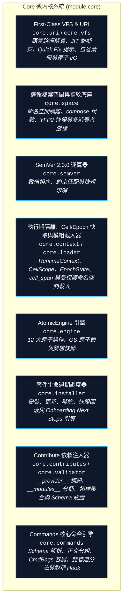

# Core 微內核架構手冊 (Core Microkernel Overview)

> 模組名稱：`core`  
> 模組版本：`1.2.8.0`  
> 職責定位：YS-Codebase 系統微內核基礎設施、套件生命週期、VFS 檔案系統、語意 URI 系統、Layer 1 邏輯檔案空間與指紋底座 (`core.space`)、SemVer 運算與依賴注入引擎。

---

## 1. Core 微內核架構設計與專題導航 (Microkernel Architecture & Topic Navigation)

`core` 模組由八大核心子系統組成：



### 1.1 中觀專題手冊與知識庫導航 (Topic Documentation Map)

| 專題手冊 / 規範文件 | 知識維度 | 核心涵蓋內容 |
| :--- | :---: | :--- |
| [Contributes 依賴注入與 Schema 驗證手冊](./contributes_architecture.md) | 維度 ③ | 雙階拓撲聚合、`__provider__` 溯源、`__modules__` 分桶、`core.validator` 輕量 Schema DSL 與 `_manifest.md` 雙向契約 |
| [語意 URI 協議與動態解析專題手冊](./uri_protocols.md) | 維度 ③ | Scheme B 正交協議清單、`@/` 當前模組自省、`yscb.host://` Fast-path 與 `project://` 零 Fallback 規範 |
| [統一虛擬檔案系統手冊 (VFS)](./vfs.md) | 維度 ③ | `core.vfs` 單向相依架構、`VirtualPath`、同目錄原子寫入與防逃逸沙盒邊界 |
| [Core Commands 架構與 CLI 派發合約手冊](./cli_commands_architecture.md) | 維度 ③ | `yscb.py` Thin Host 職責邊界、同構遞迴指令樹、正交選項分組與強型別 `CmdBags` 合約 |
| [命名空間 Hook 與生命週期事件手冊](./lifecycle_and_hooks.md) | 維度 ③ | `core.events` 獨立事件總線、`scripts/hook.{emit_module}.py` 對接與模組資料 `--purge` 治理 |
| [Zip 套件規格與同構自舉管線手冊](./ZIP_PACKAGE_SPEC.md) | 維度 ③ | 明文空間二分法、4-Stage Atomic Reload 管線、組態遞迴增量補齊與安裝產物驗證 |
| [雙層組態快照與原子回滾手冊](./SNAPSHOT_AND_ROLLBACK.md) | 維度 ③ | 不可變鏡像庫與 `snapshot://` 雙層原子快照還原機制 |
| [模組增量資料遷移與階梯調用手冊](./MIGRATION_LADDER.md) | 維度 ③ | 跨 Minor 版本 `scripts/migrations/{major}.{minor}.x.py` 階梯調用與回滾保護 |
| [四段式版本規範說明書 (SemVer v4)](./SEMVER.md) | 維度 ③ | `major.minor.patch.revision` 四段式排序、比較規則與同 Major 升級鎖定 |
| [符號解析與動態模組載入機制](./symbol_resolution.md) | 維度 ③ | `code.func://` 協議語法與雙軌動態載入器 (`core.symbols`) |
| [Core Platform 跨平台底層原語手冊](./platform.md) | 維度 ③ | 背景脫鉤進程管理 (`spawn_detached`、`kill_process_tree`) 與跨平台進程鎖 (`InterProcessLock`) |
| [Core 模組 API 規格手冊](./API_REFERENCE.md) | 維度 ④ | `core` 公開子模組 API 簽名與回傳契約速查 |
| [Core 微內核設計決策與工程註記](./DESIGN_NOTES.md) | 維度 ⑤ | 21 項關鍵反直覺工程妥協、防坑不變量與 `[!CAUTION]` 紅線 (`DN-01 ~ DN-21`) |

---

## 2. 語意 URI 協定與 First-Class VFS SDK (`core.uri` & `core.vfs`)

YS-Codebase 透過 `core.uri` 與 `core.vfs` 提供標準化虛擬檔案系統介面，全面採用 **Scheme B（全量 Root 化正交命名 + `@/` 自省語法）**，徹底廢除舊版 `*.root://` 與 `temp://`：

### 2.1 標準核心空間語意協議表 (Scheme B)
| 空間類型 | 標準正交協議 (Canonical Root) | 當前模組自省語法 (`@/`) | 跨模組顯式尋址範例 | 實體預設位置 |
| :--- | :--- | :--- | :--- | :--- |
| **工具庫核心** | `yscb://` | - | `yscb://config/` | 工具庫安裝根目錄 (`{yscb_root}`) |
| **宿主工程根** | `yscb.host://` | - | `yscb.host://yscb.py` | 宿主 `yscb.py` 與 `yscb.config.json` 所在目錄 |
| **目標專案根** | `project://` | - | `project://AGENTS.md` | `config://core/config.project.json` (`project_root`) |
| **運行端空間** | `module://` *(別名相容 `module.install://`)* | `module://@/` | `module://core/manifest.json` | `yscb://.modules/{module}/` |
| **源碼端空間** | `module.source://` | `module.source://@/` | `module.source://core/core/uri.py` | `yscb://source/{module}/` |
| **建置端空間** | `module.build://` | `module.build://@/` | `module.build://core/1.0.0.build.zip` | `yscb://.build/{module}/` |
| **發布端空間** | `module.release://` | `module.release://@/` | `module.release://core/index.json` | `yscb://release/{module}/` |
| **鏡像端空間** | `module.mirror://` | `module.mirror://@/` | `module.mirror://core/1.0.0.0.zip` | `yscb://.mirror/{module}/` |
| **團隊組態空間** | `config://` | `config://@/` | `config://core/config.project.json` | `yscb://config/{module}/` (Git 追蹤) |
| **本機組態空間** | `config.local://` | `config.local://@/` | `config.local://core/config.local.json` | `yscb://.config.local/{module}/` (Git 忽略) |
| **快取與暫存** | `cache://` *(全面取代舊 `temp://`)* | `cache://@/` | `cache://core/contributes.merged.json` | `yscb://.cache/{module}/` (Git 忽略) |
| **團隊持久儲存** | `storage://` | `storage://@/` | `storage://dev/state.json` | `yscb://storage/{module}/` (Git 追蹤) |
| **本機持久儲存** | `storage.local://` | `storage.local://@/` | `storage.local://agents-workflow/release_manifest.json` | `yscb://.storage.local/{module}/` (Git 忽略) |
| **原子快照** | `snapshot://` | - | `snapshot://snap_1724578900/` | `yscb://.snapshots/` |
| **私有微環境** | `yscb.venv://` | - | `yscb.venv://py310/` | `yscb://.venv/` (Git 忽略) |

### 2.2 JIT `!undefined` 熱更新補齊與可操作自癒提示 (`format_undefined_uri_hint`)
當 `uri.resolve()` 遇到未配置或為 `!undefined` 的協議時，會在互動 TTY 環境自動彈出熱補齊選單：
- `-y <path>`：輸入路徑（以 `yscb://` 為相對基準，支援 `../` 或語意協議），自動原子寫回 `config.project.json` 並熱刷新快取繼續運行。
- `-n`：安全終止操作。
- `--help`：展開全系統可用協議清冊與狀態。
- **非 TTY / 靜態檢查與可操作自癒提示**：直接拋出結構化 `UndefinedURIError`，並透過 `format_undefined_uri_hint()` 自動附帶精確的 `Quick fix: <cli_cmd>` 通用修復指令（例如 `project://` 提示 `python yscb.py config set core project_root ./`、模組級 `config` 協議提示 `python yscb.py config set <donor> <key> <path>`）；`python yscb.py uri check` 亦同步輸出 `[Quick Fix]` 修復指令區塊。

### 2.3 `core.vfs` 本地實體檔案代理定位與遠端快取物化邊界
- **具 `guard.py` 權限守衛之本地實體檔案代理層（Local OS Proxy with Access Guard）**：由於生態系涉及大量外部子進程（如沙盒測試、Git、Pip、Server Worker）與原生擴充模組（如 Tree-sitter C-extension、本地向量模型）的 OS 檔案描述符存取，`core.vfs` 明確定位為具備 [`core/guard.py`](../../ys_codebase/source/core/core/guard.py) 權限守衛、`assert_safe_path` 防逃逸沙盒檢核、同目錄原子寫入（`atomic_write`）與跨平台 LF 正規化之**本地實體檔案代理層**，不採用無法跨子進程共享之純記憶體（In-Memory）虛擬後端。
- **遠端與雲端來源之本地快取物化邊界（Remote-to-Local Cache Materializer）**：針對 HTTP/HTTPS Provider 或未來雲端儲存來源，系統統一於套件獲取或解算邊界將遠端資產下載並原子物化至本地快取／鏡像空間（如 `module.mirror://` 或 `cache://`），再交由 `OSBackend` 以標準本地實體路徑提供毫秒級讀寫，確保所有上層消費者與子進程 100% 享有確定性的實體檔案系統語意。

---

## 3. 微內核 Contribute 依賴注入與查詢 SDK (`core.contributes`)

> 詳細聚合機制、`_format.json` 型別簽名 DSL 與 `_manifest.md` 契約規範請參閱專題手冊：[Contributes 依賴注入、拓撲聚合與宣告式 Schema 驗證手冊](./contributes_architecture.md)。

### 3.1 `__provider__` 拓撲聚合與 `__modules__` 同名指令分桶
在微內核搜集 donor 模組 contributes 時，自動為 Dict 與 List[Dict] 項目注入 `"__provider__": donor_name`，依模組安裝之拓撲排序有序合併，並於 `commands["__modules__"][donor]` 建立分桶隔離，防範跨模組同名指令覆蓋。

### 3.2 標準查詢 SDK
```python
from core import contributes, uri

# 1. 查詢特定目標模組之已合併 Contributes
all_contribs = contributes.get("core")
schemes = contributes.get("core", "uri_schemes", default=[])

# 2. 自動在當前 module_scope 下查詢本模組 Contributes
with uri.module_scope("core"):
    my_contribs = contributes.get(uri.get_module_context())
```

### 3.3 JIT 變更嗅探與熱自愈 (JIT Freshness Gate)
`core.contributes.get()` 內建 $< 2\text{ms}$ 檔案指紋嗅探閘門。當任何模組的 `contributes/<target>.json` 或專案級 `config/<target>/contribute.json` 被編輯修改時，下次調用 `get()` 會自動感知 dirty 並原地重新執行 `scan_and_inject()`，徹底消除手動執行 `python yscb.py reload` 的負擔。

### 3.4 安裝來源 12 小時節流版本探測與同版本內容漂移偵測 (`core.update_checker`)
微內核提供 `UpdateChecker` 服務，維護 `cache://core/update_check.json`。每隔 12 小時以 2 秒短超時輕量檢查一次 Provider 端之版本資訊；當有新版本可用，或宿主 `yscb.py` 與遠端版本號相同但正規化 LF 後之 SHA-256 內容發生漂移（`is_drift=True`）時，在 CLI 執行完畢時輸出非阻塞友善提示，支援 `YSCB_NO_UPDATE_CHECK=1` 停用。

### 3.5 CLI 派發飛行紀錄器 (`core.telemetry`) 與統一雙族系日誌管線 (`core.log`)
- **統一雙族系日誌與串流基礎設施 ([`core/log.py`](../../ys_codebase/source/core/core/log.py))**：微內核提供 100% 純標準庫、零上層耦合的兩大日誌與串流族系：
  1. **調用者終端串流族系 (`log*`)**：提供 `log()`、`log_stream()`、`log_info()`、`log_warn()`、`log_error()`、`log_debug()`、基於 `ContextVar` 的 `LogExecutionScope` / `bind_log_context()`，以及 500ms 防抖 / 4KB 自動打包之 `DebouncedIOStreamer`。於前景 CLI 與沙盒測試自動寫入當前 `sys.stdout` / `sys.stderr`（並尊重內層單元測試之 `redirect_stdout` / `patch` 攔截），於 `WarmWorker` 熱派發自動導入 `DebouncedIOStreamer`，於背景 `ServiceWorker` 自動轉寫至結構化 `RollingFileLogger`。
  2. **增量滾動檔案紀錄族系 (`log_file*`)**：提供崩潰自癒與保留最新 5 份歷史紀錄之 `RollingFileLogger`、跨平台原子替換 `_safe_replace_file`（基於 `os.replace` 並具 `shutil.copy2` 跨磁碟退避），以及支援 `max_bytes` + `keep_lines` 原子滾動截斷與語意 URI 自動解析（`interactive=False`）的 `log_file()`、`log_file_jsonl()`、`read_log_file_jsonl()` 與 `read_log_file_tail()`。
- **CLI 派發飛行紀錄器 ([`core/telemetry.py`](../../ys_codebase/source/core/core/telemetry.py))**：於 [`core/commands/dispatcher.py:dispatch`](../../ys_codebase/source/core/core/commands/dispatcher.py) 外層透過 `core.log.log_file_jsonl` 將每次 CLI 調用的執行結果（`ts`、`epoch`、`module`、`cmd`、`args`、`exit_code`、`duration_ms`、`mode`、`cwd`、以及由 `core.log` 派發級緩衝自動累積萃取的 `error_hint`）追加記錄於 **`cache://core/telemetry.jsonl`**（單檔超過 `512 KB` 自動滾動保留最新 `1,500` 筆紀錄；沙盒測試、`--help` 查詢與 `session-trace` 自身呼叫預設略過）。

### 3.6 多層次語系與宿主專有名詞引擎 (`core.locale`)
微內核於 [`core/locale.py`](../../ys_codebase/source/core/core/locale.py) 提供零第三方依賴的多語系與宿主專有名詞（Proper Nouns）解析引擎：
- **宣告式檔案指標與語意契約 (`locales`)**：各模組於 `contributes/core.json` 宣告 `"locales": {"definition": "locales/definition.json", "<lang-id>": "locales/<lang-id>.json"}`，由 `ContributesAggregator` 按模組分桶保存於 `locales["__modules__"][<donor>]`。
- **100% 顯式優先級退避鏈 (`get_active_chain`) 與多平台並發自動嗅探 (`detect_active_host_dialect`)**：嚴格依顯式設定之 `lang-id` 列表順序逐層查找（專案固定預設值與最終退避保底皆為開發團隊母語 `["zh"]`；初次安裝且 `config.local.json` 尚未建立時自動透過 `detect_system_locale_chain()` 偵測作業系統主語系播種至 `config.local.json`），不做隱式 `-` 連字號父語系切分猜測。執行期若未顯式傳入 `chain` 或 `YSCB_LOCALE`，`get_active_chain()` 會自動透過 `detect_active_host_dialect()` 嗅探當前呼叫端 AI IDE / CLI 環境變數（`CLAUDECODE` / `CLAUDE_CODE_*` $\to$ `nouns-claude`；`CODEX_*` $\to$ `nouns-codex`；`ANTIGRAVITY_*` $\to$ `nouns-antigravity`）並前置於自然語系鏈首位，支援同一工作區多平台 IDE 並發運行。
- **無前綴全域穿透查找 (`Caller-First Global Lookup`) 與二階遞迴專有名詞插值 (`locale.t`)**：當 Key 未帶 `<module>:` 前綴時，優先查找呼叫端自身模組，未命中則自動穿透掃描全系統已註冊 `locales` 之模組（`<module>:` 前綴僅於跨模組同名 Key 衝突消歧義時需要）。模板內之 `{placeholder}` 優先由呼叫端 `kwargs` 替換；若未傳入則自動視為專有名詞鍵沿同一優先級鏈遞迴解析（最大深度 `5`），並支援 `{{` / `}}` 雙花括號轉義保護與 `validate_module_locales` 確定性靜態契約校驗。

### 3.7 根目錄單一 `.gitignore` 統一收斂引擎 (`core.gitignore`)
微內核於 [`core/gitignore.py`](../../ys_codebase/source/core/core/gitignore.py) 提供零外部依賴的 `.gitignore` 託管區塊收斂引擎：
- **根目錄單檔 SSOT (`project://.gitignore`) 與 `spaces.gitignore` 正向空間驅動**：將各模組於 `contributes/core.json` 宣告之 `"spaces": {"gitignore": {...}}`、專案級 `config://core/contribute.json` 宣告之 `project/gitignore`、各模組於 `scripts/hook.core.py` 實作 `on_register_file_spaces` 註冊之 `<module>/gitignore`，以及執行期透過 `core.gitignore.register(module, patterns)` 注入之 `<module>/gitignore` 統一解析：將 `effective_include` 轉換為相對於 `project://` 之忽略規則、將 `effective_exclude` 轉換為 `!<pattern>` 豁免規則，寫入 `project://.gitignore` 單一託管區塊（`# === YSCB MANAGED GITIGNORE BEGIN ===` ~ `# === YSCB MANAGED GITIGNORE END ===`）。
- **`# [<module>]` 分組可觀測性與卸載自癒**：託管區塊內部強制按模組來源輸出 `# [<module>]` 子標頭（`core` 置頂，其餘模組按字母序，`project` 置底）；當模組移除（`act_delete`）或重載（`act_reload`）時自動清除已卸載模組之忽略規則，並自動清理過時之子目錄 `.gitignore`（如舊版 `yscb://.gitignore` 與 `.vscode/schemas/.gitignore`）。

### 3.8 統一邏輯檔案空間與複合快照引擎 (`core.space`)
微內核於 [`core/space/`](../../ys_codebase/source/core/core/space/__init__.py) 提供純標準庫、零外部依賴的邏輯檔案空間、指紋快照與消費者交易游標引擎：
- **統一 `SpaceConfig` 模型、四階段兩趟編譯與 `/<short-name>` 合成空間**：全面廢除獨立 `PresetConfig`，統一由 `SpaceConfig` 承載所有空間與純規則模板（允許 `entries=()` 且 `compose=()` 皆為空，單獨求值時結果為 $\emptyset$）。`SpaceRegistry._reload()` 以四階段優先序（`1. Module Contributes` $\to$ `2. Project Config` $\to$ `3. on_register_file_spaces Event` $\to$ `4. In-Process Runtime register_space`）收集定義：Pass 1 對同名 `<owner>/<short-name>` 執行規則層絕對聯集（`[*] ∪ [any] = [*]`；未指定 `<owner>/` 之 Runtime 注入預設歸入 `__unknown__/<short-name>`）；Pass 2 為所有 `<short-name>` 自動生成無擁有者合成空間 `/<short-name>`（`owner=""`，別名 `<short-name>`，快照鍵 `synthetic__<short-name>`，其 `compose` 自動匯聚所有 `<owner>/<short-name>`）。
- **`presets` 規則引用與 `!<space>` 反向規則排除（含局部子樹剪枝）**：`presets` 引用其他空間以拉取過濾規則（正向引用合併目標顯式 `include` 與 `exclude`；反向引用 `!<space>` 將命中目標 `include` 且未命中目標 `exclude` 之檔案視為當前空間排除）。在 `os.scandir` 走訪時，若目錄 $D$ 命中負向 preset 之 `include`，且負向 preset 之 `effective_exclude` 無任何可能匹配 $D$ 子樹之豁免規則（`has_potential_descendant_match == False`），立即對 $D$ 執行 $O(1)$ 子樹剪枝。
- **`compose` 檔案集代數、無母空間二次過濾與 `!<space>` 差集運算**：母空間自身之 `include` 與 `exclude` **僅作用於母空間自身的 `entries`**，絕不對 `compose` 子空間產出之檔案執行二次過濾。`compose` 支援正向聯集與 `!<space>` 負向差集（$\text{Result} = (\text{OwnEntries} \cup \bigcup \text{PosCompose}) \setminus \bigcup \text{NegCompose}$），並於 `presets` 與 `compose` 展開時執行 DFS 環路偵測（拋出 `SpaceCycleError`）。
- **內建核心空間 `gitignore` 與 `workspace`**：
  1. `gitignore`（`core/gitignore` 與 `/gitignore`）：正向定義「哪些檔案屬於被 Git 忽略的集合」（`entries: ["project://"]`, `watch: False`），各模組可透過 `presets: ["!gitignore"]` 或 `compose: ["!gitignore"]` 排除忽略檔，並直接驅動 `core.gitignore` 物化 `project://.gitignore`。
  2. `workspace`（`core/workspace` 與 `/workspace`）：定義專案最外層遞迴掃描天花板（`entries: ["project://"]`, `include: ["*"]`, `exclude: [非專案中間產物]`），作為 `resolve_spaces(None)` 與 `scan(None)` 之預設目標，並供 `vscode-support` 投影至 `.vscode/settings.json`。
- **對稱三座標預編譯匹配 (`match`)、目錄剪枝走訪 (`ls`)、相對路徑反解 (`resolve_file_path`) 與原子指紋 (`hash`)**：
  1. `CompiledRuleSet` 與 `match_path`：`include` 與 `exclude` 100% 對稱採用 `allow_dir_prefix=True` 與 `match_any_segment_for_name=True`，支援語意 URI 前綴、含 `/` 之相對路徑（同時相容 `project_rel` 與 `entry_rel`）及不含 `/` 之檔名/目錄區段名，提供免全盤掃描之單點規則與 `compose` 來源解釋。
  2. `iter_space_files` & `resolve_file_path`：基於 `os.scandir` 目錄級剪枝與 `DirEntry.stat()` 複用，跨入口與聯集空間自動依實體路徑去重，並支援將空間內標準相對路徑安全反解為磁碟 `Path`。
  3. `compute_file_hash` / `hash_target`：支援 `stat_only`、`adaptive`（大檔頭中尾稀疏取樣 Blake2b）與 `full_hash` 策略，計算決定性 16-byte Blake2b `merkle_root`。
- **`YFP2` 單調世代二進位快照 (`SpaceScanner`) 與多消費者交易游標 (`CursorStore` / `consume_diff`)**：
  1. `BinarySnapshotManager` 將空間快照以 `b"YFP2"` 二進位格式與 16-byte Blake2b Checksum 原子持久化於 `storage.local://core/space/snapshots/<target_key>.yfp2.bin`（並由進程級共享預設單例 `get_default_registry` / `get_default_scanner` 確保跨頂層 SDK 呼叫與背景 Watcher 共享執行期註冊空間 `register_space`，且內建以 `(st_mtime_ns, st_size)` 驗證之 `_snapshot_mem_cache` 記憶體快照快取以避免重複磁碟反序列化）。
  2. `scan` / `refresh` 採 Stage 1 `(mtime_ns, size)` + `10ms` Racy-Clean 防護與 Stage 2 `core.space.hasher` 增量計算（`scan(None)` 內建實體檔案 `_hash_memo` 跨空間雜湊去重）；`patch_files` 支援單點髒路徑免全盤掃描局部修補，並透過 `sync_dependent_snapshots` / `sync_dependent_snapshots_batch` 自動連動更新既有之 `/<short_name>` 合成空間、`compose` 父組合空間與 `workspace` 統合快照。
  3. `CursorStore` 於 `storage.local://core/space/cursors/<consumer_id>.json` 維護多消費者獨立水位世代，並提供 `consume_diff(space_query, consumer_id, *, auto_refresh=None)` At-Least-Once 交易式 Context Manager（當背景 Watcher 活躍、`.watcher_dirty` 為乾淨且既有快照存在時，`auto_refresh=None` 自動旁路全盤重掃，直接 O(1) 比對快照世代）。
- **Watcher 推拉混合協調、`watch=True` 全空間預設監聽與 `on_file_space_changed` 事件廣播 (`core.space.watcher`)**：
  1. **全空間預設監聽 (`watch=True`)**：除 `gitignore` 預設 `watch=False` 外，所有靜態空間與執行期空間（`register_space(name, config, *, watch=None)`）皆預設開啟 `watch=True`；當同進程 Watcher 活躍時，自動通知 Watcher 將其入口目錄納入 `watchdog` 監聽。
  2. **無感背景加速與純標準庫退化**：`core` 本體維持 100% 純標準庫零外部依賴；當常駐 `server` 啟動 [`CoreSpaceWatcherServiceWorker`](../server/hot_reload_and_services.md) 時，透過 `cache://core/space/watcher_state.json` 與 `.watcher_dirty` 跨進程信標無感加速快照更新；當 `server` 未啟動時，100% 本地獨立執行 Pull-based 掃描。
  3. **進程內訂閱與跨模組事件廣播**：提供 `subscribe(callback, *, spaces=None)`（同時支援 `<owner>/<space>`、`/short` 與 `<space>` 短名過濾）與 `broadcast_file_space_changed`，透過 `core.events.broadcast("on_file_space_changed", payload, emit_module="core")` 觸發各模組之 `scripts/hook.core.py`。

### 3.9 執行期狀態隔離容器、Cell/Epoch 快取原語 (`core.context`) 與受保護命名空間模組載入器 (`core.loader`)
- **執行期狀態隔離、`CellScope` / `EpochState` 快取原語與 `cell_span` 階段剖析 ([`core/context.py`](../../ys_codebase/source/core/core/context.py))**：
  1. **`RuntimeContext` 統一快取與狀態收斂**：將 `core` 內部所有跨模組動態快取（`uri`、`config`、`contributes`、`locale`、`symbols`、`loader`、`gitignore`、`validator`、`dispatcher`、`platform`、`space`、`log`、`epoch_states`）集中納管於 `RuntimeContext`，徹底消除模組頂層可變全域變數與 `global` 賦值，並透過 `reset_all_caches()` 提供保物件參考（In-Place）之一鍵清空能力，以及 PEP 562 模組級 `__getattr__` 向後相容代理。
  2. **`RuntimeScope` 與 `bind_runtime_context` 請求級隔離**：基於 `ContextVar` 提供執行緒與協程安全的 `virtual_cwd`（統一由 `get_virtual_cwd()` 讀取，為全系統唯一合法呼叫 `os.getcwd()` 之邊界）、`env` 覆寫快照（由 `get_env()` / `get_env_snapshot()` 讀取，避免執行期直接突變 `os.environ`）與活躍 URI 根路徑（`host_dir`、`yscb_dir`、`module_name`），並強制 `ExecutionContext` 與全模組 `@dataclass(frozen=True)` 實例不可變。
  3. **`CellScope` 單次派發生命週期快取 (`bind_cell_context` / `get_or_compute_cell_state`)**：在單次 CLI 任務（無論冷啟動 `dispatch_local` 或常駐熱派發 `WarmWorker.execute_task`）期間綁定 `@dataclass(frozen=True)` 之 `CellScope`；下游模組透過 `get_or_compute_cell_state(key, builder_fn)` 與 `invalidate_cell_state(key_or_prefix)` 快取單次 Cell 內重複之磁碟 `stat`/`isfile` 探針或設定解析。最外層 `bind_cell_context` 退出時強制執行 `close_and_clear_cache()`（標記 `is_closed = True` 並清空字典），使透過 `contextvars.copy_context()` 繼承上下文之背景執行緒呼叫 `get_current_cell()` 時安全回傳 `None`，杜絕陳舊 Cell 快取跨執行緒洩漏。
  4. **`EpochState` 跨 Cell 世代感知常駐快取 (`get_or_compute_epoch_state` / `invalidate_epoch_state`)**：針對常駐 Worker 跨任務復用之重型或中繼狀態（如 `CrossFileResolver`、`agents-workflow` 來源 SHA-1 快取與 JIT 乾淨時間桶），提供以 `epoch_fn()` 世代特徵為驗證依據之 `get_or_compute_epoch_state(key, epoch_fn, builder_fn)`；`epoch_fn()` 與 `builder_fn()` 嚴格於鎖外執行以避免阻塞背景 `ServiceWorker`。
  5. **`cell_span` 零配置階層式階段耗時剖析**：`dispatch_local` 內建 `pre_hooks`、`option_resolve`、`mod_load`、`cmd_exec`、`post_hooks` 五大主幹階段，各模組可透過 `with cell_span("<mod>.<stage>"):` 埋設子階段。於熱派發時自動隨 `DebouncedIOStreamer.send_task_finish(..., stages=...)` 回傳至 `MasterSupervisor` 顯影於 `.cache/server/log`；於冷派發設定 `YSCB_PROFILE_CELL=1` 時輸出至 `stderr`。
- **單點受保護命名空間模組載入器 ([`core/loader.py`](../../ys_codebase/source/core/core/loader.py))**：
  1. 統一收斂 `dispatcher.py`（CLI 腳本）、`events.py`（Hook 腳本）、`engine.py`（Migration 腳本）與 `symbols.py`（`code.func://` 動態符號）之檔案級動態載入至 `load_module_from_path(module_key, file_path, *, reload_if_changed=True)`。
  2. 強制校驗受保護命名空間前綴 `_yscb_mod_*`，內建 `(st_mtime_ns, st_size)` 指紋比對快取與熱重載，並於 `exec_module` 拋出例外時自動原子回滾 `sys.modules` 快照，杜絕半初始化之殭屍模組殘留。

---

## 4. CLI 指令速查

```bash
# 1. 語意 URI 清冊自省與解析
python yscb.py uri list                     # 列出全系統已註冊語意協議清冊 (含原始設定與解析路徑)
python yscb.py uri resolve <path_or_uri>    # 解析特定語意 URI 為實體絕對路徑
python yscb.py uri to-uri <abs_path>        # 將實體路徑反查轉換為語意 URI
python yscb.py uri check                    # 全量語意協議健康檢查

# 2. Contributes 擴充點自省與剛性校驗
python yscb.py contributes list             # 列出全系統開放之擴充點清冊 (_format.json)
python yscb.py contributes check [module]   # 校驗模組 contributes 宣告是否符合目標 Schema

# 2.5 根目錄 .gitignore 託管區塊檢視與同步
python yscb.py gitignore status [--json]    # 檢視 project://.gitignore 託管狀態與各模組規則分組
python yscb.py gitignore sync [--json]      # 手動強制收斂同步全模組忽略規則至 project://.gitignore

# 2.6 L0 與複合邏輯檔案空間操作 (支援 core file-space 或快捷別名 fs)
python yscb.py fs spaces [space] [--owner=<mod>] [--json]                    # 列舉已註冊之邏輯空間定義 (含 /<short> 合成空間)、presets/compose 與入口狀態
python yscb.py fs match <path> [space] [--space=<name>] [--json]             # 單點診斷路徑命中入口與納入/排除規則來源
python yscb.py fs ls [space] [--pattern=<glob>] [--json]                     # 零冗餘目錄剪枝走訪列舉空間受納管檔案 (預設 workspace)
python yscb.py fs hash [target] [--policy=<mode>] [--json]                   # 計算單檔或空間級指紋與 Blake2b Merkle Root
python yscb.py fs status [space] [--space=<name>] [--json]                   # 檢視空間快照世代、Merkle Root 與各消費者游標狀態
python yscb.py fs scan [space] [--force] [--json]                            # 執行雙階段增量掃描並更新 YFP2 二進位快照
python yscb.py fs diff [space] [--consumer=<id>] [--ack] [--json]            # 計算或確認消費者與最新快照世代間之新增/修改/刪除差異
python yscb.py fs clean [space] [--consumer=<id>] [--json]                   # 清理空間二進位快照或重置特定消費者游標

# 3. 套件生命週期管理 (支援單一或多模組單次批次原子交易，正式版預設強制校驗 index.json SHA-256，@build 免檢，或以 --ignore-sha256 跳過)
python yscb.py install <module>[@version] [<module2>[@version] ...] [--provider="<source>"] [--force] [--ignore-sha256]
python yscb.py update [<module> ...] [--provider="<source>"] [--ignore-sha256]
python yscb.py restore [--provider="<source>"] [--force] [--ignore-sha256]
python yscb.py self-update [--provider="<source>"] [--sha256="<hex>"] [--ignore-sha256]
python yscb.py remove <module> [<module2> ...] [--clean] [--purge] [--force]
python yscb.py list [--remote] [--provider="<source>"]
python yscb.py status
python yscb.py rollback [snapshot_id]
python yscb.py reload

# 4. 組態管理與自省 (Config CLI)
python yscb.py config list [--local] [--mod=<module>] [--json]
python yscb.py config get <module> [key] [--json]
python yscb.py config set <module> <key> <val> [--local]
python yscb.py config inspect <module> <key> [--json]
python yscb.py config unset <module> <key> [--local]
python yscb.py config reload [module]
```

---

## 5. YSCB 私有微虛擬環境治理體系 (Private Venv Architecture)

針對生態系中需引入高效硬體加速或第三方套件之模組，`core` 提供私有微虛擬環境隔離基礎設施：

### 5.1 剛性隔離與 Wheel-Only 保證 (`core.pip_manager`)
- **隔離目錄**：管理 `yscb.venv://`（即 `yscb://.venv/`），依當前 Python 大小版本（`py{major}{minor}`）分層隔離，設定 `include-system-site-packages = false`，達成零全域污染。
- **Wheel-Only 安全安裝**：呼叫 `pip` 安裝時強制附加 `--only-binary=:all:` 與 `--no-warn-script-location`，任何缺乏預編譯 Wheel 之依賴在嘗試編譯前即被安全攔截，消除本機編譯崩潰風險。

### 5.2 宿主前置嗅探与統一運行時全模組路徑管理 (`yscb.py` & `core.platform`)
- `yscb.py` 在分發任何命令前，前置執行 $< 0.05\text{ms}$ 極速嗅探；若微環境之 `site-packages` 存在且未注入，自動安全插入 `sys.path` 前端。
- 進入微內核後，統一由 `core.platform`（`ensure_installed_modules_path`、`list_installed_module_roots`、`list_module_search_roots`、`build_runtime_pythonpath`、`init_subprocess_sys_path`、`activate_test_module_source_path`、`restore_sys_path`）接管全系統 `sys.path`、`PYTHONPATH` 與靜態搜尋根目錄發現：於 CLI 冷派發 (`dispatch_local`)、Server 熱預熱 (`WarmWorker.pre_warm`)、事件廣播 (`events.broadcast`) 與符號解析 (`symbols.resolve_callable`) 前一次性掛載 `yscb://.modules/<mod>` 所有已安裝模組根目錄（並將當前目標模組與 `core` 置於最前端，嚴格排除 `.staging_*` / `.old_*` 與 `/source` 路徑），使上層業務模組 100% 免除手動 `sys.path` 補丁。

### 5.3 環境同步生命週期廣播 (`on_env_synced`) 與 IDE 零假設解耦
- `core` 本身保持 100% 零下游 IDE 假設（不直接感知或修改 `.vscode/`）。
- 當 `Installer.sync_pip_dependencies()` 完成第三方套件物化後，主動廣播 `on_env_synced` 事件（`ExecutionContext("core", "env_sync", [])`），交由選配模組（如 [`vscode-support`](../vscode-support/README.md)）訂閱並執行 IDE 設定投影與 Schema 編譯。

