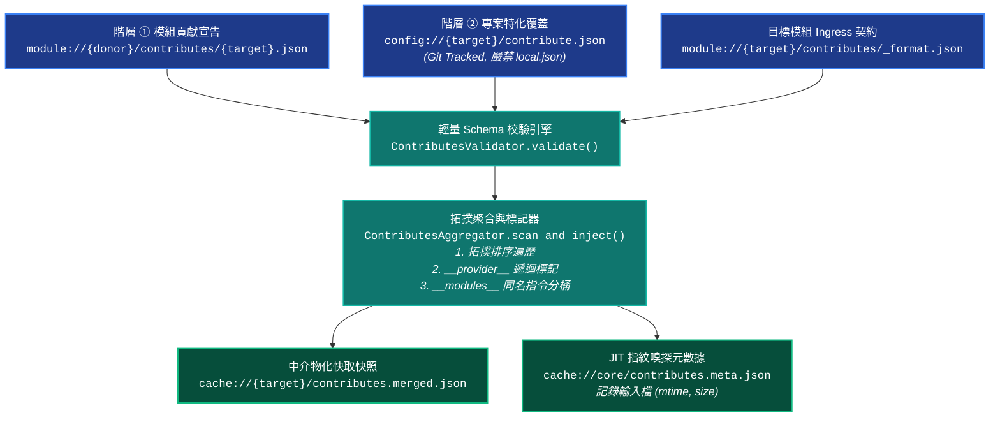

# Contributes 依賴注入、拓撲聚合與宣告式 Schema 驗證手冊 (Contributes & Schema Validation Architecture)

> 本手冊為維度 3 中觀專題手冊，定義 YS-Codebase 微內核 `core.contributes` 拓撲聚合管線、`__provider__` 溯源標記、`__modules__` 來源模組分桶隔離，以及 `core.validator` 輕量宣告式 Schema 驗證引擎與 `_manifest.md` 雙向契約規範。

---

## 1. 架構全景與雙階拓撲聚合管線 (`core.contributes`)

YS-Codebase 採用**宣告式依賴注入 (Declarative Dependency Injection)** 模型。各擴充模組（Donor）透過 `contributes/<target>.json` 向目標模組（Target）註冊語意協議、CLI 指令樹、生命週期事件或業務資產。



### 1.1 拓撲排序與雙階載入順序 (Two-Tier Topological Aggregation)
`ContributesAggregator.scan_and_inject()` 嚴格依循以下順序執行聚合，確保合併結果 100% 具備決定性：
1. **階層 ① 模組層級注入 (`module://{donor}/contributes/{target}.json`)**：
   - 依據已安裝模組之依賴拓撲順序（Topological Order，預設 `core` 最優先，後續依依賴鏈與字母序）依序掃描。
   - 支援目錄式 `contributes/<target>.json`（推薦標準）與單檔式 `contributes.json`。
2. **階層 ② 專案層級特化覆蓋 (`config://{target}/contribute.json`)**：
   - 掃描受 Git 追蹤之專案組態空間並疊加覆蓋於模組預設貢獻之上。
   - **禁止本機覆蓋**：系統剛性忽略 `config://{target}/contribute.local.json` 並輸出警告，確保團隊成員與 CI 環境的依賴注入拓撲完全一致。
3. **快取物化與零空檔原則**：
   - 聚合結果寫入 `cache://{target}/contributes.merged.json`。若目標模組未接收任何注入（空字典），則不落地空檔（若舊快取存在則自動清理）。

### 1.2 `__provider__` 自動溯源標記注入
在搜集 Donor 模組的宣告時，聚合器透過 `_tag_provider(data, donor_name)` 自動遞迴走訪所有 `dict` 與 `list[dict]` 節點，注入 `"__provider__": donor_name`：
- **顯式保留原則**：若資料節點已顯式宣告 `"__provider__"`，聚合器予以保留絕不覆蓋。
- **用途**：使下游模組與核心調度器（如 `core.uri` 診斷報告、工作流編譯器）能精確追溯每一筆擴充項目或未定義協議的來源模組。

### 1.3 `__modules__` 來源模組分桶隔離（防同名指令與語系指標覆蓋）
當多個模組同時向 `core` 注入 `commands` 或 `locales` 時，各模組擁有獨立的指令定義與 `"definition"` / `"<lang-id>"` 語系檔案路徑：
- 若僅使用頂層字典深層合併（`_deep_merge`），後載入模組的同名指令定義或 `locales.definition` 路徑會覆蓋前序模組。
- **雙層分桶設計**：聚合器在合併 `target == "core"` 的 `commands` 與 `locales` 時，除了維持頂層平鋪結構外，同步於 `commands["__modules__"][donor]` 與 `locales["__modules__"][donor]` 建立按來源模組隔離的獨立命名空間分桶（並將 `locales` 指向之實體 JSON 檔案納入 `_scan_contributes_inputs` 的 `(mtime, size)` 快照追蹤）。
- 全域 Help 渲染器、CLI Guide 生成器與 `core.locale` 引擎優先讀取 `__modules__` 分桶，確保各模組同名指令與語系契約 100% 獨立無損。

### 1.4 標準查詢 SDK 與 JIT 變更嗅探 (`core.contributes`)
```python
from core import contributes, uri

# 1. 查詢特定目標模組之已合併 Contributes (支援指定 key 與 default)
all_core_contribs = contributes.get("core")
uri_schemes = contributes.get("core", "uri_schemes", default=[])

# 2. 在當前模組作用域下自省查詢
with uri.module_scope("agents-workflow"):
    my_contribs = contributes.get_for_current_module()

# 3. 查詢全生態系已開放之擴充點清冊 (_format.json)
points = contributes.list_points(module="core")
```
- **JIT 熱自愈閘門 (`_is_contributes_dirty`)**：每次呼叫 `contributes.get()` 時，微內核比對 `cache://core/contributes.meta.json` 中記錄之所有輸入檔 `(mtime, size)` 指紋（耗時 $< 2\text{ms}$）。一旦偵測到任何 `contributes/*.json` 或 `config/*/contribute.json` 變更，立即自動觸發 `scan_and_inject()` 重建快取。

---

## 2. 輕量宣告式 Schema 驗證引擎 (`core.validator`)

為杜絕依賴注入中的「無聲拼寫錯誤」、「型別不符崩潰」與「跨模組越權污染」，同時恪守微內核 **100% 純標準庫（零第三方 Pip 依賴）** 鐵律，`core.validator` 內建了輕量級型別簽名 DSL 解析器與剛性驗證器 `ContributesValidator`。

### 2.1 `_format.json` 檔案結構與元語法
每個開放擴充點的目標模組，於 `contributes/_format.json` 定義其 **Ingress 接收契約**：
- **`_types`（複合型別定義區）**：集中宣告可複用或遞迴引用的複合結構（透過 `$TypeName` 引用）。
- **頂層擴充點（Contribution Points）**：所有不以 `_` 開頭的頂層鍵即為合法擴充點，每個擴充點必須包含 `"description"`（字串說明）與 `"format"`（型別規格）。

```json
{
  "_types": {
    "ArgDef": {
      "description": "str!",
      "required": "bool? = true",
      "choice": "list[str]?"
    },
    "CommandNode": {
      "description": "str!",
      "tier": "enum(safe, conditional, gated)? = conditional",
      "args": { "*": "$ArgDef" },
      "cmd": { "*": "$CommandNode" }
    }
  },
  "commands": {
    "description": "註冊 CLI 模組指令樹、權限分級與防呆情境",
    "format": {
      "module_alias": "list[str]?",
      "description": "str?",
      "cmd": { "*": "$CommandNode" }
    }
  }
}
```

### 2.2 型別簽名 DSL 語法表 (`parse_type_signature`)

| 語法類別 | DSL 語法範例 | 解析規則與驗證行為 |
| :--- | :--- | :--- |
| **基礎型別與必填修飾** | `str!`、`int!`、`bool!`、`float!`、`any` | 結尾 `!` 代表必填（Missing 時報錯）；亦支援別名 `string`、`integer`、`boolean`、`number`。 |
| **選填與預設值注入** | `str?`、`bool? = false`、`int? = 0` | 結尾 `?`（或省略修飾符）代表選填；若附帶 `= <val>`，當欄位缺失時驗證器自動於 payload 補齊預設值。 |
| **受限枚舉 (`enum`)** | `enum(safe, conditional, gated)!` | 限制字串必須屬於括號內逗號分隔之集合；支援後接 `!`、`?` 與 `= default`。 |
| **複合型別引用 (`$Def`)** | `$ArgDef`、`$CommandNode!` | 引用同檔案 `_types` 字典中定義之複合結構；支援自身遞迴引用（最大深度保護 `MAX_RECURSION_DEPTH = 20`）。 |
| **泛型容器** | `list[str]?`、`dict[str, str]` | 驗證陣列元素或字典鍵值型別；亦可在 JSON Schema 中直接以 `[ <item_schema> ]` 表達物件陣列。 |
| **字典動態通配鍵 (`*`)** | `{ "*": "$OptionDef" }` | 當 JSON 物件中包含 `"*"` 鍵時，所有未顯式列舉的任意自訂鍵名（`{key}` 字典映射）皆套用 `"*"` 對應之子 Schema 進行遞迴驗證。 |

### 2.3 單向依賴邊界與雙重驗證策略 (Strict Egress, Tolerant Ingress)
- **靜態嚴格阻斷 (Strict Egress)**：
  - 執行 `python yscb.py contributes check` 或 `python yscb.py dev check` 時，`strict_points=True` 剛性攔截所有未在目標模組 `_format.json` 註冊之未知頂層擴充點、未知內部欄位與型別錯誤（回傳非零 Exit Code）。
- **運行期容錯防禦 (Tolerant Ingress)**：
  - `ContributesAggregator` 在運行期動態合併時，若遇校驗失敗，會透過 Logger 輸出結構化 Warning 與修正建議，但安全保留 payload 避免單一外掛拼寫瑕疵導致整體 CLI 癱瘓。
- **智能拼寫診斷 (`Did you mean`)**：
  - 當欄位名稱或 `enum` 值拼寫錯誤時，驗證器內建 `difflib.get_close_matches` 相似度比對，自動在報錯報告中給出 `Did you mean '<closest>'?` 提示。
- **`locales` 語意契約深層校驗 (`core.locale.validate_module_locales`)**：
  - 當模組於 `contributes/core.json` 宣告 `"locales": {"definition": "locales/definition.json", "<lang-id>": "locales/<lang-id>.json"}` 時，`contributes check` 與 `dev check` 除驗證 `_format.json` 型別外，自動進一步載入 `definition` 語意解釋檔與所有 `<lang-id>` 檔案，剛性攔截路徑穿越 (`..`)、缺失 `description`、未定義於 `definition` 之孤兒鍵（Orphan Keys）以及 `{placeholder}` 佔位符集合不一致問題。
  - **版本下限強制守門 (`core >= 1.2.0`)**：由於 `locales` 擴充點與 `core.locale` 引擎自 `core@1.2.0.0` 起引入，任何外部模組（例如未來 `server` 或其他擴充模組）一旦於 `contributes/core.json` 新增 `"locales"` 宣告，**必須同步將該模組 `manifest.json` 中的 `"dependencies": {"core": ">=1.2.0"}` 版本下限一併調升**；`dev check` 內建版本下限守門，若仍停留於 `>=1.1.0` 將直接觸發 `[FAIL]` 阻斷發布。

---

## 3. 雙向契約閉環：`_format.json` 與 `_manifest.md` 同步規範

在 YS-Codebase 模組工程標準中，`contributes/` 目錄承載模組間的**雙向契約閉環**：

| 契約檔案 | 角色定位 | 方向 | 規範與職責 |
| :--- | :--- | :---: | :--- |
| **`contributes/_format.json`** | **Ingress 接收契約** | 他方 $\to$ 本模組 | 定義本模組開放給外部模組注入的擴充點名稱、型別 DSL 與預設值，供 `core.validator` 自動化驗證。 |
| **`contributes/<target>.json`** | **Egress 實體注入** | 本模組 $\to$ 他方 | 本模組向目標模組 `<target>` 實際注入的 JSON 負載，必須 100% 通過 `<target>` 之 `_format.json` 檢驗。 |
| **`contributes/_manifest.md`** | **Egress 導覽清冊** | 開發者 / Agent 文檔 | 結構化列出本模組所有 `<target>.json` 對外貢獻的能力、語意協議、CLI 指令樹與事件清冊，保持與實體 JSON 同步。 |

### 3.1 CLI 驗證與自省指令
```bash
# 1. 列出全生態系所有模組開放的擴充點 (Ingress Points)
python yscb.py contributes list
python yscb.py contributes list --module=core

# 2. 執行全量或單一模組 Contributes 剛性契約檢驗 (Egress Validation)
python yscb.py contributes check
python yscb.py contributes check dev
python yscb.py contributes check module.source://dev/contributes/core.json

# 3. 檢驗目標模組自身的 _format.json 結構合法性 (Meta-Check)
python yscb.py contributes check core --format
```
