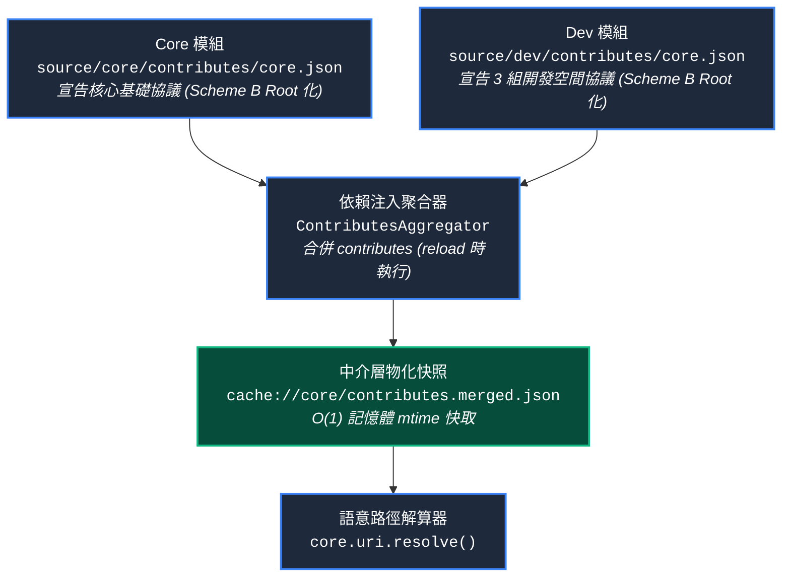

# 語意 URI 協議與動態解析專題手冊 (Semantic URI Protocol & Dynamic Resolution)

> 本手冊為維度 3 中觀專題手冊，詳細定義 YS-Codebase 方案 B（Scheme B）語意 URI 正交協議、`@/` 當前模組自省、跨模組尋址、`yscb.host://` 常數路由與 `project://` 零 Fallback 阻斷規範。

---

## 1. 語意 URI 核心原則與自宣告注入架構

YS-Codebase 採用「方案 B（Scheme B）：全量 Root 化正交命名 + `@/` 標籤語法模型」，徹底廢除所有 `*.root://` 協議與 `temp://`，形成清晰正交的標準協議體系：

---

## 2. 標準 Canonical URI 正交協議清單 (Scheme B)

Scheme B 嚴格區分**基準定位錨點**（`yscb://`、`yscb.host://`、`project://`）與**空間根目錄協議**（所有模組空間協議一律直接指向根空間，無需 `.root` 後綴）：

| 協議 Token | 注入來源 | 類型 | 物理映射 / 模板值 | Git 策略 | 說明與尋址範例 |
| :--- | :---: | :---: | :--- | :---: | :--- |
| **`yscb://`** | `core` | `const` | `{yscb_root}` | **Tracked** | 工具庫核心根目錄（O(1) Fast-path 常數自定位） |
| **`yscb.host://`** | `core` | `const` | `{yscb_host}` | **Tracked** | 宿主工程根目錄（強制指向 `yscb.py` 與 `yscb.config.json` 所在目錄） |
| **`project://`** | `core` | `config` | `project_root` | **Project** | 被管理之下游目標專案根目錄（顯式配置，預設 `!undefined`） |
| **`module://`** | `core` | `const` | `yscb://.modules/` | **Ignored** | 本機模組運行端空間（跨模組：`module://core/manifest.json`；自省：`module://@/manifest.json`） |
| **`module.source://`** | `dev` | `const` | `yscb://source/` | **Tracked** | 模組源碼開發空間（跨模組：`module.source://core/core/uri.py`） |
| **`module.build://`** | `dev` | `const` | `yscb://.build/` | **Ignored** | 本地開發完整建置產物空間（例：`module.build://core/1.0.0.build.zip`） |
| **`module.release://`** | `dev` | `const` | `yscb://release/` | **Tracked** | 模組純淨發布產物來源空間（例：`module.release://core/index.json`） |
| **`module.mirror://`** | `core` | `const` | `yscb://.mirror/` | **Ignored** | 本地模組壓縮鏡像庫空間（例：`module.mirror://core/1.0.0.0.zip`） |
| **`config://`** | `core` | `const` | `yscb://config/` | **Tracked** | 全域與模組設定檔空間（例：`config://core/config.project.json`；自省：`config://@/config.project.json`） |
| **`cache://`** | `core` | `const` | `yscb://.cache/` | **Ignored** | 模組快取、衍生快照與鎖空間（替代已廢除之 `temp://`；例：`cache://dev/sandbox/`） |
| **`storage://`** | `core` | `const` | `yscb://storage/` | **Tracked** | 模組持久化儲存空間（跨模組：`storage://dev/file.json`；自省：`storage://@/data.json`） |
| **`snapshot://`** | `core` | `const` | `yscb://.snapshots/` | **Ignored** | 雙層組態與環境原子快照備份空間 |
| **`yscb.venv://`** | `core` | `const` | `yscb://.venv/` | **Ignored** | YSCB 私有微虛擬環境空間根目錄 |

---

## 3. 方案 B 解算模型 (Scheme B Orthogonal Addressing Rules)

### 3.1 跨模組顯式尋址
- 語法：`{scheme}://{module}/{path}`
- 範例：`storage://dev/state.json` ➔ `yscb://storage/dev/state.json`
- 規範：協議 Token 直接對應空間根目錄，後面第一段 Path 為目標模組名稱，**絕無雙重嵌套**。

### 3.2 當前模組自省尋址 (`@/` 語法)
- 語法：`{scheme}://@/{path}`
- 範例：在 `agents-workflow` 模組執行時調用 `storage://@/release_manifest.json` ➔ `yscb://storage/agents-workflow/release_manifest.json`。
- 上下文保護 (EC-01)：若無 active module context 且未傳入 `current_module`，`uri.resolve()` 強制拋出 `UndefinedModuleContextError`，杜絕資料跨模組污染。

### 3.3 空間根目錄存取
- 語法：`{scheme}://`
- 範例：`storage://` ➔ `yscb://storage/`。

### 3.4 舊協議相容轉譯層 (Backwards Compatibility)
- 調用舊版 `storage.root://`、`cache.root://`、`module.root://` 等協議時，解算器自動發出 `DeprecationWarning` 並重定向至 Canonical 協議，確保歷史設定平滑過渡。

---

## 4. `project://` 顯式配置與零 Fallback 阻斷規範

- **唯一配置來源**：`yscb://config/core/config.project.json` 中配置之 `project_root` 鍵。
- **預設值**：`"!undefined"`。
- **阻斷行為**：未配置時調用 `uri.resolve("project://...")` 強制拋出 `UndefinedURIError`（或於互動式 TTY 觸發 JIT 熱補齊），**嚴禁 Fallback 猜測 `os.getcwd()`**。

---

## 5. `yscb://` 與 `yscb.host://` 雙軌對稱注入體系與 Fast-Path 常數路由

### 5.1 三大頂層錨點正交職責分離（原 `DN-14`）
當工具庫（`yscb://`）作為子目錄（如 `.yscb/` 或 `ys_codebase/`）嵌入宿主工程時，系統嚴格區分三個根錨點：
1. **`yscb://`（工具庫核心根目錄）**：指向包含 `.modules/`、`config/`、`.cache/` 的 YSCB 引擎目錄。於 `uri.resolve()` 最前端提供 **O(1) Fast-path** 直接拼接，無需讀取任何設定檔。
2. **`yscb.host://`（宿主工程根目錄）**：一等公民常數協議（`type: "const"`, `value: "{yscb_host}"`），**強制指向起手腳本 `yscb.py` 與 `yscb.config.json` 所在之宿主根目錄**。於 `uri.resolve()` 同樣享有 **O(1) Fast-path** 解析，避免模組或工作流在定位 `yscb.py` 時誤用受外部目標組態影響的 `project://`。
3. **`project://`（被管理目標專案根目錄）**：由 `config://core/config.project.json` 的 `project_root` 動態綁定，可指向宿主目錄自身（`./`）或任意外部專案路徑。

### 5.2 雙軌對稱注入與三階自省優先順序
- **常數基準自省**：`yscb://` 預設依據 `core.uri` 物理路徑（`__file__` 向上 3 層）確定性解算，零 `os.getcwd()` 猜測。
- **宿主目錄注入 (`host_dir`)**：
  - 記憶體注入：`uri.set_host_dir(path)` 與 `uri.host_scope(path)` Context Manager。
  - 環境變數：`YSCB_HOST_DIR`。
- **核心工具庫注入 (`yscb_root`)**：
  - 記憶體注入：`uri.set_yscb_root(path)` 與 `uri.yscb_scope(path)` Context Manager。
  - 環境變數：`YSCB_ROOT_DIR`。
- **三階自省優先順序**：
  $$\text{記憶體注入 } (\texttt{\_active\_yscb\_dir}) \;\longrightarrow\; \text{環境變數 } (\texttt{YSCB\_ROOT\_DIR}) \;\longrightarrow\; \text{常數基準 } (\texttt{\_\_file\_\_})$$
- **沙盒鉤子隔離保證**：測試 Runner 在調度 `scripts/hook.dev.py` 時，強制包覆 `with uri.host_scope(ctx.host_dir), uri.yscb_scope(ctx.engine_dir):`，確保所有 VFS 與 `core.config` 操作 100% 沙盒化。

