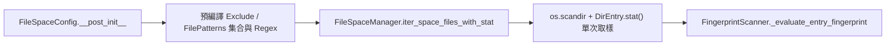
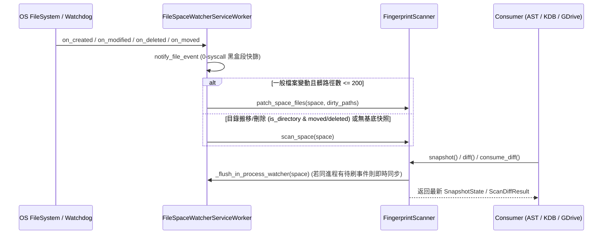

# file-space 核心架構與資料流拓撲 (Architecture)

> 模組名稱：`file-space`  
> 職責定位：定義 `file-space` 在空間幾何解析、預編譯過濾、零冗餘 `stat()` 檔案列舉、二進位 `YFP2` 增量指紋快照、局部路徑修補 (`patch_space_files`) 與跨程序游標一致性上的核心架構與資料流設計。

---

## 1. 核心組件與職責邊界

| 組件 | 實體路徑 | 核心職責 |
| :--- | :--- | :--- |
| **`FileSpaceConfig`** | `file_space/schema.py` | 封裝單一邏輯空間之 `include`、`exclude`、`file_patterns`、`hash_policy`，並於 `__post_init__` 預編譯正則、副檔名集合與路徑前綴結構。 |
| **`FileSpaceManager`** | `file_space/manager.py` | 聚合模組 Contributes (`file-space.spaces`) 與宿主 `config.local://file-space/config.json`（支援 `override_mode: "merge" \| "replace"`），並提供 `iter_space_files` 與 `iter_space_files_with_stat`。 |
| **`FingerprintScanner`** | `file_space/scanner.py` | 管理 `YFP2` 單調世代二進位快照、雙階段 (Stat Gate + Adaptive Blake2b) 指紋計算、全量掃描 (`scan_space`)、局部路徑修補 (`patch_space_files`) 與多消費者 `consume_diff` 交易游標。 |
| **`CursorStore`** | `file_space/scanner.py` | 結合執行緒鎖 (`RLock`) 與跨程序檔案鎖 (`InterProcessLock`) 保護 `cursors/<consumer_id>.json` 之 Read-Modify-Write 原子性。 |
| **`FileSpaceWatcherServiceWorker`** | `file_space/service.py` | 背景 `watchdog` 監聽服務，執行零系統呼叫黑盒路徑段快篩、按髒路徑局部修補或目錄刪除/搬移全量重掃，並維護 `watcher_state.json`。 |

---

## 2. 預編譯過濾與零冗餘 `stat()` 走訪管線

1. **預編譯過濾結構 (`FileSpaceConfig._compile_filter_rules`)**：
   - **排除規則 (`exclude`)**：拆分為單段精確名 (`_exclude_exact_segments`)、含 `/` 相對路徑精確匹配與目錄前綴 (`_exclude_rel_exact`, `_exclude_rel_prefixes`)、純副檔名後綴 (`_exclude_ext_suffixes`) 與預編譯正則 (`_exclude_seg_regexes`, `_exclude_rel_regexes`)；其中 `**/` 與 `/**/` 編譯為可匹配零或多層目錄之正則 `(?:.+/)?`。
   - **收納規則 (`file_patterns`)**：拆分為萬用全通 (`_include_all`)、純副檔名後綴 (`_include_ext_suffixes`)、精確檔名 (`_include_exact_names`) 與萬用字元正則 (`_include_regexes`)。
2. **零冗餘 `stat()` 傳遞 (`iter_space_files_with_stat`)**：
   - `_walk_root` 於 `os.scandir` 迴圈中直接透過 `entry.stat(follow_symlinks=cfg.follow_symlinks)` 取得 `(st_mtime_ns, st_ctime_ns, st_size)`，以 6 元組 `(rel_path, abs_path, src_root, mtime_ns, ctime_ns, size)` 串流產出，消除 `FingerprintScanner` 二次呼叫 `Path.stat()` 的系統呼叫開銷。
   - 當 `follow_symlinks=False` 時免除對每個子目錄呼叫 `current_dir.stat()`；多根 `include` 重疊子樹則透過正規路徑集合 `visited_dir_paths` 去重。

---

## 3. 混合式增量更新與零延遲同進程同步

- **局部路徑修補 (`patch_space_files`)**：針對背景監聽捕獲之少量變動檔案（`<= 200` 筆），僅對目標路徑執行 `stat()` 與條件式雜湊計算；若檔案已從磁碟刪除或不再符合空間過濾規則，則於既有 `SnapshotState.entries` 原地標記 `is_deleted = True` 與 `updated_gen = next_gen_candidate`，並重算 `merkle_root` 後寫回 `YFP2` 快照。
- **目錄級搬移/刪除回退全量掃描**：當 `watchdog` 收到 `is_directory=True` 且 `event_type in ("moved", "deleted")` 時，因 OS 不一定逐一派發子檔案刪除事件，`FileSpaceWatcherServiceWorker` 將該空間加入 `_full_rescan_spaces`，強制於防抖收斂時執行 `scan_space` 完整清理子樹墓碑。
- **真實監聽活性與同進程即時刷新**：
  - `is_watcher_active(project_root, space_name)` 同時檢驗空間 `cfg.watch` 旗標與 `.cache/file-space/watcher_state.json` 之 `watchdog_running` 狀態（若 `watchdog` 未就緒或空間未納入監聽，自動回退同步掃描）。
  - 同進程內呼叫 `snapshot()`、`merkle_root()` 或 `diff()` 前，若 `_ACTIVE_WATCHER_WORKER` 存在該空間之待防抖事件，會自動呼叫 `flush_space_now(space_name)` 同步落盤，消除防抖時間窗造成的讀舊快照問題。
