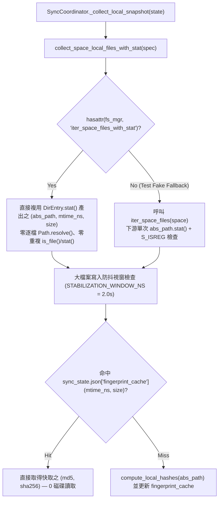

# `module:gdrive-support` 中觀架構與增量同步引擎專題手冊

本專題手冊定義 [`module:gdrive-support`](./README.md) 之本地零冗餘 `stat` 快照收集管線、Google Drive `changes` API 三級增量快取（含 Level 1 父子拓撲序新建／移除子目錄增量修補與跨分支 Shortcut 同步清理），以及前景 CLI 搶占讓鎖與 Copy-on-Write 原子持久化契約。

---

## 1. 本地零冗餘 `stat` 快照收集管線 (Zero-Redundant `stat` Local Snapshot Pipeline)

### 階段契約與不變量

| 管線階段 | 核心函式 | 輸入／輸出與效能不變量 |
| :--- | :--- | :--- |
| **① 空間枚舉與屬性傳遞** | [`collect_space_local_files_with_stat`](../../ys_codebase/source/gdrive-support/gdrive_support/config.py) | 優先呼叫 `FileSpaceManager.iter_space_files_with_stat(space_name)`，直接接收底層 `os.scandir` 已擷取之 `(mtime_ns, size)`，並移除逐檔 `Path.resolve()`，消除跨掛載檔案系統數千次冗餘 `lstat/readlink` 系統呼叫。對僅實作 `iter_space_files` 之測試替身自動平滑退回 `(abs_path, None, None)`。 |
| **② 零重複 `stat` 雜湊快取查詢** | [`SyncCoordinator._collect_local_snapshot`](../../ys_codebase/source/gdrive-support/gdrive_support/coordinator.py) | 當 `(mtime_ns, size)` 已由上游提供時，免除 `abs_path.is_file()` 與 `abs_path.stat()`；直接比對 `sync_state.json["fingerprint_cache"]` 之 `(mtime_ns, size)`，未變更檔案達成 0 額外系統呼叫與 0 磁碟 I/O。 |

---

## 2. 雲端 `changes` API 三級增量快取與 Level 1 拓撲子目錄修補

[`SyncCoordinator._try_incremental_remote_cache`](../../ys_codebase/source/gdrive-support/gdrive_support/coordinator.py) 於 `storage.local://gdrive-support/sync_state.json` 維護 `remote_repo_cache`，將雲端快照獲取分為三級：

| 快取等級 | 觸發條件 | 處理機制與 API 成本 |
| :---: | :--- | :--- |
| **Level 0** | `transport.list_changes(page_token)` 無任何受管分支或目錄變更 | 直接複用快取之 `repo_meta` 與分支快照，`0` 次 `list_files` 請求；若本地亦無上傳／刪除動作則一併跳過 `.history/` GC。 |
| **Level 1** | 已知檔案修改／刪除、Shortcut 目標更新／刪除、**已知分支內無衝突新建多層子目錄**、**已知分支子目錄刪除** | 先以拓撲序修補資料夾變更（更新 `dir_ids`、`known_folder_ids`、`folder_meta`），再於記憶體內修補 `raw_entries` 與跨分支 Shortcut，`0` 次 `list_files` 遞迴掃描。 |
| **Level 2** | 雲端根目錄 `<repo_sync_root>/` 新增未知分支資料夾、已知資料夾改名／跨父目錄搬移、同名衝突、`.yscb_gdrive.json` 或 `.trash/` 外部寫入 | 安全回退至全量掃描：先呼叫 `get_start_page_token()` 鎖定游標，自動發現並註冊雲端新分支（`_reconcile_unregistered_cloud_branches`），完成掃描後重建 `remote_repo_cache`。 |

### Level 1 資料夾拓撲序增量修補機制

1. **資料夾變更優先於檔案變更處理**：
   - 將去重後之 `ChangeRecord` 拆分為 `folder_changes` 與 `non_folder_changes`，先完成資料夾結構更新，使同一批次上傳至新建子目錄內的檔案能直接命中已註冊之 `b_data["dir_ids"]`。
2. **已知分支子目錄刪除與跨分支 Shortcut 連帶清理**：
   - 當某分支內已知子目錄（`rel_dir != ""`）被移除或移入垃圾桶時，將該目錄及其所有子目錄（`d_rel == rel_dir` 或 `d_rel.startswith(rel_dir + "/")`）從 `b_data["dir_ids"]`、`all_branch_dir_ids`、`known_folder_ids` 與 `folder_meta` 清除。
   - 同步移除該分支 `b_data["raw_entries"]` 中位於該子目錄前綴下的所有檔案，並查閱 `target_id_to_shortcuts`，將其他分支指向被刪實體檔案 `file_id` 的 Shortcut 一併從對應分支 `raw_entries` 移除，杜絕跨分支懸空引用。
3. **父子拓撲序新建子目錄掛載**：
   - 當新建資料夾之 `parent_id` 位於已知分支目錄集合 `all_branch_dir_ids` 時，透過 `while progress:` 拓撲迴圈由淺入深解析 `rel_dir = f"{parent_rel}/{dir_name}"`，並即時寫入 `b_data["dir_ids"]`、`all_branch_dir_ids`、`known_folder_ids` 與 `folder_meta`。
   - **安全退回 Level 2 圍欄**：凡偵測到 `parent_id == repo_folder_id`（於 `<repo_sync_root>/` 下直接建立新雲端分支）、系統保留名稱（`SYSTEM_NAMES` 或 `.` / `_` 開頭）、同名目錄／檔案衝突、或既有已知資料夾改名／搬移，一律立即返回 `None` 退回 Level 2 全量掃描。
