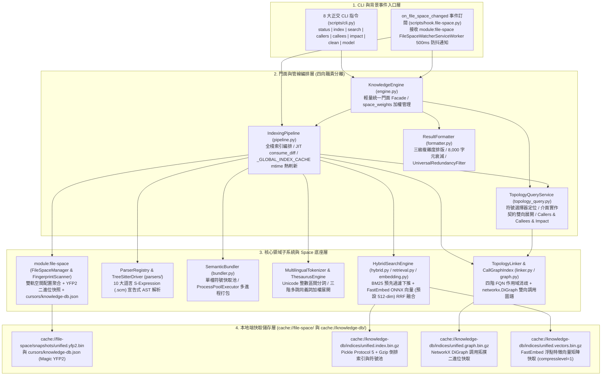
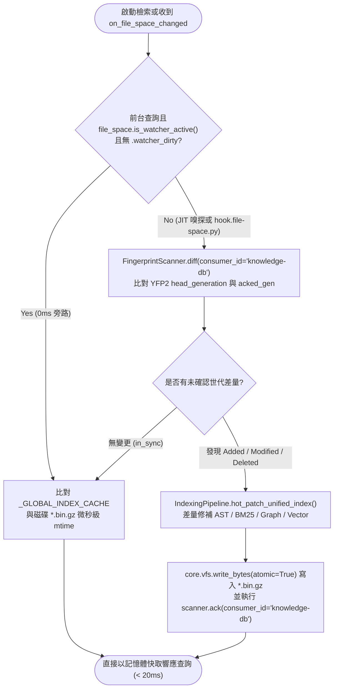

# knowledge-db 全系統整合架構設計 (System Architecture)

> 本文件說明 `knowledge-db` 模組的完整系統架構分層、門面與管線四向解耦 (`KnowledgeEngine` / `IndexingPipeline` / `TopologyQueryService` / `ResultFormatter`)、統一符號資料模型 (`UnifiedSymbol`)，以及與 `module:file-space` 底座協同之多消費者游標增量比對 (`YFP2` + `consume_diff`) 機制。

---

## 1. 全系統架構分層 (System Layering Architecture)

`knowledge-db` 採用四向職責解耦與冷/熱啟動零感知架構：頂層由 `KnowledgeEngine` 作為輕量統一門面，底層委派 `IndexingPipeline` 執行索引編排與混合檢索、由 `TopologyQueryService` 專司跨檔案調用圖譜 (`callers` / `callees` / `impact`) 與介面契約雙向展開、並由 `ResultFormatter` 負責三級複雜度排版與全域切片去重；空間幾何、雙階段指紋快照 (`YFP2`) 與背景 `watchdog` 監聽則統一委由 `module:file-space` 負責，並透過 `scripts/hook.file-space.py` 訂閱 `on_file_space_changed` 事件實現 500ms 防抖熱自癒。

---

## 2. 統一符號資料模型 (`UnifiedSymbol`)

所有語言解析器（`TreeSitterDriver` 與自訂解析器）皆將原始碼與文檔結構轉譯為不可變、支援任意巢狀階層的一等公民資料模型 `UnifiedSymbol`（定義於 `knowledge_db/schema.py`）：

| 欄位名稱 | 型別 | 預設值 | 核心語意與用途 |
| :--- | :--- | :--- | :--- |
| **`id`** | `str` | *(必填)* | 由 `compute_id(space, file_path, name, kind, line_number)` 生成之 40 碼 SHA-1 唯一識別碼 |
| **`name`** | `str` | *(必填)* | 符號短名稱（如類別名、函式名、巨集名或 Markdown 標題文字） |
| **`kind`** | `str` | *(必填)* | 符號類型（對應 `SymbolKind`，如 `class`, `function`, `method`, `struct`, `interface`, `doc_heading_1` 等） |
| **`file_path`** | `str` | *(必填)* | 正規化之相對檔案路徑（統一使用 `/` 分隔符） |
| **`line_number`** | `int` | *(必填)* | 符號定義起始行號（1-based） |
| **`end_line`** | `int` | `0` | 符號定義結束行號（供 `SnippetExtractor` 精確截取 AST 範圍） |
| **`language`** | `str` | *(必填)* | 所屬語言識別碼（如 `python`, `cpp`, `csharp`, `typescript`, `markdown`, `spice` 等） |
| **`signature`** | `str` | `""` | 完整宣告簽名（含修飾詞、參數列表與回傳型別標註） |
| **`docstring`** | `str` | `""` | 提取自 AST 之文檔註解、Doxygen/XML Doc 或 Markdown 段落內文 |
| **`fqn`** | `str` | `""` | 全限定名稱 (Fully Qualified Name)，供 `TopologyLinker` 進行跨檔案精確消歧 |
| **`scope_path`** | `str` | `""` | 所屬命名空間或外層類別範疇路徑（如 `Engine.Worker`） |
| **`parent_id`** | `Optional[str]` | `None` | 父層符號節點之 `id`，構建遞迴 AST 符號樹 |
| **`children`** | `Tuple[UnifiedSymbol, ...]` | `()` | 子符號節點元組（與向後相容屬性 `members` 自動雙向同步） |
| **`parameters`** | `Tuple[Dict[str, Any], ...]` | `()` | 結構化參數清單（含參數名、型別與預設值） |
| **`return_type`** | `str` | `""` | 函式或方法之回傳型別字串 |
| **`search_payload`** | `str` | `""` | 專供檢索與向量嵌入聚合之結構化語意負載文本 |
| **`visibility`** | `str` | `"public"` | 存取可見度（`public` / `protected` / `private`） |
| **`metadata`** | `Dict[str, Any]` | `{}` | 擴充元數據（包含 `spaces: List[str]` 多空間歸屬標籤、繼承基底 `bases` 等） |

---

## 3. 空間管理與 `module:file-space` 二進位快照游標協同 (`FileSpaceManager` & `YFP2`)

### 3.1 跨模組空間聚合與檢索權重分離 (Space & Weight Separation)
1. **空間幾何定義 (`module:file-space`)**：由 `file_space.FileSpaceManager` 自動搜集所有安裝模組之 `contributes/file-space.json` 與宿主專案 `config://file-space/contribute.json`，提供空間路徑與排除規則之記憶化解析（詳見 [`docs/file-space/README.md`](../file-space/README.md)）。
2. **空間檢索加權 (`contributes.knowledge-db.space_weights`)**：`knowledge-db` 專注於語意權重配置，由 `contributes/knowledge-db.json` 與 `config://knowledge-db/contribute.json` 宣告各邏輯空間之檢索加權係數（如 `docs: 1.2`, `plans: 0.85`）。

### 3.2 全空間聯集處理模型 (Union Scope Model)
`knowledge-db` 不設單一 `default_space` 限制，全系統以所有已註冊空間之聯集作為全域處理範圍：
$$\text{Scope} = \bigcup_{i=1}^{N} \text{Space}_i$$
重疊路徑之實體檔案在掃描階段即完成去重，**100% 僅執行 1 次 AST 解析**，並將命中的多個空間名稱寫入 `symbol.metadata["spaces"]`。

### 3.3 `YFP2` 單調世代快照與 `knowledge-db` 消費者游標比對機制
系統透過 `file_space.FingerprintScanner` 與 `file-space.storage://snapshots/unified.yfp2.bin`（Magic `b"YFP2"`）搭配 `file-space.storage://cursors/knowledge-db.json` 獨立水位線游標執行增量比對：

---

## 4. 多欄位加權 BM25 與雙軌複合檢索 (Hybrid Retrieval)

### 4.1 多欄位權重矩陣
| 欄位 | 權重 | 說明 |
| :--- | :---: | :--- |
| **`Name`** | **3.5** | 符號名稱或 Markdown 標題 (最高優先級) |
| **`Signature`** | **2.0** | 函式/類別簽名 (含參數與型別) |
| **`Members`** | **2.0** | 類別公開成員方法與子符號清單 |
| **`Docstring`** | **1.5** | 註解說明與文檔段落內文 |

### 4.2 雙軌 RRF 融合與檢索增強
- **預先過濾下推 (Filter Push-Down)**：空間 (`spaces`)、符號類型 (`kinds`) 與語言 (`languages`) 篩選條件直接下推至 BM25 候選池與向量比對階段，防止非目標空間符號擠壓候選名額。
- **平滑 IDF 與 Exact Match Boost**：採用 $\ln(1 + \max(0, \frac{N - n + 0.5}{n + 0.5}))$ 防止高頻詞負權重；精確匹配符號名稱時賦予 **2.0x 置頂加權**。
- **FastEmbed 向量與 RRF 融合**：透過 `HybridSearchEngine` 將 BM25 詞彙排名與 ONNX 稠密向量餘弦相似度排名以倒數排名融合 ($k=60$) 結合，並由純語意門檻 ($\ge 0.70$) 與子詞覆蓋率門檻 ($\ge 50\%$) 抑制雜訊。
