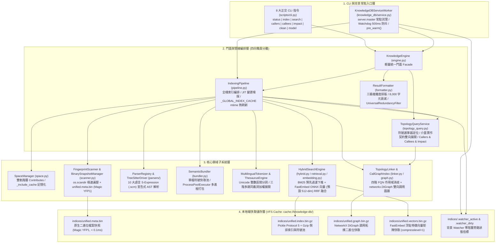
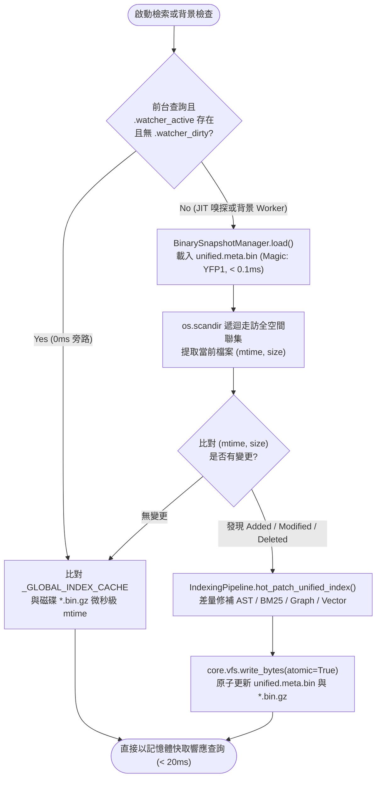

# knowledge-db 全系統整合架構設計 (System Architecture)

> 本文件說明 `knowledge-db` 模組的完整系統架構分層、門面與管線四向解耦 (`KnowledgeEngine` / `IndexingPipeline` / `TopologyQueryService` / `ResultFormatter`)、統一符號資料模型 (`UnifiedSymbol`)、空間治理與原生二進位快照比對 (`BinarySnapshotManager`) 機制。

---

## 1. 全系統架構分層 (System Layering Architecture)

`knowledge-db` 採用四向職責解耦與冷/熱啟動零感知架構：頂層由 `KnowledgeEngine` 作為輕量統一門面，底層委派 `IndexingPipeline` 執行索引編排与混合檢索、由 `TopologyQueryService` 專司跨檔案調用圖譜 (`callers` / `callees` / `impact`) 與介面契約雙向展開、並由 `ResultFormatter` 負責三級複雜度排版與全域切片去重；背景則透過 optional 擴充由 `server` 託管 `KnowledgeDBServiceWorker` 實現 500ms 防抖熱自癒。

---

## 2. 統一符號資料模型 (`UnifiedSymbol`)

所有語言解析器（`TreeSitterDriver` 與自訂解析器）皆將原始碼與文檔結構轉譯為不可變、支援任意巢狀階層的一等公民資料模型 `UnifiedSymbol`（定義於 `knowledge_db/schema.py`）：

| 欄位名稱 | 型別 | 預設值 | 核心語意與用途 |
| :--- | :--- | :--- | :--- |
| **`id`** | `str` | *(必填)* | 由 `compute_id(space, file_path, name, kind, line_number)` 生成之 40 碼 SHA-1 唯一識別碼 |
| **`name`** | `str` | *(必填)* | 符號短名稱（如類別名、函式名、巨集名或 Markdown 標題文字） |
| **`kind`** | `str` | *(必填)* | 符號類型（對應 `SymbolKind`，如 `class`, `function`, `method`, `struct`, `interface`, `doc_heading_1` 等） |
| **`file_path`** | `str` | *(必填)* | 正規化之相對檔案路徑（統一使用 `/` 分隔符） |
| **`line_number`** | `int` | *(必填)* | 符號定義起始行號（1-based） |
| **`end_line`** | `int` | `0` | 符號定義結束行號（供 `SnippetExtractor` 精確截取 AST 範圍） |
| **`language`** | `str` | *(必填)* | 所屬語言識別碼（如 `python`, `cpp`, `csharp`, `typescript`, `markdown`, `spice` 等） |
| **`signature`** | `str` | `""` | 完整宣告簽名（含修飾詞、參數列表與回傳型別標註） |
| **`docstring`** | `str` | `""` | 提取自 AST 之文檔註解、Doxygen/XML Doc 或 Markdown 段落內文 |
| **`fqn`** | `str` | `""` | 全限定名稱 (Fully Qualified Name)，供 `TopologyLinker` 進行跨檔案精確消歧 |
| **`scope_path`** | `str` | `""` | 所屬命名空間或外層類別範疇路徑（如 `Engine.Worker`） |
| **`parent_id`** | `Optional[str]` | `None` | 父層符號節點之 `id`，構建遞迴 AST 符號樹 |
| **`children`** | `Tuple[UnifiedSymbol, ...]` | `()` | 子符號節點元組（與向後相容屬性 `members` 自動雙向同步） |
| **`parameters`** | `Tuple[Dict[str, Any], ...]` | `()` | 結構化參數清單（含參數名、型別與預設值） |
| **`return_type`** | `str` | `""` | 函式或方法之回傳型別字串 |
| **`search_payload`** | `str` | `""` | 專供檢索與向量嵌入聚合之結構化語意負載文本 |
| **`visibility`** | `str` | `"public"` | 存取可見度（`public` / `protected` / `private`） |
| **`metadata`** | `Dict[str, Any]` | `{}` | 擴充元數據（包含 `spaces: List[str]` 多空間歸屬標籤、繼承基底 `bases` 等） |

---

## 3. 空間管理與原生二進位快照比對 (`SpaceManager` & `BinarySnapshotManager`)

### 3.1 雙軌來源聚合與記憶化加速 (Dual-Track Aggregation)
1. **軌道 ① 模組聯動注入 (Core Donor Contributes)**：自動搜集所有安裝模組之 `contributes/knowledge-db.json` 或 `manifest.json` 作為基底空間、語言與同義詞配置。
2. **軌道 ② 專案階層覆蓋 (`config://knowledge-db/contribute.json`)**：專案層級可宣告自訂空間或覆蓋同名空間之 `include` / `exclude` / `file_patterns`，同時完整保留基底模組貢獻之其他空間與詞庫。
3. **記憶化路徑解析 (`_include_cache`)**：`SpaceManager` 對空間路徑與排除規則實作進程內記憶化快取，消除重複 `Path.resolve()` I/O 開銷。

### 3.2 全空間聯集處理模型 (Union Scope Model)
`knowledge-db` 不設單一 `default_space` 限制，全系統以所有已註冊空間之聯集作為全域處理範圍：
$$\text{Scope} = \bigcup_{i=1}^{N} \text{Space}_i$$
重疊路徑之實體檔案在掃描階段即完成去重，**100% 僅執行 1 次 AST 解析**，並將命中的多個空間名稱寫入 `symbol.metadata["spaces"]`。

### 3.3 `BinarySnapshotManager` (`unified.meta.bin`) 極速快照比對機制
系統徹底廢除早期的 JSON 指紋檔與逐檔 SHA-1 內容雜湊，全權收斂至物理級單一真理來源 `cache://knowledge-db/indices/unified.meta.bin`：

- **二進位結構 (Magic `YFP1`)**：
  - **Header (`<4sHId`)**：`magic` (`b"YFP1"`, 4B) + `version` (`1`, 2B) + `total_files` (4B) + `timestamp` (float64, 8B)。
  - **Entry (`<HQd` + UTF-8 bytes)**：`path_len` (2B) + `size` (uint64, 8B) + `mtime` (float64, 8B) + `canonical_path` 位元組序列。
- **極速 `os.scandir` 變更嗅探**：反序列化 `unified.meta.bin` 耗時 $< 0.1\text{ ms}$；配合 `os.scandir` 直接自作業系統目錄項目取得 `(mtime, size)`，千檔規模下全量掃描比對僅需 $2\sim 3\text{ ms}$，零檔案內容讀取開銷。

---

## 4. 多欄位加權 BM25 與雙軌複合檢索 (Hybrid Retrieval)

### 4.1 多欄位權重矩陣
| 欄位 | 權重 | 說明 |
| :--- | :---: | :--- |
| **`Name`** | **3.5** | 符號名稱或 Markdown 標題 (最高優先級) |
| **`Signature`** | **2.0** | 函式/類別簽名 (含參數與型別) |
| **`Members`** | **2.0** | 類別公開成員方法與子符號清單 |
| **`Docstring`** | **1.5** | 註解說明與文檔段落內文 |

### 4.2 雙軌 RRF 融合與檢索增強
- **預先過濾下推 (Filter Push-Down)**：空間 (`spaces`)、符號類型 (`kinds`) 與語言 (`languages`) 篩選條件直接下推至 BM25 候選池與向量比對階段，防止非目標空間符號擠壓候選名額。
- **平滑 IDF 與 Exact Match Boost**：採用 $\ln(1 + \max(0, \frac{N - n + 0.5}{n + 0.5}))$ 防止高頻詞負權重；精確匹配符號名稱時賦予 **2.0x 置頂加權**。
- **FastEmbed 向量與 RRF 融合**：透過 `HybridSearchEngine` 將 BM25 詞彙排名與 ONNX 稠密向量餘弦相似度排名以倒數排名融合 ($k=60$) 結合，並由純語意門檻 ($\ge 0.70$) 與子詞覆蓋率門檻 ($\ge 50\%$) 抑制雜訊。
