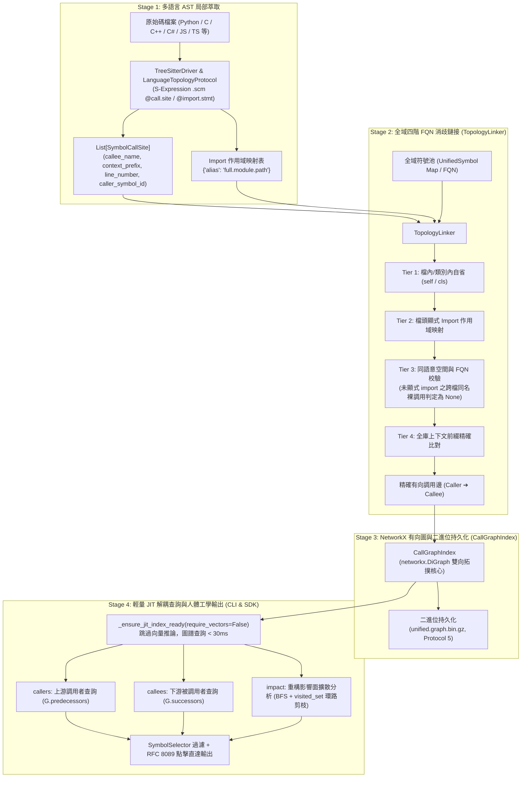

# 符號調用圖譜與引用拓撲索引專題手冊 (Call Graph & Reference Index)

> 模組：`knowledge-db`  
> 核心組件：`linker.py` (`TopologyLinker`), `graph.py` (`CallGraphIndex`), `selector.py` (`SymbolSelector`), `protocol.py` (`LanguageTopologyProtocol`), `pipeline.py`  

---

## 1. 架構全景與核心機制 (Architecture & Principles)

本專題為 `knowledge-db` 注入全域符號調用圖譜 (Call Graph) 與引用依賴拓撲能力，解決僅能搜尋定義 (Definitions) 而無法感知「誰調用了我 (Callers)」與「我調用了誰 (Callees)」的痛點。



---

## 2. 四階 FQN 消歧鏈接演算法與幽靈邊根除 (`TopologyLinker`)

在缺乏 Runtime 動態型別的情況下，`TopologyLinker` 緊扣 Universal AST `fqn` 與檔頭 Import 作用域，透過四階消歧策略實現高精準度靜態調用鏈接並徹底根除跨檔案同名幽靈關聯：

1. **Tier 1 (Self / Class / Implicit `this` & Base Inheritance Scope)**：
   - 當調用前綴為 `self`、`cls`、`this`、`base`、`super`，或為類別方法/屬性內部之隱式 `this` 裸調用（如 C# / C++ / TS 省略 `this.`）時，優先在呼叫者所屬類別、同空間 `partial class` 及 `metadata["base_types"]` 繼承基底類別鏈中尋找同名方法。
   - 支援保留真實可調用單元（`function` / `method` / `constructor`）之遞迴自調用邊（`caller_id == callee_id`），並由 `CallGraphIndex.query_impact` 的 `visited` 集合防範環路死循環。
   - 當調用為頂層裸函式呼叫且同一檔案內存在同名定義時，直接綁定檔內符號。
2. **Tier 2 (Explicit Import Alias & FQN Mapping)**：
   - 查閱 AST 提取之檔頭 `import` / `using` 映射表（例如 `from knowledge_db.retrieval import InvertedIndex as LocalIndex`）。
   - 當呼叫 `LocalIndex.load_binary()` 時，透過別名與目標模組路徑精準解析至 `retrieval.py` 內的 `InvertedIndex.load_binary` 符號。
3. **Tier 3 (Unimported Bare Call Guard & Same Space Scope)**：
   - **未顯式 Import 裸調用防呆**：針對跨檔案之同名裸調用（無 `context_prefix`、非類別繼承鏈成員且未出現於該檔案的顯式 Import 映射表中），嚴格判定為 `None`（不建立調用邊），徹底杜絕將 `service_a.run()` 與無關檔案 `service_b.run()` 誤連成跨檔幽靈邊。
   - 支援多段命名空間或成員鏈前綴（如 `UIToolkit.UI.Layout.FlexLayoutEngine.CalculateLayout`、條件存取 `m_Owner?.MarkMeasureDirty()` 與泛型調用 `GetService<IPanel>().UpdateLayout()`），優先於同一語意空間內匹配。
4. **Tier 4 (Global Context Prefix Scoring & Interface-Implementation Contract)**：
   - 當存在多個候選者且帶有明確上下文前綴（`context_prefix`）時，比對前綴與候選者所屬類別 (`parent_scope`) 或全限定名段落之契合度；無法確定時安全退回 `None`。
   - **介面與實作雙向契約聚合**：執行 `callers` 與 `impact` 查詢時，管線自動透過 `base_types` 將介面方法（如 `IPanel.UpdateLayout`）與實作類別同名方法（如 `Panel.UpdateLayout`）雙向關聯展開，完整覆蓋多型調用鏈。
   - **文檔引用預設隔離 (`--ftype`)**：`callers`、`callees` 與 `impact` 預設排除非程式碼文檔符號（`markdown` / `doc_*`），避免規格書連結干擾重構爆炸半徑；亦支援顯式傳入 `--ftype=md` 或 `--ftype=cs` 進行檔案類型正交篩選。

---

## 3. NetworkX 雙向有向圖、輕量 JIT 解耦與二進位持久化 (`CallGraphIndex`)

- **NetworkX DiGraph 工業級圖模型**：
  - 採用 `networkx.DiGraph` 作為核心拓撲資料結構，節點為符號 ID，有向邊持有結構化 `call_sites: List[SymbolCallSite]` 屬性字典。
  - 直接透過 `G.predecessors(v)`（上游 Callers）與 `G.successors(u)`（下游 Callees）達成 sub-毫秒級雙向檢索，並於 `impact` 多階擴散分析中內建 `visited_set` 環路剪枝，安全走訪遞迴或循環調用圖（$A \to B \to C \to A$）。
- **輕量 JIT 熱自癒解耦 (`require_vectors=False`)**：
  - 執行 `callers`、`callees`、`impact` 時，管線透過 `_ensure_jit_index_ready(require_vectors=False)` 僅確保 AST 符號池、倒排索引与 `CallGraphIndex` 完成同步或差量修補，**100% 跳過 FastEmbed ONNX 向量模型加載與推論**，使純靜態拓撲查詢延遲穩定保持在 $< 30\text{ ms}$。
- **Protocol 5 + Gzip 高速寫盤與增量修補**：
  - 持久化儲存於 `cache://knowledge-db/indices/unified.graph.bin.gz`，檔案體積 $< 150\text{ KB}$，反序列化載入耗時 $< 5\text{ ms}$。
  - 支援 `patch_incremental`：檔案變更時差量拔除舊檔案作為 Caller 與 Callee 的雙向邊並重新注入新調用邊，且重用已解析之 `UnifiedSymbol` 實例避免二次 AST 解析。

---

## 4. 全方位 AST 符號結構化選擇器 (`SymbolSelector`)

CLI 指令（`callers`, `callees`, `impact`, `search`）支援結構化微型語法 (`[kind] [scope.]name[()]`)，調用者可提供精確層次資訊定位目標：

| 語法模式 | 範例 | 說明 |
| :--- | :--- | :--- |
| **名稱** | `foo` | 任何名為 `foo` 的符號節點 |
| **範疇.名稱** | `Foo.bar` | 在 `Foo` 範疇（類別/模組/父節點）中名為 `bar` 的節點 |
| **可調用尾碼** | `run()` / `Worker.run()` | 限定符號類型為可調用（Function / Method）之節點 |
| **類型前綴** | `class Foo` | 限定為類別節點 |
| | `struct Point` | 限定為結構節點 |
| | `interface IService` | 限定為介面節點 |
| | `enum Color` | 限定為列舉節點 |
| | `fn init()` / `def init()` | 限定為函式/方法 |
| | `type ID` / `const MAX` / `var count` | 限定為別名、常數或變數 |
| **正交複合** | `class Engine.setup()` | 在 `Engine` 類別內名為 `setup` 的可調用方法 |
| | `struct Point.x` | 在 `Point` 結構內名為 `x` 的成員 |

---

## 5. 多語言調用拓撲協議 (`LanguageTopologyProtocol`)

系統透過 `LanguageTopologyProtocol` 抽象協議與 `TopologyProtocolRegistry`，結合 `TreeSitterDriver` 的 `.scm` 語法查詢規則，將 Python、JavaScript/TypeScript、C/C++、C#、Markdown 等語言的調用點 (`extract_call_sites`) 與 Import 映射 (`extract_imports`) 統一標準化。

---

## 6. CLI 指令人體工學輸出 (Ergonomic CLI Usage)

```bash
# 查詢誰調用了 TopologyLinker 的 resolve_call_site 方法 (支援 SymbolSelector 與代碼切片)
python yscb.py knowledge-db callers "TopologyLinker.resolve_call_site()" --json -s

# 查詢特定結構的下游調用
python yscb.py knowledge-db callees "struct Point" --json

# 分析特定類別重構的多階擴散影響面
python yscb.py knowledge-db impact "class CallGraphIndex" --depth=2 --json

# 輸出結構化 JSON 格式 (供 Agent 與自動化工具鏈串接)
python yscb.py knowledge-db callers "InvertedIndex.load_binary" --json -s
python yscb.py knowledge-db impact "InvertedIndex.patch_incremental" --depth=3 --json
```
