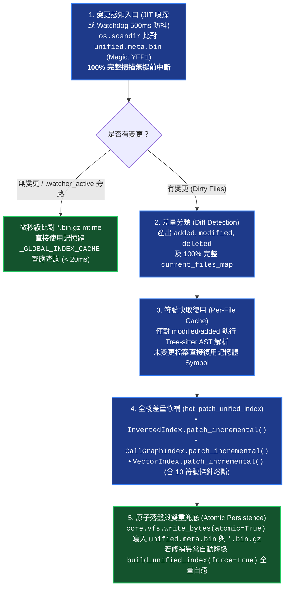

# 細粒度增量熱重載與常駐 ServiceWorker 熱自癒架構 (Incremental Hot Reload & ServiceWorker)

> 本文件說明 `knowledge-db` 模組的 `BinarySnapshotManager` (`unified.meta.bin`) 極速二進位快照、單檔符號快取池、全棧增量差量修補演算法，以及常駐 `KnowledgeDBServiceWorker` 500ms 防抖熱自癒架構。

---

## 1. 架構全景與資料流向 (Architecture & Workflow)

---

## 2. 原生二進位快照與增量修補核心機制 (Core Snapshot & Patch Features)

### 2.1 `BinarySnapshotManager` (`unified.meta.bin`) 二進位結構
為消滅傳統 JSON 指紋檔解析緩慢與雙軌狀態撕裂問題，全系統以 `cache://knowledge-db/indices/unified.meta.bin` 為物理級單一真理來源 (Physical SSOT)：

| 區段 | `struct` 格式 | 長度 | 欄位組成與說明 |
| :--- | :---: | :---: | :--- |
| **Header** | `<4sHId` | 18 Bytes | `magic` (`b"YFP1"`, 4B) + `version` (`1`, uint16, 2B) + `total_files` (uint32, 4B) + `timestamp` (float64, 8B) |
| **Entry (x N)** | `<HQd` + UTF-8 | 18 + $L$ Bytes | `path_len` ($L$, uint16, 2B) + `size` (uint64, 8B) + `mtime` (float64, 8B) + `canonical_path` ($L$ Bytes UTF-8) |

- **極速反序列化**：載入數百至數千筆檔案記錄耗時 $< 0.1\text{ ms}$。
- **原子持久化**：優先透過 `core.vfs.write_bytes(target_path, buffer, atomic=True)`（或同目錄暫存檔 + `os.replace`）寫入，杜絕寫入中斷導致快照損毀。

### 2.2 100% 完整清冊保證 (No Truncated Map)
`FingerprintScanner.check_invalidation()` 完整走訪所有已註冊空間之有效檔案，精確比對 `unified.meta.bin`，產出 `ScanDiffDetail` (`added`, `modified`, `deleted`) 與 100% 完整之 `current_files_map`，杜絕任何提前中斷返回截斷字典之問題，徹底根除「重複熱重載死循環」。

### 2.3 `os.scandir` 遍歷加速與單檔符號快取池
- **`os.scandir` 高速走訪**：直接自作業系統 `DirEntry.stat()` 取得 `(mtime, size)`，減少 50% 以上之系統呼叫開銷（千檔掃描僅 $2\sim 3\text{ ms}$）。
- **單檔符號記憶體快取 (`_file_symbols_cache`)**：`SemanticBundler` 維護單檔符號快取池，熱修補時僅對 `added` 與 `modified` 檔案重新執行 AST 解析，其餘未變更檔案 100% 記憶體零 I/O 復用。

### 2.4 全棧四維差量打補丁 (`hot_patch_unified_index`)
單次差量修補同步更新四大核心索引並以 `compresslevel=1` 快速寫盤（端到端延遲 $20\sim 50\text{ ms}$）：
1. **倒排索引 (`InvertedIndex.patch_incremental`)**：採用對稱路徑匹配拔除 `deleted` / `modified` 舊檔案之 Postings 與 `doc_lengths`，注入新符號並動態重算 `field_avgdl`。
2. **調用圖譜 (`CallGraphIndex.patch_incremental`)**：拔除異動檔案在 `networkx.DiGraph` 中的出入度邊，並由 `TopologyLinker` 重新鏈接注入新邊。
3. **向量特徵 (`VectorIndex.patch_incremental`)**：差量移除舊符號向量並對新符號提取特徵（前台 JIT 模式受 10 符號動態探針保護，預估逾時則平滑熔斷退回純 BM25）。

---

## 3. 常駐 `KnowledgeDBServiceWorker` 與 500ms 防抖熱自癒架構

當環境安裝選用模組 `server`（於 `manifest.json` 宣告為 `optional` 弱耦合依賴）時，`knowledge-db` 透過 `contributes/server.json` 註冊常駐背景服務 `KnowledgeDBServiceWorker` (`"knowledge-db-watcher"`)，由 `server` 模組統一託管生命週期與 Idle TTL：

### 3.1 預熱事件與 Eager Preload (`pre_warm()`)
- Worker 啟動時響應 `server` 發出之 `worker_warming` 事件，主動呼叫 `KnowledgeEngine.pre_warm()`，提前將 FastEmbed ONNX 模型單例與 `unified.index.bin.gz` / `unified.graph.bin.gz` / `unified.vectors.bin.gz` 載入進程記憶體 `_GLOBAL_INDEX_CACHE`，實現首發查詢零冷啟動延遲。

### 3.2 三層動態路徑過濾 (`is_path_watched`)
背景 Watchdog 監聽目錄完全由 `SpaceManager.resolve_space_include()` 動態解算，嚴禁硬編碼目錄或副檔名，事件觸發時依序執行三層快篩：
1. **第一層（VCS 與快取忽略）**：快速排除 `.git`, `.venv`, `__pycache__`, `.pytest_cache`, `.cache`, `.modules` 等系統目錄。
2. **第二層（動態副檔名集合 `resolve_watch_extensions`）**：動態聚合 `ParserRegistry.get_supported_extensions()`（自 `contributes.knowledge-db.languages` 提取之 10 大語言副檔名）、`.json` 與所有空間之 `file_patterns`。
3. **第三層（Space 歸屬校驗）**：比對檔案絕對路徑是否座落於已註冊空間之 `include` 根目錄下且符合排除規則。

### 3.3 500ms 防抖熱修補與雙重剛性自癒兜底
- **500ms 防抖聚合窗口**：當收到連續檔案存檔事件（Burst Saves）時，Worker 將變更路徑收集至 `_pending_dirty_paths`，建立 `.watcher_dirty` 標記並重設 `0.5s` `threading.Timer`，避免高頻磁碟 I/O 抖動。
- **冷啟動倒排索引磁碟懶加載**：在 `hot_patch_unified_index()` 入口處，若記憶體 `self._unified_index` 為 `None` 且磁碟存在 `unified.index.bin.gz`，自動呼叫 `InvertedIndex.load_binary()` 還原基底索引至記憶體再執行差量打補丁，防止冷啟動短路失效。
- **雙重剛性自癒兜底 (`build_unified_index(force=True)`)**：若增量熱修補回傳 `False`（如基底快取不存在或損毀）或拋出任何未預期例外，Worker 強制降級執行 `pipeline.build_unified_index(force=True, current_files=full_files_map)` 全量重建，100% 保證磁碟快照與索引最終一致。

### 3.4 前台 `.watcher_active` 零阻塞旁路與 `_GLOBAL_INDEX_CACHE` 微秒級熱刷新
- **前台零阻塞旁路**：`KnowledgeDBServiceWorker` 啟動時於 `indices/` 寫入 `.watcher_active`（停止時自動清除）。當前台檢索管線探測到 `.watcher_active` 存在且無 `.watcher_dirty` 時，**前台 0ms 直接略過同步 `os.scandir` 掃描與熱修補**，徹底消除前台查詢與背景防抖修補的競態阻塞。
- **微秒級 `mtime` 記憶體熱刷新**：`_GLOBAL_INDEX_CACHE` 記錄 `unified_mtime`、`graph_mtime` 與 `vector_mtime`。背景 Worker 完成原子寫盤後，下次查詢僅比對磁碟 `*.bin.gz` 之微秒級 `st_mtime`，感知變更即就地熱重載記憶體快取，維持 $< 20\text{ ms}$ 瞬發檢索體驗。
