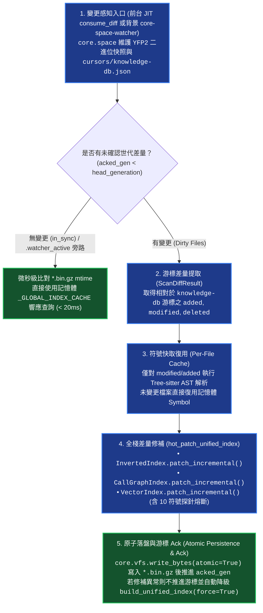

# 細粒度增量熱重載與 `on_file_space_changed` 事件驅動熱自癒架構 (Incremental Hot Reload & Space Watcher)

> 本文件說明 `knowledge-db` 模組如何基於 `core.space` 的 `YFP2` 單調世代二進位快照與 `module:ast` 的 `ASTSnapshot` (`ast_generation`)，配合 `cursors/knowledge-db.json` 與 `InvertedIndex.acked_ast_generation` 雙水位線、單次解析符號共享以及 `scripts/hook.core.py` (`on_file_space_changed` 訂閱) 實現零重複 AST 解析的自動熱自癒。

---

## 1. 架構全景與資料流向 (Architecture & Workflow)

---

## 2. `YFP2` 快照游標消費與增量修補核心機制 (Core Snapshot & Patch Features)

### 2.1 `core.space` `YFP2` 二進位快照與獨立消費者游標
`knowledge-db` 將底層檔案指紋掃描與快照管理 100% 委由 `core.space` 負責：
- **二進位快照 (`storage.local://core/space/snapshots/unified.yfp2.bin`)**：採用 Magic `b"YFP2"` 二進位結構，記錄單調遞增世代 `head_generation`、`merkle_root` 與每檔 `(created_gen, updated_gen, is_deleted)` 軟刪除墓碑（詳見 [`docs/core/README.md`](../core/README.md)）。
- **獨立消費者游標 (`storage.local://core/space/cursors/knowledge-db.json`)**：`knowledge-db` 以固定 `consumer_id="knowledge-db"` 維護自身已處理完成的快照世代 `acked_gen`，與其他下游工具的游標完全隔離。
- **索引與游標一致性守門**：當 `storage.local://knowledge-db/indices/` 下之基底索引被清除（如執行 `knowledge-db clean`）時，系統同步呼叫 `core.space.reset_cursor(consumer_id="knowledge-db")`，確保下次建立或查詢時必定觸發全量重建並對齊最新世代。

### 2.2 單檔符號快取池与全棧差量打補丁 (`hot_patch_unified_index`)
- **單檔符號記憶體快取 (`_file_symbols_cache`)**：`SemanticBundler` 維護單檔符號快取池，熱修補時僅對 `added` 與 `modified` 檔案重新執行 AST 解析，其餘未變更檔案 100% 記憶體零 I/O 復用。
- **全棧三維差量打補丁**：單次差量修補同步更新三大核心索引並以 `compresslevel=1` 快速寫盤（端到端延遲 $20\sim 50\text{ ms}$）：
  1. **倒排索引 (`InvertedIndex.patch_incremental`)**：採用對稱路徑匹配 (`io_utils.is_dirty_file_match`) 拔除 `deleted` / `modified` 舊檔案之符號與 `doc_lengths`，於移除舊符號分詞時收集 `removed_terms` 並僅針對受影響詞條修剪 Postings（避免全詞表線性掃描），注入新符號（含 C# `partial class` 跨檔重聚合）並動態重算 `field_avgdl`。
  2. **調用圖譜 (`CallGraphIndex.patch_incremental`)**：透過 Stage 1 `Identity Remap` 與 Stage 2 `TopologyLinker` 更新異動檔案在 `networkx.DiGraph` 中的出入度邊。
  3. **向量特徵 (`VectorIndex.patch_incremental` 與 `doc_text_hashes` 內容指紋)**：透過 Blake2b 8-byte `doc_text_hashes` 比對同行號修改之符號重算特徵，並對僅發生行號平移之未改動符號以 `(norm_file_path, name, kind, text_hash)` 直接 $O(1)$ 零推論復用舊向量；ONNX 推論移至 `_index_lock` 外執行後與 `working_idx` 原子發佈落盤（前台 JIT 模式受 10 符號動態探針保護，預估逾時或異常時強制淘汰過期舊向量並平滑熔斷退回純 BM25）。

---

## 3. 常駐 `core-space-watcher` 與專屬 `KnowledgeDBServiceWorker` (`knowledge-db-worker`) 兩階段自癒架構

當環境啟動 `server` 常駐 Daemon 時，背景檔案系統 `watchdog` 監聽由 `server` 模組託管之 `CoreSpaceWatcherServiceWorker` (`core-space-watcher`)，而 `knowledge-db` 則於 `contributes/server.json` 註冊專屬背景同步服務 `KnowledgeDBServiceWorker` (`knowledge-db-worker`)，透過事件驅動實現「Stage 1 快篩 + Stage 2 微批次向量補齊」兩階段管線：

### 3.1 預熱事件 (`hook.server.py:on_worker_warming`) 與組態守門
- Server Warm Worker 啟動時響應 `worker_warming` 事件，主動呼叫 `KnowledgeEngine.pre_warm()`，提前將 `unified.index.bin.gz` / `unified.graph.bin.gz`（以及當 `config.enable_vector_search=True` 時之 `unified.vectors.bin.gz` 與 FastEmbed ONNX 模型單例）載入進程記憶體 `_GLOBAL_INDEX_CACHE`，實現首發查詢零冷啟動延遲。

### 3.2 `on_file_space_changed` 喚醒與兩階段背景同步 (`KnowledgeDBServiceWorker`)
- **Stage 1（Fast Path — AST + BM25 + CallGraph 快篩同步）**：當 `core-space-watcher` 經 500ms 防抖（最大上限 `5.0s`）更新 `YFP2` 二進位快照並廣播 `on_file_space_changed` 後，`scripts/hook.core.py` 透過 O(1) `notify_space_changed()` 喚醒 `KnowledgeDBServiceWorker` 主迴圈。Worker 先以 `skip_vectors=True` 消費 `consume_diff("knowledge-db")`，秒級完成 AST 符號增量解析、BM25 倒排索引與調用圖譜更新並立即推進游標。
- **Stage 2（Slow Path — 微批次鎖分離向量差集自癒與檢查點持久化）**：Worker 主迴圈透過 `pipeline.get_vector_deficit_info()` 比對 `unified_index.symbols` 與 `vector_index.doc_ids`（含 `doc_text_hashes` 內容雜湊）之差集，以微批次 `sync_vector_deficit_step(batch_size=config.vector_batch_size, persist=...)`（預設每批 `32` 符號，截斷 Docstring 至 `400` 字元）逐步計算嵌入：`embedding_service.embed_texts()` 移出 `_index_lock` 外執行以免阻塞前景檢索，偵測前景活躍時以 `_stop_event.wait(0.05)` 零忙等禮讓並延後刷盤，重新加鎖寫回前二次過濾仍存活於 `unified_index.symbols` 之符號 ID，並由 Worker 每滿 8 批（256 符號）、距上次存盤 $\ge 2.0\text{s}$、全部完成或於退出 `finally` 區塊時呼叫 `flush_vector_index()` 原子寫入 `unified.vectors.bin.gz`，兼顧前景零阻塞與磁碟寫入放大抑制。

### 3.3 `is_worker_busy() -> int` 探針與 `jit_vector_timeout_ms` 動態容差降級
- **已運行毫秒探針 (`is_worker_busy() -> int`)**：`KnowledgeDBServiceWorker` 執行背景任務時於 `indices/.kdb_worker_state.json` 記錄狀態與 `start_ts`（並附帶 PID 存活校驗防止死進程殘留）。`engine.is_worker_busy()` 回傳 `0` 代表空閒，`> 0` 代表當前任務已連續運行之毫秒數 `elapsed_ms`。
- **動態剩餘時間等待與 0ms 瞬時降級**：當 `search()` 需要向量檢索且偵測到 `elapsed_ms = engine.is_worker_busy() > 0`（或向量覆蓋率尚未達標且 Worker 忙碌）時：
  - 若 `elapsed_ms >= config.jit_vector_timeout_ms`（預設 `3000` ms）：代表後台正在執行長耗時任務（如初次全量嵌入或模型下載），前台**等待 0ms 立即降級為純 BM25 搜尋**，並於 `sys.stderr` 輸出 `[後台向量資料庫更新中，已暫時降級為純 BM25 搜尋]`。
  - 若 `0 < elapsed_ms < config.jit_vector_timeout_ms`：前台僅等待剩餘時間 `remain_ms = timeout_ms - elapsed_ms`；若期間內 Worker 完成並轉為空閒，即熱重載最新 `unified.vectors.bin.gz` 執行 `hybrid_rrf`；若逾時則平滑降級為純 BM25 並輸出相同提示。
- **微秒級 `mtime` 記憶體熱刷新**：`_GLOBAL_INDEX_CACHE` 記錄 `unified_mtime`、`graph_mtime` 與 `vector_mtime`。背景完成原子寫盤後，下次查詢僅比對磁碟 `*.bin.gz` 之微秒級 `st_mtime`，感知變更即就地熱重載記憶體快取，維持 $< 20\text{ ms}$ 瞬發檢索體驗。
