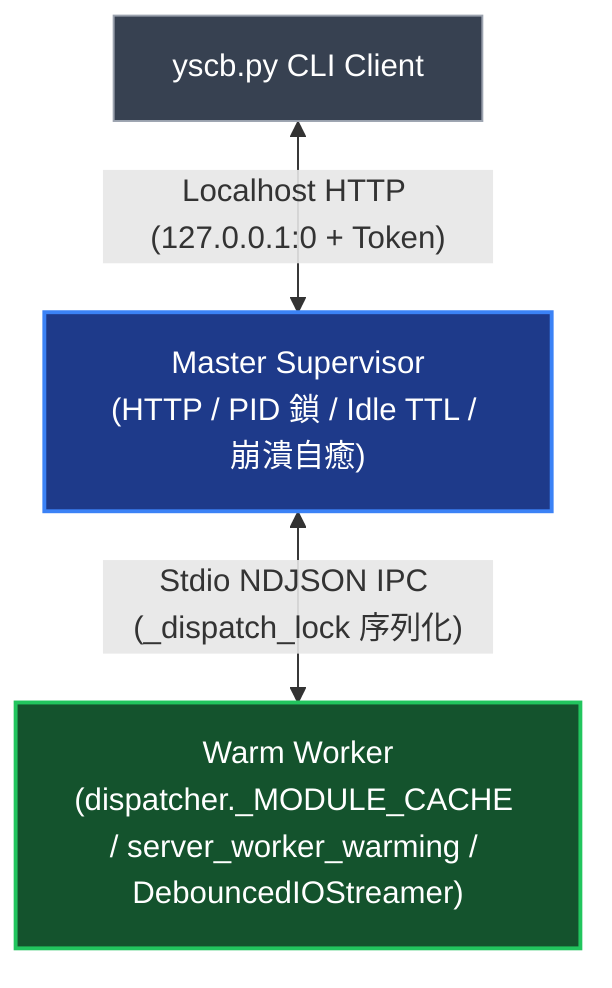
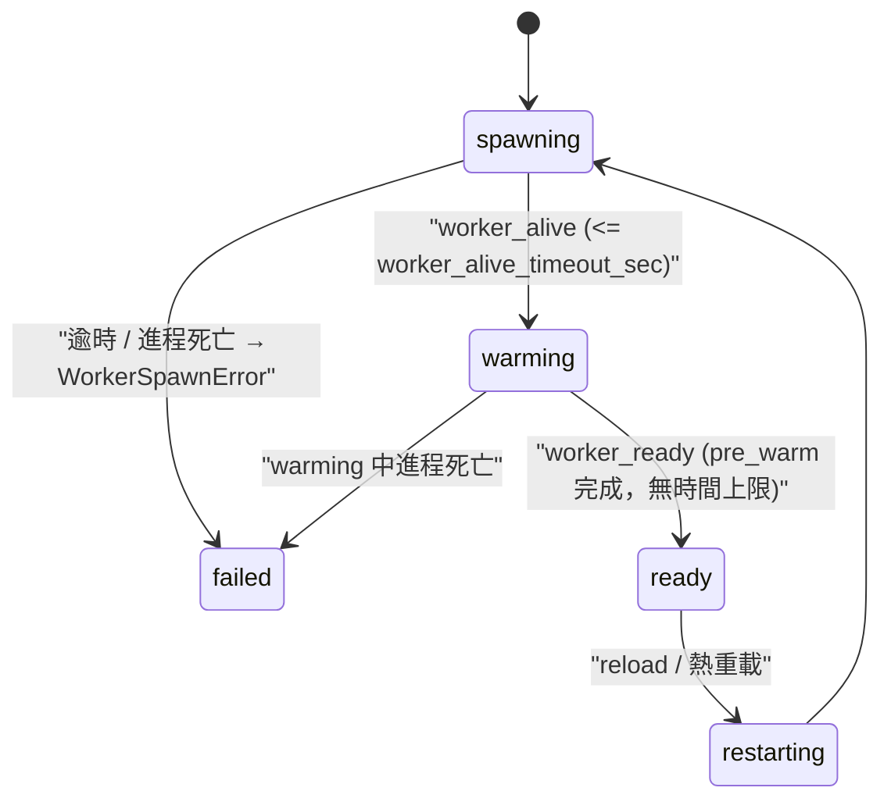
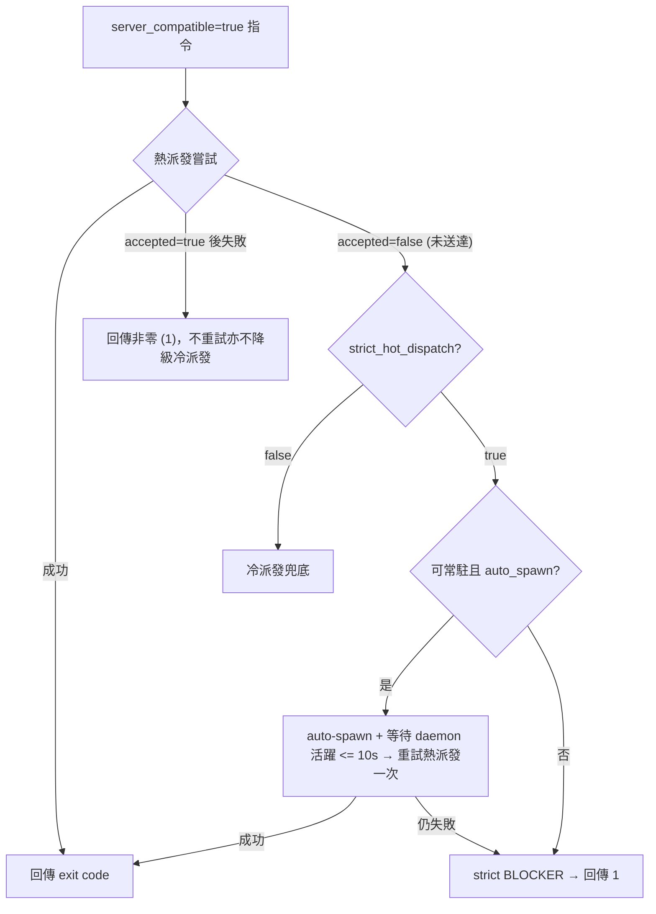

# Server 常駐架構與通訊協定專題 (Daemon Architecture & IPC Protocol)

> 本手冊深入說明 `server` 模組內部 Master-Worker 雙進程模型、Worker 進程級模組快取與預熱廣播、500ms 防抖串流協議、宿主四大耦合邊界與環境權限自適應探針。

---

## 1. Master-Worker 雙進程模型與崩潰自癒 (Master-Worker Model)

1. **職責分離 (Control Plane vs. Data Plane)**：
   - **Master Supervisor**：純控制平面，負責外部 Localhost HTTP 網絡、安全 Token 守門、狀態鎖 (`cache://server/daemon.json`)、Idle TTL 計時器與子進程守護（Worker 啟動採兩段式握手，見 §1.1）。
   - **Warm Worker**：常駐預熱資料平面，內部攔截 `SystemExit` 避免被業務模組中斷，兼顧啟動加速 (<30ms) 與模組記憶體隔離。
2. **模組崩潰自動自癒 (Crash Self-Healing)**：
   - 若業務模組執行期間發生嚴重崩潰或導致 Worker 子進程異常退場（Broken Pipe / EOF），Master Supervisor 會自動偵測並在下一次調度或恢復週期中透明拉起全新 Warm Worker 子進程自癒，確保常駐服務整體高可用。
3. **Worker 進程樹與存活判定**：POSIX 上 Worker 以 `start_new_session=True` 啟動，終止時以 `terminate_popen_tree`（`killpg` SIGTERM → 寬限 → SIGKILL）收割整個進程群組並交由 `Popen` 自行回收；Master 對 Worker 之存活判定一律使用 `proc.poll()`，不使用 `is_process_alive()`（其內含 `waitpid` 會搶走 `Popen` 的回收）。
4. **進程級模組快取與標準預熱事件廣播 (`_MODULE_CACHE` & `server_worker_warming`)**：
   - **進程級模組快取 (`core.commands.dispatcher._MODULE_CACHE`)**：為避免每次派發任務時重複執行 `importlib.util.module_from_spec` 與 `exec_module` 造成無謂的直譯解析與符號評估開銷，Worker 統一透過微內核 `dispatch_local` 將已載入之 `cli.py` 模組快取於 `dispatcher._MODULE_CACHE` 中，後續跨任務調用直接復用。
   - **標準預熱廣播 (`server_worker_warming`)**：Worker 初始化完成後，立即透過微內核標準事件原語 `core.events.broadcast("server_worker_warming", emit_module="server")` 發送預熱廣播，讓各領域重型模組（如 `knowledge-db` 向量推論與倒排索引）可掛載自定義 Pre-warm 邏輯，消除首次請求的冷加載卡頓。

### 1.1 兩段式 Worker 握手與狀態機 (Two-Stage Handshake)

- Worker 進入主程式即送 `{"type":"worker_alive"}`，完成 `pre_warm()`（服務載入與預熱廣播）後送 `worker_ready`（附帶服務清冊）。
- Master 僅對 alive 階段設上限（`worker_alive_timeout_sec`，預設 5.0s）；逾時視為啟動失敗並拋 `WorkerSpawnError`，由 `dispatch_task` 轉為 `task_finish(exit_code=1, error=...)`，不以 PID `0` 冒充成功。
- warming 期間由背景執行緒等待 ready；只要 Worker 存活即不設上限（重型預熱如向量模型載入可能很久）。此期間進入的 dispatch 阻塞等待 ready，若 Worker 死亡則立即回傳 `1`，下次請求重新 spawn。
- daemon 啟動時首個 Worker spawn 失敗僅記錄錯誤，daemon 本身保持運行。

### 1.2 搶占式重啟與停止 (Preemptive Restart / Stop)

`restart_worker()` 與 `stop()` **不先取 `_dispatch_lock`**：先於 `_worker_lock` 內強殺現役 Worker，使進行中 dispatch 阻塞的 `readline()` 得到 EOF 而回傳 `1`（`error="Worker terminated by restart/stop"`）並釋放 `_dispatch_lock`，之後才取 `_dispatch_lock` spawn 新 Worker。因此 Worker 卡住時 reload 仍可於「kill 逾時 + 5s」內返回。被搶占的任務不會被重試。`restart_worker()` 於殺 Worker 前先載入 `ServerConfig`，spawn 失敗時拋 `WorkerSpawnError`（HTTP 層轉 500）。

### 1.3 狀態觀測 (`get_status_dict`)

`get_status_dict()` 不取 `_dispatch_lock`，可於任務執行中即時回應：`state ∈ {warming, ready, restarting}`，warming 時附 `warming_elapsed_sec`；`current_task` 為 `{module, args, started_at, elapsed_sec}` 或 `null`。

---

## 2. 500ms 防抖分流串流協議 (Debounced Streaming Protocol)

為避免業務模組高頻輸出時產生大量微小封包衝擊 IPC 管道與 HTTP 串流，同時兼顧終端機即時互動感，Worker 透過 `DebouncedIOStreamer` 攔截 `sys.stdout` 與 `sys.stderr`：

1. **防抖與雙水位 Flush 觸發條件**：
   - 設置 **500ms 緩衝閥值**與 **`max_buffer_bytes=4096` 容量上限**：一般輸出在緩衝區累積達 500ms 或字節數達 4096 bytes 時批次刷出（不再於每次遇到 `\n` 時立即呼叫 `flush()`，避免高頻逐行輸出產生大量微小 IPC 封包）。
   - **任務結束立即 Flush**：當當前派發任務執行結束時，無須等待 500ms 計時器，**立即觸發 `flush()`**，確保最終結果零遺漏送達終端。
2. **NDJSON 分流封包規格**：
   - **`terminal_stream`**：`{"type": "terminal_stream", "stream": "stdout"|"stderr", "text": "..."}`（即時轉發至客戶端對應之標準輸出/錯誤流）。
   - **`task_finish`**：`{"type": "task_finish", "exit_code": 0, "duration_ms": 24.5, "error": null}`（標記單次任務閉環並回傳退出碼與耗時）。

---

## 3. `yscb` 宿主四大耦合邊界 (Host Coupling Boundaries)

為防止 `yscb.py` 宿主腳本再次膨脹或對 `server` 產生硬依賴，嚴格落實四大解耦原則：

1. **軟依賴探測**：`yscb.py` 零靜態 import `server` 模組；探測到 Server 未安裝或未啟動時，100% 透明降級為本地冷啟動執行。
2. **自循環旁路**：凡目標模組為 `module == "server"` 之管理指令（如 `server start/stop/status/reload`），強制直接走本地冷啟動，嚴禁進入熱派發循環（詳見 [DESIGN_NOTES.md](./DESIGN_NOTES.md) `DN-01`）。
3. **按需非同步拉起**：當 `auto_spawn` 啟用且 Server 未運行時，於背景脫鉤非同步拉起 Master 進程，而當前命令直接走本地冷啟動執行，確保首發指令零等待感（`strict_hot_dispatch=true` 時例外，見 §6）。
4. **極簡客戶端**：宿主端僅內嵌極簡標準庫 HTTP 轉發器與串流讀取迴圈，維持微內核輕量純淨。

---

## 4. 環境權限自適應探針與沙盒防護 (Adaptive Environment Probing)

1. **Windows Job Object 限制感知**：在 IDE Agent（如 Antigravity / Cursor / Claude Code）或 CI 虛擬環境中，工具子進程可能繫屬於未開啟 `JOB_OBJECT_LIMIT_BREAKAWAY_OK` 的 Windows Job Object，命令結束時背景進程會被 OS 強制收割。
2. **常駐能力判定順序 (`can_spawn_background_daemon(force_reprobe=False, yscb_root=None)`)**：
   1. `YSCB_FORCE_DAEMON=1`（或 `true`）→ 可常駐（略過所有探針）。
   2. `YSCB_NO_DAEMON=1`（或 `true`）→ 不可常駐。
   3. Windows：Job Object 探針（見下）。
   4. POSIX：傳入 `yscb_root` 時依 §5 實證回收偵測判定（不做進程級快取，因 daemon 狀態會變）；未傳入時視為可常駐。
3. **Windows 記憶體快取探針**：
   - 透過 `ctypes` 呼叫 `kernel32.IsProcessInJob` 檢測進程狀態。
   - 非 Job 環境直接回傳 `True`；Job 環境下執行 1 次非破壞性探針測試 Breakaway 權限，結果快取於進程記憶體中（防坑細節詳見 [DESIGN_NOTES.md](./DESIGN_NOTES.md) `DN-02`）。
4. **自適應冷派發降級**：當 `auto_spawn` 為 `true` 但探針檢測無背景常駐權限時，自動跳過背景拉起並降級至本地極速冷派發（~86ms），同時透過 `sys.stderr` 輸出具備防洗頻抑制的環境診斷提示與 IDE Agents 常駐指引（建議透過背景常駐任務執行 `python yscb.py server start --console`）。

---

## 5. POSIX 實證回收偵測 (Empirical Reaping Detection)

部分沙盒終端（如 IDE Agent 工具終端）會在單次命令結束時靜默收割脫鉤之背景 daemon，無法以靜態特徵判斷，故由 `core.platform.daemon_probe` 以實際結果累計判定：

| 項目 | 規則 |
| :--- | :--- |
| 紀錄檔 | `cache://server/spawn_probe.json`，依 `env_fingerprint()`（`hostname\|sys.platform`）分鍵，避免 Windows Host 與 Linux Guest 共用 `.cache` 時互相污染 |
| 記錄 | dispatcher auto-spawn 後 `record_spawn(pid)`（此時為短命 launcher PID）；Master 取得單例鎖後 `bind_master_pid()` 改寫為真正的 Master PID（紀錄已 `clean_exit` 或不存在則不動作） |
| 累計 | 判定時若紀錄 PID 已死、無 `clean_exit`、且 daemon 不活躍（先看 `daemon.json` PID，必要時才非阻塞探 `daemon.lock`），則 `reaped_count += 1` 並消耗該紀錄 |
| 判定 | 同一 fingerprint `reaped_count >= 2`（`REAP_THRESHOLD`）即判不可常駐；單次崩潰不觸發 |
| 歸零 | 任一次 clean exit 寫入 `clean_exit=true, reaped_count=0`：Master 優雅關閉（含 Idle TTL 自毀）、`server stop` 優雅逾時後強殺、`server stop --force` 皆會標記 |
| 容錯 | 紀錄檔損壞/不可讀視為無紀錄（不判不可常駐）；寫入失敗靜默降級（屬觀測性資料） |

判定不可常駐時（非嚴格模式）：stderr 印 advisory `[BLOCKER]` 一次、照常冷派發、exit code 不變。手動 `kill -9` daemon 兩次會誤判，可用 `YSCB_FORCE_DAEMON=1` 或一次正常關閉復原。

---

## 6. 嚴格熱派發 (`strict_hot_dispatch`)

- **送達判準**：`_hot_dispatch_attempt` 回傳 `_HotDispatchResult(exit_code, accepted)`；`accepted=true` 表示請求已被 server 接收。不論是否開啟 strict 模式，**僅對未送達（`accepted=false`）的失敗才允許重試或降級冷派發**；一旦 `accepted=true` 後中途失敗（如讀取逾時或串流中斷），一律直接回傳非零退出碼（`1`），因為任務已在 Worker 執行，重試或降級冷派發會造成雙重執行（見 DN-11）。
- 生效條件：`enable=true` 且指令 `server_compatible=true`；`enable=false` 時嚴格模式失效，`server_compatible=false` 指令（如 `server start/status`）照常冷執行。
- `[BLOCKER]` 文案兩種：advisory（已冷派發兜底）與 strict（已阻斷）。
- 非嚴格模式下 `_try_hot_dispatch` 僅在 `not res.accepted` 時回傳 `None` 降級冷派發；若 `res.accepted` 為 `True`，則直接回傳 `res.exit_code`（若為 `None` 則回傳 `1`）。
