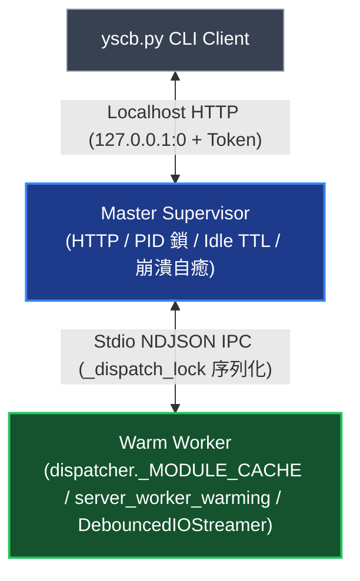

# Server 常駐架構與通訊協定專題 (Daemon Architecture & IPC Protocol)

> 本手冊深入說明 `server` 模組內部 Master-Worker 雙進程模型、Worker 進程級模組快取與預熱廣播、500ms 防抖串流協議、宿主四大耦合邊界與環境權限自適應探針。

---

## 1. Master-Worker 雙進程模型與崩潰自癒 (Master-Worker Model)

1. **職責分離 (Control Plane vs. Data Plane)**：
   - **Master Supervisor**：純控制平面，負責外部 Localhost HTTP 網絡、安全 Token 守門、狀態鎖 (`cache://server/daemon.json`)、Idle TTL 計時器與子進程守護（啟動 Worker 時以 `ready_event` 同步確認 `worker_ready` 握手完成，超時或異常立即強制收割子進程與管道，杜絕背景執行緒爭搶 `proc.stdout`）。
   - **Warm Worker**：常駐預熱資料平面，內部攔截 `SystemExit` 避免被業務模組中斷，兼顧啟動加速 (<30ms) 與模組記憶體隔離。
2. **模組崩潰自動自癒 (Crash Self-Healing)**：
   - 若業務模組執行期間發生嚴重崩潰或導致 Worker 子進程異常退場（Broken Pipe / EOF），Master Supervisor 會自動偵測並在下一次調度或恢復週期中透明拉起全新 Warm Worker 子進程自癒，確保常駐服務整體高可用。
3. **進程級模組快取與標準預熱事件廣播 (`_MODULE_CACHE` & `server_worker_warming`)**：
   - **進程級模組快取 (`core.commands.dispatcher._MODULE_CACHE`)**：為避免每次派發任務時重複執行 `importlib.util.module_from_spec` 與 `exec_module` 造成無謂的直譯解析與符號評估開銷，Worker 統一透過微內核 `dispatch_local` 將已載入之 `cli.py` 模組快取於 `dispatcher._MODULE_CACHE` 中，後續跨任務調用直接復用。
   - **標準預熱廣播 (`server_worker_warming`)**：Worker 初始化完成後，立即透過微內核標準事件原語 `core.events.broadcast("server_worker_warming", emit_module="server")` 發送預熱廣播，讓各領域重型模組（如 `knowledge-db` 向量推論與倒排索引）可掛載自定義 Pre-warm 邏輯，消除首次請求的冷加載卡頓。

---

## 2. 500ms 防抖分流串流協議 (Debounced Streaming Protocol)

為避免業務模組高頻輸出時產生大量微小封包衝擊 IPC 管道與 HTTP 串流，同時兼顧終端機即時互動感，Worker 透過 `DebouncedIOStreamer` 攔截 `sys.stdout` 與 `sys.stderr`：

1. **防抖與立即 Flush 觸發條件**：
   - 設置 **500ms 緩衝閥值**：一般零碎輸出在緩衝區累積達 500ms 時批次刷出。
   - **換行或結束立即 Flush**：當輸出內容包含換行符 (`\n`) 或當前派發任務執行結束時，無須等待 500ms 計時器，**立即觸發 `flush()`**，確保單行訊息與最終結果零延遲送達終端。
2. **NDJSON 分流封包規格**：
   - **`terminal_stream`**：`{"type": "terminal_stream", "stream": "stdout"|"stderr", "text": "..."}`（即時轉發至客戶端對應之標準輸出/錯誤流）。
   - **`task_finish`**：`{"type": "task_finish", "exit_code": 0, "duration_ms": 24.5, "error": null}`（標記單次任務閉環並回傳退出碼與耗時）。

---

## 3. `yscb` 宿主四大耦合邊界 (Host Coupling Boundaries)

為防止 `yscb.py` 宿主腳本再次膨脹或對 `server` 產生硬依賴，嚴格落實四大解耦原則：

1. **軟依賴探測**：`yscb.py` 零靜態 import `server` 模組；探測到 Server 未安裝或未啟動時，100% 透明降級為本地冷啟動執行。
2. **自循環旁路**：凡目標模組為 `module == "server"` 之管理指令（如 `server start/stop/status/reload`），強制直接走本地冷啟動，嚴禁進入熱派發循環（詳見 [DESIGN_NOTES.md](./DESIGN_NOTES.md) `DN-01`）。
3. **按需非同步拉起**：當 `auto_spawn` 啟用且 Server 未運行時，於背景脫鉤非同步拉起 Master 進程，而當前命令直接走本地冷啟動執行，確保首發指令零等待感。
4. **極簡客戶端**：宿主端僅內嵌極簡標準庫 HTTP 轉發器與串流讀取迴圈，維持微內核輕量純淨。

---

## 4. 環境權限自適應探針與沙盒防護 (Adaptive Environment Probing)

1. **Windows Job Object 限制感知**：在 IDE Agent（如 Antigravity / Cursor / Claude Code）或 CI 虛擬環境中，工具子進程可能繫屬於未開啟 `JOB_OBJECT_LIMIT_BREAKAWAY_OK` 的 Windows Job Object，命令結束時背景進程會被 OS 強制收割。
2. **記憶體快取探針 (`can_spawn_background_daemon`)**：
   - 透過 `ctypes` 呼叫 `kernel32.IsProcessInJob` 檢測進程狀態。
   - 非 Job 環境直接回傳 `True`；Job 環境下執行 1 次非破壞性探針測試 Breakaway 權限，結果快取於進程記憶體中（防坑細節詳見 [DESIGN_NOTES.md](./DESIGN_NOTES.md) `DN-02`）。
3. **自適應冷派發降級**：當 `auto_spawn` 為 `true` 但探針檢測無背景常駐權限時，自動跳過背景拉起並降級至本地極速冷派發（~86ms），同時透過 `sys.stderr` 輸出具備防洗頻抑制的環境診斷提示與 IDE Agents 常駐指引（建議透過背景常駐任務執行 `python yscb.py server start --console`）。
