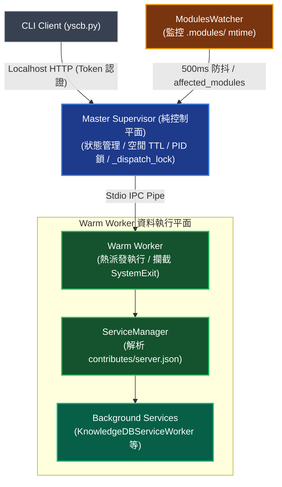

# 熱重載與背景服務託管專題 (Service Workers & Hot Reload Architecture)

> 本手冊定義 YS-Codebase 生態系中常駐守護中樞、Warm Worker 資料執行平面、領域背景服務掛載 (`ServiceManager`)、統一 Idle TTL 生命週期與雙軌自動熱重載之架構拓撲與協調機制。

---

## 1. 常駐守護架構與中樞模型 (Unified Server & Worker Topology)

全生態系常駐守護進程分為「Master 純控制平面」與「Warm Worker 資料執行平面」。各領域模組之背景服務（如 `KnowledgeDBServiceWorker`）由 `WarmWorker` 內部之 `ServiceManager` 統一託管與調度，避免污染 Master 控制平面：



- **Master Supervisor (純控制平面)**：僅負責管理 Localhost HTTP 服務、安全 Token、PID 鎖、`_dispatch_lock` 序列化 IPC、Worker `stderr` 排空與空閒自毀（Idle TTL），剝離所有領域模組初始化邏輯。
- **Warm Worker (資料執行平面)**：常駐預熱進程，序列化執行派發任務並攔截 `SystemExit` 保證進程穩定；內部持有 `ServiceManager` 實例，負責啟動與管理背景領域服務。
- **統一生命週期與共享 15 分鐘自毀 (Shared 15m Idle TTL)**：所有背景 `ServiceWorker` 嚴格跟隨 Server 生命週期配置。當配置 Idle TTL（預設 900 秒 / 15 分鐘）到期時，Master 與 Warm Worker 內所有託管之背景服務一同優雅自毀退出；若配置無 TTL 則一同常駐；手動執行 `server stop` 時亦同步優雅停止所有背景服務，杜絕背景孤兒進程或資源洩漏。

---

## 2. 背景服務宣告式註冊與託管協議 (Service Worker Protocol)

### 2.1 `contributes/server.json` 宣告規範
各領域模組無需修改 `server` 源碼，僅需透過 `contributes/server.json`（或聚合之 `contribute.json`）以純宣告方式聲明背景服務之 `name`、`worker_class`（類別 URI 或連字號路徑）、`description` 與 `auto_start`：

```json
{
  "services": [
    {
      "name": "knowledge-db-watcher",
      "worker_class": "knowledge_db.service:KnowledgeDBServiceWorker",
      "description": "知識庫即時檔案變更監聽與增量熱自癒服務",
      "auto_start": true
    }
  ]
}
```

1. **動態發現與拉起**：`WarmWorker` 啟動時，`ServiceManager` 透過 `core.contributes.get("server", "services")` 動態載入所有模組之服務宣告，動態將 `.modules/<provider>` 注入 `sys.path`，支援連字號名稱正規化、相容 `code.class://` 前綴，並依 `auto_start` 旗標決定是否在 Worker 啟動時自動喚醒。
2. **`worker_ready` 狀態回傳**：Worker 完成預熱與背景服務初始化後，於發送給 Master 的 `worker_ready` IPC 握手封包中附帶已啟動之服務清單與健康狀態，供 Master 快取並於啟動橫幅 (`format_startup_banner`) 及 `/api/status` 端點即時呈現。
3. **兩階段停機安全卸載**：當 Server 或 Worker 關閉/重載時，Master 發送 `{"action": "exit"}` 握手，Worker 依序呼叫所有常駐服務的 `stop()` 進行資源釋放，保障資料一致性。

### 2.2 `BaseServiceWorker` 實作介面
領域模組之背景服務類別須繼承並實作 `server.service.BaseServiceWorker` 抽象基類：

```python
class BaseServiceWorker(ABC):
    @property
    @abstractmethod
    def name(self) -> str:
        """服務唯一識別名稱"""
        pass

    @abstractmethod
    def start(self, context: Dict[str, Any]) -> None:
        """啟動背景任務與監聽線程"""
        pass

    @abstractmethod
    def stop(self) -> None:
        """優雅停止服務並釋放資源"""
        pass

    @abstractmethod
    def health_check(self) -> bool:
        """回傳服務是否健康運行"""
        pass
```

### 2.3 實例：Knowledge-DB Service Worker
`knowledge-db` 模組透過 `KnowledgeDBServiceWorker` 掛載於 `WarmWorker` 中：
- **500ms 防抖監聽**：透過 Watchdog 監控工作區檔案變更，防抖聚合 Burst Save 事件。
- **增量全棧修補**：呼叫 `IndexingPipeline.hot_patch_unified_index`，一次性完成 AST、倒排索引 (BM25)、調用圖譜 (Graph) 與向量嵌入 (Vector) 之差量更新。
- **零前台阻塞**：前台 CLI 查詢直接讀取已更新之記憶體/磁碟快取，零推論延遲。

---

## 3. Modules Watcher 路徑感知與雙軌熱重載 (Dual-Track Hot Reload)

`ModulesWatcher` 以輕量級 `mtime` 快照監聽專案模組部署目錄（`.modules/`），當模組完成安裝、更新或重編譯（如 `install <mod>@build`）時自動觸發重載：

1. **500ms 批次防抖與頂層目錄解析**：
   - 當偵測到 `.modules/` 下檔案變動時，啟動 **500ms 批次防抖視窗**，聚合連續寫入事件。
   - 比對快照時精確提取變動檔案所屬之頂層模組目錄集合 `affected_modules: Set[str]`。
2. **雙軌重載分流機制**：

| 變更模組類型 (`affected_modules`) | 重載軌道與調用方法 | 內部執行機制說明 |
| :--- | :--- | :--- |
| **領域業務模組**<br/>(僅含 `knowledge-db`, `dev` 等) | **Track A：重啟 Warm Worker**<br/>(`MasterSupervisor.restart_worker()`) | 優雅終止舊 Worker（連帶停止其託管之 `ServiceManager` 服務）並拉起全新 Worker 進程，100% 刷新業務代碼與模組快取，**保持 Master 進程與 HTTP Port 零中斷**。 |
| **核心平台模組**<br/>(命中 `server` 或 `core`) | **Track B：Master 自重啟整棵進程樹**<br/>(`MasterSupervisor.restart_server()`) | 由於 Master 進程自身載入了 `core` 與 `server` 代碼，必須透過 `core.platform.spawn_detached` 重新拉起全新 Master 守護進程，隨後安全釋放舊 PID 鎖、狀態檔與 HTTP 資源並平滑退出舊進程樹。 |

---

## 4. 運行期狀態可觀測性 (Runtime Observability)

系統提供結構化 HTTP API 與 CLI 指令，即時觀測 Master、Worker、ModulesWatcher 與背景服務運行健康度：

### 4.1 CLI 狀態檢視 (`server status`)
```bash
python yscb.py server status
```

輸出包含 Process Info、Service Counters（含 Uptime 與累計處理任務數）以及 Background Services 清冊（含狀態與模組歸屬）：
```text
======================================================================
YS-Codebase Server Daemon Status
======================================================================
[*] State         : READY
[*] Master PID    : 26138
[*] Worker PID    : 26145 (Alive)
[*] Port          : 42939
[*] Workspace Root: /workspace/ys-codebase/ys_codebase
[*] Uptime        : 125.4s
[*] Tasks Handled : 4
[*] Idle TTL Left : 774.6s
[*] Modules Watcher: ACTIVE (Monitoring .modules/)
----------------------------------------------------------------------
[*] Background Services (1 active):
    - knowledge-db-worker [RUNNING] (provider: knowledge-db)
      Knowledge-DB Background File Watcher & Incremental Patcher
======================================================================
```

### 4.2 HTTP 狀態端點 (`GET /api/status`)
Master 透過 `/api/status` 回傳完整 JSON 狀態負載（其中 `services` 由 Worker 於 `worker_ready` 時同步回報並由 Master 維護）：
```json
{
  "status": "running",
  "state": "ready",
  "pid": 26138,
  "worker_pid": 26145,
  "port": 42939,
  "uptime_seconds": 125.4,
  "tasks_executed": 4,
  "watcher": {
    "enabled": true,
    "active": true,
    "monitored_dir": "/workspace/ys-codebase/ys_codebase/.modules"
  },
  "services": [
    {
      "name": "knowledge-db-worker",
      "provider": "knowledge-db",
      "description": "Knowledge-DB Background File Watcher & Incremental Patcher",
      "alive": true
    }
  ]
}
```

---

## 5. 日常維運與管理操作 (Operations Cheatsheet)

```bash
# 啟動常駐 Server (Worker 自動掛載所有 contributes/server.json 註冊之背景服務)
python yscb.py server start

# 手動熱重載 Worker (刷新業務代碼記憶體與重啟背景服務)
python yscb.py server reload

# 檢視運行狀態、Uptime、任務計數與背景服務清冊
python yscb.py server status

# 優雅停止常駐服務與所有背景服務，並輸出停機總結報告
python yscb.py server stop
```
