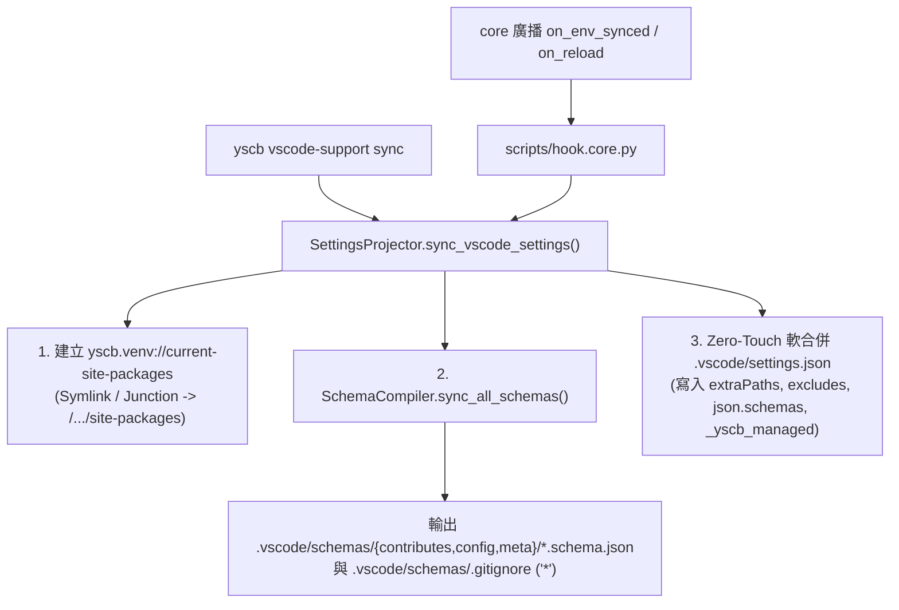

# `vscode-support` — VS Code 工作區設定投影與單檔級 JSON Schema 編譯器

> 本模組將 VS Code 工作區投影自 `core` 100% 解耦，提供顯式安裝即賦能（`install vscode-support`）、無版本號穩定微環境路徑連結、單檔級精準 JSON Schema 自動編譯與 `remove vscode-support` 完全可逆還原。

---

## 1. 核心架構與子系統職責

| 組件 | 原始碼位置 | 核心職責 |
| :--- | :--- | :--- |
| **`SettingsProjector`** | `vscode_support/projector.py` | 管理 `yscb.venv://current-site-packages` 穩定連結（恆定注入 `./ys_codebase/.venv/current-site-packages` 避免容器或 Python 版本切換產生設定漂移）、自動建立 `project://.vscode/`、以 `_yscb_managed` 差集軟合併 `.vscode/settings.json`（含 `extraPaths`、`excludes`、`analysisExclude`、`json.schemas`），並提供 `revert_vscode_settings` 完全可逆拆卸。 |
| **`SchemaCompiler`** | `vscode_support/schema_compiler.py` | 掃描 `module://<mod>/contributes/_format.json`、`module://<mod>/configurable/_format.json`（及 `module.mirror://<mod>/<ver>.zip` 內之 `configurable/*.json`），支援 `uri` / `path` 型別之全系統語意 URI 協議前綴補全（`defaultSnippets`）與 `@desc(...)` 正交欄位說明，動態編譯 Draft-07 JSON Schema 至 `project://.vscode/schemas/`（內含 `.gitignore` `*` 自我忽略）並自動清理孤兒 Schema。 |
| **`hook.core.py`** | `scripts/hook.core.py` | 訂閱 `core` 廣播之 `on_env_synced`、`on_reload` 與 `on_remove` 生命週期事件。 |
| **`cli.py`** | `scripts/cli.py` | 提供 `vscode-support <status\|sync\|revert>` 三項命令列工具。 |

---

## 2. 運作資料流



---

## 3. CLI 指令速查

```bash
# 檢視 .vscode/settings.json 託管狀態、穩定連結目標與已編譯 Schema 清單
python yscb.py vscode-support status [--json]

# 手動強制重新同步 .vscode/settings.json 與重新編譯全模組 JSON Schema
python yscb.py vscode-support sync [--json]

# 乾淨剔除所有 YSCB 託管設定、移除 .vscode/schemas/ 與穩定連結
python yscb.py vscode-support revert [--json]
```

