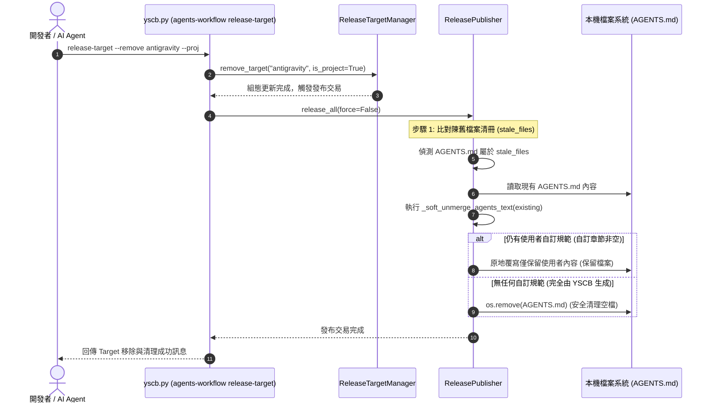

# 架構設計說明書 (Architecture Design)

> 功能名稱：純淨安裝環境下游反饋 4 項缺陷修復與設定引導校準  
> 建立日期：2026-10-15  
> 所屬主計畫：N/A  
> 狀態：Confirmed  
> 模型：Gemini 3.8 Flash  

> 模板版本：v1.2  

---

## 1. 模組架構分層與職責邊界 (Layered Architecture)

```text
+-----------------------------------------------------------------------------------+
| 1. 宿主啟動層 (Host Bootstrapper Layer: yscb.py)                                    |
|    - DEFAULT_PROVIDER_URL: https://.../ys_codebase/release (模組套件來源，可變)     |
|    - DEFAULT_SELF_UPDATE_URL: https://.../yscb.py (官方入口腳本來源，不可變)         |
|    - cmd_self_update: 直接對準 DEFAULT_SELF_UPDATE_URL 或 --url，無字串猜測          |
+-----------------------------------------------------------------------------------+
                                          |
+-----------------------------------------------------------------------------------+
| 2. 工作流發布中樞 (Workflow Publisher: agents_workflow/publisher.py)               |
|    - ReleasePublisher.release_all: 4 步原子交易                                   |
|    - 步驟 1 陳舊檔案清理 (Prune Stale Files):                                      |
|      * 一般發布檔案: 直接 os.remove                                                |
|      * agents_md 根目錄檔案: _cleanup_stale_agents_md 軟剝離過濾器                 |
|        -> 移除 YSCB 管理區塊 (YSCB_AGENTS_BEGIN..END 及預設空殼章節)               |
|        -> 若剩餘使用者自訂文字 != empty: 原地覆寫保留                               |
|        -> 若剩餘文字 == empty: os.remove 清理空檔                                  |
+-----------------------------------------------------------------------------------+
                                          |
+-----------------------------------------------------------------------------------+
| 3. CLI 派發與契約層 (CLI Dispatch & Contributes: scripts/cli.py & core.json)       |
|    - cli.py:release_target: 先比對 add/remove 動作/選項，再判定 list                |
|    - contributes/core.json: 註冊 target 位置參數與 --proj / --project 選項         |
+-----------------------------------------------------------------------------------+
                                          |
+-----------------------------------------------------------------------------------+
| 4. 知識庫與文檔導引層 (Knowledge Space Guidance: READMEs & manifest.json)          |
|    - 堅守 SpaceManager 讀取 contribute.json 之 SSOT 原則                           |
|    - 校準全專案文檔與 Onboarding 指引為 config/knowledge-db/contribute.json        |
+-----------------------------------------------------------------------------------+
```

---

## 2. 核心資料流與循序圖 (Data Flow & Sequence Diagram)



---

## 3. 受影響檔案與新建檔案清單 (Impacted & New Files Inventory)

| 檔案路徑 | 類型 | 職責與變更說明 |
| :--- | :---: | :--- |
| `yscb.py` | Modify | 拆分 `DEFAULT_PROVIDER_URL` 與 `DEFAULT_SELF_UPDATE_URL`，重構 `_resolve_self_update_target_url` |
| `ys_codebase/source/agents-workflow/scripts/cli.py` | Modify | 修正 `release_target` 解析邏輯與 `get_option_value` 調用 |
| `ys_codebase/source/agents-workflow/contributes/core.json` | Modify | 補充 `release-target` 之 `args.target` 與 `options.flags.proj` 契約宣告 |
| `ys_codebase/source/agents-workflow/agents_workflow/publisher.py` | Modify | 實作 `_soft_unmerge_agents_text` 與陳舊 `agents_md` 檔案軟剝離保護機制 |
| `README.md` | Modify | 修正 3.3 節 `knowledge-db` 空間設定教學為 `config/knowledge-db/contribute.json` |
| `ys_codebase/source/knowledge-db/README.md` | Modify | 修正快速上手與自訂空間說明為 `contribute.json` |
| `ys_codebase/source/knowledge-db/manifest.json` | Modify | 修正 `onboarding` 第 1 條引導指令為修改 `contribute.json` |
| `docs/knowledge-db/contributes_guide.md` | Modify | 校準空間覆蓋說明為 `contribute.json` |
| `ys_codebase/source/agents-workflow/tests/test_release_publisher.py` | Modify | 新增 Target 切換時 `AGENTS.md` 軟剝離保留與清理單元測試 |
| `ys_codebase/source/agents-workflow/tests/test_cli.py` | Modify | 新增 `release-target --add <t> --proj` 與 `add <t> --proj` 雙向 CLI 測試 |
| `ys_codebase/source/core/tests/test_cli_router.py` | Modify | 新增 `self-update` 與 `init` URL 解析單元測試 |

---

## 4. 架構決策記錄 (Architecture Decision Records)

- **[P02:DR-01] 宿主自更新 URL 與套件 Provider URL 完全正交解耦**：
  - 核心考量：宿主腳本 `yscb.py` 來源固定且唯一（官方專案倉庫根目錄），而套件 `provider` 可為私有庫或第三方鏡像。兩者職責與變化頻率不同，嚴禁透過路徑字串切割互相推導。
- **[P02:DR-02] 根目錄規範入口檔實施軟剝離 (Soft-Unmerge) 與自訂內容零滅失保證**：
  - 核心考量：`AGENTS.md` / `CLAUDE.md` 在專案中常包含開發者手寫的架構限制與業務規範。切換 IDE Target 時僅能撤除 YSCB 注入的章節，絕不能物理刪除開發者的原創文檔。

