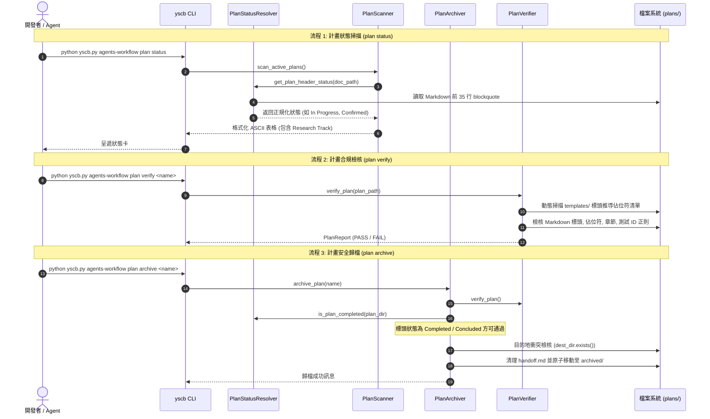

# 架構設計說明書 (Architecture Design)

> 功能名稱：工作流審計全面修復 (Workflow Audit Remediation)  
> 建立日期：2026-10-17  
> 所屬主計畫：2026_10_17_1133_workflow_optimization  
> 狀態：Confirmed  
> 模型：Gemini 3.8 Flash  

> 模板版本：v1.2  

---

## 1. 模組架構分層與職責邊界 (Layered Architecture)

```text
+-----------------------------------------------------------------------------------+
|                           Agents-Workflow 模組架構                                |
+-----------------------------------------------------------------------------------+
| 空間 ① 源碼空間 (SSOT)                                                            |
|                                                                                   |
|  [資產層 assets/]                                                                 |
|   ├── standards/AgentsStandards.md   -> 模板指針改向 development-sop, FP-03 更名  |
|   ├── skills/                        -> development-sop, continue, auto, context- |
|   │                                     init, research, new-plan, pause 語意對齊  |
|   └── templates/                     -> fast_track_plan, P07, revision_log,       |
|                                         umbrella, RXX 模板全面純淨化與守門強化     |
|                                                                                   |
|  [工具鏈層 agents_workflow/plans/]                                                |
|   ├── status.py (NEW)                -> PlanStatusResolver: 標頭狀態解析唯一真理  |
|   ├── scanner.py                     -> 標頭化 Phase 判定, Research Track 支援    |
|   ├── verifier.py                    -> R\d{2}_* 映射, 測試 ID 正則, 佔位符推導   |
|   └── archiver.py                    -> 標頭化 Completed 判定, handoff 時序修正   |
|                                                                                   |
|  [貢獻宣告 contributes/]                                                          |
|   ├── agents-workflow.json           -> export descriptions 對齊                   |
|   └── _manifest.md                   -> 模板數量同步 (16 個)                       |
+-----------------------------------------------------------------------------------+
| 空間 ② 測試與驗證空間 (tests/)                                                    |
|   └── test_plans_toolchain.py        -> FT-01 ~ FT-27 單元測試覆蓋                |
+-----------------------------------------------------------------------------------+
| 空間 ③ 投影與發布空間 (.agents/ / .claude/ / .codex/)                              |
|   └── 由 ReleasePublisher.release_all() 編譯物化 (授權守門)                       |
+-----------------------------------------------------------------------------------+
```

---

## 2. 核心資料流與循序圖 (Data Flow & Sequence Diagram)



---

## 3. 受影響檔案與新建檔案清單 (Impacted & New Files Inventory)

| 檔案路徑 | 類型 | 職責與變更說明 |
| :--- | :---: | :--- |
| `ys_codebase/source/agents-workflow/agents_workflow/plans/status.py` | New | `PlanStatusResolver`: 標頭解析唯一真理、狀態正規化、完成狀態檢測 |
| `ys_codebase/source/agents-workflow/agents_workflow/plans/__init__.py` | Modify | 導出 `PlanStatusResolver` 相關輔助函式 |
| `ys_codebase/source/agents-workflow/agents_workflow/plans/scanner.py` | Modify | 引入 status 解析、修正 Full Track Phase 判定、支援 Research Track |
| `ys_codebase/source/agents-workflow/agents_workflow/plans/archiver.py` | Modify | 引入 status 完成判定、修正 handoff 刪除時序、支援 Research Concluded |
| `ys_codebase/source/agents-workflow/agents_workflow/plans/verifier.py` | Modify | 放寬調研檔映射、收緊測試 ID 正則、動態佔位符推導、清理死代碼 |
| `ys_codebase/source/agents-workflow/assets/standards/AgentsStandards.md` | Modify | 模板來源指向 development-sop 佔位符、FP-03 更名 |
| `ys_codebase/source/agents-workflow/assets/skills/development-sop/SKILL.md` | Modify | FP-01~03 更名、DR 前綴擴充、Roadmap 描述更新 |
| `ys_codebase/source/agents-workflow/assets/skills/development-sop/references/plan_modes.md` | Modify | FP-01~03、Revision 熔斷與重開、移除 verify 附掛檢核、Roadmap 與 Umbrella 詞彙 |
| `ys_codebase/source/agents-workflow/assets/skills/development-sop/references/phase_02_architecture.md` | Modify | P06 Draft 狀態機說明 |
| `ys_codebase/source/agents-workflow/assets/skills/development-sop/references/phase_04_plan.md` | Modify | P06 Confirmed 狀態機說明 |
| `ys_codebase/source/agents-workflow/assets/skills/development-sop/references/phase_06_test.md` | Modify | P06 完整狀態機 (Draft -> Confirmed -> In Progress -> Passed -> Completed) 與 UX 二元標記 |
| `ys_codebase/source/agents-workflow/assets/skills/development-sop/references/phase_07_walkthrough.md` | Modify | FP-03 更名對齊 |
| `ys_codebase/source/agents-workflow/assets/skills/new-plan/SKILL.md` | Modify | FP-01~03 更名、Roadmap 每主題一檔描述 |
| `ys_codebase/source/agents-workflow/assets/skills/continue/SKILL.md` | Modify | 模式判定優先序、FP-01~03、P07 列、P06 狀態機對齊、Research 分支 |
| `ys_codebase/source/agents-workflow/assets/skills/auto/SKILL.md` | Modify | 允許 P00 Confirmed 觸發、P06 UX 卡片 Passed 狀態對齊 |
| `ys_codebase/source/agents-workflow/assets/skills/pause/SKILL.md` | Modify | FP-0Y 格式對齊 |
| `ys_codebase/source/agents-workflow/assets/skills/context-init/SKILL.md` | Modify | 移除懸空引用條款、消除與 CLI 的矛盾描述 |
| `ys_codebase/source/agents-workflow/assets/skills/research/SKILL.md` | Modify | 命名規範 `R{NN}_{topic}.md`、立項必建 P00 規範 |
| `ys_codebase/source/agents-workflow/assets/templates/fast_track_plan.md` | Modify | FP-01~03 章節、4 守門檢核表、移除寫死 Completed、測試檢核表 |
| `ys_codebase/source/agents-workflow/assets/templates/P07_walkthrough.md` | Modify | 去除預填 PASS、plan verify 轉為確認填寫項 |
| `ys_codebase/source/agents-workflow/assets/templates/revision_log.md` | Modify | CHANGELOG 比例原則、plan verify 轉為確認填寫項 |
| `ys_codebase/source/agents-workflow/assets/templates/umbrella_overview.md` | Modify | 狀態選項標準化 (Planning \| In Progress \| Completed) |
| `ys_codebase/source/agents-workflow/assets/templates/RXX_research_report.md` | Modify | 統一命名規範與引導 |
| `ys_codebase/source/agents-workflow/contributes/agents-workflow.json` | Modify | export descriptions 更新 |
| `ys_codebase/source/agents-workflow/contributes/_manifest.md` | Modify | 模板數量 16 個對齊 |

---

## 4. 架構決策記錄 (Architecture Decision Records)

- **[P02:DR-01] 抽出獨立 `status.py` 模組**：建立 `PlanStatusResolver` 類別與輕量靜態方法，將文件標頭解析與狀態判定與 `verifier.py` 解耦，避免 `scanner` / `archiver` / `verifier` 循環引入，確保全系統單一真理。
- **[P02:DR-02] 狀態解析容錯與優先順序**：標頭解析優先取 `狀態`，次取 `status`、`計畫狀態`、`調研狀態`。字串統一轉小寫比對。若遇 `In Progress` 與 `Implementing` 等同義詞標準化為 `in progress`。
- **[P02:DR-03] P06 狀態對 Phase 6 的判定條件**：`PlanScanner` 判定 Full Track 處於 Phase 6 的條件為：`P06_test_plan.md` 存在且其標頭狀態為 `in progress`、`passed` 或 `completed`。若標頭為 `draft` 或 `confirmed`，則回落由 `P05` (Phase 5) 或 `P04` 判定。
- **[P02:DR-04] 動態佔位符推導機制**：`PlanVerifier` 初始化時，自模板目錄讀取所有 `.md` 檔案前 35 行的 blockquote 標頭行，使用正則 `\[[^\]\r\n]+\]` 擷取包含 `|` 或中文字符之模式（排除空括號或純格式說明），動態編譯至佔位符正則清單中，徹底根絕模板擴充時佔位符漏網之缺陷。
- **[P02:DR-05] 移除死代碼 `VALID_CHANGELOG_TYPES`**：因 changelog 檢核已由正則與表格行結構保證，且過度嚴格限制自訂日誌標籤可能降低靈活性，決策直接清理未引用之死常數與 docstring 階段描述。
- **[P02:DR-06] 標頭路徑佔位符協議**：`AgentsStandards.md` 採用 `__#{module://agents-workflow/assets/skills/development-sop/SKILL.md}__`，由 Stage 2 編譯器自動根據當前 Target (antigravity/claude/codex) 動態解算為對應 Target 相對路徑。

