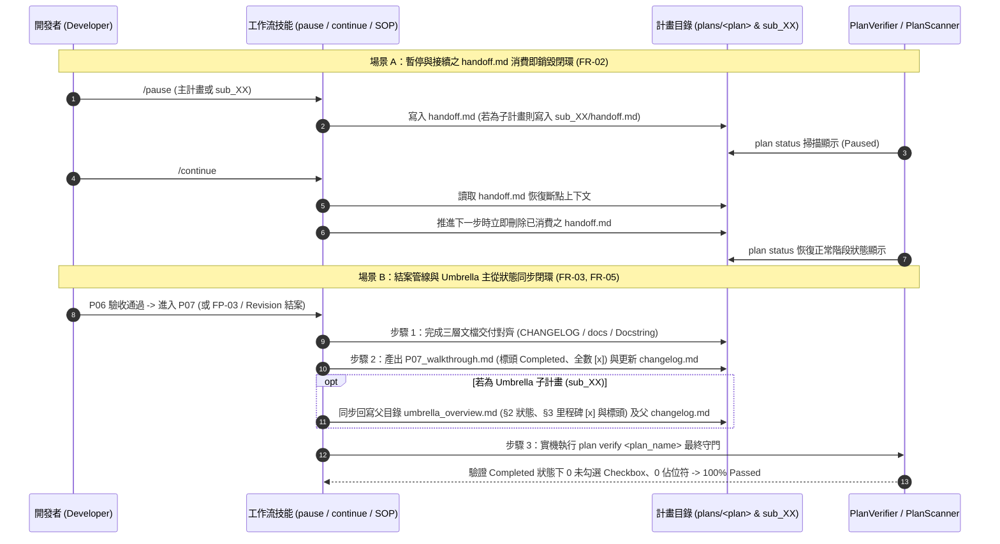

# 架構設計說明書 (Architecture Design)

> 功能名稱：工作流流程架構與提示詞設計調研與優化 (Workflow Process Architecture & Prompt Refinement)  
> 建立日期：2026-10-18  
> 所屬主計畫：2026_10_17_1133_workflow_optimization  
> 狀態：Confirmed  
> 模型：Gemini 4 Argon (Low)  

> 模板版本：v1.2  

---

## 1. 模組架構分層與職責邊界 (Layered Architecture)

```text
ys_codebase/source/agents-workflow/assets/ (SSOT 原始資產空間)
├── standards/
│   └── AgentsStandards.md             # [L0 全域治理層] 核心公理、模型紀錄規範與條件技能攔截矩陣 (FR-08)
├── skills/
│   ├── context-init/SKILL.md          # [L0 熱啟動層] 對齊模型紀錄規範、CLI 原則表述與權限標籤 (FR-01, FR-08)
│   ├── yscb-cli-guild/SKILL.md        # [L0 終端守門層] 定義 [SAFE]/[CONDITIONAL]/[GATED] 執行契約 (FR-08)
│   ├── new-plan/SKILL.md              # [L1 立項入口層] 輕量立項索引，單行指針跳轉 phase_00_discuss.md (FR-08)
│   ├── research/SKILL.md              # [L1 調研探索層] 三大出口拍板強制標記 Concluded (FR-04)
│   ├── roadmap/SKILL.md               # [L1 路線圖層] 流轉立項 In Progress 與結案 Completed 狀態閉環 (FR-04)
│   ├── development-sop/
│   │   ├── SKILL.md                   # [L2 核心 SOP 樞紐] Umbrella 主目錄產物定義與全階段標頭預設狀態表 (FR-03, FR-08)
│   │   └── references/
│   │       ├── plan_modes.md          # [L2 軌道規範] Fast->Full 刪舊檔、Revision 熔斷雙軌處置、Umbrella 主從同步 (FR-03, FR-04)
│   │       ├── phase_00_discuss.md    # [L2 階段手冊] 與 P00 模板欄位對齊 (FR-08)
│   │       ├── phase_01_requirements.md # [L2 階段手冊] 驗收條件與 [P01:DR-XX] 紀錄位置指引 (FR-08)
│   │       ├── phase_03_api_spec.md   # [L2 階段手冊] 介面簽名與錯誤契約對齊 (FR-08)
│   │       └── phase_07_walkthrough.md # [L2 結案管線] 調換步驟 2/3 使 plan verify 成為最終守門、Umbrella 回寫 (FR-03, FR-05)
│   ├── auto/SKILL.md                  # [L3 連續推進層] P04 一次性建立並定稿 P06_test_plan.md (Confirmed) (FR-08)
│   ├── pause/SKILL.md                 # [L3 暫停交接層] 明定 Umbrella 子計畫 handoff.md 落檔於 sub_XX/ (FR-02)
│   ├── continue/SKILL.md              # [L3 接續恢復層] handoff.md 消費後即刻刪除、修正 §3-U 主目錄讀取 (FR-02, FR-03)
│   ├── discuss/SKILL.md               # [L3 異常熔斷層] 次要問題三大範疇出口與全階段回填鏈 (FR-06)
│   └── session-analysis/SKILL.md      # [L3 歷程自檢層] 對齊 [SAFE]/[CONDITIONAL]/[GATED] 權限標籤 (FR-08)
└── templates/
    ├── P00_discuss.md                 # [模板層] §1 補架構影響範圍、§3 預設 - [ ] 改為一般清單 - (FR-08, EC-04)
    ├── P01_requirements_spec.md       # [模板層] §1 表頭改為詳細規格與驗收條件 (Acceptance Criteria) (FR-08)
    ├── P03_api_spec.md                # [模板層] §2 補充錯誤與例外契約提示 (FR-08)
    ├── P04_implementation_plan.md     # [模板層] §2 三層 5 列文檔表 (<Category>)、§4 改為無 Checkbox 有序清單 (FR-07, EC-01)
    ├── P07_walkthrough.md             # [模板層] §4.1 三層 5 列文檔表 (<Category>)、§6 結案檢核時序校準 (FR-05, FR-07)
    ├── fast_track_plan.md             # [模板層] §3 結案檢核與 Completed 標頭更新時序校準 (FR-05)
    ├── revision_log.md                # [模板層] §2 結案檢核與 Completed 標頭更新時序校準 (FR-05)
    ├── roadmap.md                     # [模板層] 狀態枚舉新增 Completed、通用化 §1.2 與 §4 標題 (FR-04, FR-08, EC-02)
    └── changelog.md                   # [模板層] 移除範例列之硬編碼 (狀態：Discussing) (FR-08)
```

---

## 2. 核心資料流與循序圖 (Data Flow & Sequence Diagram)



---

## 3. 受影響檔案與新建檔案清單 (Impacted & New Files Inventory)

| 檔案路徑 | 類型 | 職責與變更說明 |
| :--- | :---: | :--- |
| `ys_codebase/source/agents-workflow/assets/standards/AgentsStandards.md` | Modify | 於 §2 `development-sop` 觸發條件附註生命週期工作流路由提示 (`FR-08`) |
| `ys_codebase/source/agents-workflow/assets/skills/context-init/SKILL.md` | Modify | 對齊模型紀錄規範、校準核心原則 1 表述、對齊 `[SAFE]/[CONDITIONAL]/[GATED]` 標籤 (`FR-01`, `FR-08`) |
| `ys_codebase/source/agents-workflow/assets/skills/yscb-cli-guild/SKILL.md` | Modify | 於 §2 矩陣前補齊 `[SAFE]` / `[CONDITIONAL]` / `[GATED]` 三級權限守門行為定義 (`FR-08`) |
| `ys_codebase/source/agents-workflow/assets/skills/new-plan/SKILL.md` | Modify | 於 §1 立項時序末端補上單行跳轉 `phase_00_discuss.md` 與 `plan_modes.md` 指針 (`FR-08`) |
| `ys_codebase/source/agents-workflow/assets/skills/research/SKILL.md` | Modify | 於步驟 4 明定三大出口拍板時均須先將 `R{NN}_{topic}.md` 標頭更新為 `Concluded` (`FR-04`) |
| `ys_codebase/source/agents-workflow/assets/skills/roadmap/SKILL.md` | Modify | 擴充狀態枚舉含 `Completed`，於步驟 4 明定立項時改為 `In Progress`、結案時改為 `Completed` (`FR-04`) |
| `ys_codebase/source/agents-workflow/assets/skills/development-sop/SKILL.md` | Modify | 於 §4 補列 Umbrella 主目錄 `changelog.md`，於 §6 新增各產物落檔預設標頭狀態定錨表 (`FR-03`, `FR-08`) |
| `ys_codebase/source/agents-workflow/assets/skills/development-sop/references/plan_modes.md` | Modify | 補齊 Fast->Full 刪舊檔、Revision 熔斷獨立/附掛雙軌處置、Research 出口 `Concluded`、Umbrella 主從狀態連動 (`FR-03`, `FR-04`) |
| `ys_codebase/source/agents-workflow/assets/skills/development-sop/references/phase_00_discuss.md` | Modify | 補充若為 Umbrella 子計畫立項須同步登記更新父目錄 `umbrella_overview.md` (`FR-03`, `FR-08`) |
| `ys_codebase/source/agents-workflow/assets/skills/development-sop/references/phase_01_requirements.md` | Modify | 說明階段決策 `[P01:DR-XX]` 記錄於對應條目、`## 4.` 或 `changelog.md` (`FR-08`) |
| `ys_codebase/source/agents-workflow/assets/skills/development-sop/references/phase_03_api_spec.md` | Modify | 對齊 `P03_api_spec.md` 3 大章節結構，明定錯誤契約與 `[P03:DR-XX]` 撰寫位置 (`FR-08`) |
| `ys_codebase/source/agents-workflow/assets/skills/development-sop/references/phase_07_walkthrough.md` | Modify | 調換步驟 2 與步驟 3 使 `plan verify` 成為落檔後最終守門，並補齊 Umbrella 子計畫結案回寫父目錄規定 (`FR-03`, `FR-05`) |
| `ys_codebase/source/agents-workflow/assets/skills/auto/SKILL.md` | Modify | 於步驟 2 免除 Phase 2 建立 `P06 (Draft)` 中繼寫入，改於 Phase 4 一次性建立並定稿 `P06 (Confirmed)` (`FR-08`) |
| `ys_codebase/source/agents-workflow/assets/skills/pause/SKILL.md` | Modify | 明定 Umbrella 子計畫之 `handoff.md` 落檔於 `sub_{編號}_{名稱}/handoff.md` (`FR-02`) |
| `ys_codebase/source/agents-workflow/assets/skills/continue/SKILL.md` | Modify | 明定 `handoff.md` 消費後即刻刪除，修正 §3-U 讀取主計畫 `umbrella_overview.md`（`P00`/`R{NN}` 選配）(`FR-02`, `FR-03`) |
| `ys_codebase/source/agents-workflow/assets/skills/discuss/SKILL.md` | Modify | 於步驟 2 補充次要問題三大範疇出口，於步驟 3.2 補齊 `P00~P06` 與 `fast_track_plan.md` 回填鏈 (`FR-06`) |
| `ys_codebase/source/agents-workflow/assets/skills/session-analysis/SKILL.md` | Modify | 將 §3.1 權限分級表述對齊 `[SAFE] 自主安全 / [CONDITIONAL] 階段條件 / [GATED] 授權守門` (`FR-08`) |
| `ys_codebase/source/agents-workflow/assets/templates/P00_discuss.md` | Modify | §1 新增 `- **架構影響範圍**：`，§3 預設 `- [ ]` 改為 `- ` (`FR-08`, `EC-04`) |
| `ys_codebase/source/agents-workflow/assets/templates/P01_requirements_spec.md` | Modify | §1 表頭欄位更新為 `詳細規格與驗收條件 (Acceptance Criteria)` (`FR-08`) |
| `ys_codebase/source/agents-workflow/assets/templates/P03_api_spec.md` | Modify | §2 補充錯誤與例外契約及 `[P03:DR-XX]` 結構提示 (`FR-08`) |
| `ys_codebase/source/agents-workflow/assets/templates/P04_implementation_plan.md` | Modify | §2 擴充為三層 5 列文檔表 (`<Category>`)，§4 保留標題但將內部 `- [ ]` 改為有序清單 `1. **TASK-01**：` (`FR-07`, `EC-01`) |
| `ys_codebase/source/agents-workflow/assets/templates/P07_walkthrough.md` | Modify | §4.1 擴充為三層 5 列文檔表 (`<Category>`)，§6 調整 `plan verify` 與 `Completed` 說明 (`FR-05`, `FR-07`) |
| `ys_codebase/source/agents-workflow/assets/templates/fast_track_plan.md` | Modify | §3 調整結案標頭更新 `Completed` 與執行 `plan verify` 之順序說明 (`FR-05`) |
| `ys_codebase/source/agents-workflow/assets/templates/revision_log.md` | Modify | §2 調整結案標頭更新 `Completed` 與執行 `plan verify` 之順序說明 (`FR-05`) |
| `ys_codebase/source/agents-workflow/assets/templates/roadmap.md` | Modify | 標頭狀態新增 `Completed`，通用化 §1.2 與 §4 標題與內容 (`FR-04`, `FR-08`, `EC-02`) |
| `ys_codebase/source/agents-workflow/assets/templates/changelog.md` | Modify | 移除範例列尾端之硬編碼 `(狀態：Discussing)` (`FR-08`) |
| `ys_codebase/source/agents-workflow/tests/test_plans_model_record.py` | Modify | 擴充單元測試驗證 `FR-01` ~ `FR-08` 之資產與模板約束 |

---

## 4. 架構決策記錄 (Architecture Decision Records)

- **[P02:DR-01] 模板章節標題相容性保護策略**：由於 `PlanVerifier.get_resolved_template_headers()` 會動態提取 `assets/templates/*.md` 內所有 `##` 與 `###` 標題並對 `plans/` 下活躍計畫（包含同 Umbrella 主計畫下已結案但尚未歸檔之 `sub_01`）進行鏡像比對，因此在修改 `P00`、`P01`、`P03`、`P04`、`P07`、`fast_track_plan`、`revision_log` 時，**100% 保持既有 `##` 與 `###` 標題文字不變**（僅對不被 `PlanVerifier` 映射之 `roadmap.md` 通用化 §1.2 與 §4 標題），將所有新增欄位與結構優化收斂於既有章節之表格或清單內部，確保全專案活躍計畫 `plan verify` 零回歸衝突。
- **[P02:DR-02] `/auto` 模式下免除 `P06_test_plan.md` 之 `Draft` 中繼寫入**：依 `FR-08` (`GAP-12a`)，在 `/auto` 連續推進期間直接於 Phase 4 一次性建立並定稿 `P06_test_plan.md`（狀態：`Confirmed`），省去同輪內先寫 `Draft` 隨即覆寫 `Confirmed` 之冗餘 I/O。

