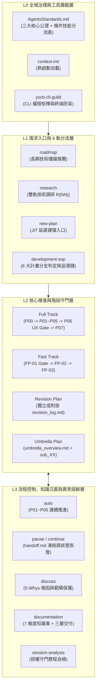

# 技術調研報告：agents-workflow 流程架構與提示詞設計分析 (R01_workflow_process_and_prompt_analysis.md)

> 調研主題：agents-workflow 業務流程架構拆解與提示詞查漏補缺 (Workflow Process & Prompt Analysis)  
> 建立日期：2026-10-17  
> 所屬主計畫：2026_10_17_1133_workflow_optimization  
> 調研狀態：Concluded  
> 模型：Gemini 4 Argon (High)  
> 模板版本：v1.1  

---

## 1. 背景與調研目標 (Background & Objectives)

- **核心問題與痛點**：`sub_01_workflow_audit_remediation` 已解決 `agents-workflow` 在 Python 工具鏈（`scanner` / `verifier` / `archiver`）與基礎規格上的邏輯矛盾與狀態解析問題。然而從業務流程分析師（Business Process Analyst）與提示詞工程（Prompt Engineering）視角審視，工作流各階段與各軌道之間的「狀態轉移閉環、異常恢復路徑、技能入口路由、階段產物重工與模板欄位對稱性」仍存在設計斷點。
- **調研目標**：
  - **審視範圍**：嚴格限定於 `ys_codebase/source/agents-workflow/assets/` 下共 **37 份原始資產文件**（1 份 `standards/AgentsStandards.md`、12 個 `skills/` 含 `references/` 共 20 檔、16 份 `templates/`），不包含已編譯物化至 `.agents/` 之輸出文件，亦不涉及 Python 運行邏輯層。
  - **分析方法**：端到端拆解 L0~L3 四層業務流程架構，逐一檢驗每個狀態轉移節點（Entry $\to$ Triage $\to$ Execution $\to$ Gate $\to$ Exception/Pause/Continue $\to$ Closure）之輸入、輸出、守門條件與提示詞一致性。

### 1.1 現行工作流四層業務架構 (As-Is Process Architecture)

---

## 2. 候選方案分析與對比 (Candidate Evaluation)

針對盤點出之核心架構設計取捨點，以下就候選方案進行客觀評估：

### 2.1 `GAP-01`：`handoff.md` 暫停快照被 `/continue` 消費後之生命週期管理

| 方案 | 運作原理 | 優點 (Pros) | 缺點 / 成本 (Cons) | 適用度評級 |
| :--- | :--- | :--- | :--- | :---: |
| **方案 A（推薦）：消費後即刻刪除 (Consume & Delete)** | `/continue` 讀取 `handoff.md` 完成狀態恢復並推進下一步時，立即刪除該 `handoff.md`（交接資訊已自然轉入當前階段產物與 `changelog.md`）；若再次中斷由 `/pause` 重新生成 | 徹底根除後續 `/continue` 讀到過期 `handoff.md` 而跳過步驟 3 結構化判定的斷點劫持風險；與 `archiver` 視為暫時性檔案之定位一致 | 需在 `continue/SKILL.md` 步驟 2 明文加入刪除指令 | ★★★ |
| **方案 B：保留檔案但新增 `Status: Consumed` 標頭** | 在 `handoff.md` 標頭新增狀態欄位，`/continue` 恢復後將其改為 `Consumed`，下次 `/continue` 忽略 `Consumed` 快照 | 保留歷史暫停痕跡 | 增加額外寫檔 Tool Call，且與 `PlanVerifier` / `PlanArchiver` 既有設計增加耦合 | ★ |

### 2.2 `GAP-10`：Full Track `P04_implementation_plan.md` 與 `P05_task.md` 任務清單職責劃分

| 方案 | 運作原理 | 優點 (Pros) | 缺點 / 成本 (Cons) | 適用度評級 |
| :--- | :--- | :--- | :--- | :---: |
| **方案 A（推薦）：`P04` 專注定稿審查與變更矩陣，`TASK-XX` 唯一落於 `P05`** | `P04` 負責：① 交叉驗證 Checklist、② 具體檔案變更矩陣、③ 三層文檔衝擊規劃、④ 架構靈魂拷問、⑤ 定稿 `P06`；具體 `- [ ] TASK-XX` 執行清單由 `P05_task.md` 作為唯一 SSOT 載體 | 消除同一份 `TASK-XX` 在 `P04` 與 `P05` 重複撰寫與未勾選 Checkbox 潛在衝突；符合 `phase_04_plan.md §1`「轉化為具體檔案變更矩陣」之定義 | 需調整 `templates/P04_implementation_plan.md` §4 標題與內容 | ★★★ |
| **方案 B：兩檔皆保留 `TASK-XX`，但 `P04` 不使用 Checkbox `- [ ]`** | `P04 §4` 改用純編號清單預排 `TASK-01/02`，`P05 §1` 使用 `- [ ] TASK-01/02` 追蹤勾選 | 保留 P04 預覽任務顆粒度的習慣，同時避免 Checkbox 雙重勾選 | 兩份文件內容仍有高度重複，Token 與維護成本較高 | ★★ |

### 2.3 `GAP-06` & `GAP-07`：技能路由與 `/new-plan` 立項入口架構

| 方案 | 運作原理 | 優點 (Pros) | 缺點 / 成本 (Cons) | 適用度評級 |
| :--- | :--- | :--- | :--- | :---: |
| **方案 A（推薦）：雙層路由表 + `/new-plan` 步驟化立項路由器** | 於 `AgentsStandards.md §2` 補充工作流生命週期意圖路由（立項/接續/暫停/調研/路線圖/異常熔斷）；將 `new-plan/SKILL.md` 移除重複表格，改為 4 步標準立項路由流程（零臆測釐清 $\to$ 6 軌判定 $\to$ 按軌建檔與 Umbrella 子計畫同步 $\to$ 呈遞卡片） | 自然語言與 Slash 指令皆能精準命中對應 Skill；消除 `new-plan` 與 `development-sop §4` 表格重複，補齊 Fast/Revision/Umbrella 立項步驟斷層 | 需同步調整 `AgentsStandards.md` 與 `new-plan/SKILL.md` | ★★★ |
| **方案 B：維持現狀，僅在 `development-sop` 內部補充說明** | 不改動 `AgentsStandards.md` 與 `new-plan/SKILL.md` 結構 | 改動範圍小 | 無法解決自然語言意圖漏觸發工作流 Skill 與 `new-plan` 缺乏執行步驟之問題 | ★ |

---

## 3. 架構設計與驗證 (Architecture & PoC)

### 3.1 查漏補缺全量清單 (`GAP-01` ~ `GAP-12`)

以下為針對 `assets/` 37 份原始文件交叉比對出的 12 項流程架構與提示詞設計缺口：

#### 維度 A：跨階段 / 跨軌道「狀態流轉與生命週期閉環」缺口

| 編號 | 嚴重度 | 缺口名稱 | 涉及原始文件 (`assets/`) | 根因與流程斷點說明 |
| :--- | :---: | :--- | :--- | :--- |
| **GAP-01** | 🔴 High | **`handoff.md` 恢復後未銷毀與子計畫路徑未定義** | `pause/SKILL.md` `continue/SKILL.md` | ① `continue` 步驟 2 規定存在 `handoff.md` 時優先依其恢復而不進步驟 3，但恢復後未規定刪除該 `handoff.md`，導致後續再次 `/continue` 時被過期快照劫持。 ② `pause` 未說明 Umbrella 子計畫之 `handoff.md` 應置於 `sub_XX/` 目錄內（與 `continue §3-U` 對齊）。 |
| **GAP-02** | 🔴 High | **Umbrella 主計畫與 `sub_XX` 缺乏狀態連動且主目錄產物矛盾** | `plan_modes.md` `continue/SKILL.md` `phase_07_walkthrough.md` | ① 子計畫立項（P00）與結案（P07 / FP-03）時，未規定回寫父目錄 `umbrella_overview.md` 之標頭狀態（`Planning -> In Progress -> Completed`）、子計畫狀態表與里程碑。 ② `continue §3-U` 第 51 行要求讀取主計畫之 `P00_discuss.md`，但 `plan_modes §5` 與 `development-sop §4` 定義主目錄僅有 `umbrella_overview.md`。 |
| **GAP-03** | 🟠 Med | **跨軌道「升級 / 轉型」缺乏舊產物處置與狀態回寫 SOP** | `plan_modes.md` `research/SKILL.md` `roadmap/SKILL.md` `templates/roadmap.md` | ① Fast Track 升級 Full Track 時，未規定原 `fast_track_plan.md` 須刪除或遷移（否則 `continue §3` 會永遠優先匹配為 Fast Track）。 ② Revision 觸發 4 大熔斷時，未區分「獨立修訂原地升級」與「附掛於已結案計畫之修訂須結算/回滾並另開新計畫或新 `sub_XX`」。 ③ Research 出口 ①/② 未明定先將 `R{NN}` 標為 `Concluded`。 ④ Roadmap 流轉立項與結案時未規定更新 `{topic}.md` 狀態，且 `templates/roadmap.md` 標頭缺少 `Implemented` / `Completed` 狀態枚舉。 |
| **GAP-04** | 🟠 Med | **結案管線之 `plan verify` 執行時序悖論** | `phase_07_walkthrough.md` `templates/P07_walkthrough.md` `templates/fast_track_plan.md` `templates/revision_log.md` | `phase_07_walkthrough.md §1` 將「步驟 2：執行 `plan verify`」置於「步驟 3：撰寫 `P07_walkthrough.md`」之前，導致 `P07` 尚未產出就先跑檢核；且 `P07`、`fast_track_plan`、`revision_log` 均含 `- [ ] 實機執行 plan verify`，須先完成落檔、勾選並將標頭設為 `Completed` 後，再以 `plan verify` 作為最終驗收守門。 |
| **GAP-05** | 🟡 Low | **各階段產物標頭狀態（Header State）賦值時機未明文化** | `phase_00`~`05.md` `plan_modes.md` `templates/changelog.md` | `phase_00`~`05` 與 Fast Track `FP-01/02` 未明文規定產出檔案時的標頭 `> 狀態：` 應填何值（如 `P00`：`Discussing -> Confirmed`；`P01~P04`：產出即 `Confirmed`；`P05` / `fast_track_plan`：`In Progress -> Completed`；`changelog.md`：結案時同步改為 `Completed`）。 |

#### 維度 B：技能路由、入口分工與異常恢復機制缺口

| 編號 | 嚴重度 | 缺口名稱 | 涉及原始文件 (`assets/`) | 根因與流程斷點說明 |
| :--- | :---: | :--- | :--- | :--- |
| **GAP-06** | 🟠 Med | **`AgentsStandards.md` 技能分流表未涵蓋工作流生命週期意圖** | `AgentsStandards.md` | `AgentsStandards.md §2` 僅列出 `development-sop`、`yscb-cli-guild`、`documentation` 3 項技能，缺乏自然語言業務意圖（立項、接續、暫停交接、技術調研、路線圖探索、除錯熔斷）至 `new-plan`、`continue`、`pause`、`research`、`roadmap`、`discuss` 之路由指引。 |
| **GAP-07** | 🟠 Med | **`/new-plan` 缺乏步驟化立項路由流程且與 `development-sop` 重複** | `new-plan/SKILL.md` `phase_00_discuss.md` | `new-plan/SKILL.md` 僅重複 6 大分支表並指向 `development-sop`，無 `## 執行步驟`，未扮演好「統一立項路由器（含獨立計畫與 Umbrella `sub_XX` 子計畫立項）」角色。 |
| **GAP-08** | 🟠 Med | **`/discuss` 異常熔斷缺少次要問題三大出口與完整回填清單** | `discuss/SKILL.md` `AgentsStandards.md` | ① 未將 `AgentsStandards.md` 核心原則 3.3 之「次要衍生問題（擴充當前範疇 vs. 另闢新計畫/子計畫 vs. 軌道升級）」結構化納入 `discuss` 討論卡與決策出口。 ② 步驟 3 產物回填僅列 `P02/P04/P05`，漏列 `P00/P01/P03/P06` 與 `fast_track_plan.md`。 |

#### 維度 C：階段產物精簡度、模板對齊與提示詞工程品質

| 編號 | 嚴重度 | 缺口名稱 | 涉及原始文件 (`assets/`) | 根因與流程斷點說明 |
| :--- | :---: | :--- | :--- | :--- |
| **GAP-09** | 🔴 High | **`context-init` 殘留已廢除之「首行強制輸出模型錨點」指令** | `context-init/SKILL.md` | `context-init/SKILL.md` 第 30 行仍要求「首行強制輸出當前模型識別錨點」，直接牴觸 `AgentsStandards.md` 核心原則 2 最新修訂之「模型紀錄 (`[DN-AW-08]`)」規範；且原則 1「不依賴 CLI」與步驟 3「執行 `plan status` CLI」表述矛盾。 |
| **GAP-10** | 🟠 Med | **`P04` 與 `P05` 任務清單重工，且 `P04` 與 `P07` 三層文檔表不對稱** | `templates/P04_implementation_plan.md` `templates/P05_task.md` `templates/P07_walkthrough.md` | ① `P04 §4` 與 `P05 §1` 重複定義 `- [ ] TASK-01/02`。 ② `P04 §2` 文檔衝擊表缺「微觀註解」列，`P07 §4.1` 三層文檔交付表缺「專題手冊 `[topic].md`」列，且兩者皆使用舊詞 `<Module>` 而非 `documentation` 規範之 `<Category>`。 |
| **GAP-11** | 🟠 Med | **階段手冊 (`references/phase_XX.md`) 與模板 (`templates/`) 欄位不匹配** | `phase_00/01/03.md` `templates/P00/P01/P03/roadmap.md` | ① `phase_00` 要求「架構影響範圍」，`P00` 模板無此項。 ② `phase_01` 要求 `[P01:DR-XX]`，`P01` 模板無決策區塊；反之 `P01` 模板有「§4 知識庫與踩坑紀錄查閱」，`phase_01` 手冊未提及。 ③ `phase_03` 要求「2. 錯誤與例外合約」與「4. 階段決策 `[P03:DR-XX]`」，`P03` 模板漏此二節。 ④ `templates/roadmap.md` §1.2「全庫歷史物件量化分析」與 §4 `bash`「標準作業流程」過度特化。 |
| **GAP-12** | 🟡 Low | **`/auto` 連續推進 I/O 冗餘與 `yscb-cli-guild` 權限等級定義缺失** | `auto/SKILL.md` `yscb-cli-guild/SKILL.md` | ① `/auto` 模式下未提示先讀取 `phase_01~06.md` 規範，且在單輪內對 `P06_test_plan.md`（Draft $\to$ Confirmed $\to$ Passed）與 `changelog.md` 進行多次碎片化寫入。 ② `yscb-cli-guild/SKILL.md` 未定義 `[SAFE]` / `[CONDITIONAL]` / `[GATED]` 三級權限之守門行為規則，且與 `context-init` / `session-analysis` 之 `🟢 / 🟡 / 🔴` 符號表述未對齊。 |

---

## 4. 調研結論與落地建議 (Conclusion & Recommendation)

- **推薦落地策略**：
  1. **優先級 P1（高風險流程陷阱與規範衝突）**：優先修復 `GAP-09`（移除 `context-init` 舊模型首行錨點指令）、`GAP-01`（`handoff.md` 消費後銷毀與子計畫路徑對齊）、`GAP-02`（Umbrella 主從狀態連動與移除 `continue §3-U` 主目錄 `P00` 誤讀）、`GAP-04`（P07 / FP-03 / Revision 之 `plan verify` 最終守門時序校正）。
  2. **優先級 P2（軌道轉型、技能路由與模板對齊）**：處理 `GAP-03`（跨軌道升級/流轉 SOP 與 Roadmap 狀態閉環）、`GAP-06` & `GAP-07`（全域技能路由擴充與 `/new-plan` 步驟化重構）、`GAP-08`（`/discuss` 三大決策出口與回填清單）、`GAP-10` & `GAP-11`（`P00~P07` 及 `roadmap` 模板與階段手冊 1:1 對齊）。
  3. **優先級 P3（推進效率與提示詞精緻化）**：處理 `GAP-05`（各檔案標頭狀態機明文化）、`GAP-12`（`/auto` 批次 I/O 優化與 `yscb-cli-guild` 三級權限守門定義）及回覆卡標題多餘空格清理。
- **後續行動與 P00 銜接**：待開發者於下次 `/continue` 裁定 `P00_discuss.md` §3 之開放議題（Q1~Q5）後，將 `P00_discuss.md` 狀態轉為 `Confirmed`，並依「出口 ① 立即實作」原地推進本子計畫。

