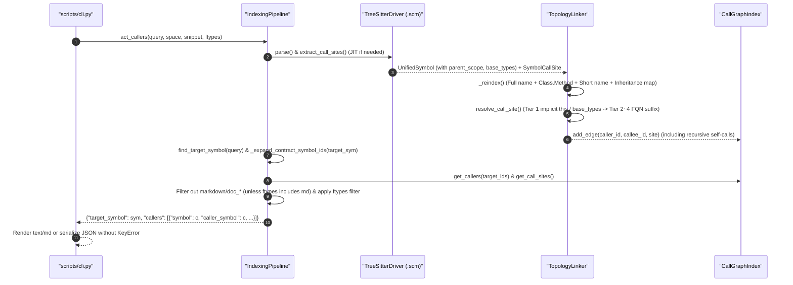

# 架構設計說明書 (Architecture Design)

> 功能名稱：sub_01_knowledge_db_callers_and_parsers_remediation  
> 建立日期：2026-10-22  
> 所屬主計畫：2026_10_22_0843_downstream_feedback_and_optimizations  
> 狀態：Confirmed  
> 模型：Gemini 4 Argon (Low)  

> 模板版本：v1.2  

---

## 1. 模組架構分層與職責邊界 (Layered Architecture)

```text
+-----------------------------------------------------------------------------------+
| Presentation & CLI Router Layer (scripts/cli.py, contributes/core.json)           |
|  - callers / callees / impact 支援 --ftype 選項解析與透傳                         |
|  - callers --json 對齊 c.get("symbol") or c.get("caller_symbol") 消除 KeyError    |
+-----------------------------------------------------------------------------------+
                                         |
                                         v
+-----------------------------------------------------------------------------------+
| Facade & Indexing Pipeline Layer (engine.py, pipeline.py)                         |
|  - find_target_symbol: 預設排除 doc_* / markdown 符號，優先定位程式碼符號          |
|  - _expand_contract_symbol_ids: 結合 base_types 自動展開介面與實作類別同名方法 ID |
|  - act_callers / act_callees / act_impact: 預設排除文檔節點，支援 ftypes 過濾     |
+-----------------------------------------------------------------------------------+
                                         |
                                         v
+-----------------------------------------------------------------------------------+
| Disambiguation & Graph Layer (linker.py, graph.py)                                |
|  - TopologyLinker._reindex: 索引完整 FQN、Class.Method 雙段名、Method 短名與基類  |
|  - TopologyLinker.resolve_call_site:                                              |
|      * Tier 1: 支援 self/this/base 及無前綴隱式 this 查找當前類別與繼承鏈成員     |
|      * Tier 2~4: 支援完整命名空間限定前綴 (Ns.Class.Method) 尾段類別與後綴消歧    |
|  - TopologyLinker.link_call_sites: 允許 function/method/constructor 遞迴自呼叫邊  |
+-----------------------------------------------------------------------------------+
                                         |
                                         v
+-----------------------------------------------------------------------------------+
| Multi-Language AST Parser Layer (parsers/treesitter.py, assets/queries/*.scm)     |
|  - c_sharp.scm / cpp.scm / c.scm / typescript.scm / javascript.scm / python.scm   |
|  - 萃取類別 base_types (繼承/介面)、處理 C++ 類別外 Class::Method parent_scope    |
|  - 精確解析調用點接收者 prefix (支援泛型 foo<T>()、條件存取 a?.b()、鏈式 a().b()) |
+-----------------------------------------------------------------------------------+
```

---

## 2. 核心資料流與循序圖 (Data Flow & Sequence Diagram)



---

## 3. 受影響檔案與新建檔案清單 (Impacted & New Files Inventory)

| 檔案路徑 | 類型 | 職責與變更說明 |
| :--- | :---: | :--- |
| `ys_codebase/source/knowledge-db/contributes/core.json` | Modify | 為 `callers`、`callees`、`impact` 補齊 `filter.ftype` 選項宣告 |
| `ys_codebase/source/knowledge-db/scripts/cli.py` | Modify | 修復 `callers --json` 之 `caller_symbol` 存取，並為 `callers`、`callees`、`impact` 串接 `--ftype` |
| `ys_codebase/source/knowledge-db/knowledge_db/engine.py` | Modify | `act_callers`、`act_callees`、`act_impact` 簽名擴充 `ftypes: Optional[Union[str, List[str]]] = None` 並透傳 |
| `ys_codebase/source/knowledge-db/knowledge_db/pipeline.py` | Modify | 實作預設文檔節點排除、`ftypes` 過濾、介面/實作方法契約集合展開 (`_expand_contract_symbol_ids`) 與 `caller_symbol` 相容鍵 |
| `ys_codebase/source/knowledge-db/knowledge_db/linker.py` | Modify | 強化多段命名空間下之 `Class.Method` 雙段索引、Tier 1 無前綴隱式 `this` 與基類查找、完整命名空間限定前綴消歧與遞迴自呼叫保留 |
| `ys_codebase/source/knowledge-db/knowledge_db/parsers/treesitter.py` | Modify | 萃取類別/結構/介面之 `base_types`、支援 C++ 類別外 `Class::Method` 作用域推導、精準拆解鏈式/泛型/條件存取之 `context_prefix`，並支援 `constructor`/`property` 作為 caller 範圍 |
| `ys_codebase/source/knowledge-db/assets/queries/c_sharp.scm` | Modify | 擴充 `record_declaration`、`local_function_statement`、`generic_name`、`conditional_access_expression` |
| `ys_codebase/source/knowledge-db/assets/queries/c.scm` | Modify | 擴充 `field_expression` 支援 `ptr->fn()` 與 `obj.fn()` |
| `ys_codebase/source/knowledge-db/assets/queries/cpp.scm` | Modify | 擴充 `template_function`、`template_method` 與 `nested_namespace_specifier` |
| `ys_codebase/source/knowledge-db/tests/test_graph.py` | Modify | 新增 C# 完整命名空間、隱式 `this`、條件存取、泛型呼叫、遞迴自呼叫、介面實作關聯與文檔排除測試 |
| `ys_codebase/source/knowledge-db/tests/test_cli.py` | Modify | 新增有實際 caller 命中時之 `callers --json` 三種 tier 測試與 `--ftype` 過濾測試 |
| `docs/knowledge-db/call_graph_and_reference_index.md` | Modify | 同步更新四階消歧演算法、介面契約聚合與 `--ftype` 過濾規範 |
| `docs/knowledge-db/DESIGN_NOTES.md` | Modify | 同步更新防坑邊界說明 |

---

## 4. 架構決策記錄 (Architecture Decision Records)

- **[P02:DR-01] 維持 `UnifiedSymbol.name` 向後相容並於 `TopologyLinker` 建立雙段式 `Class.Method` 索引**：
  - 既有測試（如 `test_parsers.py:test_ft_06_csharp_parser_classes_and_xml_doc`）斷言 C# 傳統 namespace 下類別 `sym.name` 為 `"App.Services.UserService"`。為確保 100% 向後相容，不破壞 `UnifiedSymbol.name` 的 FQN 賦值，而是在 `TreeSitterDriver.parse` 將直接外層類別名存入 `metadata["parent_scope"]`，並在 `TopologyLinker._reindex` 中同時建立 `sym.name`、`f"{parent_scope}.{short_name}"`（即 `Class.Method`）與 `short_name` 三層查找鍵，兼顧向後相容與 100% 精準消歧。
- **[P02:DR-02] 介面與實作類別契約展開 (`_expand_contract_symbol_ids`)**：
  - 於 `TreeSitterDriver.parse` 中從類別/結構/介面 AST 節點提取繼承與實作介面名稱清單（存入 `metadata["base_types"]`）。當查詢 `act_callers` 或 `act_impact` 時，若目標為方法 `X.M`，管線自動查找同空間/全庫中 `X` 所實作的介面 `I.M` 以及實作/繼承 `X` 的子類 `Sub.M`，將其納入目標符號集合一併提取上游調用邊（並去重）。

