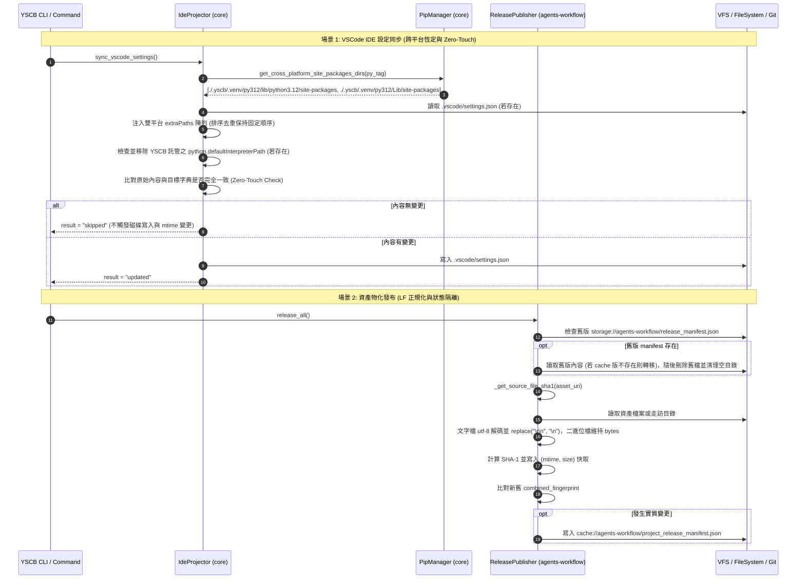

# 架構設計說明書 (Architecture Design)

> 功能名稱：sub_02_cross_platform_git_dirty_remediation  
> 建立日期：2026-10-22  
> 所屬主計畫：2026_10_22_0843_downstream_feedback_and_optimizations  
> 狀態：Confirmed  
> 模型：Gemini 3.8 Flash (Medium)  

> 模板版本：v1.2  

---

## 1. 模組架構分層與職責邊界 (Layered Architecture)

```text
+---------------------------------------------------------------------------------------------------+
|                                             YSCB CLI                                              |
|                               (yscb.py / commands / dev / install)                                |
+---------------------------------------------------------------------------------------------------+
                                                  |
                         +------------------------+------------------------+
                         |                                                 |
                         v                                                 v
      +--------------------------------------+          +--------------------------------------+
      |              core 模組               |          |         agents-workflow 模組         |
      |   (IDE 投射與主機環境隔離)           |          |         (資產編譯與物化發布)         |
      +--------------------------------------+          +--------------------------------------+
      | - PipManager:                        |          | - ReleasePublisher:                  |
      |   * get_cross_platform_site_packages |          |   * _get_source_file_sha1:           |
      |     _dirs(py_tag)                    |          |     文字內容 CRLF->LF 正規化後 HASH  |
      |   (gitignore 不變更 [P05:DR-01])     |          |   * PROJECT_MANIFEST_CACHE_URI:      |
      |                                      |          |     遷移至 cache:// 並物理清理舊檔   |
      | - IdeProjector:                      |          |                                      |
      |   * sync_vscode_settings:            |          |                                      |
      |     注入雙平台 extraPaths 靜態陣列   |          |                                      |
      |     停止寫入 defaultInterpreterPath  |          |                                      |
      |     清理舊版 YSCB 託管 interpreter   |          |                                      |
      |     比對異動 Zero-Touch 寫入機制     |          |                                      |
      |   * revert_vscode_settings:          |          |                                      |
      |     無損回滾雙平台 extraPaths        |          |                                      |
      +--------------------------------------+          +--------------------------------------+
                         |                                                 |
                         +------------------------+------------------------+
                                                  |
                                                  v
                         +-------------------------------------------------+
                         |                 實體檔案系統 / Git               |
                         +-------------------------------------------------+
                         | - .vscode/settings.json (雙平台 0 diff 恆定)     |
                         | - storage:// 不再寫入 (舊檔遷移後刪除)          |
                         | - .yscb/.cache/agents-workflow/ (本地隔離)      |
                         +-------------------------------------------------+
```

---

## 2. 核心資料流與循序圖 (Data Flow & Sequence Diagram)



---

## 3. 受影響檔案與新建檔案清單 (Impacted & New Files Inventory)

| 檔案路徑 | 類型 | 職責與變更說明 |
| :--- | :---: | :--- |
| `ys_codebase/source/core/core/pip_manager.py` | Modify | 新增 `get_cross_platform_site_packages_dirs(py_tag)` |
| `ys_codebase/source/core/core/ide_projector.py` | Modify | `sync_vscode_settings` 注入雙平台 `extraPaths`、停止寫入 `python.defaultInterpreterPath` 並清理託管舊值、實作 Zero-Touch 比對防重複寫入；`revert_vscode_settings` 相容清理雙平台路徑 |
| `ys_codebase/source/agents-workflow/agents_workflow/publisher.py` | Modify | `PROJECT_MANIFEST_CACHE_URI` 改指向 `cache://agents-workflow/project_release_manifest.json`；`_get_source_file_sha1` 實作文字 UTF-8 CRLF $\to$ LF 正規化；`release_all` 啟動時遷移舊版 `storage://` 清單並物理刪除舊檔 |
| `ys_codebase/source/core/tests/test_ide_projector_cross_platform.py` | New | 針對雙平台 extraPaths 恆定性、defaultInterpreterPath 停止寫入與舊值清理、Zero-Touch 略過寫入之單元測試 |
| `ys_codebase/source/agents-workflow/tests/test_publisher_cross_platform.py` | New | 針對 CRLF 換行符 sha1 正規化、cache 狀態隔離、舊 storage manifest 遷移與自動刪除之單元測試 |

---

## 4. 架構決策記錄 (Architecture Decision Records)

- **[P02:DR-01] 雙平台 site-packages 靜態路徑併存決策**：在 `.vscode/settings.json` 的 `python.analysis.extraPaths` 同時置放 Linux (`lib/pythonX.Y/site-packages`) 與 Windows (`Lib/site-packages`)，依據 VSCode / Pylance 機制，不存在的路徑會被靜默忽略，雙平台開發者均能正常獲得補全，且 Git 追蹤檔案內容永久固定為 0 diff。
- **[P02:DR-02] 廢棄 `python.defaultInterpreterPath` 託管寫入決策**：VSCode 具有工作區本地直譯器記憶機制（儲存於開發者本機全域儲存區或 `.vscode` 之外），且各作業系統直譯器檔名差異大（`python` vs `python.exe`）。停止主動將 host-local 路徑寫入團隊共享的 `settings.json`，並清除先前由 YSCB 託管注入之值，若開發者自訂了直譯器則予以保留。
- **[P02:DR-03] 資產文字 SHA-1 正規化策略**：在走訪資產計算 SHA-1 時，嘗試以 UTF-8 解碼文字內容，若成功則以 `chunk.replace("\r\n", "\n")` 轉為 LF 再計算摘要；遇到二進位檔案時捕獲 `UnicodeDecodeError` 並退回二進位 bytes 計算，確保跨平台 Git `core.autocrlf` 轉換差異不影響 fingerprint。
- **[P02:DR-04] 物化狀態清單本地隔離與舊版自癒決策**：將 Project 軌的物化發布清單從 `storage://` 全面遷移至已在 `.yscb/.gitignore` 內的 `cache://`。啟動發布時自動偵測舊版 `storage://agents-workflow/release_manifest.json`，無痛平滑接軌至 `cache://` 後立即以物理刪除清理舊檔，杜絕殘留檔案；不新增任何忽略規則（`[P05:DR-01]`）。

