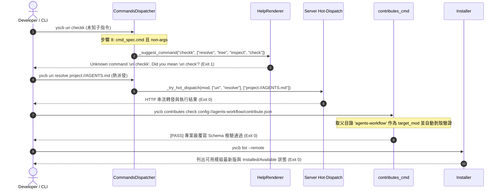

# 架構設計說明書 (Architecture Design)

> 功能名稱：sub_01_core_microkernel_and_tests  
> 建立日期：2026-10-24  
> 所屬主計畫：2026_10_23_1122_ecosystem_modules_hardening_and_test_purification  
> 狀態：Confirmed  
> 模型：Gemini 3.8 Flash (Medium)  

> 模板版本：v1.2  

---

## 1. 模組架構分層與職責邊界 (Layered Architecture)

```text
+-----------------------------------------------------------------------------------+
|                            YS-Codebase CLI (yscb.py)                             |
+-----------------------------------------------------------------------------------+
                                         |
                                         v
+-----------------------------------------------------------------------------------+
|               core.commands.dispatcher (CommandsDispatcher)                      |
|  - 步驟 7: 群組節點無參數保護 (has_fn 優先保留上層預設動作，core 函式調用 HelpRenderer)  |
|  - 步驟 8: 未知子命令強制攔截 (cmd_spec.cmd 且 non-args 時調用 _suggest_command 報錯)   |
|  - _try_hot_dispatch: 支援 cmd_path: List[str]，Payload 序列化保持完備陣列        |
+-----------------------------------------------------------------------------------+
        |                                   |                              |
        v                                   v                              v
+-------------------------+     +-------------------------+    +--------------------+
|  core.commands          |     |  core.installer         |    |  core.uri          |
|  - contributes_cmd.py   |     |  - cmd_list             |    |  - format_undefined|
|    * config:// 支援     |     |    * remote=True/False  |    |    _uri_hint       |
|    * 父目錄模組推導與剝殼 |     |    * Provider 索引探測  |    |    (微內核通用化)  |
+-------------------------+     +-------------------------+    +--------------------+
        |                                   |
        v                                   v
+---------------------------------------------------------+
|                  core.scripts.cli (葉節點)               |
|  - config_list (--local 過濾)                            |
|  - config_inspect (呼叫 ConfigManager.inspect)          |
|  - config_unset (呼叫 ConfigManager.delete)             |
|  - uri / config / event / contributes (HelpRenderer 轉調)|
+---------------------------------------------------------+
                                         |
                                         v
+-----------------------------------------------------------------------------------+
|              測試集純化架構 (core/tests/ 收斂為 20 個高內聚子系統測試檔)              |
|  - 裁撤 8 碎片檔並無損整併入對應主檔 (test_uri, test_config, test_events_pipeline...) |
|  - 5 處虛假測驗實質化斷言 (sync_pip_dependencies, zip, migrate, status)          |
|  - 跨模組 patch 清除與沙盒 @require / tearDown 零殘留清理                          |
+-----------------------------------------------------------------------------------+
```

---

## 2. 核心資料流與循序圖 (Data Flow & Sequence Diagram)



---

## 3. 受影響檔案與新建檔案清單 (Impacted & New Files Inventory)

| 檔案路徑 | 類型 | 職責與變更說明 |
| :--- | :---: | :--- |
| `ys_codebase/source/core/core/providers.py` | Modify | 移除 `get_phase*_cli_guide` 11 個遺留函式，徹底解除與 `agents-workflow` 耦合 (`C-01`)。 |
| `ys_codebase/source/core/core/uri.py` | Modify | 移除 `format_undefined_uri_hint` 內針對 `agents-workflow` 硬編碼分支，改為微內核通用格式 (`C-01`)。 |
| `ys_codebase/source/core/core/contributes.py` | Modify | 移除未使用的死代碼 `print_global_help()` (`T-03`)。 |
| `ys_codebase/source/core/core/installer.py` | Modify | 實作 `cmd_list(remote=True, provider=...)` 遠端與本地 Provider 模組探測與狀態顯示 (`C-04`)。 |
| `ys_codebase/source/core/core/commands/contributes_cmd.py` | Modify | 支援單檔 `contribute.json` 父目錄推導、外層剝殼與全量/模組 `config://` 掃描驗證 (`C-02`)。 |
| `ys_codebase/source/core/core/commands/dispatcher.py` | Modify | 修復 `_try_hot_dispatch` 為 `cmd_path: List[str]`；步驟 8 強制攔截未知子指令提供建議 (`C-03`, `C-06`)。 |
| `ys_codebase/source/core/contributes/core.json` | Modify | 宣告 `config inspect` 與 `config unset` 子命令契約 (`C-05`)。 |
| `ys_codebase/source/core/scripts/cli.py` | Modify | 實作 `config_inspect`、`config_unset`、`config_list --local` 過濾，並將群組函式 fallback 轉調 `HelpRenderer` (`C-05`, `C-06`)。 |
| `ys_codebase/source/core/tests/` (20 檔) | Refactor | 裁撤 8 碎片檔，改寫 5 虛假測驗，消除跨模組耦合，加固沙盒零殘留與補齊漏測路徑 (`T-01`~`T-06`)。 |

---

## 4. 架構決策記錄 (Architecture Decision Records)

- **[P02:DR-01] 宣告式群組節點雙重分流策略**：未帶子命令時優先保留各模組 `scripts/cli.py` 群組函式之自訂預設動作（如 `agents-workflow plan/roadmap/todo`），若無自訂動作或為 `core` 自身群組則統一輸出 `HelpRenderer`；帶有未知子命令時一律強制攔截並輸出 `_suggest_command` 模糊建議，杜絕手寫輸出分歧與未知指令放行。
- **[P02:DR-02] 測試集子系統 1:1 歸戶架構**：測試集命名嚴格對齊 `core/<component>.py` $\rightarrow$ `core/tests/test_<component>.py`。不再允許隨案建立 `test_<plan_topic>.py`，所有功能性與回歸性案例全數無損併入對應主檔，大幅降低環境重複初始化負載並使架構索引一目了然。

