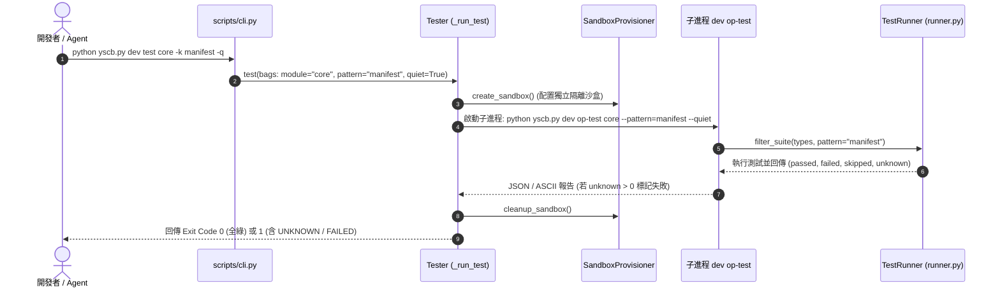

# 架構設計說明書 (Architecture Design)

> 功能名稱：sub_02_dev_toolchain_and_tests  
> 建立日期：2026-10-24  
> 所屬主計畫：2026_10_23_1122_ecosystem_modules_hardening_and_test_purification  
> 狀態：Confirmed  
> 模型：Gemini 3.8 Flash (Medium)  

> 模板版本：v1.2  

---

## 1. 模組架構分層與職責邊界 (Layered Architecture)

```text
+----------------------------------------------------------------------------------------------------+
|                                  CLI & Contributes 契約調度層                                       |
|  - contributes/core.json (宣告 test/op-test/op-mksb 完整 options 契約、events 生命週期清冊)          |
|  - scripts/cli.py (_normalize_bags 處理帶值短長選項；PEP 562 函式級按需匯入)                        |
+----------------------------------------------------------------------------------------------------+
                                                  │
                 ┌────────────────────────────────┴──────────────────────────────┐
                 ▼                                                               ▼
+------------------------------------+                         +-------------------------------------+
|         檢核與建置引擎 (Checker/Builder)    |                         |        發布調度引擎 (Releaser)       |
|  - Checker: 8 步靜態檢核管線          |                         |  - 3-Gate 守門: 全庫最高版單調遞增   |
|    * _check_custom_rules: 運行時隔離 |                         |  - release_all: 穩定 Kahn DAG 拓撲   |
|    * _check_core_injection: 源碼優先|                         |  - release_git: commit 錯誤攔截     |
|    * _check_cli_compliance: 精確全名|                         +-------------------------------------+
|  - Builder: clean=False 產物保留    |                                            │
+------------------------------------+                                            │
                 │                                                                 │
                 └────────────────────────────────┬────────────────────────────────┘
                                                  ▼
+----------------------------------------------------------------------------------------------------+
|                                 端到端沙盒測試引擎 (Tester & Sandbox)                               |
|  - Tester: _run_test 正規化傳遞 --pattern=<pat> / -q / -v 至子進程 op-test; UNKNOWN > 0 剛性阻斷      |
|  - SandboxProvisioner: _sort_zip_filenames_by_semver 數值 SemVer 排序; 3-Tier 零拷貝微環境安全斷開 |
|  - TestRunner: filter_suite 保留 _FailedTest; 納入 Requirement.NETWORK 預設發現                    |
|  - YSCBTestCase: setUp/tearDown 自動備份與還原 os.getcwd(); mark_passed() 三態狀態閉環             |
+----------------------------------------------------------------------------------------------------+
```

---

## 2. 核心資料流與循序圖 (Data Flow & Sequence Diagram)

### 2.1 `dev test` 跨沙盒子進程參數無損傳遞與 `UNKNOWN` 阻斷流程


---

## 3. 受影響檔案與新建檔案清單 (Impacted & New Files Inventory)

| 檔案路徑 | 類型 | 職責與變更說明 |
| :--- | :---: | :--- |
| `ys_codebase/source/dev/contributes/core.json` | Modify | 補齊 `test`、`op-test`、`op-mksb` 完整選項 Schema，修正 `--sync` 說明，註冊 `events` (`FR-01`, `FR-07`) |
| `ys_codebase/source/dev/scripts/cli.py` | Modify | `_normalize_bags` 支援帶值選項，正規化短選項別名，函式內按需延遲匯入 (`FR-01`, `FR-07`) |
| `ys_codebase/source/dev/dev/__init__.py` | Modify | 匯出 `Releaser` 並以 `__getattr__` 實作 PEP 562 按需延遲載入 (`FR-07`) |
| `ys_codebase/source/dev/dev/tester.py` | Modify | `_run_test` 正規化子進程參數，`_run_op_test` 扣除 `unknown` 並落實 `UNKNOWN > 0` 剛性阻斷 (`FR-01`, `FR-03`) |
| `ys_codebase/source/dev/dev/testing/runner.py` | Modify | 保留 `_FailedTest` 不被過濾，將 `Requirement.NETWORK` 納入預設發現 (`FR-03`) |
| `ys_codebase/source/dev/dev/releaser.py` | Modify | Gate 3 全庫最高版本防回退，`release_all` 字母序穩定 DAG 阻斷，`release_git` 攔截 commit 錯誤 (`FR-02`) |
| `ys_codebase/source/dev/dev/checker.py` | Modify | 自訂規則臨時加入 `module://` 運行空間，優先讀取源碼 Schema，對齊 `{full_fn, primary_fn}` (`FR-04`) |
| `ys_codebase/source/dev/dev/scaffold.py` | Modify | 汰除 `process(args)` 範本，改用 `def hello(cmd_bags)`，修正 `tests/__init__.py` 字面 `\\n` (`FR-05`) |
| `ys_codebase/source/dev/dev/testing/sandbox.py` | Modify | 以數值 SemVer 排序 `.build` zip，Mock 模組預設合規，`BadZipFile` 防護 (`FR-05`, `FR-06`) |
| `ys_codebase/source/dev/dev/testing/case.py` | Modify | `setUp/tearDown` 自動還原 `os.getcwd()`，Mock 源碼模組預設 0 Error / 0 Warn (`FR-05`, `FR-06`) |
| `ys_codebase/source/dev/dev/builder.py` | Modify | `build_module` 僅在 `clean=True` 時清空 `real_build_dir` (`FR-06`) |
| `ys_codebase/source/dev/tests/test_*.py` | Modify/Delete | 裁撤 3 碎片檔，收斂為 7 檔，重寫 5 虛假測驗，補齊 `D-01`~`D-08` 五大回歸路徑 (`FR-08`, `FR-09`) |
| `assets/skills/yscb-module-dev/references/cli_and_commands.md` | Modify | 校正 `CmdBags` 取值範例、預設版號 `0.1.0.0`、產物路徑與 3-Gate 說明 (`FR-07`) |
| `docs/dev/DESIGN_NOTES.md` | Modify | 增補 `[DN-DEV-04]` CLI 具名函式契約與全庫單調防回退註記 (`FR-07`) |

---

## 4. 架構決策記錄 (Architecture Decision Records)

- **[P02:DR-01]** **沙盒子進程長選項正規化 (`FR-01`)**：在 `Tester._run_test` 組裝子進程 `op_test_args` 時，一律將 `-k <pattern>` 轉換為單一 Token `--pattern=<pattern>`，將 `-q` 轉為 `--quiet`，將 `-v` 轉為 `--verbose`，徹底規避子進程 `OptionResolver` 將分離參數誤判為位置參數之漏洞。
- **[P02:DR-02]** **全庫最高版本單調遞增守門 (`FR-02`)**：`Releaser` Gate 3 在比對同三元組外，加入 `target_tuple > max(all_released_versions)` 全庫最高版本限制，即使帶 `--force` 亦禁止小於全庫最高版本，根除跨三元組回退漏洞。
- **[P02:DR-03]** **`UNKNOWN` 三態狀態剛性失敗 (`FR-03`)**：將 `UNKNOWN` 測試明確定義為未達驗收標準之缺陷，`mod_unknown > 0` 時測試整體狀態標記為 `FAILED` 並返回 Exit Code `1`，維護驗收紀律。
- **[P02:DR-04]** **測試套件 1:1 歸戶收斂 (10 檔 $\rightarrow$ 7 檔) (`FR-08`)**：徹底落實 `testing-sop` 鐵律 1，裁撤以歷史任務命名的 `test_cli_compliance.py`、`test_output_purification.py` 與 `test_pip_adaptation.py`，完整拆併入 7 大核心子系統測試檔。

