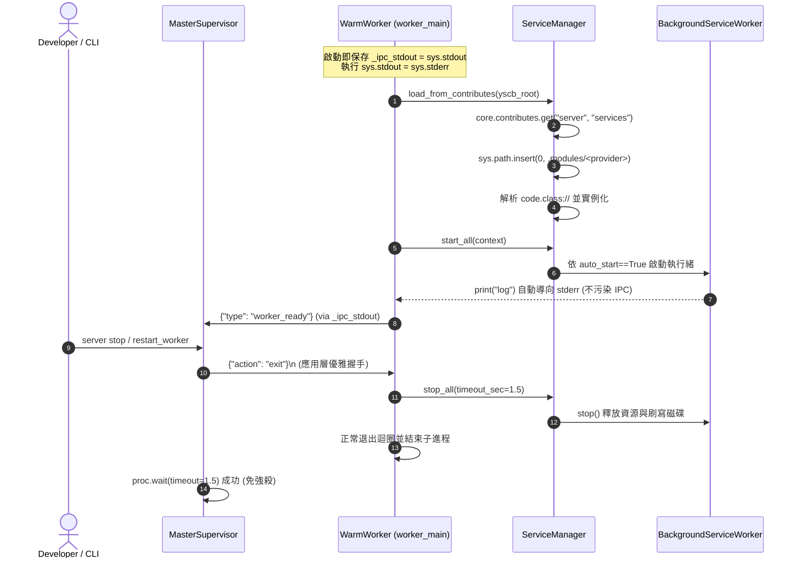

# 架構設計說明書 (Architecture Design)

> 功能名稱：sub_03_server_hosting_ipc_and_tests  
> 建立日期：2026-10-24  
> 所屬主計畫：2026_10_23_1122_ecosystem_modules_hardening_and_test_purification  
> 狀態：Confirmed  
> 模型：Gemini 3.8 Flash (Medium)  

> 模板版本：v1.2  

---

## 1. 模組架構分層與職責邊界 (Layered Architecture)

```text
[Control Plane: MasterSupervisor]
  |-- Localhost HTTP Server (127.0.0.1:0)
  |-- PID & Port State (_write_state -> daemon.json, start_time 保持為 self._start_time)
  |-- Dispatch Lock (threading.Lock, 序列化任務派發與狀態讀寫)
  |-- Stderr Background Drain Thread (持續排空避免 64KB OS Pipe 死鎖)
  |-- Two-Stage Kill Protocol (1. {"action": "exit"} -> 2. kill_process_tree)
  \-- ServerConfig Hot Reload (reload 時同步刷新 idle_timeout_sec)
        |
   (Private NDJSON Pipe: stdin / _ipc_stdout)
        |
[Data Plane: WarmWorker & Service Hosting]
  |-- worker_main Loop (sys.stdout -> sys.stderr 重導向, 獨佔 _ipc_stdout)
  |-- IPC Write Lock (threading.Lock, 保護 emit_fn 避免交錯損毀)
  |-- DebouncedIOStreamer (500ms 防抖攔截 stdout/stderr 串流)
  \-- ServiceManager (100% SDK 驅動服務發現)
        |-- core.contributes.get("server", "services")
        |-- Provider sys.path 動態注入 (.modules/<provider>)
        |-- code.class:// 協議解析與連字號模組名正規化
        \-- auto_start 生命週期控制
```

---

## 2. 核心資料流與循序圖 (Data Flow & Sequence Diagram)



---

## 3. 受影響檔案與新建檔案清單 (Impacted & New Files Inventory)

| 檔案路徑 | 類型 | 職責與變更說明 |
| :--- | :---: | :--- |
| `ys_codebase/source/server/server/service.py` | Modify | 補齊 `import os`，接入 `core.contributes.get`，支援 `code.class://`、連字號模組路徑注入與 `auto_start` |
| `ys_codebase/source/server/server/worker.py` | Modify | 實作 `_ipc_stdout` 私有句柄、`sys.stdout -> sys.stderr` 重導向與 `ipc_lock` 寫入鎖；移除 `source/` 注入 |
| `ys_codebase/source/server/server/master.py` | Modify | 實作兩階段優雅停機握手；修正 `_write_state` 的 `start_time`；移除冗餘 `ServiceManager` 與 `source/` 注入；支援 reload 組態刷新 |
| `ys_codebase/source/server/contributes/core.json` | Modify | 補齊 `server_worker_warming` 與 `server_worker_ready` events 宣告 |
| `ys_codebase/source/server/contributes/_format.json` | Modify | 確保 `services` Schema 宣告包含 `name`, `worker_class`, `description`, `auto_start` |
| `ys_codebase/source/server/scripts/cli.py` | Modify | 移除過渡期死代碼 `_handle_start`；四大指令強化 `CmdBags` 契約與負數 TTL 阻斷 |
| `ys_codebase/source/server/tests/test_basic.py` | Delete | 物理刪除空殼測試檔 |
| `ys_codebase/source/server/tests/test_server.py` | Modify | 主子系統測試：合併重複測試、補齊服務載入、`worker_main` IPC 隔離與 HTTP 端點實測 |
| `ys_codebase/source/server/tests/test_server_config.py` | Modify | 組態與 CLI 測試：移除 `_handle_start`，改測 `CmdBags` 入口與 contributes Schema |
| `ys_codebase/source/server/tests/test_server_logging.py` | Modify | 日誌測試：移除重複測試，重寫 `test_worker_ipc_logging_stream` 為真實呼叫 `dispatch_task` |
| `docs/server/DESIGN_NOTES.md` | Modify | 增補 `[DN-05]` 記錄 Worker IPC 通道隔離與兩階段優雅停機協議 |
| `docs/server/README.md` | Modify | 更新手冊 `services` 範例與 3-Tier 測試結構 |

---

## 4. 架構決策記錄 (Architecture Decision Records)

- **[P02:DR-01]** **`worker_main` 私有 IPC 句柄硬隔離機制**：子進程啟動時將全域 `sys.stdout` 指向 `sys.stderr`，專用 `_ipc_stdout` 僅由 `emit_fn` 在 `threading.Lock` 保護下獨佔寫入。背景服務與第三方依賴的非結構化 `print` 一律由 Master 的 `_drain_stderr` 導出至日誌，100% 根除 NDJSON IPC 污染。
- **[P02:DR-02]** **兩階段優雅停機協定 (Two-Stage Termination Protocol)**：`MasterSupervisor._kill_worker_locked` 優先向 Worker 發送 `{"action": "exit"}\n` 並等待最多 `1.5s`，由 Worker 觸發 `finally: service_manager.stop_all(1.5)` 讓背景服務優雅持久化；僅在逾時後才呼叫作業系統層級 `kill_process_tree` 強制作業收割。
- **[P02:DR-03]** **SDK 服務載入器模組路徑注入防呆**：為相容 `knowledge-db` 等連字號命名模組，於 `_load_service_item` 動態將 `.modules/<provider>` 插入 `sys.path`，確保跨模組背景服務順利載入。

