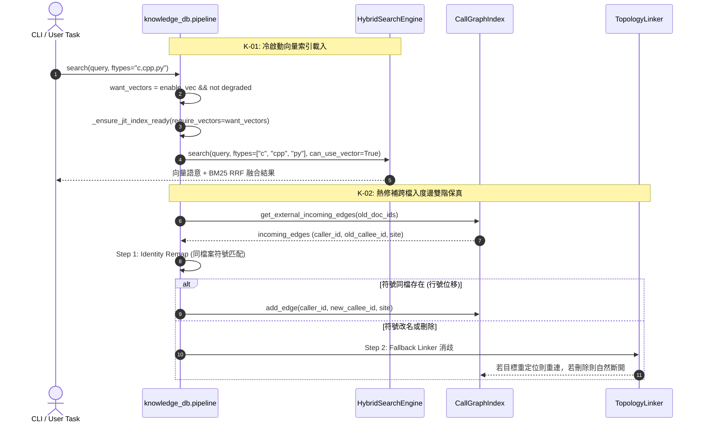

# 架構設計說明書 (Architecture Design)

> 功能名稱：sub_04_knowledge_db_pipeline_and_tests  
> 建立日期：2026-10-24  
> 所屬主計畫：2026_10_23_1122_ecosystem_modules_hardening_and_test_purification  
> 狀態：Confirmed  
> 模型：Gemini 3.8 Flash (Medium)  

> 模板版本：v1.2  

---

## 1. 模組架構分層與職責邊界 (Layered Architecture)

```text
[CLI & Public Interface Layer]
  - scripts/cli.py (CmdBags 入口、-d 代碼切片保證、JSON 欄位補齊)
  - knowledge_db/engine.py:KnowledgeEngine (門面 facade、SDK 別名 callers/callees/impact、組態熱刷新)
  - contributes/core.json & contributes/server.json (聲明式 Hook/選項/服務契約)

[Retrieval & Topology Pipeline Layer]
  - knowledge_db/pipeline.py (JIT 延遲建構、冷啟動向量載入前置分離、雙階入度邊增量重連)
  - knowledge_db/hybrid.py (HybridSearchEngine、FastEmbed 向量召回、BM25 融合、多副檔名過濾)
  - knowledge_db/graph.py (CallGraphIndex、外部入度邊提取 get_external_incoming_edges)
  - knowledge_db/linker.py (TopologyLinker、跨檔案消歧、次選回退重連)

[Background Service & Runtime Space Layer]
  - scripts/hook.server.py (純化 pre_warm、杜絕雙重 Watcher 衝突)
  - knowledge_db/service.py (KnowledgeDBServiceWorker、由 server.ServiceManager 單一託管、移除 source 注入)
  - knowledge_db/config.py (KnowledgeDBConfig、以 core.config 為最高優先級)

[Core Storage & Pure AST Layer]
  - space.py, scanner.py, parsers.py, bundler.py, schema.py (純化同義詞庫、刪除 protocol.py 與 CallGraphNode)
```

---

## 2. 核心資料流與循序圖 (Data Flow & Sequence Diagram)



---

## 3. 受影響檔案與新建檔案清單 (Impacted & New Files Inventory)

| 檔案路徑 | 類型 | 職責與變更說明 |
| :--- | :---: | :--- |
| `ys_codebase/source/knowledge-db/knowledge_db/pipeline.py` | Modify | 分離向量載入需求條件、實作入度邊雙階重連、多副檔名正規化、修復降級提示 |
| `ys_codebase/source/knowledge-db/knowledge_db/graph.py` | Modify | 新增 `get_external_incoming_edges()`，移除 `CallGraphNode` 與重複邏輯 |
| `ys_codebase/source/knowledge-db/knowledge_db/hybrid.py` | Modify | 支援多副檔名比對，對齊向量過濾邏輯 |
| `ys_codebase/source/knowledge-db/knowledge_db/service.py` | Modify | 移除 `source/server` 注入，安全回退內建基類 |
| `ys_codebase/source/knowledge-db/scripts/hook.server.py` | Modify | 移除私自啟動 `_watcher_instance`，僅保留 `pre_warm()` |
| `ys_codebase/source/knowledge-db/knowledge_db/config.py` | Modify | 修正 `core.config` 優先級，移除 `yscb.config.json` 倒置覆蓋 |
| `ys_codebase/source/knowledge-db/knowledge_db/engine.py` | Modify | 移除 `thesaurus` 參數與無效 events 呼叫，新增 SDK 方法別名與組態熱刷新 |
| `ys_codebase/source/knowledge-db/knowledge_db/schema.py` | Modify | 刪除 `ThesaurusConfig`、`ThesaurusGroup` 與 `CallGraphNode` |
| `ys_codebase/source/knowledge-db/knowledge_db/protocol.py` | Delete | 物理刪除生產環境 0 引用之死代碼 |
| `ys_codebase/source/knowledge-db/contributes/core.json` | Modify | 補齊 CLI 選項與 `hooks` 宣告，移除同義詞定義 |
| `ys_codebase/source/knowledge-db/contributes/_format.json` | Modify | 移除 `thesaurus / aliases / related` 宣告點 |
| `ys_codebase/source/knowledge-db/contributes/knowledge-db.json` | Modify | 移除同義詞陣列，僅保留 languages 宣告 |
| `ys_codebase/source/knowledge-db/scripts/cli.py` | Modify | 修復 `-d` 模式切片與 JSON 欄位輸出，清理同義詞輸出 |
| `ys_codebase/source/knowledge-db/tests/test_benchmark_perf_and_memory.py` | Delete | 物理裁撤碎片檔，內容併入 `test_retrieval.py` 與 `test_bundler.py` |
| `ys_codebase/source/knowledge-db/tests/test_cli_ux.py` | Delete | 物理裁撤碎片檔，內容併入 `test_space.py`、`test_hot_reload.py`、`test_cli.py` |
| `ys_codebase/source/knowledge-db/tests/test_*.py` | Modify | 收斂為 12 檔，合併雙胞胎測試，重寫 5 處虛假測試，補齊 4 大高風險路徑 |

---

## 4. 架構決策記錄 (Architecture Decision Records)

- **[P02:DR-01] 雙階入度邊增量重連 (Dual-Stage Incoming Edge Reconnection)**：為防止無前綴裸函式調用丟邊，熱修補拔除舊節點前快照 `(norm_file_path, name, lower_fqn, kind)`，第一階優先以 O(1) 於同檔案中執行身分重映；若符號改名或刪除才走第二階 `TopologyLinker` 跨檔消歧。
- **[P02:DR-02] Watcher 單一權責收歸 `server.ServiceManager`**：徹底清除 `hook.server.py` 私自啟動的實例，全生命週期嚴格由 `contributes/server.json` 註冊並交由宿主 Worker 託管，消滅多 Watchdog 競態。
- **[P02:DR-03] 徹底純化移除同義詞包袱**： FastEmbed 複合語意檢索已上線，同義詞機制全面汰除，清除整個模組約 350 行 Python 死代碼與 185 行 JSON 配置。

