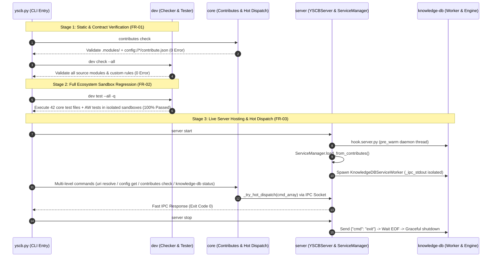

# 架構設計說明書 (Architecture Design)

> 功能名稱：sub_05_ecosystem_integration_and_acceptance  
> 建立日期：2026-10-24  
> 所屬主計畫：2026_10_23_1122_ecosystem_modules_hardening_and_test_purification  
> 狀態：Confirmed  
> 模型：Gemini 4 Argon (Low)  

> 模板版本：v1.2  

---

## 1. 模組架構分層與職責邊界 (Layered Architecture)

```text
+-------------------------------------------------------------------+
| Layer 4: Knowledge Base Engine & Background Worker (knowledge-db) |
| - KnowledgeEngine / RetrievalPipeline / CallGraphIndex            |
| - KnowledgeDBServiceWorker (Hosted by Server ServiceManager)      |
+-------------------------------------------------------------------+
                                  |
                                  v
+-------------------------------------------------------------------+
| Layer 3: Daemon Server & Service Hosting (server)                 |
| - YSCBServer / CommandRouter (_try_hot_dispatch)                  |
| - ServiceManager ( Contributes scan, isolated _ipc_stdout, 2-phase|
|   graceful exit handshake )                                       |
+-------------------------------------------------------------------+
                                  |
                                  v
+-------------------------------------------------------------------+
| Layer 2: Developer & Sandbox Toolchain (dev)                      |
| - Checker (contributes rules & module.source:// schema validation)|
| - Tester / Sandbox (UNKNOWN test blocking, 42 purified test files)|
| - Builder / Releaser (3-Gate anti-rollback protection)            |
+-------------------------------------------------------------------+
                                  |
                                  v
+-------------------------------------------------------------------+
| Layer 1: Microkernel Foundation (core)                            |
| - CLI Dispatcher / HelpRenderer / CmdBags                         |
| - ContributesManager (including config://<target>/contribute.json)|
| - ConfigManager / URIManager / Runtime .modules/ Isolation        |
+-------------------------------------------------------------------+
```

---

## 2. 核心資料流與循序圖 (Data Flow & Sequence Diagram)



---

## 3. 受影響檔案與新建檔案清單 (Impacted & New Files Inventory)

| 檔案路徑 | 類型 | 職責與變更說明 |
| :--- | :---: | :--- |
| `ys_codebase/source/dev/dev/tester.py` | Modify | 修正 `_run_op_test` 不再從父進程環境變數 `YSCB_TEST_QUIET` 繼承 `quiet_mode`，僅依 `op-test` 自身 `argv` (`-q`/`--quiet`) 判定，消除 `dev test --all -q` 下內聯 `op-test` 單元測試之環境洩漏 |
| `ys_codebase/source/server/README.md` | Modify | 移除 §2.2 結尾多餘之舊版 JSON 殘留片段 |
| `plans/2026_10_23_1122_ecosystem_modules_hardening_and_test_purification/umbrella_overview.md` | Modify | 更新 `sub_05` 與主計畫狀態為 `Completed`（結案階段） |
| `CHANGELOG.md` | Modify | 核驗並新增 `sub_05` 跨模組端到端二次驗收與主計畫結案紀錄 |
| `docs/{core,dev,server,knowledge-db}/README.md` | Audit | 核驗中觀模組手冊與各子計畫實作 100% 同步對齊 |

---

## 4. 架構決策記錄 (Architecture Decision Records)

- **[P02:DR-01]** **由下而上四層聯合驗收管線**：依循 `Layer 1 (core) -> Layer 2 (dev) -> Layer 3 (server) -> Layer 4 (knowledge-db)` 之拓撲依賴順序，先執行靜態契約與規則檢驗（`contributes check`、`dev check --all`），再執行全量沙盒單元與回歸測試（`dev test --all -q`），最後執行常駐服務與熱派發實機整合測試，確保各層邊界零洩漏。
- **[P02:DR-02]** **Consume-on-Promote 儲備閉環審計**：8 份目標路線圖已於 `sub_01` ~ `sub_04` 分別透過 `Consume-on-Promote` 物理遷入各子計畫目錄之 `roadmap.md`；本階段以非破壞性目錄與 Git 追蹤狀態核驗取代重複搬移操作，確保歷史追溯鏈完整。
