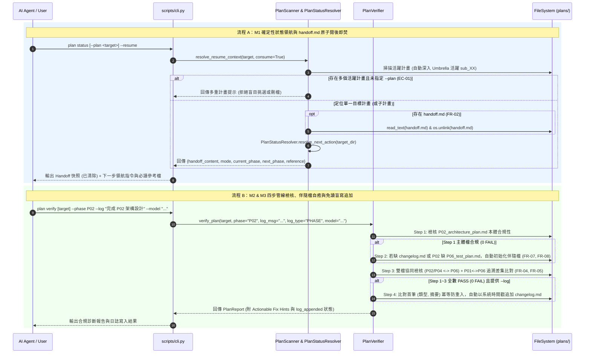

# 架構設計說明書 (Architecture Design)

> 功能名稱：sub_01_python_aci_toolchain  
> 建立日期：2026-10-23  
> 所屬主計畫：2026_10_23_1314_agents_workflow_aci_and_delegation_evolution  
> 狀態：Confirmed  
> 模型：Gemini 4 Argon (Low)  

> 模板版本：v1.2  

---

## 1. 模組架構分層與職責邊界 (Layered Architecture)

```text
+-----------------------------------------------------------------------------------+
|                        CLI Presentation & Contract Layer                          |
|  - contributes/core.json : 宣告 plan status (--plan, --resume)                    |
|                            與 plan verify/check (--phase, --log, --type, --model) |
|  - scripts/cli.py        : 解析 CmdBags，調用 PlanScanner / PlanVerifier           |
+-----------------------------------------------------------------------------------+
                                         |
                                         v
+-----------------------------------------------------------------------------------+
|                     Plans Toolchain Domain Layer (agents_workflow/plans/)         |
|  - status.py (PlanStatusResolver) :                                               |
|      * 標頭解析 SSOT (parse_header_metadata, get_doc_header_status)               |
|      * resolve_next_action(plan_dir) -> 推導 mode, current/next_phase, reference  |
|  - scanner.py (PlanScanner) :                                                     |
|      * 計畫目錄與活躍 sub_XX 定位 (resolve_target_plan_dir)                       |
|      * execute_resume(plan_name_or_subpath, consume_handoff) -> 閱後即焚與領航輸出  |
|  - verifier.py (PlanVerifier) :                                                   |
|      * Step 1: 目標階段主體檔合規檢核 (--phase P00..P07|current|all)               |
|      * Step 2: 伴隨檔自癒初始化 (changelog.md & P02 伴隨之 P06_test_plan.md Draft) |
|      * Step 3: 雙檔協同狀態檢核 (P02/P04 <-> P06) + P01<->P06 追溯差集比對         |
|      * Step 4: 100% PASS 後免讀盲寫追加 changelog.md (含冪等防重入保護)            |
+-----------------------------------------------------------------------------------+
                                         |
                                         v
+-----------------------------------------------------------------------------------+
|                        Workflow Skills & Documentation Layer                      |
|  - assets/skills/continue/SKILL.md        : 優先呼叫 plan status --resume         |
|  - assets/skills/yscb-cli-guide/SKILL.md  : 補充 --log 禁用雙引號與反引號防呆      |
|  - assets/skills/development-sop/         : 階段手冊整合 plan verify --phase --log |
|  - docs/agents-workflow/                  : README, user_guide, DESIGN_NOTES      |
+-----------------------------------------------------------------------------------+
```

---

## 2. 核心資料流與循序圖 (Data Flow & Sequence Diagram)



---

## 3. 受影響檔案與新建檔案清單 (Impacted & New Files Inventory)

| 檔案路徑 | 類型 | 職責與變更說明 |
| :--- | :---: | :--- |
| `ys_codebase/source/agents-workflow/agents_workflow/plans/status.py` | Modify | 新增 `resolve_next_action(plan_dir)` 與模型標頭提取輔助方法 `get_doc_header_model(doc_target)`。 |
| `ys_codebase/source/agents-workflow/agents_workflow/plans/scanner.py` | Modify | 新增 `resolve_target_plan_dir(plan_name_or_subpath)`、`execute_resume(plan_name_or_subpath, consume_handoff)` 與領航卡片格式化輸出。 |
| `ys_codebase/source/agents-workflow/agents_workflow/plans/verifier.py` | Modify | 實作 `--phase` 過濾、四步執行管線、伴隨檔（`changelog.md`、`P06 Draft`）自動補齊與模型防回溯、`P02/P04` 雙檔協同檢核、`P01<->P06` 追溯差集比對（含刪除線/代碼塊/註解預過濾）、自癒型 Fix Hint 與 `--log` 冪等盲寫追加。 |
| `ys_codebase/source/agents-workflow/scripts/cli.py` | Modify | 擴充 `plan_status`（支援位置參數、`--plan`、`--resume`）與 `plan_check` / `plan_verify`（支援 `--phase`、`--log`、`--type`、`--model`）。 |
| `ys_codebase/source/agents-workflow/contributes/core.json` | Modify | 同步宣告 `plan.cmd.status` 與 `plan.cmd.{check,verify}` 新增之 `args` 與 `options`。 |
| `ys_codebase/source/agents-workflow/assets/skills/continue/SKILL.md` | Modify | 重構為優先調用 `plan status --resume` 取得確定性領航與自動消費刪除 `handoff.md`，精簡手動查表篇幅並保留沙盒唯讀 Fallback。 |
| `ys_codebase/source/agents-workflow/assets/skills/yscb-cli-guide/SKILL.md` | Modify | 於終端指令防呆紀律新增第 4 點：`--log` 等雙引號參數字串內文禁用雙引號 `"` 與反引號 `` ` `` 防逃逸崩潰。 |
| `ys_codebase/source/agents-workflow/assets/skills/development-sop/SKILL.md` | Modify | 於日誌與階段推進規範補齊 `plan verify --phase <P0X> --log "<摘要>"` 免讀盲寫與伴隨檔自癒指引。 |
| `ys_codebase/source/agents-workflow/assets/skills/development-sop/references/phase_02_architecture.md` | Modify | 增補透過 `plan verify <plan> --phase P02 --log "..."` 自動初始化伴隨 `P06_test_plan.md (Draft)` 與追加日誌之說明。 |
| `ys_codebase/source/agents-workflow/assets/skills/development-sop/references/phase_04_plan.md` | Modify | 增補透過 `plan verify <plan> --phase P04 --log "..."` 檢核 `P01<->P06` 需求追溯差集與 `P06 Confirmed` 狀態守門。 |
| `ys_codebase/source/agents-workflow/assets/skills/development-sop/references/phase_07_walkthrough.md` | Modify | 同步更新 Step 3 結案驗證指令支援 `plan verify <plan> --log "..."`。 |
| `ys_codebase/source/agents-workflow/tests/test_plans_aci_toolchain.py` | New | 新增 `FT-01` ~ `FT-08` 與 `ET-01` ~ `ET-06` 完整單元與邊界測試套件。 |
| `docs/agents-workflow/README.md` | Modify | 同步更新 CLI 快速使用指南之 `plan status --resume` 與 `plan verify --phase --log` 範例。 |
| `docs/agents-workflow/user_guide.md` | Modify | 擴充 §1.1 `plan status --resume` 與 §1.4 `plan verify` 左移檢核、追溯差集比對及免讀日誌追加說明。 |
| `docs/agents-workflow/DESIGN_NOTES.md` | Modify | 登錄 `[DN-AW-10]`：ACI 四步執行管線時序、伴隨檔模型防回溯與 `P01` 刪除線預過濾設計。 |

---

## 4. 架構決策記錄 (Architecture Decision Records)

- **[P02:DR-01] `Umbrella` 主從計畫透明鑽取 (`Transparent Active Sub-Plan Drill-down`)**：當對 `Umbrella` 主計畫執行 `plan status --resume`（或 `resolve_next_action`）時，若未顯式指定特定 `sub_XX`，掃描器自動依序尋找第一個未處於 `Completed`/`Concluded` 狀態之活躍 `sub_XX` 子目錄作為領航目標；若全部 `sub_XX` 皆已完成而主計畫 `umbrella_overview.md` 尚未 `Completed`，則領航指向主計畫本身提示開立下一子計畫或結案主計畫。
- **[P02:DR-02] 四步執行管線隔離不合規主體檔 (`Strict 4-Step Verification & Self-Healing Pipeline`)**：在 `PlanVerifier.verify_plan()` 中，伴隨檔自癒（Step 2）與日誌盲寫（Step 4）必須嚴格受控於檢核結果：Step 1 先對目標階段主體檔執行 `_verify_markdown_file`，若主體檔存在任何 `FAIL`（如未替換佔位符或缺少必填標頭），立即跳過 Step 2 伴隨檔生成與 Step 4 日誌寫入，防止在主體檔有錯時污染計畫目錄或誤寫成功日誌。
- **[P02:DR-03] `P01` 需求 ID 萃取之三層雜訊剝除器 (`Three-Pass Noise Stripper`)**：為確保 `P01` $\leftrightarrow$ `P06` 集合差集比對零誤報，萃取 `P01` 之 `FR-\d+`/`EC-\d+`/`NFR-\d+` 前依序執行：(1) 剝除 Fenced Code Blocks (`` ```[\s\S]*?``` ``)、(2) 剝除 HTML 註解 (`<!--[\s\S]*?-->`)、(3) 剝除整行或行內包含刪除線 `~~...~~` 之廢止需求片段。

