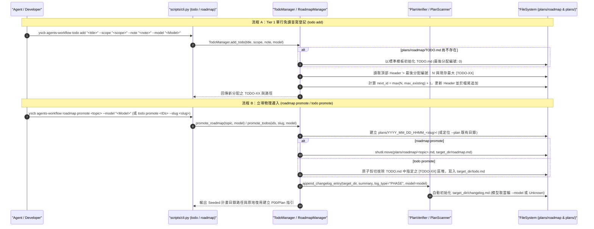

# 架構設計說明書 (Architecture Design)

> 功能名稱：sub_02_roadmap_and_todo_refactoring  
> 建立日期：2026-10-24  
> 所屬主計畫：2026_10_23_1314_agents_workflow_aci_and_delegation_evolution  
> 狀態：Confirmed  
> 模型：Unknown  

> 模板版本：v1.2  

---

## 1. 模組架構分層與職責邊界 (Layered Architecture)

```text
+-----------------------------------------------------------------------------------+
|                        CLI & Contributes Contract Layer                           |
|  - contributes/core.json      : 擴充 roadmap (list/promote) + 新增 todo (add/list/promote) |
|  - scripts/cli.py             : def roadmap(), def todo() 頂層函式與子命令路由     |
|  - contributes/agents-workflow.json : 匯出 todo 技能與 todo.md 模板                |
+-----------------------------------------+-----------------------------------------+
                                          |
                                          v
+-----------------------------------------------------------------------------------+
|                      Dual-Tier Backlog & Promotion Engine                         |
|  - agents_workflow/roadmap.py                                                     |
|    * TodoItem (dataclass)     : id, title, date, scope, note, raw_block           |
|    * TodoManager              :                                                   |
|        - add_todo()           : 免讀盲寫、讀取/遞增 '> 最後分配編號：N'、自動初始化 |
|        - list_todos()         : 解析 TODO.md 條目並支援 --scope 關鍵字過濾         |
|        - promote_todos()      : 單筆/多筆原子剪切 (Pop)、--slug 校驗、建立 todo.md |
|    * RoadmapItem (dataclass)  : 擴充 scope, trigger 欄位                          |
|    * RoadmapManager           :                                                   |
|        - scan_roadmaps()      : 自動排除 TODO.md，支援 --status 過濾              |
|        - promote_roadmap()    : 物理搬移 shutil.move 為計畫目錄內 roadmap.md      |
+-----------------------------------------+-----------------------------------------+
                                          |
                                          v
+-----------------------------------------------------------------------------------+
|                   Dev Plans Origin Seed Whitelist & State Layer                   |
|  - agents_workflow/plans/{status.py, scanner.py, verifier.py}                     |
|    * ORIGIN_SEED_FILES = {"roadmap.md", "todo.md"}                                |
|    * PlanStatusResolver / PlanScanner :                                           |
|        - 若計畫目錄僅含 roadmap.md / todo.md (+ changelog.md) -> 狀態為 'Seeded'   |
|        - 若已建立 P00~P07 / fast_track_plan / revision_log -> 由主體文件主導進度    |
|    * PlanVerifier             :                                                   |
|        - 識別計畫目錄內之 roadmap.md / todo.md，豁免模板章節鏡像、所屬主計畫與終態 |
+-----------------------------------------------------------------------------------+
```

---

## 2. 核心資料流與循序圖 (Data Flow & Sequence Diagram)



---

## 3. 受影響檔案與新建檔案清單 (Impacted & New Files Inventory)

| 檔案路徑 | 類型 | 職責與變更說明 |
| :--- | :---: | :--- |
| `ys_codebase/source/agents-workflow/assets/templates/todo.md` | New | Tier 1 集中式輕量待辦帳本 (`plans/roadmap/TODO.md`) 標準模板（含 `> 最後分配編號：0`）。 |
| `ys_codebase/source/agents-workflow/assets/templates/roadmap.md` | Modify | Tier 2 路線圖模板升級（新增 `> 目標範疇：` 與 `> 前置解鎖條件：`，收斂狀態為 `Backlog \| Proposed \| Ready \| Deferred`）。 |
| `ys_codebase/source/agents-workflow/assets/skills/todo/SKILL.md` | New | `/todo` 輕量待辦管理技能手冊（主動指令型極致精簡契約）。 |
| `ys_codebase/source/agents-workflow/assets/skills/roadmap/SKILL.md` | Modify | 收斂為主動指令型極致精簡契約，整合 `roadmap promote` 物理遷入與 `--status` 過濾流程。 |
| `ys_codebase/source/agents-workflow/assets/skills/new-plan/SKILL.md` | Modify | 增補 `[防呆 1]` 既有 `Seeded` 目錄（含 `roadmap.md` / `todo.md`）原地復用鐵律。 |
| `ys_codebase/source/agents-workflow/assets/skills/development-sop/SKILL.md` | Modify | 增補 `/todo` 生命週期分流與 `todo.md` 模板指針。 |
| `ys_codebase/source/agents-workflow/assets/skills/discuss/SKILL.md` | Modify | 於次要衍生問題出口 ③ 增補經開發者裁定後使用 `todo add` 單行盲寫或 `/roadmap` 收錄說明。 |
| `ys_codebase/source/agents-workflow/assets/skills/research/SKILL.md` | Modify | 於出口 ② 增補路線圖儲備與後續 `roadmap promote` 銜接說明。 |
| `ys_codebase/source/agents-workflow/assets/skills/yscb-cli-guide/SKILL.md` | Modify | 於雙引號字串逃逸防呆補充 `todo add` 參數同樣禁止夾帶雙引號與反引號。 |
| `ys_codebase/source/agents-workflow/agents_workflow/roadmap.py` | Modify | 擴充 `RoadmapItem`/`RoadmapManager`（排除 `TODO.md`、`--status` 過濾、`promote_roadmap`）並新增 `TodoItem`/`TodoManager`（`add_todo`, `list_todos`, `promote_todos`）。 |
| `ys_codebase/source/agents-workflow/agents_workflow/plans/status.py` | Modify | 定義 `ORIGIN_SEED_FILES = {"roadmap.md", "todo.md"}`；支援 `Seeded` 狀態判定與 `resolve_next_action` 原地復用領航。 |
| `ys_codebase/source/agents-workflow/agents_workflow/plans/scanner.py` | Modify | `get_plan_info` 支援識別僅含 `roadmap.md` / `todo.md` 之 `Seeded` 計畫目錄。 |
| `ys_codebase/source/agents-workflow/agents_workflow/plans/verifier.py` | Modify | 對計畫目錄內之 `roadmap.md` / `todo.md` 實作前置源頭背景資產白名單檢核（豁免子計畫 `> 所屬主計畫：`、允許 `> 歸檔日期：` / `> 更新日期：` 與儲備狀態，豁免模板章節鏡像與終態強制）。 |
| `ys_codebase/source/agents-workflow/scripts/cli.py` | Modify | 擴充 `def roadmap()`（支援 `list`/`promote` 子命令與 `--status`/`--plan`/`--model`）並新增 `def todo()`（支援 `add`/`list`/`promote`）。 |
| `ys_codebase/source/agents-workflow/contributes/core.json` | Modify | 宣告 `roadmap` 擴充參數與頂層 `todo` 命令群契約。 |
| `ys_codebase/source/agents-workflow/contributes/agents-workflow.json` | Modify | 註冊匯出 `todo` 技能與 `todo.md` 模板並同步更新 `roadmap` 技能描述。 |
| `ys_codebase/source/agents-workflow/tests/test_plans_toolchain.py` | Modify | 新增 `TodoManager`、`RoadmapManager.promote_roadmap` 與 `Seeded` 白名單之完整單元與邊界測試。 |
| `docs/agents-workflow/{README.md,user_guide.md,DESIGN_NOTES.md}` | Modify | 同步更新雙層儲備架構、`Consume-on-Promote` 與單調計數器設計決策 (`[DN-AW-11]`)。 |

---

## 4. 架構決策記錄 (Architecture Decision Records)

- **[P02:DR-01] `TodoManager` 與 `RoadmapManager` 同駐 `agents_workflow/roadmap.py` 共享路徑解析**：
  `TODO.md` 與 `{topic}.md` 皆存放於 `workflow.roadmap://` (`plans/roadmap/`) 且立項目標皆為 `workflow.plans://` (`plans/`)。將 `TodoItem` 與 `TodoManager` 直接建置於 `agents_workflow/roadmap.py` 並於 `agents_workflow/__init__.py` / `plans/__init__.py` 按需匯出，可重用相同的 URI 解析與計畫目錄建立基底，避免模組碎片化。
- **[P02:DR-02] `roadmap` CLI 複合路由向後相容設計**：
  為確保 `python yscb.py agents-workflow roadmap`、`roadmap --list`、`roadmap <topic>` 等既有調用 100% 向後相容，同時支援 `roadmap list [--status <val>]` 與 `roadmap promote <topic> [--plan <dir>] [--model <m>]`：`scripts/cli.py:roadmap()` 檢查 `bags.args[0]` 是否為 `"list"` 或 `"promote"`；若為 `"promote"` 則執行立項搬移，若為 `"list"` 或無參數或帶 `--list` 則執行列表（支援 `--status` 過濾），否則視為查詢單一 `<topic>` 詳情。
- **[P02:DR-03] `PlanVerifier` 前置源頭資產輕量驗證策略**：
  當 `PlanVerifier._verify_markdown_file` 檢測到檔案名稱為 `roadmap.md` 或 `todo.md` 時，仍執行「零 HTML 註解 (`<!-- -->`)」與「零未替換模板佔位符」安全檢查，但放寬日期欄位（接受 `建立日期 | 歸檔日期 | 更新日期`）與狀態枚舉（額外接受 `backlog | proposed | ready | deferred`），並跳過 `is_sub_plan` 的 `> 所屬主計畫：` 強制檢查與模板章節標題鏡像檢查，兼顧檔案純淨度與歷史提案原貌保留。

