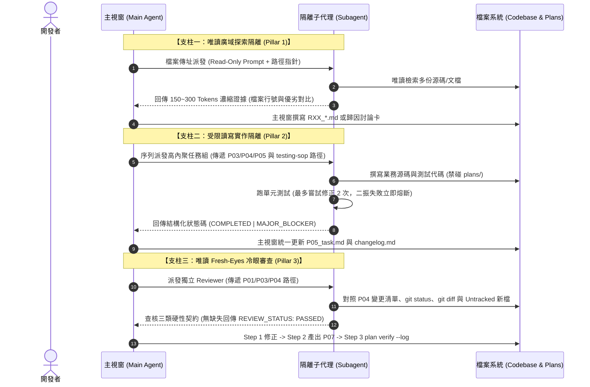

# 架構設計說明書 (Architecture Design)

> 功能名稱：sub_03_testing_sop_and_subagent_isolation  
> 建立日期：2026-10-24  
> 所屬主計畫：2026_10_23_1314_agents_workflow_aci_and_delegation_evolution  
> 狀態：Confirmed  
> 模型：Gemini 3.8 Flash (High)  

> 模板版本：v1.2  

---

## 1. 模組架構分層與職責邊界 (Layered Architecture)

本子計畫整體架構分為「規範與技能層 (Layer 1 Standards & Skills)」、「編譯與擴充匯出層 (Layer 2 Contributes & Engine)」與「Python 工具鏈加固層 (Layer 3 Python ACI)」，呈現清晰之單向依賴拓撲：

```text
+-----------------------------------------------------------------------------------+
| Layer 1: 專案規範與工作流技能層 (Standards, SOP References & Skills)             |
|  - AgentsStandards.md: 條件式技能路由表新增 testing-sop 守門                      |
|  - testing-sop/SKILL.md: 六大測試鐵律 + TESTING_SOP_STANDARDS 錨點                |
|  - testing-sop/references/test_suite_audit_and_purification.md: T-01~06 存量體檢   |
|  - development-sop/references/: P04/P05/P06 測試守門 + P07 Fresh-Eyes Review     |
|  - research/SKILL.md & discuss/SKILL.md: Pillar 1 唯讀廣域探索委派                |
|  - auto/SKILL.md: Pillar 2 受限讀寫序列委派 + 二振失敗熔斷 (2-Strike Limit)       |
+-----------------------------------------+-----------------------------------------+
                                          | 宣告匯出與 Token 註冊
                                          v
+-----------------------------------------------------------------------------------+
| Layer 2: 模組宣告與雙層編譯層 (Contributes & Release Projections)                 |
|  - contributes/agents-workflow.json:                                              |
|      * 匯出 skill: testing-sop                                                    |
|      * 註冊 token: TESTING_SOP_STANDARDS                                          |
|  - 双層編譯管線: contributes check -> compile -> release 物化至 .agents/ / .claude/ |
+-----------------------------------------+-----------------------------------------+
                                          | 驅動與工具鏈支援
                                          v
+-----------------------------------------------------------------------------------+
| Layer 3: Python ACI 工具鏈層 (RoadmapManager Multi-Promote Append)                |
|  - agents_workflow/roadmap.py:                                                    |
|      * RoadmapManager.promote_roadmap(): 目標目錄已存在 roadmap.md 時無損追加合併  |
+-----------------------------------------------------------------------------------+
```

---

## 2. 核心資料流與循序圖 (Data Flow & Sequence Diagram)

### 2.1 三支柱 Subagent 委派協定時序 (Three-Pillar Delegation Flow)



---

## 3. 受影響檔案與新建檔案清單 (Impacted & New Files Inventory)

| 檔案路徑 | 類型 | 職責與變更說明 |
| :--- | :---: | :--- |
| `ys_codebase/source/agents-workflow/assets/skills/testing-sop/SKILL.md` | New | 建立環境型技能主檔，封裝六大測試鐵律、`TESTING_SOP_STANDARDS` 錨點與日常/存量分流 (`FR-01`) |
| `ys_codebase/source/agents-workflow/assets/skills/testing-sop/references/test_suite_audit_and_purification.md` | New | 建立存量測試集六大病灶體檢模型 (`T-01`~`T-06`) 與子系統 1:1 歸戶收斂參考指南 (`FR-02`) |
| `ys_codebase/source/agents-workflow/contributes/agents-workflow.json` | Modified | 註冊 `testing-sop` 技能匯出與 `TESTING_SOP_STANDARDS` Token (`FR-01`) |
| `ys_codebase/source/agents-workflow/assets/standards/AgentsStandards.md` | Modified | §2 條件式技能路由表新增 `testing-sop` 強制觸發路由列 (`FR-03`) |
| `ys_codebase/source/agents-workflow/assets/skills/development-sop/references/phase_04_plan.md` | Modified | 植入定稿 `P06_test_plan.md` 前強制觸發 `testing-sop` 連鎖引用 (`FR-03`) |
| `ys_codebase/source/agents-workflow/assets/skills/development-sop/references/phase_05_task.md` | Modified | 植入編測前觸發 `testing-sop` 與支柱二 Subagent 序列實作、檔案傳址及二振熔斷協定 (`FR-03`, `FR-05`) |
| `ys_codebase/source/agents-workflow/assets/skills/development-sop/references/phase_06_test.md` | Modified | 植入觸發 `testing-sop` 與 Phase 06 雙重守門（子系統回歸全綠 + 新增測試反模式自檢）(`FR-03`, `FR-05`) |
| `ys_codebase/source/agents-workflow/assets/skills/development-sop/references/phase_07_walkthrough.md` | Modified | Step 1 內化支柱三 Fresh-Eyes Review（Untracked 盲區防護 + 三類硬性契約 + 三步時序）(`FR-06`) |
| `ys_codebase/source/agents-workflow/assets/skills/development-sop/references/plan_modes.md` | Modified | Fast Track `FP-02` 植入 `testing-sop` 連鎖引用守門 (`FR-03`) |
| `ys_codebase/source/agents-workflow/assets/skills/research/SKILL.md` | Modified | 步驟 2 內化支柱一唯讀廣域探索委派指引與 150~300 Tokens 摘要格式 (`FR-04`) |
| `ys_codebase/source/agents-workflow/assets/skills/discuss/SKILL.md` | Modified | 步驟 1 內化支柱一唯讀探索委派指引與由近及遠證據收集協定 (`FR-04`) |
| `ys_codebase/source/agents-workflow/assets/skills/auto/SKILL.md` | Modified | 步驟 2/3 內化支柱二門檻判定、高內聚任務組序列委派與二振熔斷機制 (`FR-05`) |
| `ys_codebase/source/agents-workflow/agents_workflow/roadmap.py` | Modified | `RoadmapManager.promote_roadmap()` 補強既有 `roadmap.md` 無損追加合併與移除來源檔案 (`FR-07`) |
| `ys_codebase/source/agents-workflow/tests/test_plans_model_record.py` | Modified | 同步更新內建技能預期清單，加入 `testing-sop` 並驗證三段式描述 (`FR-01`, `NFR-02`) |
| `ys_codebase/source/agents-workflow/tests/test_roadmap.py` | Modified | 新增多路線圖合流遷入無損追加合併單元測試 (`FR-07`, `ET-05`) |

---

## 4. 架構決策記錄 (Architecture Decision Records)

- **[P02:DR-01] 漸進式雙層揭露技能設計**：
  `testing-sop/SKILL.md` 精簡承載日常六大測試鐵律與錨點，將複雜度高的存量純化流程拆至 `references/` 按需載入，確保日常寫測試或審查測試時 context 負擔最小化。
- **[P02:DR-02] 連鎖引用觸發 (Chained Semantic Triggers)**：
  透過 `AgentsStandards.md` 條件式路由與 `phase_04/05/06`、`plan_modes.md` 內的 Stage 2 語意連結 `__#{module://agents-workflow/assets/skills/testing-sop/SKILL.md}__`，達成開發者/Agent「一旦涉及測試，必觸發 testing-sop」之無死角守門。
- **[P02:DR-03] 三支柱門檻委派與 Single-Writer 防呆**：
  全面採用「檔案路徑傳址」，不開發 CLI 切片器；Subagent 嚴格遵守 Single-Writer（禁碰 `plans/`）與二振失敗熔斷（最多重試 2 次），杜絕爆窗與衝突。
- **[P02:DR-04] 多路線圖遷入無損追加合併**：
  當 `promote_roadmap` 目標目錄已存在 `roadmap.md` 時，將新路線圖以標準分隔線追加合併至現有 `roadmap.md` 尾部，並維護伴隨 `changelog.md`。

