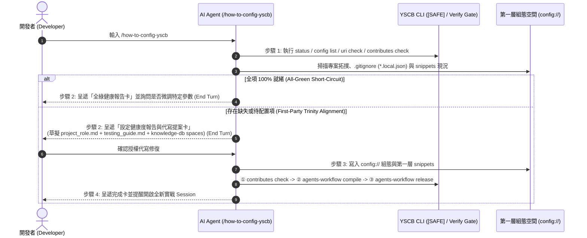

# 架構設計說明書 (Architecture Design)

> 功能名稱：sub_04_onboarding_and_config_coaching  
> 建立日期：2026-10-24  
> 所屬主計畫：2026_10_23_1314_agents_workflow_aci_and_delegation_evolution  
> 狀態：Confirmed  
> 模型：Gemini 4 Argon (Low)  

> 模板版本：v1.2  

---

## 1. 模組架構分層與職責邊界 (Layered Architecture)

```mermaid
flowchart TD
    subgraph Layer1["第一層源碼與宣告層 (Source & Config Space)"]
        AS["agents-workflow: AgentsStandards.md<br/>(__@{PROJECT_ROLE_AND_BOUNDARIES}__)"]
        HTC["agents-workflow: how-to-config-yscb/SKILL.md<br/>(__@{HOW_TO_CONFIG_MODULES}__)"]
        HTY["agents-workflow: how-to-yscb/SKILL.md<br/>(__@{HOW_TO_YSCB_MODULES}__)"]
        MODS["四大核心模組 (core / dev / server / knowledge-db)<br/>assets/{config_guide.md, usage_guide.md}<br/>+ contributes/agents-workflow.json"]
        PRJ_CFG["專案組態層 (config://agents-workflow/)<br/>snippets/{project_role.md, testing_guide.md}<br/>+ contribute.json"]
    end

    subgraph Compiler["雙階編譯與發布管線 (ArtifactCompiler & ReleasePublisher)"]
        S1["Stage 1: Token 遞迴解算與跨模組 Fallback 防護<br/>(resolve_single_artifact / _resolve_source_path)"]
        S2["Stage 2: 語意 URI 相對路徑轉譯<br/>(__#{module://<mod>/README.md}__)"]
    end

    subgraph Layer2["第二層物化唯讀空間 (Materialized Target Space)"]
        AG_MD["根目錄規範入口 (AGENTS.md / CLAUDE.md)<br/>Turn 0 常駐專案角色與主客體空間邊界"]
        SKILLS[".agents/skills/ (或 .claude/skills/)<br/>how-to-config-yscb & how-to-yscb"]
    end

    MODS -->|"mode: below"| S1
    PRJ_CFG -->|"mode: replace"| S1
    AS --> S1
    HTC --> S1
    HTY --> S1
    S1 --> S2
    S2 --> AG_MD
    S2 --> SKILLS
```

---

## 2. 核心資料流與循序圖 (Data Flow & Sequence Diagram)

---

## 3. 受影響檔案與新建檔案清單 (Impacted & New Files Inventory)

| 檔案路徑 | 類型 | 職責與變更說明 |
| :--- | :---: | :--- |
| `ys_codebase/source/agents-workflow/assets/standards/AgentsStandards.md` | Modify | 於導言下方、`## 1. 核心原則` 上方新增獨立行 `` `__@{PROJECT_ROLE_AND_BOUNDARIES}__` `` 選配錨點。 |
| `ys_codebase/source/agents-workflow/assets/skills/how-to-config-yscb/SKILL.md` | New | 建立跨模組設定體檢、三處聯動對齊代寫與三步嚴格編譯驗證守門之主動指令型技能。 |
| `ys_codebase/source/agents-workflow/assets/skills/how-to-yscb/SKILL.md` | New | 建立雙入口自適應開場、兩階段知識調度、唯讀教學護欄與新開實戰 Session 隔離之互動教練技能。 |
| `ys_codebase/source/agents-workflow/assets/skills/context-init/SKILL.md` | Modify | 步驟 1 補充提取專案角色與空間邊界（若已配置），熱啟動狀態卡底部新增 `/how-to-yscb` 與 `/how-to-config-yscb` 提示。 |
| `ys_codebase/source/agents-workflow/contributes/agents-workflow.json` | Modify | 註冊 `how-to-config-yscb`、`how-to-yscb` 技能匯出，以及 `PROJECT_ROLE_AND_BOUNDARIES`、`HOW_TO_CONFIG_MODULES`、`HOW_TO_YSCB_MODULES` 三個 Token 錨點。 |
| `ys_codebase/source/agents-workflow/agents_workflow/compiler.py` | Modify | 修正 `_resolve_source_path()` Step 2 針對跨模組 `module://<mod>/<rel_p>` 之同級模組目錄 Fallback，防止誤讀 `agents-workflow` 同名檔案。 |
| `ys_codebase/source/agents-workflow/scripts/cli.py` | Modify | 修復 `tokens()` 顯示邏輯，相容 `tok.get("value") or tok.get("name") or ""`。 |
| `ys_codebase/source/core/assets/config_guide.md` & `usage_guide.md` | New | `core` 模組之設定體檢卡與標準用法速查卡（各 15~25 行）。 |
| `ys_codebase/source/core/contributes/agents-workflow.json` & `_manifest.md` | Modify | 注入 `core` 之設定體檢卡與標準用法速查卡至 `HOW_TO_CONFIG_MODULES` 與 `HOW_TO_YSCB_MODULES`。 |
| `ys_codebase/source/dev/assets/config_guide.md` & `usage_guide.md` | New | `dev` 模組之設定體檢卡與標準用法速查卡（各 15~25 行）。 |
| `ys_codebase/source/dev/contributes/agents-workflow.json` & `_manifest.md` | Modify | 注入 `dev` 之設定體檢卡與標準用法速查卡。 |
| `ys_codebase/source/server/assets/config_guide.md` & `usage_guide.md` | New | `server` 模組之設定體檢卡與標準用法速查卡（各 15~25 行）。 |
| `ys_codebase/source/server/contributes/agents-workflow.json` & `_manifest.md` | New / Modify | 新建 `server/contributes/agents-workflow.json` 並更新 `_manifest.md`，注入 `server` 之設定體檢卡與標準用法速查卡。 |
| `ys_codebase/source/knowledge-db/assets/config_guide.md` & `usage_guide.md` | New | `knowledge-db` 模組之設定體檢卡與標準用法速查卡（各 15~25 行）。 |
| `ys_codebase/source/knowledge-db/contributes/agents-workflow.json` & `_manifest.md` | Modify | 補齊 `KNOWLEDGE_DB_SPACE` 之 `"value"` 欄位，並注入 `knowledge-db` 之設定體檢卡與標準用法速查卡。 |
| `ys_codebase/source/agents-workflow/tests/test_plans_model_record.py` & `test_compiler.py` | Modify | 擴充技能清冊、雙星技能結構、`PROJECT_ROLE_AND_BOUNDARIES` 注入/抹除、`tokens` 顯示與跨模組 `_resolve_source_path` 測試。 |
| `ys_codebase/source/agents-workflow/README.md` & `docs/agents-workflow/` | Modify | 同步更新模組手冊、使用者指南與 `DESIGN_NOTES.md`。 |

---

## 4. 架構決策記錄 (Architecture Decision Records)

- **[P02:DR-01] 基底內建工作流引導 + 跨模組 `mode: "below"` 宣告式匯聚架構**：
  `agents-workflow` 自身之設定檢核項（`paths.*`、`release_targets`、`project_role.md`、`testing_guide.md`）與核心工作流心法直接內建於 `how-to-config-yscb/SKILL.md` 及 `how-to-yscb/SKILL.md` 基底文本中；而 `core`、`dev`、`server`、`knowledge-db` 則透過各自 `contributes/agents-workflow.json` 以 `mode: "below"` 注入 `HOW_TO_CONFIG_MODULES` 與 `HOW_TO_YSCB_MODULES`。如此一來，下游專案實際安裝了哪些模組，物化出的兩個技能就精準呈現哪些模組的體檢卡與速查卡，實現 100% 動態解耦。
- **[P02:DR-02] `_resolve_source_path` 跨模組路徑隔離與 `tokens` 雙鍵名相容**：
  在 `ArtifactCompiler._resolve_source_path()` 中解析 `module://<mod>/<rel_p>` 時，若 `uri.resolve()` 因環境尚未物化而走本地相對路徑 Fallback，強制檢查 `<mod>` 是否為 `"agents-workflow"`；若為其他模組則定位至同級模組目錄 `os.path.join(os.path.dirname(self.module_root), mod_name, rel_p)`，徹底消除多個模組皆命名 `assets/config_guide.md` 時在本地未打包階段誤讀 `agents-workflow` 檔案的風險。

