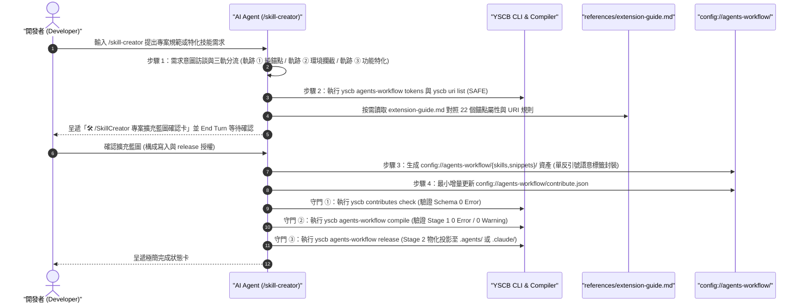

# 架構設計說明書 (Architecture Design)

> 功能名稱：專案特化技能建置與 Layer 2 宣告式擴充引導工作流 (sub_05_skill_creator_extension_workflow)  
> 建立日期：2026-10-25  
> 所屬主計畫：2026_10_23_1314_agents_workflow_aci_and_delegation_evolution  
> 狀態：Confirmed  
> 模型：Gemini 4 Argon (Low)  

> 模板版本：v1.2  

---

## 1. 模組架構分層與職責邊界 (Layered Architecture)

本子計畫於 `agents-workflow` 模組之「第一層核心資產層 (`module://agents-workflow/assets/`)」與「組態宣告層 (`contributes/`)」建立 `/skill-creator` 專案特化技能建置與 Layer 2 宣告式擴充引導工作流，完整串接雙階段語意編譯器 (`ArtifactCompiler`) 與專案組態空間 (`config://agents-workflow/`)：

```mermaid
flowchart TD
    subgraph HubLayer["中樞與互指導流層 (Hub & Peer Routing)"]
        DevSOP["development-sop/SKILL.md\n(§1 生命週期工作流中樞分流)"]
        SkillOpt["skill-optimizer/SKILL.md\n(排除情境 -> 導流 /skill-creator)"]
        HowTo["how-to-yscb/SKILL.md\n(角度 D 進階客製化引導)"]
    end

    subgraph SkillCreatorPkg["新增技能包 (assets/skills/skill-creator/)"]
        SCMain["skill-creator/SKILL.md\n(≤180行 主動指令型四步工作流 + 藍圖確認卡)"]
        SCRef["references/extension-guide.md\n(單層參考手冊：22 個錨點地圖 + URI 規則 + 三軌 JSON 範本)"]
        SCToken["`__@{SKILL_CREATOR_STANDARDS}__`\n(尾部擴充錨點)"]
    end

    subgraph DiscoveryCLI["動態探索與三步驗證守門 (CLI & Compiler Gate)"]
        TokensCLI["yscb agents-workflow tokens\n(查詢 22 個 Stage 1 錨點)"]
        UriCLI["yscb uri list\n(查詢全系統語意 URI)"]
        Gate1["① yscb contributes check"]
        Gate2["② yscb agents-workflow compile\n(0 Error / 0 Warning)"]
        Gate3["③ yscb agents-workflow release\n(物化至 .agents/ 或 .claude/)"]
    end

    subgraph Layer2Config["下游專案第一層宣告式擴充空間 (config://agents-workflow/)"]
        Track1["軌跡 ① 純錨點注入\nsnippets/<name>.md + insert"]
        Track2["軌跡 ② 環境攔截型 Skill\nskills/<name>/SKILL.md + export + AGENTS_SKILL_ROUTING"]
        Track3["軌跡 ③ 功能特化型 Skill\nskills/<name>/SKILL.md + export (+ 選配路由)"]
    end

    DevSOP --> SCMain
    SkillOpt <--> SCMain
    HowTo --> SCMain
    SCMain --> SCRef
    SCMain --> SCToken
    SCMain --> TokensCLI
    SCMain --> UriCLI
    SCMain --> Layer2Config
    Layer2Config --> Gate1 --> Gate2 --> Gate3
```

### 組件職責邊界表

| 組件 / 檔案 | 所屬層級 | 核心職責與正負向邊界 | 對應需求 |
| :--- | :---: | :--- | :--- |
| `assets/skills/skill-creator/SKILL.md` | 技能主入口層 | 定義主動指令型 Frontmatter 契約、四步建置檢核表、三軌擴充判定矩陣（軌跡 ①/②/③）、擴充藍圖確認卡（End Turn 守門）、扁平路徑規範、同技能相對路徑 vs. 跨空間單反引號語意 URI 分流、三步編譯驗證守門與 `SKILL_CREATOR_STANDARDS` 錨點。嚴格控制 $\le 180$ 行。 | FR-01, FR-02, FR-03, EC-01~EC-04, NFR-01, NFR-02 |
| `assets/skills/skill-creator/references/extension-guide.md` | 單層按需參考層 | 頂部含 TOC；收錄全系統 22 個 Stage 1 Token 錨點完整地圖（宿主位置、獨立區塊 vs. 表格行結構屬性、適用場景）、Stage 2 語意 URI 轉換與單反引號防呆正反範例、以及軌跡 ①/②/③ 之 `config://agents-workflow/contribute.json` 最小增量 JSON 範本。 | FR-02, FR-04, EC-01, EC-03, EC-05, NFR-01, NFR-02 |
| `contributes/agents-workflow.json` & `_manifest.md` | 模組貢獻宣告層 | 註冊 `skill-creator` 技能匯出（內建技能共 17 個）與 `SKILL_CREATOR_STANDARDS` Token（本模組 21 個、全系統共 22 個）。 | FR-01, FR-05 |
| `development-sop/SKILL.md` & `skill-optimizer/SKILL.md` | 技能互指導流層 | 建立「新建專案特化技能／擴充規範 (`skill-creator`)」與「審查優化既有技能 (`skill-optimizer`)」之雙向互指與中樞導流閉環。 | FR-01, FR-05 |
| `tests/test_plans_model_record.py` | 自動化驗證層 | 更新 `test_ft_08` 將 `skill-creator` 納入全部 17 個技能之雙軌 `description`、零裸寫標籤与零特化污染掃描；新增 `test_ft_11_sub05_skill_creator_extension_workflow` 驗證 `FR-01`~`FR-05` 與 `EC-01`~`EC-05`。 | FR-05, EC-01, NFR-01, NFR-02 |

---

## 2. 核心資料流與循序圖 (Data Flow & Sequence Diagram)



---

## 3. 受影響檔案與新建檔案清單 (Impacted & New Files Inventory)

| 檔案路徑 | 類型 | 職責與變更說明 |
| :--- | :---: | :--- |
| `ys_codebase/source/agents-workflow/assets/skills/skill-creator/SKILL.md` | New | 新增 `/skill-creator` 技能主檔（主動指令型契約、三軌分流、藍圖確認卡、單反引號封裝與三步驗證守門，$\le 180$ 行） |
| `ys_codebase/source/agents-workflow/assets/skills/skill-creator/references/extension-guide.md` | New | 新增單層擴充參考手冊（含 TOC、全系統 22 個 Stage 1 錨點地圖、Stage 2 語意 URI 規則與三軌 `contribute.json` 範本） |
| `ys_codebase/source/agents-workflow/contributes/agents-workflow.json` | Modify | 新增 `skill-creator` 技能 `export` 條目與 `SKILL_CREATOR_STANDARDS` `token` 條目 |
| `ys_codebase/source/agents-workflow/contributes/_manifest.md` | Modify | 同步更新模組導出技能數量（17 大技能）與說明 |
| `ys_codebase/source/agents-workflow/assets/skills/development-sop/SKILL.md` | Modify | 於 §1 生命週期工作流中樞分流新增 `/skill-creator` 導流條目 |
| `ys_codebase/source/agents-workflow/assets/skills/skill-optimizer/SKILL.md` | Modify | 於「排除情境（負向邊界）」新增「從零建立專案特化 Skill 或階段錨點注入規則」導流至 `/skill-creator` |
| `ys_codebase/source/agents-workflow/tests/test_plans_model_record.py` | Modify | 更新 `test_ft_08`（納入 `skill-creator` 共 17 個技能）並新增 `test_ft_11_sub05_skill_creator_extension_workflow` |
| `ys_codebase/source/agents-workflow/README.md` | Modify | 同步更新隨包手冊之內建技能清單（17 個）與 Token 錨點清單（21 個本模組 / 22 個全系統） |
| `docs/agents-workflow/README.md` | Modify | 同步更新系統知識庫之技能總表與擴充引導說明 |
| `docs/agents-workflow/user_guide.md` | Modify | 同步更新指令速查與 `/skill-creator` 實戰引導說明 |
| `docs/agents-workflow/DESIGN_NOTES.md` | Modify | 視需要補充或更新設計決策紀錄 |

---

## 4. 架構決策記錄 (Architecture Decision Records)

- **`[P02:DR-01]` 雙層漸進式揭露拆分與 1-Level Deep 參考手冊架構**：
  - **決策**：將核心工作流控制邏輯（三軌判定、藍圖確認卡、路徑分流規則、三步編譯驗證守門）收斂於 `skill-creator/SKILL.md` 主檔（嚴格控制在 $\le 180$ 行），而將高資訊密度的「全系統 22 個 Stage 1 Token 錨點速查表」、「Stage 2 語意 URI 轉換語法與正反對照」及「三軌 `contribute.json` JSON 範本」獨立拆分至單層 `references/extension-guide.md`（頂部配置 `## 目錄 (Contents)`，且不包含次級子目錄）。
  - **理由**：符合 `NFR-01` 與 `skill-optimizer` 漸進式揭露規範，避免每次載入 `SKILL.md` 時消耗過多 Context，同時在執行步驟 2 與步驟 3 時提供 100% 精確的查表依據。
- **`[P02:DR-02]` 教學範例之編譯器 `<!-- yscb:literal -->` 字面量保護與真實標籤雙軌寫法**：
  - **決策**：由於 `ArtifactCompiler` 在 Stage 1 (`resolve_single_artifact`) 與 Stage 2 (`resolve_stage2_uri`) 預設會解算一般 Fenced Code Block 內部的模板佔位符（否則狀態卡模板內的路徑無法轉譯），若直接在 `skill-creator` 或 `extension-guide.md` 展示 `__@{...}__`、`__#{...}__`、`__${...}__` 語法，物化後教學範例會被抹除或轉譯為相對路徑。因此：
    1. 於 `ArtifactCompiler` (`compiler.py`) 實作 `LITERAL_FENCED_BLOCK_REGEX`：凡在 Fenced Code Block 首行標註 `<!-- yscb:literal -->` 者，於 Stage 1 與 Stage 2 預先抽離保護，並在 Stage 2 結尾剝除首行 `<!-- yscb:literal -->` 標記後原樣還原，確保物化後的 `.agents/skills/skill-creator/` 完整保留 `__@{...}__`、`__#{...}__`、`__${...}__` 教學語法且 0 編譯警告。
    2. 凡位於散文或表格內需實際解算之語意路徑，採用穿插型真實語意 URI（如 `` `__${config://agents-workflow}__/contribute.json` ``），使 Stage 2 解算後仍保留外層行內反引號。
    3. 同時嚴格避開 `test_ft_08` 禁字（不在文檔中出現「不要加反引號」或「compiler.py」字樣）。
  - **理由**：徹底滿足 `EC-01` 與 `NFR-02`，保證 `python yscb.py agents-workflow compile` 與 `release` 100% 零 Error、零 Warning，且通過 `test_ft_08` 剛性回歸。
- **`[P02:DR-03]` 確認卡前置授權與三步驗證守門閉環**：
  - **決策**：將開發者對步驟 2「🛠️ /SkillCreator 專案擴充藍圖確認卡」的明確同意，定義為步驟 4 通過 `contributes check` 與 `compile` 後執行 `agents-workflow release` 物化同步的前置授權（與 `/how-to-config-yscb` Step 2 $\to$ Step 3 模式完全一致）；若 `contributes check` 或 `compile` 檢出任何錯誤或警告，強制阻斷 `release` 並原地修正。

