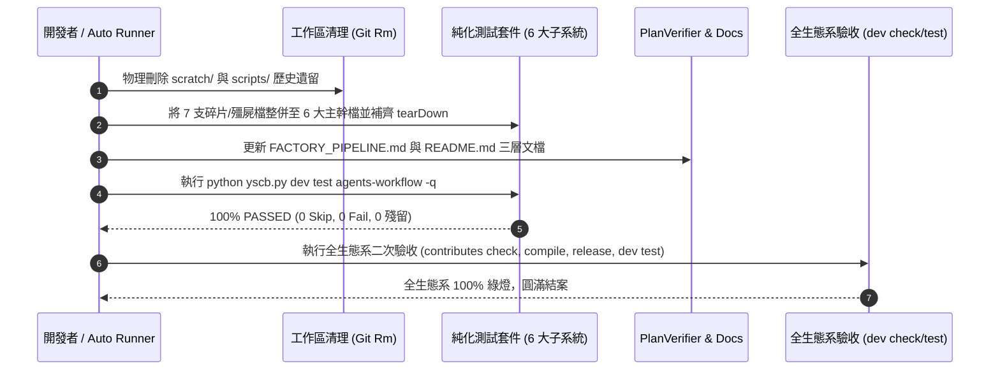

# 系統架構設計與模組規劃書 (Architecture Plan)

> 功能名稱：全主計畫二次驗收、測試集子系統 1:1 純化、歷史目錄清理與三層文檔收官 (sub_08_final_acceptance_and_suite_purification)  
> 建立日期：2026-10-25  
> 所屬主計畫：2026_10_23_1314_agents_workflow_aci_and_delegation_evolution  
> 狀態：Confirmed  
> 模型：Gemini 3.8 Flash (Medium)  

---

## 1. 模組架構分層與職責邊界 (Layered Architecture)

```
ys_codebase/source/agents-workflow/
  ├── agents_workflow/ (生產核心子系統，維持 6 大職責邊界)
  │     ├── compiler.py           <--- Stage 1 錨點注入、Stage 2 語意 URI 解析、字面量保護
  │     ├── publisher.py          <--- 二層物化發布、JIT 雜湊偵測、目錄自動清理
  │     ├── initializer.py        <--- 專案工作流初始化、組態生成
  │     ├── targets.py            <--- 多目標平台發布投影管理 (antigravity/claude)
  │     ├── roadmap.py            <--- 雙層儲備管理器 (RoadmapManager & TodoManager)
  │     └── plans/                <--- Plans 工具鏈 (status, scanner, verifier, archiver, searcher)
  └── tests/ (純化後 1:1 歸戶之 6 大子系統測試集)
        ├── test_compiler.py      <--- 對應 compiler.py 及內建 17 Skills / 16 Templates 資產 Meta-Linter
        ├── test_publisher.py     <--- 對應 publisher.py（整合 JIT、清單隔離與 cross-platform LF）
        ├── test_initializer.py   <--- 對應 initializer.py
        ├── test_targets.py       <--- 對應 targets.py
        ├── test_roadmap.py       <--- 對應 roadmap.py (RoadmapManager & TodoManager)
        └── test_plans_toolchain.py <--- 對應 plans/ 全套 ACI 工具鏈與 _auto.md 雙軌相容
```

---

## 2. 核心資料流與循序圖 (Data Flow & Sequence Diagram)



---

## 3. 受影響檔案與新建檔案清單 (Impacted & New Files Inventory)

> **全計畫檔案變更清單唯一 SSOT**：

### 3.1 測試套件整併與物理刪除 (7 支碎片/殭屍檔)
- `[DEL]` `ys_codebase/source/agents-workflow/tests/test_auto_workflow.py`（已淘汰死測試檔）
- `[DEL]` `ys_codebase/source/agents-workflow/tests/test_jit_release.py`（併入 `test_publisher.py`）
- `[DEL]` `ys_codebase/source/agents-workflow/tests/test_manifest_placement.py`（併入 `test_publisher.py`）
- `[DEL]` `ys_codebase/source/agents-workflow/tests/test_publisher_cross_platform.py`（併入 `test_publisher.py`）
- `[DEL]` `ys_codebase/source/agents-workflow/tests/test_plans_status.py`（併入 `test_plans_toolchain.py`）
- `[DEL]` `ys_codebase/source/agents-workflow/tests/test_plans_aci_toolchain.py`（併入 `test_plans_toolchain.py`）
- `[DEL]` `ys_codebase/source/agents-workflow/tests/test_plans_model_record.py`（併入 `test_plans_toolchain.py` 與 `test_compiler.py`）

### 3.2 測試套件主幹純化與吸收擴充 (6 支子系統檔)
- `[MOD]` `ys_codebase/source/agents-workflow/tests/test_compiler.py`（吸收資產 Meta-Linter、刪除墓碑、補齊 mock assert）
- `[MOD]` `ys_codebase/source/agents-workflow/tests/test_publisher.py`（吸收 3 支發布碎片、刪除墓碑、剛性斷言）
- `[MOD]` `ys_codebase/source/agents-workflow/tests/test_initializer.py`（消除寬容分支、補齊斷言）
- `[MOD]` `ys_codebase/source/agents-workflow/tests/test_targets.py`（修正測試方法名稱）
- `[MOD]` `ys_codebase/source/agents-workflow/tests/test_roadmap.py`（吸收 `TodoManager` 測試、補齊 `tearDown` 清理）
- `[MOD]` `ys_codebase/source/agents-workflow/tests/test_plans_toolchain.py`（移出 todo 測試、吸收 plans/ 狀態與 ACI 工具鏈測試、補齊 `tearDown`）

### 3.3 工作區歷史遺留物理刪除
- `[DEL]` `scratch/server_test.log`（及空目錄 `scratch/`）
- `[DEL]` `scripts/scan_native_io.py`（及空目錄 `scripts/`）

### 3.4 三層文檔同步更新
- `[MOD]` `docs/agents-workflow/FACTORY_PIPELINE.md`（修正快取路徑與更新日期）
- `[MOD]` `ys_codebase/source/agents-workflow/README.md`（同步雙軌 CLI、`_auto.md` 與 Roadmap 狀態）

---

## 4. 架構決策記錄 (Architecture Decision Records)

- **[P02:DR-01] 6 大子系統 1:1 歸戶與單一 `tearDown` 沙盒契約**：
  - 每個測試類別統一繼承 `YSCBTestCase`，凡於 `setUp` 建立暫存目錄或修改組態者，強制於 `tearDown` 包覆 `try...finally` 徹底清理 `shutil.rmtree(self.temp_dir, ignore_errors=True)`，確保測試完畢工作區與系統 temp 目錄零殘留。
- **[P02:DR-02] 淘汰歷史墓碑測試與廢棄標籤殭屍檔**：
  - 嚴格遵守 `testing-sop` 鐵律 4，徹底清除已除役之 `session-analysis`、`watchdog`、`ensure_jit_release` 及 `VALID_CHANGELOG_TYPES` 墓碑斷言；物理刪除標註失效 `Requirement.WORKFLOW` 的 `test_auto_workflow.py`。

