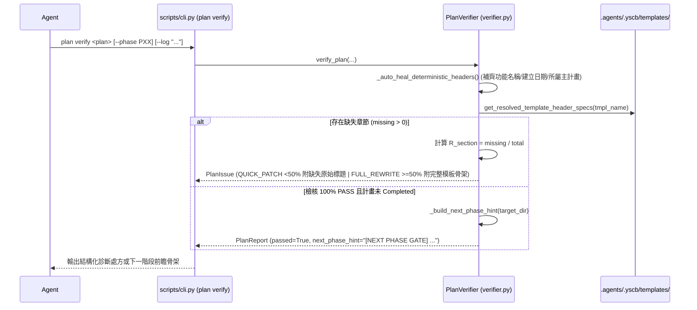

# 系統架構設計與模組規劃書 (Architecture Plan)

> 功能名稱：PlanVerifier 缺失率分流處方、確定性標頭自癒、階段前瞻提示與 /auto 兩階段 JIT 讀模板瘦身 (sub_09_verifier_triage_and_auto_jit_refinement)  
> 建立日期：2026-10-25  
> 所屬主計畫：2026_10_23_1314_agents_workflow_aci_and_delegation_evolution  
> 狀態：Confirmed  
> 模型：Gemini 4 Argon (Low)  

---

## 1. 模組架構分層與職責邊界 (Layered Architecture)

- **Skill 規範層 (`assets/skills/auto/SKILL.md`)**：
  - 移除 §3 內聯 `P01~P06` 骨架速查表，改為兩階段 JIT 模板直讀規範（Batch A 編碼前平行讀 `.agents/.yscb/templates/P01~P04.md`、Batch B 測試後平行讀 `P05_task.md` 與 `P06_test_plan.md`），並於步驟 3 增補支柱二實作子代理量化觸發門檻（$\ge 5$ 檔或 $> 1,500$ 行）。
- **核心檢核與處方引擎層 (`agents_workflow/plans/verifier.py`)**：
  - **確定性標頭自癒 (`_auto_heal_deterministic_headers`)**：於 `_verify_single_file` 解析標頭時，若檔案缺少 `功能名稱`、`建立日期` 或二級子計畫之 `所屬主計畫`，自動推導確定性值並原地無損寫回檔案、記入 `report.header_healed`（絕不觸碰或偽造 `模型` 與 `狀態`）。
  - **原始標題快取與缺失率分流 (`get_resolved_template_header_specs` + `Triage`)**：解析模板時同步保留 `(norm_title, raw_heading_line)`；當檢出缺失章節時，計算 $R_{\text{section}} = \text{missing} / \text{total}$，分流產出 `[TRIAGE: QUICK_PATCH]`（$< 50\%$）或 `[TRIAGE: FULL_REWRITE]`（$\ge 50\%$）並內聯原始 Markdown 標題清單與 `.agents/.yscb/templates/<tmpl>.md` 路徑。
  - **下一階段前瞻提示 (`_build_next_phase_hint`)**：當 `verify_plan` 檢核 `PASSED` 且計畫未 `Completed` 時，呼叫 `PlanStatusResolver.resolve_next_action`，若下一階段對應 `P01`~`P07` 標準模板，提取該模板檔名與原始二級標題清單寫入 `report.next_phase_hint`。
- **CLI 呈現層 (`scripts/cli.py`)**：
  - 於 `plan_check` 輸出報告中顯示 `[SELF-HEAL] 已自動補齊確定性標頭: ...` 與 `PASSED` 時之 `[NEXT PHASE GATE]` 前瞻指引。

---

## 2. 核心資料流與循序圖 (Data Flow & Sequence Diagram)

---

## 3. 受影響檔案與新建檔案清單 (Impacted & New Files Inventory)

| 檔案路徑 | 變更類型 | 職責與變更摘要 |
| :--- | :---: | :--- |
| `ys_codebase/source/agents-workflow/assets/skills/auto/SKILL.md` | Modify | 拔除 §3 內聯骨架表，改採兩階段 JIT 讀模板，並量化支柱二委派門檻。 |
| `ys_codebase/source/agents-workflow/assets/skills/development-sop/SKILL.md` | Modify | 對齊 §5 階段前置閱讀鐵律對 `/auto` 兩階段 JIT 讀模板之描述。 |
| `ys_codebase/source/agents-workflow/agents_workflow/plans/verifier.py` | Modify | 擴充 `PlanReport`（`header_healed`, `next_phase_hint`），實作 `_auto_heal_deterministic_headers`、`get_resolved_template_header_specs`、缺失率分流處方與 `_build_next_phase_hint`。 |
| `ys_codebase/source/agents-workflow/scripts/cli.py` | Modify | 於 `plan_check` 渲染 `header_healed` 與 `next_phase_hint` 輸出。 |
| `ys_codebase/source/agents-workflow/tests/test_plans_toolchain.py` | Modify | 更新 `test_ft_13` 並新增 `test_ft_14` 驗證確定性標頭自癒、`QUICK_PATCH` vs `FULL_REWRITE` 缺失率分流與 `next_phase_hint`。 |
| `docs/agents-workflow/user_guide.md` | Modify | 同步更新 `/auto` 兩階段 JIT 讀模板、`plan verify` 標頭自癒、缺失率分流處方與前瞻領航說明。 |
| `docs/agents-workflow/DESIGN_NOTES.md` | Modify | 新增 `[DN-AW-16]` 記錄兩階段 JIT 讀模板與 `PlanVerifier` 缺失率處方分流設計。 |

---

## 4. 架構決策記錄 (Architecture Decision Records)

- **[P02:DR-01] 確定性標頭自癒嚴格排除 `> 狀態：` 與 `> 模型：`**：`狀態` 與 `模型` 涉及階段推進語意與 `AGENTS.md §1.2` 真實模型宣告紀律，若缺失必須報錯由 Agent 顯式填寫；僅 `功能名稱`、`建立日期`、`所屬主計畫` 屬 100% 可由目錄上下文推導之環境事實，納入自動無損自癒。
- **[P02:DR-02] 同一檔案多章節缺失合併為單一 `TEMPLATE` 處方 Issue**：避免單一盲寫檔案產生 5~8 條重複 `[FAIL]` 洗版，單檔章節缺失統一彙總為 1 筆帶 `[TRIAGE: QUICK_PATCH | FULL_REWRITE]` 與原始 Markdown 標題清單之 `PlanIssue`。
