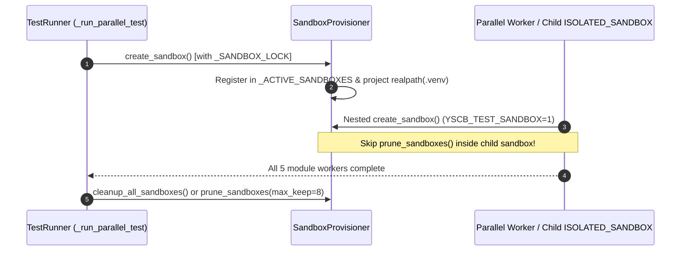

# 架構設計說明書 (Architecture Design)

> 功能名稱：新世代全量複檢收尾與發布前最終打磨 (Global Step 1~13 Pre-Release Polish)  
> 建立日期：2026-10-25  
> 所屬主計畫：N/A (Root Plan)  
> 狀態：Confirmed  
> 模型：Unknown  

> 模板版本：v1.2  

---

## 1. 模組架構分層與職責邊界 (Layered Architecture)

```text
+-----------------------------------------------------------------------+
| Layer 1: Dev Sandbox & Parallel Test Harness (source/dev/)            |
|  - SandboxProvisioner (_SANDBOX_LOCK, realpath venv, max_keep=8)      |
|  - TestRunner._run_parallel_test (centralized post-worker prune)      |
+-----------------------------------------------------------------------+
| Layer 2: Workflow Plan Verifier (source/agents-workflow/)             |
|  - PlanVerifier._is_header_match (negation-prefix guard)              |
+-----------------------------------------------------------------------+
| Layer 3: Knowledge-DB & Server Polish (source/knowledge-db/, server/) |
|  - pipeline.py (ftypes passthrough, config set hint)                  |
|  - config.py (pure module config loader), contributes/core.json       |
|  - server/tests/test_server.py & test_server_logging.py (dedup)       |
+-----------------------------------------------------------------------+
| Layer 4: Knowledge Base & Macro Changelog (docs/, CHANGELOG.md)       |
+-----------------------------------------------------------------------+
```

---

## 2. 核心資料流與循序圖 (Data Flow & Sequence Diagram)



---

## 3. 受影響檔案與新建檔案清單 (Impacted & New Files Inventory)

| 檔案路徑 | 類型 | 職責與變更說明 |
| :--- | :---: | :--- |
| `ys_codebase/source/dev/dev/testing/sandbox.py` | Modify | 新增 `_SANDBOX_LOCK`、預設 `max_keep=8`、子沙盒跳過 `prune_sandboxes`、`_project_venv` 使用 `os.path.realpath` |
| `ys_codebase/source/dev/dev/tester.py` | Modify | `_run_single_module_worker` 失敗時不提前觸發跨模組 `prune_sandboxes`，統一由 `_run_parallel_test` 收尾執行 `prune_sandboxes(max_keep=8)` |
| `ys_codebase/source/agents-workflow/agents_workflow/plans/verifier.py` | Modify | 新增 `_is_header_match(exp_norm, dh)` 攔截否定前綴（`非`/`不`/`無`/`未`）子字串誤配 |
| `ys_codebase/source/knowledge-db/knowledge_db/pipeline.py` | Modify | `act_callers`/`act_callees`/`act_impact` 補傳 `ftypes=ftypes`；向量降級提示更新為 `config set` 指令 |
| `ys_codebase/source/knowledge-db/knowledge_db/config.py` | Modify | 移除讀取舊版根目錄 `yscb.config.json` 殘留分支 |
| `ys_codebase/source/knowledge-db/contributes/core.json` | Modify | 補齊頂層 `"hooks"` 及 `status`/`search`/`callers`/`callees`/`impact` CLI 選項宣告 |
| `ys_codebase/source/knowledge-db/tests/test_graph_and_impact.py` | Modify | 新增或擴充 `callers`/`callees`/`impact` 搭配 `ftypes` 過濾之斷言驗證 |
| `ys_codebase/source/server/tests/test_server.py` | Modify | 合併 3 組重複測項並移除靜態 `test_server_manifest_metadata` |
| `ys_codebase/source/server/tests/test_server_logging.py` | Modify | 移除手動開啟檔案寫入之重複模擬測項 `test_worker_and_task_log_separation` |
| `docs/agents-workflow/DESIGN_NOTES.md` | Modify | 補充 `[DN-AW-12]` 與 `[DN-AW-15]` 於 `sub_09` (`[DN-AW-16]`) 之演進說明 |
| `docs/core/README.md` | Modify | 更新 `DN-01 ~ DN-13` 導覽範圍並移除舊 `workflow.*://` 特判描述 |
| `docs/knowledge-db/README.md` | Modify | 移除失效之 `tokenizer.md` 連結 |
| `CHANGELOG.md` | Modify | 修正 `sub_08` 6 檔測試清單檔名與補充本次收尾打磨紀錄 |

---

## 4. 架構決策記錄 (Architecture Decision Records)

- **[P02:DR-01] 子沙盒禁觸發全域 Prune 與 Realpath Venv 投影**：當 `YSCB_TEST_SANDBOX == "1"` 時，子行程之 `_ACTIVE_SANDBOXES` 記憶體集合無法感知父行程平行建立的 5 個模組沙盒，因此在子沙盒內強制禁止呼叫 `prune_sandboxes()`，並在 `_project_venv` 對 `host_venv_dir` 取 `os.path.realpath` 直接連結至母倉 `.venv`，徹底消除平行沙盒互刪與巢狀 Junction 斷鏈。
- **[P02:DR-02] 章節標題否定詞前綴精準過濾**：在 `PlanVerifier._is_header_match` 中，除了支援 `exp_norm == dh` 與正向包含外，針對較長字串包含較短字串且前綴以 `("非", "不", "無", "未")` 結尾之情況（如 `非` + `功能需求`）強制回傳 `False`，兼顧模板章節彈性與語意精確度。

