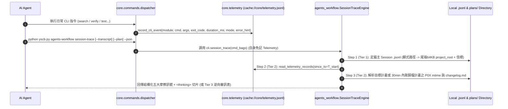

# 架構設計說明書 (Architecture Design)

> 功能名稱：Session 隱形摩擦自檢技能與三級軌跡提取機制 (`session_audit_and_trace_telemetry`)  
> 建立日期：2026-10-28  
> 所屬主計畫：獨立計畫 (Standalone)  
> 狀態：Confirmed  
> 模型：Gemini 4 Argon (Low)  

> 模板版本：v1.2  

---

## 1. 模組架構分層與職責邊界 (Layered Architecture)

```text
+-----------------------------------------------------------------------------------+
| Layer 3: AI Agent Skill Layer (agents-workflow/assets/skills/session-audit/)      |
|  - /session-audit SKILL.md (初版：唯讀隔離、呼叫 session-trace、A/B/C/D 四象限歸因) |
+-----------------------------------------+-----------------------------------------+
                                          | CLI: python yscb.py agents-workflow session-trace
                                          v
+-----------------------------------------------------------------------------------+
| Layer 2: Trace & Friction Analysis Engine (agents_workflow/plans/session_trace.py)|
|  - SessionTraceEngine:                                                            |
|    * Tier 1: 多 release_targets 候選 .jsonl 三層信標定錨 (顯式 -> 尾端64KB指紋)     |
|    * Tier 2: 消費 core.telemetry 時間窗切片 + 計畫 P0X mtime / changelog 回寫消歧  |
|    * Tier 3: In-Context 逆向審訊保底                                              |
|    * Detectors: MULTI_EDIT_CHURN / TOOL_MISS_AND_RETRY / SILENT_BACKPATCH /       |
|                 GATE_BOUNCE / CONTEXT_WASTE                                       |
+-----------------------------------------+-----------------------------------------+
                                          | Read API / URI: cache://core/telemetry.jsonl
                                          v
+-----------------------------------------------------------------------------------+
| Layer 1: Core Microkernel Telemetry Infrastructure (core/telemetry.py & dispatcher)|
|  - core/commands/dispatcher.py: 單點攔截 router_err / option_err / hot / local     |
|  - core/telemetry.py: 寫入 cache://core/telemetry.jsonl (512KB / 1500筆滾動截斷)   |
+-----------------------------------------------------------------------------------+
```

---

## 2. 核心資料流與循序圖 (Data Flow & Sequence Diagram)



---

## 3. 受影響檔案與新建檔案清單 (Impacted & New Files Inventory)

| 檔案路徑 | 類型 | 職責與變更說明 |
| :--- | :---: | :--- |
| `ys_codebase/source/core/core/telemetry.py` | New | `core` 層級 CLI 飛行紀錄器：寫入 `cache://core/telemetry.jsonl`、沙盒旁路、512KB 滾動截斷與時間窗讀取 API (`FR-01`, `EC-03`, `EC-04`)。 |
| `ys_codebase/source/core/core/commands/dispatcher.py` | Modify | 於 `dispatch()`、`dispatch_local()` 與 `_try_hot_dispatch()` 埋入非阻塞計時、首行 `error_hint` 擷取與 `record_cli_event` 呼叫 (`FR-01`)。 |
| `ys_codebase/source/core/core/__init__.py` | Modify | 透過 PEP 562 `_MODULE_MAP` 匯出 `telemetry` 子模組 (`FR-01`)。 |
| `ys_codebase/source/core/tests/test_cli_router.py` | Modify | 依子系統 1:1 歸戶新增 `core.telemetry` 寫入、沙盒略過、512KB 截斷與錯誤擷取測試 (`FT-01`, `ET-03`, `ET-04`)。 |
| `ys_codebase/source/agents-workflow/agents_workflow/plans/session_trace.py` | New | 實作 `SessionTraceEngine`：三層信標 `.jsonl` 定錨、Telemetry 時間窗切片、`mtime` 與 `changelog.md` 回寫消歧、五大摩擦訊號偵測與 Tier 3 Fallback (`FR-02` ~ `FR-04`, `EC-01`, `EC-02`, `EC-05`)。 |
| `ys_codebase/source/agents-workflow/agents_workflow/plans/__init__.py` | Modify | 匯出 `SessionTraceEngine` 與 `SessionTraceReport`。 |
| `ys_codebase/source/agents-workflow/agents_workflow/__init__.py` | Modify | 透過 PEP 562 匯出 `SessionTraceEngine` 與 `SessionTraceReport`。 |
| `ys_codebase/source/agents-workflow/scripts/cli.py` | Modify | 新增 `session_trace` 與 `cmd_session_trace` CLI 入口函式 (`FR-05`)。 |
| `ys_codebase/source/agents-workflow/contributes/core.json` | Modify | 註冊 `session-trace` 指令與 `--plan`, `--transcript`, `--since`, `--limit`, `--json` 正交選項 (`FR-05`)。 |
| `ys_codebase/source/agents-workflow/assets/skills/session-audit/SKILL.md` | New | 初版 `/session-audit` 唯讀自檢技能手冊（含 `__@{SESSION_AUDIT_STANDARDS}__` 錨點） (`FR-05`, `NFR-02`)。 |
| `ys_codebase/source/agents-workflow/contributes/agents-workflow.json` | Modify | 註冊導出 `session-audit` 技能與 `SESSION_AUDIT_STANDARDS` Token (`FR-05`)。 |
| `ys_codebase/source/agents-workflow/contributes/_manifest.md` | Modify | 同步更新導出清冊與 `session-trace` CLI 說明 (`FR-05`)。 |
| `ys_codebase/source/agents-workflow/tests/test_plans_toolchain.py` | Modify | 依子系統 1:1 歸戶新增 `SessionTraceEngine` 三級提取、多宿主信標定錨、`mtime` 回寫消歧与五大摩擦訊號正負向單元測試 (`FT-02` ~ `FT-05`, `ET-01`, `ET-02`, `ET-05`)。 |

---

## 4. 架構決策記錄 (Architecture Decision Records)

- **[P02:DR-01] `core.telemetry` 單向依賴與 `cache://core/telemetry.jsonl` 定位**：`core/telemetry.py` 僅依賴 Python 標準庫與 `core.uri`（若 `uri` 尚未就緒則回退至 `os.path.join(yscb_abs, ".cache", "core", "telemetry.jsonl")`），絕不匯入任何上層業務模組；`agents-workflow` 單向讀取該檔案，徹底滿足微內核純淨度。
- **[P02:DR-02] `_try_hot_dispatch` 與 `dispatch_local` 首行錯誤摘要無損擷取**：`_try_hot_dispatch` 調整為內部輔助或以狀態字典保存最後一次熱派發擷取到的首行 `stderr` / `[Error]` 文字，不改變公開回傳型別 `Optional[int]`，維持既有呼叫方 100% 相容。

