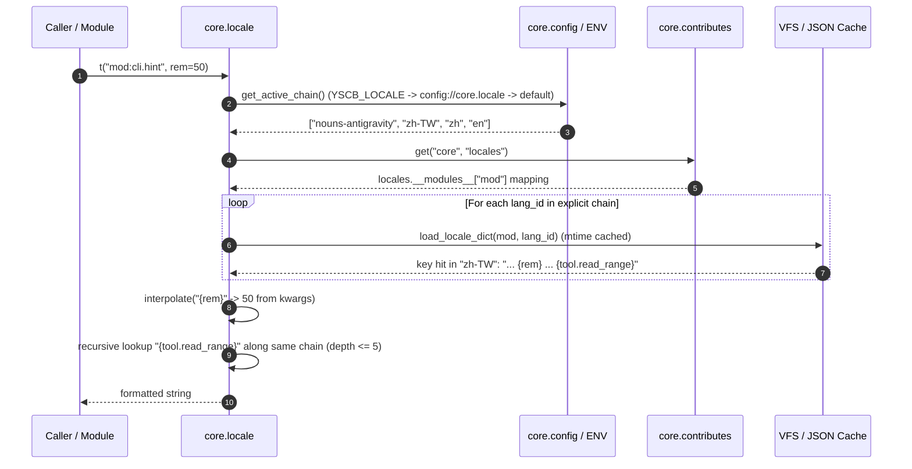

# 架構設計說明書 (Architecture Design)

> 功能名稱：實作 `core.locale` 多層語系引擎與宣告式 `definition` 契約校驗 (`sub_01_core_locale_engine`)  
> 建立日期：2026-10-29  
> 所屬主計畫：`2026_10_28_1845_core_locale_and_ecosystem_i18n`  
> 狀態：Confirmed  
> 模型：Gemini 4 Argon (Low)  

> 模板版本：v1.2  

---

## 1. 模組架構分層與職責邊界 (Layered Architecture)

```text
+-----------------------------------------------------------------------------------+
| Layer 1: Contributes Schema & Aggregation (core/contributes.py, _format.json)     |
|  - Schema: "locales": {"definition": "str!", "*": "str!"}                         |
|  - ContributesAggregator: preserves per-donor buckets in locales.__modules__      |
|  - _scan_contributes_inputs: tracks mtime/size of referenced locale JSON files    |
+-----------------------------------------------------------------------------------+
                                         |
                                         v
+-----------------------------------------------------------------------------------+
| Layer 2: Core Locale Engine (core/locale.py, PEP 562 lazy export in core/__init__)|
|  - Explicit Priority Fallback Chain: resolves strictly in declared list order     |
|  - Two-Stage Recursive Interpolation: kwargs first -> fallback chain token lookup |
|  - (file_path, mtime) Memory Cache: < 0.5ms hot-path resolution                   |
+-----------------------------------------------------------------------------------+
                                         |
                                         v
+-----------------------------------------------------------------------------------+
| Layer 3: Deterministic Contract Validation (core/locale.py, contributes_cmd, dev) |
|  - Validates definition.json structure (description, optional placeholders)       |
|  - Rejects orphan keys in <lang-id>.json with difflib suggestions                 |
|  - Enforces {placeholder} integrity & blocks path traversal ("..")                |
+-----------------------------------------------------------------------------------+
```

---

## 2. 核心資料流與循序圖 (Data Flow & Sequence Diagram)



---

## 3. 受影響檔案與新建檔案清單 (Impacted & New Files Inventory)

| 檔案路徑 | 類型 | 職責與變更說明 |
| :--- | :---: | :--- |
| `ys_codebase/source/core/contributes/_format.json` | Modify | 新增頂層擴充點 `"locales"` Schema（`"definition": "str!"`, `"*": "str!"`）(`FR-01`) |
| `ys_codebase/source/core/contributes/_manifest.md` | Modify | 登記 `locales` 擴充點說明與結構範例 (`FR-01`) |
| `ys_codebase/source/core/core/locale.py` | New | 實作 `LocaleEngine`、顯式退避鏈解析、二階遞迴專有名詞插值、`validate_module_locales` 靜態契約校驗 (`FR-03`, `FR-04`, `FR-05`, `EC-01`~`EC-05`) |
| `ys_codebase/source/core/core/__init__.py` | Modify | 透過 PEP 562 `_MODULE_MAP` 延遲導出 `locale` 子模組 (`FR-03`, `NFR-02`) |
| `ys_codebase/source/core/core/contributes.py` | Modify | 於 `ContributesAggregator.scan_and_inject` 保存 `locales.__modules__[donor]` 分桶（含 `project` 覆寫），並於 `_scan_contributes_inputs` 追蹤語系檔 `mtime` (`FR-02`) |
| `ys_codebase/source/core/core/commands/contributes_cmd.py` | Modify | 於 `check_contributes` 串聯 `locale.validate_module_locales`，檢驗模組與單檔之 `locales` 定義與語系檔契約 (`FR-05`) |
| `ys_codebase/source/dev/dev/checker.py` | Modify | 於 `_check_core_injection` 開放 `core` 自身 Schema 檢驗並串聯 `locale.validate_module_locales` 檢驗源碼空間語系檔契約 (`FR-05`, `EC-04`) |
| `ys_codebase/source/core/tests/test_locale.py` | New | `core.locale` 子系統完整單元與邊界測試（`FT-01`~`FT-05`, `ET-01`~`ET-05`） |
| `ys_codebase/source/dev/tests/test_checker.py` | Modify | 擴充 `dev check` 對 `locales` (`definition` 契約、孤兒鍵、佔位符不匹配) 之靜態攔截測試 (`FT-05`, `ET-04`) |

---

## 4. 架構決策記錄 (Architecture Decision Records)

- **[P02:DR-01] `locales.__modules__` 按 Donor 隔離分桶**：比照 `commands.__modules__` 的設計，當多個模組各自在 `contributes/core.json` 宣告 `"locales": {"definition": "locales/definition.json", ...}` 時，若直接扁平 `_deep_merge` 會導致後載入模組覆蓋前載入模組的路徑。因此 `ContributesAggregator` 將各 Donor 的 `locales` 字典獨立掛載於 `aggregated["core"]["locales"]["__modules__"][donor]`，同時支援 `config://core/contribute.json` 透過 `locales.<donor>` 或頂層覆寫。
- **[P02:DR-02] 雙花括號轉義與佔位符提取正則規範**：為支援模板字串內含合法 `{` 或 `}` 字面量（如 JSON 範例），定義轉義規則 `{{` $\to$ `{`、`}}` $\to$ `}`；提取佔位符時先剔除 `{{` 與 `}}`，再以 `r"\{([a-zA-Z0-9_.:-]+)\}"` 提取有效佔位符名稱，確保靜態校驗與執行期格式化 100% 一致 (`EC-03`)。
- **[P02:DR-03] 佔位符靜態契約雙向校驗策略**：在 `definition.json` 中宣告 `"placeholders": ["rem", "tool.read_range"]` 時，任何 `<lang-id>.json` 對該 Key 的翻譯字串若出現**未宣告於 `placeholders` 的未知變數**一律報 `ERROR`；對於非專有名詞類之必備動態佔位符（或 `definition` 宣告之 `placeholders`），若翻譯字串遺漏亦報 `ERROR`，確保執行期格式化零驚喜 (`FR-05`)。

