# 架構設計說明書 (Architecture Design)

> 功能名稱：跨平台宿主環境專有名詞庫、多平台並發自動嗅探與首輪 Dogfooding 實機驗證 (`sub_02_host_nouns_and_dogfooding`)  
> 建立日期：2026-10-29  
> 所屬主計畫：`2026_10_28_1845_core_locale_and_ecosystem_i18n`  
> 狀態：Confirmed  
> 模型：Gemini 4 Argon (Low)  

> 模板版本：v1.2  

---

## 1. 模組架構分層與職責邊界 (Layered Architecture)

```text
+-----------------------------------------------------------------------------------+
| Layer 3: Consumer Modules & Dogfooding Assets                                     |
|   - knowledge-db/scripts/cli.py       : locale.t("cli.search.snippet_truncated")  |
|   - knowledge-db-search/SKILL.md      : `__%{agent_tool.file_read_range}__` etc.  |
|   - yscb-cli-guide/SKILL.md           : `__%{agent_tool.shell_exec}__` etc.       |
+-----------------------------------------------------------------------------------+
                                         |
                                         v
+-----------------------------------------------------------------------------------+
| Layer 2: Host Proper Nouns Provider & Stage 2 Projection (`agents-workflow`)      |
|   - locales/{definition,zh,nouns-antigravity,nouns-claude,nouns-codex}.json       |
|   - compiler.py (resolve_stage2_uri)  : Expands `__%{key}__` per target_name      |
|   - publisher.py (_get_sources_digest): Tracks locales/*.json SHA-1 fingerprints  |
+-----------------------------------------------------------------------------------+
                                         |
                                         v
+-----------------------------------------------------------------------------------+
| Layer 1: Micro-Kernel Locale Engine (`core.locale`)                               |
|   - detect_active_host_dialect()      : Runtime env sniffing for multi-IDE        |
|   - get_active_chain()                : Prepends 'nouns-<host>' to ['zh']         |
|   - resolve_raw()                     : Caller-first + global registered lookup   |
|   - validate_module_locales()         : Cross-module noun placeholder validation  |
+-----------------------------------------------------------------------------------+
```

---

## 2. 核心資料流與循序圖 (Data Flow & Sequence Diagram)

```mermaid
sequenceDiagram
    autonumber
    participant IDE as Host IDE / Agent (Antigravity / Claude / Codex)
    participant CLI as knowledge-db CLI (search -s)
    participant Pub as ReleasePublisher (release)
    participant Comp as ArtifactCompiler (Stage 2)
    participant Loc as core.locale

    rect rgb(30, 58, 138)
    Note over Pub,Loc: Flow A: Compile-Time Multi-Target Projection (Stage 2)
    Pub->>Comp: resolve_stage2_uri(content, dst_path, map, proj_root, target_name="claude")
    Comp->>Loc: t("agent_tool.file_read_range", chain=["nouns-claude", "zh"])
    Loc-->>Comp: "Read (offset/limit)"
    Comp-->>Pub: "`Read (offset/limit)`"
    end

    rect rgb(20, 83, 45)
    Note over IDE,Loc: Flow B: Runtime Concurrent CLI Execution (Env Sniffing + Unqualified Lookup)
    IDE->>CLI: python yscb.py knowledge-db search ... -s
    CLI->>Loc: t("cli.search.snippet_truncated_hint", omitted=N, start_line=S, end_line=E)
    Loc->>Loc: get_active_chain() -> detect_active_host_dialect() -> ["nouns-antigravity", "zh"]
    Loc->>Loc: resolve_raw("cli.search.snippet_truncated_hint", module="knowledge-db")
    Loc->>Loc: Stage 2 recursive resolve("agent_tool.file_read_range") -> global lookup hits agents-workflow
    Loc-->>CLI: "... use read_file (StartLine/EndLine) to view]"
    end
```



---

## 3. 受影響檔案與新建檔案清單 (Impacted & New Files Inventory)

| 檔案路徑 | 類型 | 職責與變更說明 |
| :--- | :---: | :--- |
| `ys_codebase/source/core/core/locale.py` | Modify | 新增 `detect_active_host_dialect()` 並整合進 `get_active_chain()`；擴充 `resolve_raw()` 支援無 `<module>:` 前綴之全域穿透查找（Caller-First $\to$ Global Registered Modules）；擴充 `validate_module_locales` 支援跨模組專有名詞佔位符识别 |
| `ys_codebase/source/core/tests/test_locale.py` | Modify | 新增無前綴全域穿透查找、同名衝突 Caller-First 優先級、以及多平台並發環境變數嗅探 (`detect_active_host_dialect`) 之單元測試 |
| `ys_codebase/source/agents-workflow/contributes/core.json` | Modify | 新增 `"locales"` 區塊註冊 `definition`、`zh`、`nouns-antigravity`、`nouns-claude`、`nouns-codex` |
| `ys_codebase/source/agents-workflow/locales/definition.json` | New | 定義 6 個 `agent_tool.*` 宿主工具專有名詞之語意說明與佔位符契約 |
| `ys_codebase/source/agents-workflow/locales/zh.json` | New | 提供 `agent_tool.*` 之開發團隊母語 (`zh`) 平台中立通用工具描述保底 |
| `ys_codebase/source/agents-workflow/locales/nouns-antigravity.json` | New | 提供 Google Antigravity IDE 專屬工具名稱映射 |
| `ys_codebase/source/agents-workflow/locales/nouns-claude.json` | New | 提供 Anthropic Claude Code 專屬工具名稱映射 |
| `ys_codebase/source/agents-workflow/locales/nouns-codex.json` | New | 提供 OpenAI Codex CLI 專屬工具名稱映射 |
| `ys_codebase/source/agents-workflow/agents_workflow/compiler.py` | Modify | 新增 `LOCALE_NOUN_INNER_REGEX` (`__%{key}__`)，於 `resolve_stage2_uri` 支援選填 `target_name: Optional[str] = None` 並依目標平台展開專有名詞 |
| `ys_codebase/source/agents-workflow/agents_workflow/publisher.py` | Modify | 於 `release_all` 呼叫 `resolve_stage2_uri` 時傳入 `target_name=t_name`，並於 `_get_sources_digest` 納入 `locales` JSON 檔案指紋 |
| `ys_codebase/source/agents-workflow/assets/skills/yscb-cli-guide/SKILL.md` | Modify | 導入 `` `__%{agent_tool.shell_exec}__` `` 與 `` `__%{agent_tool.shell_bg_daemon}__` `` 進行手冊編譯期 Dogfooding |
| `ys_codebase/source/agents-workflow/tests/test_compiler.py` | Modify | 新增 Stage 2 `` `__%{key}__` `` 跨平台 (`antigravity` / `claude` / `codex`) 投影轉譯測試 |
| `ys_codebase/source/knowledge-db/contributes/core.json` | Modify | 新增 `"locales"` 區塊註冊 `definition.json` 與 `zh.json` |
| `ys_codebase/source/knowledge-db/locales/definition.json` | New | 定義 `cli.search.snippet_truncated_hint` 語意契約（含 `omitted`、`start_line`、`end_line`、`agent_tool.file_read_range`） |
| `ys_codebase/source/knowledge-db/locales/zh.json` | New | 提供 `cli.search.snippet_truncated_hint` 模板字串 |
| `ys_codebase/source/knowledge-db/scripts/cli.py` | Modify | 於 `_cap_json_snippet` 呼叫 `core.locale.t("cli.search.snippet_truncated_hint", ...)` 取代硬編碼提示 |
| `ys_codebase/source/knowledge-db/assets/skills/knowledge-db-search/SKILL.md` | Modify | 導入 `` `__%{agent_tool.file_read_range}__` ``、`` `__%{agent_tool.file_read}__` ``、`` `__%{agent_tool.file_grep_single}__` `` |
| `ys_codebase/source/knowledge-db/tests/test_cli_and_Formatting.py` | Modify | 驗證 `search -s` 截斷提示透過 `core.locale` 動態替換 `{agent_tool.file_read_range}` |

---

## 4. 架構決策記錄 (Architecture Decision Records)

- **[P02:DR-01] 全域無前綴查找優先序 (`Caller -> agents-workflow -> core -> sorted(other_modules)`)**：
  - 當 `resolve_raw(key)` 解析無 `<module>:` 前綴之 Key 時，首先檢查呼叫端模組自身；若未命中且 `base_dir` 未鎖定單一沙盒目錄，則依序檢查 `agents-workflow`（專有名詞中樞）、`core`（微內核基礎），最後依字母序遍歷 `contributes.merged.json` 中其他註冊了 `locales` 的模組。如此既保證 100% 確定性，又讓 `agent_tool.*` 具備 $O(1)$ 等級的查找效率。
- **[P02:DR-02] Stage 2 `resolve_stage2_uri` 向後相容擴充 `target_name: Optional[str] = None`**：
  - 經 `knowledge-db callers resolve_stage2_uri` 排查，全系統共有 `ReleasePublisher.release_all`（行 684、705）與 `scripts/cli.py`（行 421）兩處呼叫端。將 `target_name: Optional[str] = None` 設為預設 `None` 之選填參數，可 100% 維持既有 Public API 簽名相容性。

