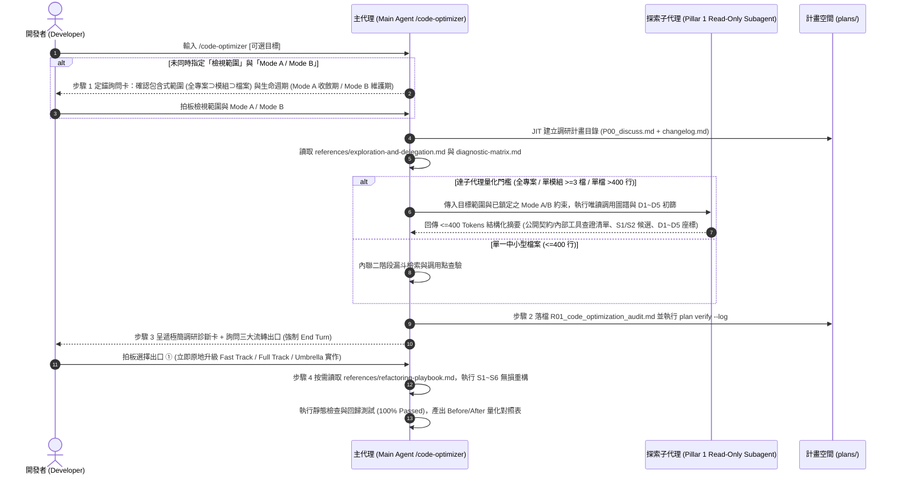

# 架構設計說明書 (Architecture Design)

> 功能名稱：2026_10_30_1605_code_optimizer_skill  
> 建立日期：2026-10-30  
> 所屬主計畫：N/A  
> 狀態：Confirmed  
> 模型：Gemini 4 Argon (High)  

> 模板版本：v1.2  

---

## 1. 模組架構分層與職責邊界 (Layered Architecture)

```text
ys_codebase/source/agents-workflow/
├── contributes/
│   ├── agents-workflow.json                 # [註冊層] 匯出 code-optimizer 技能與 CODE_OPTIMIZER_STANDARDS 錨點
│   └── _manifest.md                         # [清冊層] 更新 19 大純 Skill 與錨點導覽說明
└── assets/
    └── skills/
        ├── code-optimizer/                  # [新建核心技能包]
        │   ├── SKILL.md                     # [調度主控層 <=180行] 純手動觸發契約、步驟 1 雙維度定錨 (包含式範圍 × Mode A/B)、
        │   │                                #   步驟 2 R01 調研診斷、步驟 3 三出口裁決、步驟 4 無損重構驗收、四大紅線、
        │   │                                #   D1~D5 & S1~S6 速查表、`__@{CODE_OPTIMIZER_STANDARDS}__` 錨點
        │   └── references/                  # [單層漸進式揭露資產]
        │       ├── exploration-and-delegation.md  # [探索與子代理層] 包含式三層範圍探索策略、支柱一量化門檻、
        │       │                                  #   Mode A/B 調用圖譜查驗契約 (含 Mode B 內部工具函式嚴格查證收斂)、<=400 Tokens 回傳表
        │       ├── diagnostic-matrix.md           # [五維度診斷層] D1~D5 跨語言軟工審查指標與 P0/P1/P2 嚴重度判準
        │       └── refactoring-playbook.md        # [六大重構策略層] S1 業務階段拆解、S2 無狀態邏輯剝離、S3~S6 手術刀與 Mode A/B 處置
        ├── development-sop/SKILL.md         # [中樞路由層] §1 新增 code-optimizer 導流指針
        ├── how-to-yscb/SKILL.md             # [教練導覽層] 補充 /code-optimizer 進階重構武器指引
        └── skill-creator/                   # [擴充指南層] 同步更新全系統標準 Stage 1 錨點地圖 (23 -> 24 個)
            ├── SKILL.md
            └── references/extension-guide.md
```

---

## 2. 核心資料流與循序圖 (Data Flow & Sequence Diagram)



---

## 3. 受影響檔案與新建檔案清單 (Impacted & New Files Inventory)

| 檔案路徑 | 類型 | 職責與變更說明 |
| :--- | :---: | :--- |
| `ys_codebase/source/agents-workflow/assets/skills/code-optimizer/SKILL.md` | New | `code-optimizer` 主控技能檔（$\le 180$ 行）：定義純手動觸發契約、四步執行閉環（雙維度前置定錨 $\to$ `R01` 調研診斷 $\to$ 三出口裁決 $\to$ 無損重構與驗證）、`D1~D5` 與 `S1~S6` 速查表、防過度設計四大紅線、`__@{CODE_OPTIMIZER_STANDARDS}__` 錨點與 Gotchas |
| `ys_codebase/source/agents-workflow/assets/skills/code-optimizer/references/exploration-and-delegation.md` | New | Phase 1 探索與子代理委派手冊：定義包含式三層範圍（全專案 $\supset$ 模組 $\supset$ 檔案）探索策略、子代理量化門檻、依開發者拍板之 `Mode A / Mode B` 調用圖譜查驗規則（含 `Mode B` 嚴格查驗 0 外部調用之純內部工具函式直接破壞性收斂規範）與 $\le 400$ Tokens 回傳格式 |
| `ys_codebase/source/agents-workflow/assets/skills/code-optimizer/references/diagnostic-matrix.md` | New | Phase 2 跨語言五維度靜態診斷矩陣（`D1`~`D5`）、審查指標、`P0 / P1 / P2` 嚴重度判準與 `R01_code_optimization_audit.md` 報告結構指引 |
| `ys_codebase/source/agents-workflow/assets/skills/code-optimizer/references/refactoring-playbook.md` | New | Phase 3 六大通用軟工重構策略庫（`S1` 業務階段拆解、`S2` 無狀態邏輯剝離、`S3` 同構樣板聚合、`S4` 衛語句與表驅動分派、`S5` 資料團塊封裝、`S6` 物理模組拆分）與 `Mode A / Mode B` 入口處置細則 |
| `ys_codebase/source/agents-workflow/contributes/agents-workflow.json` | Modify | 於 `export` 新增 `code-optimizer` 技能宣告，於 `token` 新增 `CODE_OPTIMIZER_STANDARDS` 擴充錨點宣告 |
| `ys_codebase/source/agents-workflow/contributes/_manifest.md` | Modify | 更新自導出技能數量（18 $\to$ 19 大純 Skill）與 `CODE_OPTIMIZER_STANDARDS` 錨點說明 |
| `ys_codebase/source/agents-workflow/assets/skills/development-sop/SKILL.md` | Modify | 於 §1 生命週期工作流中樞分流新增 `code-optimizer` 導流項目 |
| `ys_codebase/source/agents-workflow/assets/skills/how-to-yscb/SKILL.md` | Modify | 於角度 B / 角度 D 補充 `/code-optimizer` 業務代碼五維度診斷與無損重構指引 |
| `ys_codebase/source/agents-workflow/assets/skills/skill-creator/SKILL.md` | Modify | 同步更新標準 Stage 1 錨點數量描述 |
| `ys_codebase/source/agents-workflow/assets/skills/skill-creator/references/extension-guide.md` | Modify | 於 §2 全系統 Stage 1 Token 錨點地圖補入 `CODE_OPTIMIZER_STANDARDS`（全系統標準錨點由 23 個更新為 24 個） |
| `ys_codebase/source/agents-workflow/tests/test_compiler.py` | Modify | 更新 `test_ft_08` 與 `test_ft_11` 之技能/Token 集合斷言，並新增 `test_ft_14_code_optimizer_skill_and_standards_anchor` 驗證 `code-optimizer` 結構、雙維度定錨、`Mode B` 內部函式規則、`R01` 三出口與 Stage 1/2 實機編譯零警告 |
| `docs/agents-workflow/README.md` | Modify | 同步更新技能列表与 `CODE_OPTIMIZER_STANDARDS` 錨點說明 |
| `docs/agents-workflow/user_guide.md` | Modify | 新增 §7.6 業務代碼五維度診斷與無損重構工作流 (`/code-optimizer`) 說明並更新錨點統計 |

---

## 4. 架構決策記錄 (Architecture Decision Records)

- **[P02:DR-01] `SKILL.md` 內嵌 `D1~D5` / `S1~S6` 速查索引與兩階段 `references/` 延遲讀取**：
  - 在 `SKILL.md` 主體內提供精簡的 `D1~D5` 診斷維度表與 `S1~S6` 重構策略索引表，使步驟 2（調研診斷落檔 `R01`）僅需按需載入 `exploration-and-delegation.md` 與 `diagnostic-matrix.md` 即可開立 `S1~S6` 處方箋；待步驟 3 開發者拍板選擇「出口 ① 立即實作」進入步驟 4 動刀時，才按需讀取 `refactoring-playbook.md`，避免在純診斷或轉入 `Roadmap`/`TODO` 時預先讀取重構實作細節。
- **[P02:DR-02] 探索子代理受控於開發者拍板之 `Mode A / Mode B` 硬約束**：
  - 探索子代理（Pillar 1）不負責猜測模組處於收斂期或維護期，而是接收步驟 1 開發者已拍板的 `Mode A` 或 `Mode B` 作為輸入參數，專注於利用 `callers` / `callees` / `impact`（或靜態檢索）精確分類「對外公開入口」與「0 外部跨模組調用之純內部工具函式」。

