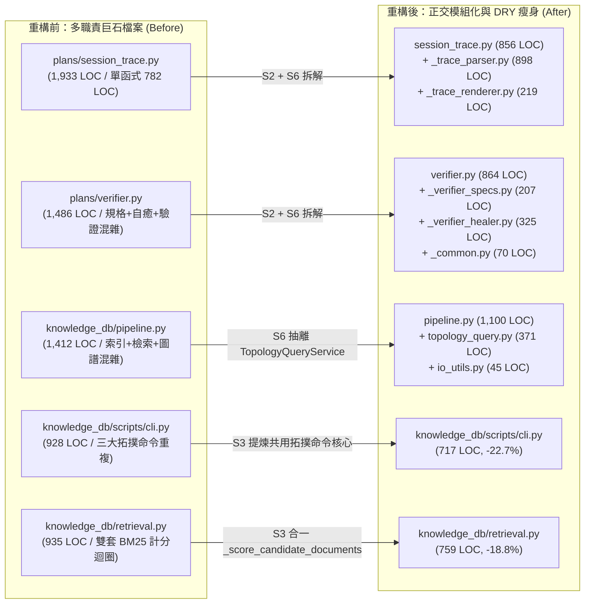

# 技術調研報告：YS-Codebase 全生態系 `/code-optimizer` 重構與技能標準演進 — 前後量化對比總結報表 (R01_before_after_summary_report.md)

> 調研主題：全生態系 5 大模組三代盲審重構與 22 個技能標準演進之前後量化對比總結  
> 建立日期：2026-10-31  
> 所屬主計畫：2026_10_30_1641_code_optimize  
> 調研狀態：Concluded  
> 模型：Unknown  
> 模板版本：v1.2  

---

## 1. 背景與調研目標 (Background & Objectives)

- **背景脈絡與核心問題**：
  - 本次透過 [`2026_10_30_1641_code_optimize`](./umbrella_overview.md) 主計畫對 YS-Codebase 核心生態系 5 大模組（`core`、`dev`、`server`、`knowledge-db`、`agents-workflow`）執行三代盲審重構（`R01 -> R02 -> R03`），並於 [`2026_10_30_1605_code_optimizer_skill`](../2026_10_30_1605_code_optimizer_skill/umbrella_overview.md) 完成 `[REV-01]` ~ `[REV-06]` 技能與中央標準演進。
- **調研目標與範疇**：
  - 以重構前基線 Commit `23ee9f0` 與重構後基線 Commit `8b67bc1` 為對照，量化盤點全倉業務源碼 AST 指標、巨石檔案正交拆解、`Mode A` 技術債清除、潛伏 Bug 根除與 22 個技能常駐預載 Context 節流效益。

| 評估維度 | 重構前 (`23ee9f0`) | 重構後 (`8b67bc1`) | 淨變化量 / 改善幅度 | 核心工程意義 |
| :--- | :---: | :---: | :---: | :--- |
| **業務源碼總行數 (Production LOC)** | `37,922` 行 | `35,731` 行 | **`-2,191` 行 (`-5.8%`)** | 在新增多項防漏鎖、跨模組搜尋與 SSOT 自動解析功能下，仍淨削減近 2,200 行冗餘代碼 |
| **業務有效程式碼行數 (Production SLOC)** | `32,399` 行 | `31,012` 行 | **`-1,387` 行 (`-4.3%`)** | 剔除死分支、重複實作與轉發殼層，提升真實邏輯密度 |
| **超長函式數量 (`> 100` 行之巨型方法)** | `67` 個 | `41` 個 | **`-26` 個 (`-38.8%`)** | 透過 `S1` 業務階段聚合與 `S2` 無狀態純函式剝離，大幅消滅百行以上深層巢狀函式 |
| **長函式數量 (`> 80` 行之方法)** | `97` 個 | `72` 個 | **`-25` 個 (`-25.8%`)** | 各模組主幹入口全面收斂為高可讀性的階段管線（Stage Pipeline） |
| **全倉最長單一函式長度 (Max Function LOC)** | `782` 行 | `292` 行 | **`-490` 行 (`-62.7%`)** | 原 `session_trace.py` 782 行閉包巨石拆解為獨立解析器與渲染器純函式 |
| **全倉最大單一檔案行數 (Max File LOC)** | `1,933` 行 | `1,133` 行 | **`-800` 行 (`-41.4%`)** | 消除 `1,400 ~ 1,900+` 行之多職責巨石檔（`session_trace.py`、`verifier.py`、`pipeline.py`） |
| **`Mode A` 轉發殼層／廢棄別名／死代碼清除** | `79+` 處殘留 | **`0` 處** | **`100% 清零`** | 物理移除 `uri.<io>` 15 個薄轉發、`KnowledgeEngine` 16 個代理、6 個空殼解析器子類與 30+ 個 `staticmethod` 殼層 |
| **常駐預載技能 `description` 總字元數 (22 Skills)** | `4,015` 字元 | `2,227` 字元 | **`-1,788` 字元 (`-44.5%`)** | 升級 `A1 + B2` 契約並聚合精簡，每次對話啟動常態節省約 **45% 技能預載 Context 負擔** |
| **4 份 `contribute.json` 總字元數** | `17,510` 字元 | `13,483` 字元 | **`-4,027` 字元 (`-23.0%`)** | `[REV-05]` 廢除 `contribute.json` 技能 `description` 雙寫遺留設計，確立 `SKILL.md` 為唯一 SSOT |
| **全倉單元測試與合規檢核 (`dev check` & `dev test`)** | `611` Passed | `611` Passed (`100%`) | **`0 Regression`** | 5 大模組 `dev check --all` 100% PASSED、611 項單元與邊界測試 100% 通過 |

---

## 2. 核心分析與評估 (Core Analysis & Evaluation)

以下對比五大核心模組在重構前後之 AST 規模、函式粒度、巨石檔案拆解與潛伏 Bug 根除成效：

### 2.1 模組級程式碼行數與檔案拓撲對比

| 模組名稱 | 檔案數 (前 $\to$ 後) | 總行數 LOC (前 $\to$ 後) | LOC 淨變化 | 有效行數 SLOC (前 $\to$ 後) | 最大單檔行數 (前 $\to$ 後) |
| :--- | :---: | :---: | :---: | :---: | :---: |
| **`core`** | `35` $\to$ `35` | `10,464` $\to$ `10,025` | **`-439` (`-4.2%`)** | `8,857` $\to$ `8,580` (`-3.1%`) | `1,066` $\to$ `1,012` (`engine.py`) |
| **`dev`** | `13` $\to$ `13` | `4,813` $\to$ `4,579` | **`-234` (`-4.9%`)** | `4,194` $\to$ `4,034` (`-3.8%`) | `1,136` $\to$ `1,133` (`checker.py`) |
| **`server`** | `9` $\to$ `9` | `2,263` $\to$ `2,175` | **`-88` (`-3.9%`)** | `1,903` $\to$ `1,867` (`-1.9%`) | `757` $\to$ `784` (`master.py`)* |
| **`knowledge-db`** | `30` $\to$ `32` (`+2`) | `11,535` $\to$ `10,281` | **`-1,254` (`-10.9%`)** | `9,810` $\to$ `8,942` (`-8.8%`) | `1,412` $\to$ `1,100` (`pipeline.py`) |
| **`agents-workflow`** | `16` $\to$ `21` (`+5`) | `8,847` $\to$ `8,671` | **`-176` (`-2.0%`)** | `7,635` $\to$ `7,589` (`-0.6%`) | `1,933` $\to$ `955` (`publisher.py`) |
| **全倉總計 (Total)** | **`103` $\to$ `110` (`+7`)** | **`37,922` $\to$ `35,731`** | **`-2,191` (`-5.8%`)** | **`32,399` $\to$ `31,012` (`-4.3%`)** | **`1,933` $\to$ `1,133` (`-41.4%`)** |

*(註：`server/master.py` 因補齊 `_spawn_worker_locked` 交握超時管道防競爭鎖與 `start()` 異常回滾保護，行數微增 27 行，全模組總行數仍淨減 88 行。)*

### 2.2 模組級函式粒度與長函式收斂對比 (`S1` / `S2` 效益)

| 模組名稱 | 頂層/類別方法總數 (前 $\to$ 後) | 平均每個方法行數 (前 $\to$ 後) | `> 50` 行方法數 (前 $\to$ 後) | `> 80` 行方法數 (前 $\to$ 後) | `> 100` 行巨型方法數 (前 $\to$ 後) | 最長方法行數 (前 $\to$ 後) |
| :--- | :---: | :---: | :---: | :---: | :---: | :---: |
| **`core`** | `365` $\to$ `379` | `28.7` $\to$ `26.5` | `48` $\to$ `45` | `25` $\to$ `11` (**`-56.0%`**) | `17` $\to$ `4` (**`-76.5%`**) | `225` $\to$ `210` |
| **`dev`** | `117` $\to$ `135` | `41.1` $\to$ `33.9` | `32` $\to$ `27` | `17` $\to$ `12` (**`-29.4%`**) | `9` $\to$ `5` (**`-44.4%`**) | `299` $\to$ `244` |
| **`server`** | `85` $\to$ `98` | `26.6` $\to$ `22.2` | `11` $\to$ `5` | `3` $\to$ `2` (**`-33.3%`**) | `1` $\to$ `1` (`0.0%`) | `135` $\to$ `115` |
| **`knowledge-db`** | `330` $\to$ `320` | `35.0` $\to$ `32.1` | `53` $\to$ `46` | `28` $\to$ `21` (**`-25.0%`**) | `22` $\to$ `12` (**`-45.5%`**) | `292` $\to$ `292` |
| **`agents-workflow`** | `182` $\to$ `199` | `48.6` $\to$ `43.6` | `39` $\to$ `48`* | `24` $\to$ `26`* | `18` $\to$ `19`* | `782` $\to$ `262` (**`-66.5%`**) |
| **全倉總計 (Total)** | **`1,079` $\to$ `1,131`** | **`35.1` $\to$ `31.6`** | **`183` $\to$ `171` (`-6.6%`)** | **`97` $\to$ `72` (`-25.8%`)** | **`67` $\to$ `41` (`-38.8%`)** | **`782` $\to$ `292` (`-62.7%`)** |

*(註：重構前 `agents-workflow/plans/session_trace.py` 將 10 餘個解析子函式巢狀定義在單一 782 行的 `_parse_transcript_file` 函式內部，導致頂層方法統計時僅被計為 1 個 782 行方法；重構後將這些巢狀閉包全部攤平提煉為 `_trace_parser.py` 與 `_trace_renderer.py` 的模組級頂層純函式，最長函式由 `782` 行驟降至 `262` 行。)*

### 2.3 指標性巨石檔案拆解與瘦身前後對照 (`S6` & `S3` 關鍵戰果)

| 原始檔案路徑 | 重構前行數 | 重構後行數 | 單檔行數變化 | 正交拆解產物與結構優化說明 |
| :--- | :---: | :---: | :---: | :--- |
| [`agents_workflow/plans/session_trace.py`](../../ys_codebase/source/agents-workflow/agents_workflow/plans/session_trace.py) | `1,933` | `856` | **`-1,077` (`-55.7%`)** | 剝離 [`_trace_parser.py`](../../ys_codebase/source/agents-workflow/agents_workflow/plans/_trace_parser.py) (`898` 行) 與 [`_trace_renderer.py`](../../ys_codebase/source/agents-workflow/agents_workflow/plans/_trace_renderer.py) (`219` 行)，主檔僅保留雙模查詢與遙測調度 |
| [`agents_workflow/plans/verifier.py`](../../ys_codebase/source/agents-workflow/agents_workflow/plans/verifier.py) | `1,486` | `864` | **`-622` (`-41.9%`)** | 剝離 [`_verifier_specs.py`](../../ys_codebase/source/agents-workflow/agents_workflow/plans/_verifier_specs.py) (`207` 行)、[`_verifier_healer.py`](../../ys_codebase/source/agents-workflow/agents_workflow/plans/_verifier_healer.py) (`325` 行) 與 [`_common.py`](../../ys_codebase/source/agents-workflow/agents_workflow/plans/_common.py) (`70` 行)，並移除 11 個 1 行轉發殼 |
| [`knowledge_db/pipeline.py`](../../ys_codebase/source/knowledge-db/knowledge_db/pipeline.py) | `1,412` | `1,100` | **`-312` (`-22.1%`)** | 剝離 [`topology_query.py`](../../ys_codebase/source/knowledge-db/knowledge_db/topology_query.py) (`TopologyQueryService`, `371` 行) 與 [`io_utils.py`](../../ys_codebase/source/knowledge-db/knowledge_db/io_utils.py) (`45` 行) |
| [`knowledge_db/scripts/cli.py`](../../ys_codebase/source/knowledge-db/scripts/cli.py) | `928` | `717` | **`-211` (`-22.7%`)** | 提煉 `_run_topology_cli_command` 與 `_parse_common_display_options`，消除 `callers`/`callees`/`impact` 重複樣板 |
| [`knowledge_db/retrieval.py`](../../ys_codebase/source/knowledge-db/knowledge_db/retrieval.py) | `935` | `759` | **`-176` (`-18.8%`)** | 合一 `BM25Engine._score_candidate_documents`（保留複合詞 $\ge 50\%$ 覆蓋率門檻），改用 `io_utils` |
| [`knowledge_db/graph.py`](../../ys_codebase/source/knowledge-db/knowledge_db/graph.py) | `380` | `243` | **`-137` (`-36.1%`)** | 移除與 `nx.DiGraph` 重複維護的 `_adj` / `_rev_adj` 雙重邊表，100% 收斂至單一有向圖結構 |
| [`knowledge_db/engine.py`](../../ys_codebase/source/knowledge-db/knowledge_db/engine.py) | `485` | `380` | **`-105` (`-21.6%`)** | 刪除 16 個內部組件 pass-through 代理方法與 `act_*` 舊別名 |
| [`core/core/uri.py`](../../ys_codebase/source/core/core/uri.py) | `720` | `650` | **`-70` (`-9.7%`)** | 物理刪除 15 個 `uri.<io> -> vfs.<io>` 薄轉發函式，公開 `resolve_yscb_root()` 統一 5 處尋根邏輯 |
| [`core/scripts/cli.py`](../../ys_codebase/source/core/scripts/cli.py) | `580` | `518` | **`-62` (`-10.7%`)** | 移除 12 個 `cmd_*` 舊轉發殼與 `bootstrap` 死分支，提煉共用子命令渲染輔助 |
| [`dev/scripts/cli.py`](../../ys_codebase/source/dev/scripts/cli.py) | `438` | `378` | **`-60` (`-13.7%`)** | 合一 `check()` 單模與全模報表渲染迴圈，統一委派 `discover_source_modules` |

### 2.4 透過三代盲審 (`R01 -> R02 -> R03`) 根除之 9 項真實潛伏 Bug

1. **`server/master.py` — Worker 啟動交握超時之 `stdout` 管道併發爭搶 (`P0` 潛伏競爭)**：引入 `ready_event` 同步追蹤，一旦交握超時或異常，立即強制呼叫 `_kill_worker_locked` 關閉管道並回收子進程。
2. **`server/logger.py` — `--console` 模式之隱藏 `NameError`**：補齊遺漏之 `import sys` 與 `import shutil`，並新增 `echo_console=True` 實機單元測試覆蓋。
3. **`core/platform/lock.py` — `InterProcessLock.acquire` 等待中斷時之檔案描述符洩漏 (FD Leak)**：以 `try...except BaseException: os.close(fd); raise` 嚴密包覆，確保任何異常下零 FD 洩漏。
4. **`core/engine.py` — 初次部署 `core` 時之語系 (`locale`) 自動偵測失效**：刪除死函式 `_seed_or_update_config` 並將初次語系自動偵測整合進標準安裝閉環。
5. **`dev/testing/sandbox.py` & `dev/builder.py` — 沙盒建立與打包中途異常之殘留檔案污染**：實作 `_create_module_archive_atomic`（`.zip.tmp` + `try...finally` 清理）與沙盒建立異常回滾。
6. **`knowledge-db/config.py` — `_resolve_config_uri` 匯入不存在之 `core.uri.resolve_uri`**：修正為 `from core.uri import resolve` 並統一 `resolve_threads` 為唯一真理來源。
7. **`knowledge-db/pipeline.py` — `pipeline.search()` 吃掉 `context_lines` 參數**：完整補齊 `--context` 切片行數透傳鏈路。
8. **`knowledge-db/parsers/` — `.sass` / `.netlist` / `.spice` 副檔名宣告與解析器不對稱**：雙向對齊 `contributes/knowledge-db.json` 與 `CssParser` / `SpiceParser` 之 `SUPPORTED_EXTENSIONS`。
9. **`agents-workflow/compiler.py` & `publisher.py` — `workflow.archived://` 路徑拼寫錯誤與 `host_dir` 遺失**：將 `"plans/archive"` 修正為 `"plans/archived"` 並貫穿 `self.host_dir`。

---

## 3. 結論 (Conclusion)

- **核心結論（技能體系與中央標準演進總結 `[REV-01]` ~ `[REV-06]`）**：

| 演進項目 | 修訂前狀態 (`Before`) | 修訂後狀態 (`After: [REV-01] ~ [REV-06]`) |
| :--- | :--- | :--- |
| **中央標準拓撲** | 僅 `AgentsStandards.md` 1 份，代碼品質與技能規範散落於各技能內部 | **4 大正交中央標準**：[`AgentsStandards.md`](../../ys_codebase/source/agents-workflow/assets/standards/AgentsStandards.md)、[`CodeQualityStandards.md`](../../ys_codebase/source/agents-workflow/assets/standards/CodeQualityStandards.md)、[`SkillDesignStandards.md`](../../ys_codebase/source/agents-workflow/assets/standards/SkillDesignStandards.md)（純 L1/L2 通用概念）、[`YscbSkillDesignToolStandards.md`](../../ys_codebase/source/agents-workflow/assets/standards/YscbSkillDesignToolStandards.md)（L3 工具包語法） |
| **技能路由契約 (`description`)** | 軌跡 A 強制寫 `排除情境：（改用 xxx）` 造成網狀耦合與粉紅大象效應；軌跡 B 留有自然語言誤觸發後門 | **雙軌結構化邊界 (`A1 + B2`)**：軌跡 A 採高密度正向邊界（100% 拔除跨技能點名）；軌跡 B 細分為 `B-Strict`（純斜線鎖定）與 `B-Assist`（斜線＋明確委託動作） |
| **常駐預載 Context 成本 (22 Skills)** | 總長 **`4,015` 字元**（平均每技能 `182.5` 字元） | 總長 **`2,227` 字元**（平均每技能 `101.2` 字元，**常態節省 `44.5%` 預載成本**） |
| **`contribute.json` 技能註冊機制** | 歷史遺留雙寫設計：需在 `SKILL.md` 與 `contribute.json` 重複維護 `description` | **`SKILL.md` 單一真理來源 (SSOT)**：`type: "skill"` 僅宣告 `type`、`name`、`source`，由編譯器自動自 `SKILL.md` 擷取，4 份 `contribute.json` 體積縮減 **`23.0%`** |
| **`/code-optimizer` 執行彈性與防呆** | 強制一律派發子代理、以 `500~800` 行硬性定罪 `P0`、無免拆守門 | 支援 **三層多軌代理模式**（`軌道 1` / `軌道 2A·2B` / `軌道 3A·3B`）、新增 **零 P0/P1 榮譽結案守門**、**`S6` 三大免拆守門**、`partial class` 防偽拆檔、`S2` 零轉發殼與 `S3` 20% 差異分支不變量核對 |
| **日常開發預防勝於治療** | `development-sop` 缺乏微觀代碼結構守門，易在日常開發累積技術債 | 將 [`CodeQualityStandards.md`](../../ys_codebase/source/agents-workflow/assets/standards/CodeQualityStandards.md) 雙層嵌入 `P05` / `FP-02` / `/auto`（源頭遵守）、`P06`（增量 Diff 自檢 + Pre-UX 盲審攔截）與 `P07`（存量債轉介） |

