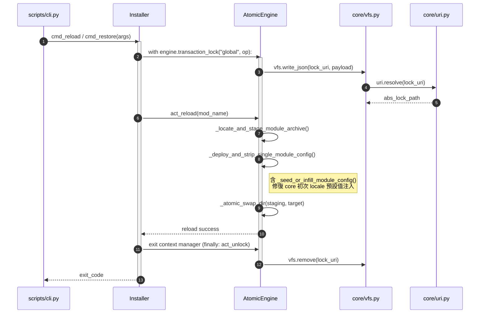

# 架構設計說明書 (Architecture Design)

> 功能名稱：sub_01_core_code_optimization  
> 建立日期：2026-10-31  
> 所屬主計畫：2026_10_30_1641_code_optimize  
> 狀態：Confirmed  
> 模型：Gemini 4 Argon (Low)  

> 模板版本：v1.2  

---

## 1. 模組架構分層與職責邊界 (Layered Architecture)

```text
+-----------------------------------------------------------------------------------+
| Layer 4: CLI Entry & Command Routing (CLI 入口與路由派發層)                        |
|   - scripts/cli.py          : core 內建子命令處理器 (移除 cmd_* 轉發與 bootstrap)   |
|   - commands/dispatcher.py  : 統一命令路由、Server 喚醒與本地/遠端派發              |
|   - commands/contributes_cmd.py : contributes check/list 實作 (移除死入口 cmd())    |
|   - commands/help_renderer.py   : 統一 CLI Help 渲染器                             |
+-----------------------------------------------------------------------------------+
                                         |
                                         v
+-----------------------------------------------------------------------------------+
| Layer 3: Module Lifecycle & Orchestration (模組生命週期與生態系編排層)             |
|   - installer.py      : 模組安裝/更新/移除/重載/還原編排 (套用 transaction_lock)    |
|   - engine.py         : AtomicEngine 原子部署、組態種子化與無狀態檔案工具函式       |
|   - pip_manager.py    : 模組 Python 依賴同步與 ensure_yscb_gitignore               |
|   - ide_projector.py  : VSCode / Pyright 靜態分析路徑投影同步                      |
|   - update_checker.py : 遠端模組版本檢查                                           |
+-----------------------------------------------------------------------------------+
                                         |
                                         v
+-----------------------------------------------------------------------------------+
| Layer 2: Metadata, Config & i18n Services (元數據、組態與語系服務層)               |
|   - contributes.py : ContributesAggregator 跨模組貢獻點掃描、校驗與快取聚合         |
|   - validator.py   : 宣告式型別簽名解析與 _KIND_VALIDATORS 分派驗證                |
|   - locale.py      : 多層語系退避翻譯 t() 與三階段 validate_module_locales          |
|   - config.py      : ConfigManager 雙層組態管理 (移除 Config 別名)                 |
|   - events.py      : 行程內事件廣播 (移除 emit 別名)                               |
|   - telemetry.py   : CLI 執行飛行紀錄器                                            |
+-----------------------------------------------------------------------------------+
                                         |
                                         v
+-----------------------------------------------------------------------------------+
| Layer 1: Virtual File System & URI Kernel (虛擬檔案系統與路徑核心層 — 單向無環)    |
|   - vfs.py         : VFSBackend / OSBackend 唯一正統 I/O 入口 (依賴 uri.resolve)   |
|   - uri.py         : 純 URI 解析、沙盒邊界校驗與 get_yscb_dir() (零 vfs 反向依賴)  |
|   - exceptions.py / symbols.py : 基底例外與符號反射工具                            |
+-----------------------------------------------------------------------------------+
```

---

## 2. 核心資料流與循序圖 (Data Flow & Sequence Diagram)



---

## 3. 受影響檔案與新建檔案清單 (Impacted & New Files Inventory)

| 檔案路徑 | 類型 | 職責與變更說明 |
| :--- | :---: | :--- |
| `ys_codebase/source/core/core/uri.py` | Modify | 物理刪除 `L650-720` 15 個 VFS 薄轉發函式、`_DEPRECATED_SCHEME_REDIRECTS` 空表、`get_execution_context` 與 `_find_host_config` 別名；公開 `get_yscb_dir()`；將 `reconcile_undefined_uri` 與 `resolve` 執行 `S1/S2` 階段拆解。 |
| `ys_codebase/source/core/core/engine.py` | Modify | 將 `_seed_or_update_config` 內 `core` 初次 `locale` 初始化併入 `_deploy_and_strip_single_module_config`，物理刪除 `_seed_or_update_config` 與 `act_get_installed_commands_summary`；新增 `transaction_lock` 上下文管理器；剝離 7 個無狀態函式（含共用之 `_extract_zip_safely`）；拆解 4 個百行長方法；將所有 `uri.<io>` 改為 `vfs.<io>`。 |
| `ys_codebase/source/core/core/installer.py` | Modify | 套用 `engine.transaction_lock("global")` 於 `cmd_reload` 與 `cmd_restore`；共用 `_extract_zip_safely` 與 `ensure_yscb_gitignore`；拆解 `cmd_update`、`cmd_list`、`cmd_restore` 並剝離 `_print_onboarding_guide` 與 `_restore_module_package`；將所有 `uri.<io>` 改為 `vfs.<io>`。 |
| `ys_codebase/source/core/core/locale.py` | Modify | 物理刪除 `_MODULE_DECL_CACHE` 死快取與 `translate = t` 別名；將 `validate_module_locales` (205 LOC) 拆解為 3 個階段函式；將 `uri.<io>` 改為 `vfs.<io>`。 |
| `ys_codebase/source/core/core/validator.py` | Modify | 將 `validate_node` (225 LOC) 拆解為 6 個型別驗證器與 `_KIND_VALIDATORS` 分派表；拆解 `parse_type_signature` 子步驟。 |
| `ys_codebase/source/core/core/contributes.py` | Modify | 移除 `scan_and_inject` 未使用之 `clean` 參數並拆解為 4 個階段方法；將 `_deep_merge` 剝離為模組級純函式；將 34 處 `uri.<io>` 改為 `vfs.<io>`。 |
| `ys_codebase/source/core/core/commands/contributes_cmd.py` | Modify | 物理刪除未引用之 `cmd(cmd_bags)`；抽取 `_append_locale_validation_errors` 消除 3 處重複迴圈；將 12 處 `uri.<io>` 改為 `vfs.<io>`。 |
| `ys_codebase/source/core/core/commands/dispatcher.py` | Modify | 物理刪除 `L622` `cmd_{command_name}` fallback；統一使用 `uri.get_yscb_dir()`；剝離 `_is_server_code_stale` 與 `_wait_for_server_daemon_ready`；抽取 `dispatch` 與 `dispatch_local` 共用路由解析與環境掛載邏輯。 |
| `ys_codebase/source/core/scripts/cli.py` | Modify | 物理刪除 `bootstrap` 廢棄子命令分支與底部 12 個 `cmd_*` 舊轉發函式；提取 `_render_subcommand_group_help` 消除 4 處重複 Help 渲染表。 |
| `ys_codebase/source/core/core/config.py` | Modify | 物理刪除 `Config = ConfigManager` 別名；統一使用 `uri.get_yscb_dir()`。 |
| `ys_codebase/source/core/core/events.py` | Modify | 物理刪除 `emit = broadcast` 別名；將 3 處 `uri.<io>` 改為 `vfs.<io>`。 |
| `ys_codebase/source/core/core/pip_manager.py` | Modify | 統一使用 `uri.get_yscb_dir()`；公開並統一 `ensure_yscb_gitignore`（補齊 `*.bak` 共 5 條規則）。 |
| `ys_codebase/source/core/core/ide_projector.py` | Modify | 統一使用 `uri.get_yscb_dir()`；將 `sync_vscode_settings` (150 LOC) 拆解為 3 個階段函式。 |
| `ys_codebase/source/core/core/telemetry.py` | Modify | 統一使用 `uri.get_yscb_dir()` 取代私有 `_resolve_yscb_root`。 |
| `ys_codebase/source/core/core/update_checker.py` | Modify | 將 5 處 `uri.<io>` 調用改為 `vfs.<io>`。 |
| `ys_codebase/source/core/core/symbols.py` | Modify | 將 `uri.exists` 調用改為 `vfs.exists`。 |
| `ys_codebase/source/core/core/__init__.py` | Modify | 新增 `if TYPE_CHECKING:` 靜態型別匯入區塊，對齊 `__all__` 公開介面。 |
| `ys_codebase/source/core/tests/*.py` | Modify | 同步更新 `test_uri.py`、`test_config.py`、`test_cli.py`、`test_engine.py`、`test_installer.py`、`test_contributes.py` 等測試內對已移除別名/轉發函式之引用。 |

---

## 4. 架構決策記錄 (Architecture Decision Records)

- **[P02:DR-01] 徹底斬斷 `uri <-> vfs` 循環依賴並遵守並行子計畫邊界**：
  - 依據 `Mode A` 規範與並行隔離約束，於 `core/uri.py` 直接物理刪除 `L650-720` 共 15 個 VFS 薄轉發函式，並將 `core` 模組內部約 165 處及 `core/tests/` 內所有 `uri.<io>` 調用 100% 遷移至 `vfs.<io>`（跨模組 `dev`、`agents-workflow`、`knowledge-db` 則由並行子計畫 `sub_02`、`sub_04`、`sub_05` 在各自模組目錄內同步完成），達成 `vfs -> uri` 單向無環依賴。
- **[P02:DR-02] 無狀態邏輯剝離 (`S2`) 與實例方法向後相容綁定策略**：
  - 將 `AtomicEngine` 與 `ContributesAggregator` 內不讀寫 `self` 的輔助方法提取為模組級純函式（如 `_parse_dependencies`、`_deep_infill_dict`、`_extract_zip_safely`、`_deep_merge` 等），同時若類別內部或既有單元測試透過 `self._xxx` / `Class._xxx` 存取，以 `staticmethod` 綁定指向模組級函式或同步更新測試調用點，確保類別本體精簡且零行為退化。
- **[P02:DR-03] 全域鎖 Context Manager 化與 `.gitignore` / `.yscb_root` 單點收斂**：
  - 於 `AtomicEngine` 新增 `transaction_lock(target_name, operation)` `@contextmanager`，強制 `cmd_reload` 與 `cmd_restore` 以 `with self.engine.transaction_lock("global", ...):` 管理鎖生命週期；同時將 5 處 `.yscb_root` 探測統一收斂至 `uri.get_yscb_dir()`，將 2 處 `.gitignore` 合併統一收斂至 `pip_manager.ensure_yscb_gitignore()`。
