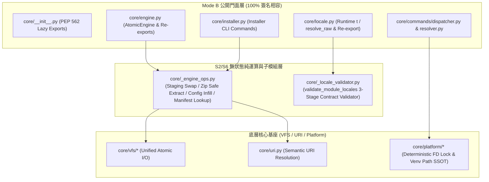

# 技術調研報告：`core` 模組業務代碼五維度靜態診斷與無損重構審計 (R03_code_optimization_audit.md)

> 調研主題：`ys_codebase/source/core/`（排除 `tests/`）五維度靜態診斷與 S1~S6 重構處方箋  
> 建立日期：2026-10-31  
> 所屬主計畫：`2026_10_30_1641_code_optimize / sub_01_core_code_optimization`  
> 狀態：Concluded  
> 調研狀態：Concluded  
> 模型：Gemini 4 Argon (Low)  
> 模板版本：v1.1  

---

## 1. 背景與調研目標 (Background & Objectives)

### 1.1 定錨基準與範圍摘要
- **檢視範圍**：`Module Scope` — `ys_codebase/source/core/` 全模組業務生產源碼（排除 `ys_codebase/source/core/tests/`），共涵蓋 **27 個 Python 源碼檔案（約 7,764 LOC）**，包含微核心套件引擎（`engine.py`、`installer.py`）、語意 URI 與虛擬檔案系統（`uri.py`、`vfs/*`）、多語系與宿主方言引擎（`locale.py`）、Contributes 聚合與型別 DSL 校驗器（`contributes.py`、`validator.py`）、CLI 雙管道派發器（`commands/*`、`scripts/cli.py`）、跨平台進程/檔案鎖原語（`platform/*`）、私有微環境與 IDE 投影（`pip_manager.py`、`ide_projector.py`）及觀測/更新服務（`telemetry.py`、`update_checker.py`）。
- **生命週期模式**：同時代入 **`Mode B：維護期 / 嚴守向下相容`**（保護 `core/__init__.py`、`core/vfs/__init__.py`、`core/platform/__init__.py`、`core/commands/__init__.py`、`scripts/cli.py` 與跨模組 SDK 契約 100% 零破壞）與 **「經全空間調用圖譜嚴格查驗 0 外部調用之純內部工具函式直接破壞性收斂」** 雙層查驗標準。
- **核心問題與痛點**：
  1. **巨型檔案職責交織（`D1`）**：`core/engine.py`（1,007 行）、`core/locale.py`（808 行）、`core/installer.py`（805 行）、`core/commands/dispatcher.py`（675 行）、`core/uri.py`（634 行）及 `scripts/cli.py`（518 行）承載多重正交職責，且 `AtomicEngine` 與 `Installer` 內部存在大量未讀寫實例狀態之假性實例方法。
  2. **跨檔邏輯重複與雙軌分叉（`D2` / `D3`）**：`Installer.cmd_restore` / `_restore_module_package` 與 `AtomicEngine.act_download` / `act_reload` 各自維護一套本地/遠端 Zip 探測與 `.staging_` 原子解壓邏輯；`dispatcher._load_registry` 與 `ContributesAggregator`、以及 `UpdateChecker` 與 `Installer._discover_*` 均存在結構性重複。
  3. **超長編排函式與深層巢狀（`D3`）**：`dispatch`（210 行）、`dispatch_local`（135 行）、`OptionResolver.resolve`（115 行，縮排達 6 層）、`resolve_callable`（102 行，縮排達 6 層）混雜高階路由與底層細節。
  4. **基礎設施抽象繞過與重複實作（`D4` / `D5`）**：部分模組（`telemetry.py`、`dispatcher.py`、`installer.py`、`locale.py`）直接混用原生 `open()` / `json.load()` 或自行實作 `.tmp` 原子寫入，未統一走 `core.vfs` 抽象層；`pip_manager.py` 與 `platform/venv.py` 重複計算跨平台 `site-packages` 路徑。
- **調研目標**：
  完成 `D1`~`D5` 五維度全量靜態體檢，盤點公開匯出門面與 0 外部調用之內部符號邊界，並制定可 100% 行為無損落地之 `S1`~`S6` 外科手術重構處方箋。

---

## 2. 候選方案分析與對比 (Candidate Evaluation)

### 2.1 契約邊界與內部工具函式查驗表 (Contract Boundary & Call-Graph Audit)

經 `knowledge-db callers` 全空間調用圖譜與匯出清單雙重查驗，`core` 模組之符號邊界分類如下：

| 分類層級 | 涵蓋檔案與符號清單 | 外部調用查驗結果 | 重構處置原則 (`Mode B` 雙層準則) |
| :--- | :--- | :--- | :--- |
| **第一層：對外公開契約與跨模組門面 (Frozen Public Surface)** | • `core/__init__.py`：`__all__` 匯出之 30 個頂層符號與模組 • `core/uri.py`：`resolve`, `to_uri`, `module_scope`, `host_scope`, `yscb_scope`, `resolve_yscb_root`, `list_registered_schemes_summary`, `format_undefined_uri_hint`, `_get_host_config`（跨檔案 12 處調用） • `core/config.py`：`get`, `get_all`, `get_raw`, `set`, `delete`, `reload`, `inspect`, `list_modules`, `get_config_path`, `ConfigManager` • `core/vfs/__init__.py`：`vfs`, `VirtualPath`, `VFS`, `VFSBackend`, `OSBackend` 及 19 個頂層委託函式 • `core/platform/__init__.py`：`InterProcessLock`, `LockAcquisitionError`, `can_spawn_background_daemon`, `spawn_detached`, `is_process_alive`, `kill_process_tree`, `set_process_title`, `ensure_private_venv` • `core/commands/__init__.py`：`dispatch`, `dispatch_local`, `CmdBags`, `CmdOption`, `CommandsRegistry`, `OptionResolver`, `HelpRenderer` 及規格/異常類別 • `core/semver.py` / `symbols.py` / `pip_manager.py` / `ide_projector.py` / `telemetry.py` / `locale.py` / `validator.py` / `contributes.py` / `events.py` / `guard.py` 公開函式與類別 • `scripts/cli.py`：CLI 精確入口函式（`install`, `update`, `remove`, `list`, `status`, `reload`, `rollback`, `restore`, `uri*`, `config*`, `event*`, `contributes*`） | 供 `yscb.py`、`dev`、`server`、`knowledge-db`、`agents-workflow` 及沙盒測試廣泛調用 | **強制門面保護**：維持模組匯入路徑、函式簽名、參數預設值、回傳結構與異常型別 100% 相容；若執行 `S6` 物理拆檔，必須於原模組透過 Facade Re-export 無縫轉發。 |
| **第二層：經嚴格查驗 0 外部跨模組調用之純內部工具函式與私有方法 (Strictly Verified Internal Helpers)** | • `core/pip_manager.py`：`ensure_yscb_gitignore`（`total_callers: 1`，僅 `PipManager._ensure_gitignore` 呼叫，且僅單行轉發 `generate_internal_gitignore`） • `core/installer.py`：`fetch_and_extract_zip`（`total_callers: 1`，僅 `_restore_module_package` 呼叫）、`_discover_available_versions_for_module`（`total_callers: 1`）、`_discover_remote_modules`（`total_callers: 1`）、`_print_restore_failure_guidance`（`total_callers: 1`）、`Installer._restore_module_package`（`total_callers: 1`）、`Installer._check_optional_dependencies`（`total_callers: 1`）、`Installer._print_onboarding_guide`（`total_callers: 1`） • `core/engine.py`：`_parse_dependencies`、`_deep_infill_dict`、`_force_rmtree_with_retry`、`_cleanup_stale_swap_dirs`、`_atomic_swap_dir`、`_clean_module_cache`、`_extract_zip_safely`、`_is_build_version_request`、`_resolve_target_cfg_uris`；以及 `AtomicEngine` 內部 `_download_from_*`（各 1 處）、`_find_manifest_in_*`（各 1 處）、`_infill_single_template`（1 處）、`_deploy_and_strip_single_module_config`（2 處）、`_reload_materialize_single_module`（1 處）、`act_deploy_configs_from_modules`（1 處） • `core/commands/dispatcher.py`：`_try_hot_dispatch`、`_is_server_daemon_active_or_locked`、`_read_server_spawn_config`、`_print_agent_daemon_blocker`、`_maybe_auto_spawn_server`、`_find_module_cli`、`_ensure_hooks`、`_maybe_check_and_print_updates` • `core/locale.py`：`_resolve_module_base_dir`、`_is_safe_subpath`、`_load_json_cached`、`_get_module_locales_decl`、`_split_module_key`、`_get_all_registered_locale_modules`、`_interpolate_template`、`_validate_*` • `scripts/cli.py`：`_render_subcommand_group_help`、`_parse_cli_scalar_or_json`、`_normalize_bags`（14 處全在 `scripts/cli.py` 內部） | 經 `knowledge-db callers` 查驗確認 **0 外部跨模組引用**，100% 屬於 `core` 內部實作細節 | **直接破壞性收斂**：不保留冗餘轉發層，直接執行 `S1` 階段拆解、`S2` 無狀態剝離、`S3` 同構合併與死代碼/薄包裝清除，並同步更新 `core` 內部調用點。 |

---

### 2.2 `D1 ~ D5` 五維度分級診斷矩陣 (Five-Dimension Diagnostic Matrix)

以下按 `D1`~`D5` 列出 `ys_codebase/source/core/` 之完整靜態診斷結果（含檔案座標、`P0/P1/P2` 嚴重度與對應重構策略）：

#### 維度 `D1`：職責內聚與抽象層級 (Cohesion & Abstraction Levels)

| 編號 | 檔案路徑與行號區間 | 嚴重度 | 具體結構病徵 | 對應策略 |
| :---: | :--- | :---: | :--- | :---: |
| **D1-01** | `core/engine.py:1-1007` | **P0** | **巨型破窗檔案与多軸職責耦合（God File / 1,007 LOC）**：單一檔案同時塞入 5 個正交職責軸線：① 底層檔案系統強韌刪除與目錄原子替換（`L85-192`）、② Zip 安全檢驗與 3-Tier 套件下載解析（`L204-234`, `L342-600`）、③ SemVer 依賴拓撲求解器（`L603-643`）、④ 模組組態模板遞迴補齊與剝離（`L52-83`, `L236-255`, `L650-778`）、⑤ 快照備份還原與版本遷移階梯（`L882-1007`）。 | `S2`, `S6` |
| **D1-02** | `core/engine.py:272-880` | **P1** | **假性實例方法膨脹（Stateless Methods Bound to Class）**：`AtomicEngine` 僅持有 `self.contributes_aggregator` 與 `self._active_locks`，但其內部方法 `_download_from_build_tier`（`L342-384`）、`_download_from_release_tier`（`L386-415`）、`_download_from_remote_tier`（`L417-444`）、`_find_manifest_in_build_tier`（`L482-514`）、`_find_manifest_in_local_provider`（`L516-569`）、`_infill_single_template`（`L650-686`）、`_deploy_and_strip_single_module_config`（`L688-755`）、`_reload_materialize_single_module`（`L805-834`）、`act_delete`（`L779-803`）、`act_snapshot`（`L882-914`）、`act_migrate`（`L964-1007`）**完全未讀寫 `self` 任何實例狀態**，卻與 `AtomicEngine` 強綁定。 | `S2`, `S6` |
| **D1-03** | `core/installer.py:1-805` | **P1** | **CLI 顯示層與底層套件提取/環境同步職責混雜（805 LOC）**：`Installer` 同時負責終端表格列印（`cmd_list`, `cmd_status`, `_print_onboarding_guide`）、底層 Zip 串流提取（`fetch_and_extract_zip` `L87-143`, `_restore_module_package` `L676-767`）以及 Pip 微環境與 VS Code 設定同步（`sync_pip_dependencies` `L769-817`）；且 `_print_onboarding_guide` 與 `_restore_module_package` 完全不依賴 `self`。 | `S1`, `S2`, `S3` |
| **D1-04** | `core/locale.py:1-808` | **P1** | **執行期翻譯引擎與編譯期靜態契約校驗器共處單一巨型檔案（808 LOC）**：前半部（`L42-556`）為高頻執行期語系鏈解析、快取載入與雙階段遞迴插值（`t`, `resolve_raw`）；後半部（`L558-808`，約 250 行）為純靜態 Schema 與佔位符契約校驗器（`validate_module_locales` 及其 3 個 Stage 輔助函式），僅在 `contributes check` / `dev check` 時調用，兩者生命週期與依賴截然不同。 | `S6` |
| **D1-05** | `core/commands/dispatcher.py:339-699` | **P1** | **頂層路由方法違反 SLAP（`dispatch` 210 行、`dispatch_local` 135 行）**：`dispatch`（`L489-699`）在單一函式內混雜 UTF-8 串流重組態、環境變數注入、快捷指令判定、模糊拼寫建議、3 處重複之 `record_cli_event` 錯誤埋點、純分支 `cli.py` 原始碼字串嗅探（`L617-631`）、熱派發與背景 Daemon 喚醒；`dispatch_local`（`L339-473`）則混雜 Hook 觸發、Option 解析、`sys.path` 注入、動態模組載入與函式反射分派。 | `S1`, `S3` |

#### 維度 `D2`：調用耦合與拓撲健康度 (Coupling & Topology Hygiene)

| 編號 | 檔案路徑與行號區間 | 嚴重度 | 具體結構病徵 | 對應策略 |
| :---: | :--- | :---: | :--- | :---: |
| **D2-01** | `core/commands/dispatcher.py:54-95` vs `core/contributes.py:285-339` | **P1** | **指令註冊表載入邏輯繞過 Contributes 快取體系**：`dispatcher._load_registry`（`L54-95`）每次啟動時自行以 `os.listdir(modules_dir)` 逐一讀取 `.modules/<mod>/contributes/core.json` 原始檔，未使用 `core.contributes` 已物化之 `cache://core/contributes.merged.json`（其中已包含 `commands.__modules__`），亦未支援 `config://core/contribute.json` 覆蓋。 | `S3` |
| **D2-02** | `core/pip_manager.py:18-24` & `L234-236` | **P2** | **純內部薄轉發冗餘（Pass-through Wrapper）**：`ensure_yscb_gitignore(yscb_dir)` 僅單行呼叫 `generate_internal_gitignore(yscb_dir)`，且 `PipManager._ensure_gitignore(self)` 又再包一層呼叫 `ensure_yscb_gitignore(self.yscb_dir)`；全空間 `callers` 查驗 0 外部引用。 | `S2` |
| **D2-03** | `core/uri.py:190-218` | **P2** | **跨子模組共用介面命名為私有前綴**：`uri._get_host_config()` 被 `engine.py`（4 處）、`installer.py`（3 處）、`dispatcher.py`（1 處）直接跨檔呼叫（共 12 處），實質上已是 `core` 內部跨模組核心尋根契約，卻僅以單底線私有函式暴露且各處重複拼裝 `os.path.join(host_dir, "yscb.config.json")`。 | `S2`, `S3` |

#### 維度 `D3`：控制流與認知複雜度 (Control Flow & Cognitive Complexity)

| 編號 | 檔案路徑與行號區間 | 嚴重度 | 具體結構病徵 | 對應策略 |
| :---: | :--- | :---: | :--- | :---: |
| **D3-01** | `core/installer.py:87-143`, `L676-767` vs `core/engine.py:342-464`, `L805-835` | **P1** | **跨檔案同構樣板重複（3-Tier 套件探測與 Staging 原子解壓雙軌化）**：`Installer._restore_module_package` + `fetch_and_extract_zip` 與 `AtomicEngine.act_download` + `_reload_materialize_single_module` 各自實作了「探測 `.build` / `release` / `.mirror` / 本地 Provider / 遠端 HTTP $\to$ 建立 `.staging_<name>_<pid>_<ts>` $\to$ `_extract_zip_safely` $\to$ `_atomic_swap_dir` $\to$ `finally` 清理」的完整管線，導致維護時需雙處同步修改。 | `S3` |
| **D3-02** | `core/installer.py:145-241` vs `core/update_checker.py:247-290` vs `core/engine.py:516-570` | **P1** | **Provider `index.json` 版本探測邏輯三處重複**：`_discover_available_versions_for_module`、`UpdateChecker._fetch_latest_version` 與 `AtomicEngine._find_manifest_in_local_provider` 均重複編寫「區分 `http(s)://` 與本地路徑 $\to$ 走訪 `<prov>/<mod>/index.json` 與 `<prov>/release/<mod>/index.json` $\to$ 解析 `versions` 並調用 `semver.find_best_version`」的控制流。 | `S3` |
| **D3-03** | `core/commands/resolver.py:43-161` | **P1** | **箭頭型深層巢狀（Arrow Anti-pattern，縮排達 6 層，118 行）**：`OptionResolver.resolve` 在單一 `while` 迴圈內同時處理 `--` 終止符、`--key=val` 切分、正交群組互斥檢查、帶參選項下一個 token 預讀、選項 `choice` 驗證、布林旗標轉型、未知選項兜底及位置參數必填/`choice` 驗證，最深縮排達 6 層。 | `S1`, `S4` |
| **D3-04** | `core/symbols.py:89-191` | **P1** | **動態符號載入深層巢狀（縮排達 6 層，102 行）**：`resolve_callable` 的軌道 2（VFS 實體檔案載入，`L134-169`）在 `if loaded_mod is None -> for f_uri -> if vfs.exists -> if os.path.isfile -> try -> if spec and spec.loader -> for p_cand` 連續嵌套 6 層。 | `S1`, `S4` |
| **D3-05** | `core/contributes.py:285-373` & `core/commands/contributes_cmd.py:115-197` | **P1** | **Donor 模組與專案覆蓋 `contribute.json` 驗證/合併迴圈重複**：`ContributesAggregator._collect_donor_contributes` 與 `_apply_project_overrides_and_persist` 重複編寫「讀取 JSON $\to$ `validate()` $\to$ 迴圈輸出 `logger.warning` $\to$ 特判 `target == 'core'` 擷取 `commands`/`locales` $\to$ `_deep_merge`」；`contributes_cmd._check_modules_mode`（83 行，縮排 5 層）亦重複編寫模組 `contributes/*.json` 與 `config://<donor>/contribute.json` 兩段同構檢驗邏輯。 | `S3`, `S4` |
| **D3-06** | `scripts/cli.py:227-252`, `L336-357`, `L462-474`, `L497-518` | **P2** | **CLI 群組分派器重複 `if-elif-else` 分支鏈**：`config`、`uri`、`event`、`contributes` 四個群組入口函式重複編寫「`_normalize_bags` $\to$ 空參數渲染 `_render_subcommand_group_help` $\to$ 組裝 `sub_bags` $\to$ `if/elif` 分派子函式 $\to$ 未知子指令報錯」之同構樣板。 | `S3`, `S4` |

#### 維度 `D4`：介面契約與資源生命週期 (Contracts & Resource Lifecycle)

| 編號 | 檔案路徑與行號區間 | 嚴重度 | 具體結構病徵 | 對應策略 |
| :---: | :--- | :---: | :--- | :---: |
| **D4-01** | `core/platform/lock.py:54-71` | **P0** | **`InterProcessLock.acquire` 潛在檔案描述符（FD）洩漏風險**：在 `L54` 執行 `fd = os.open(...)` 後，進入 `while True` 迴圈呼叫 `self._try_lock_fd(fd)` 與 `time.sleep(0.05)`；若等待期間拋出非預期例外（如 `KeyboardInterrupt` 或底層系統錯誤），由於未包裹於 `try...except` 中關閉 `fd`，該 OS file descriptor 將直接洩漏直至進程結束。 | `S3` |
| **D4-02** | `core/telemetry.py:103-153` | **P1** | **長參數列（10 個散裝參數）與裸字典結構**：`record_cli_event` 接收 10 個散裝參數（`module_name`, `cmd_path`, `args`, `exit_code`, `duration_ms`, `mode`, `error_hint`, `yscb_abs`, `cwd`, `max_bytes`, `keep_lines`），且在 `dispatcher.py` 中於 5 處重複手動展開長參數呼叫。 | `S3`, `S5` |
| **D4-03** | `core/vfs/os_backend.py:274-301` vs `core/engine.py:156-168` | **P2** | **Windows 原子替換重試邏輯分散與異常掩蓋差異**：`OSBackend.atomic_write`（`L275-299`）內聯了 25 行針對 `win32` 的 10 次重試與 `remove` + `copy2` 降級邏輯，而 `engine._atomic_swap_dir`（`L156-168`）又另寫一套 `_replace_with_retry`，兩者未共享底層跨平台 retry-replace 工具函式。 | `S1`, `S3` |

#### 維度 `D5`：架構邊界與專案慣例 (Architectural Idioms)

| 編號 | 檔案路徑與行號區間 | 嚴重度 | 具體結構病徵 | 對應策略 |
| :---: | :--- | :---: | :--- | :---: |
| **D5-01** | `core/pip_manager.py:101-133` vs `core/platform/venv.py:18-26` | **P1** | **跨平台微環境 `site-packages` 路徑規則重複硬編碼**：`PipManager.get_site_packages_dir`、`PipManager.get_cross_platform_site_packages_dirs` 與 `core.platform.venv.ensure_private_venv` 各自獨立硬編碼 `py{major}{minor}` 標籤與 Windows（`Lib/site-packages`）vs POSIX（`lib/pythonX.Y/site-packages`）路徑拼接邏輯，違反單一真相來源（SSOT）。 | `S3`, `S5` |
| **D5-02** | `core/telemetry.py:170-175`, `core/installer.py:162-167`, `L206-218`, `core/locale.py:617-626`, `L707-715` | **P1** | **繞過 `core.vfs` 統一檔案抽象層**：`telemetry._rotate_telemetry_file` 自行手寫 `.tmp.{os.getpid()}` + `os.replace` 而未複用 `vfs.atomic_write` / `vfs.write_text`；`installer.py` 與 `locale.py` 多處直接呼叫 `with open(..., "r", encoding="utf-8") as f: json.load(f)`，未統一透過 `vfs.read_json` 存取。 | `S3` |
| **D5-03** | `core/locale.py:381-382` & `L483` | **P2** | **核心底層模組硬編碼上層業務模組名稱**：`core/locale.py` 在 `_get_all_registered_locale_modules` 與 `_interpolate_template` 中直接硬編碼上層選配模組名稱 `"agents-workflow"` 作為優先回退順序，造成微核心底層對特定上層業務模組名稱的隱式耦合（宜抽離為頂層常數 `DEFAULT_FALLBACK_LOCALE_MODULES = ("agents-workflow", "core")` 集中宣告）。 | `S5` |

---

### 2.3 重構候選方案對比

| 方案 | 運作原理 | 優點 (Pros) | 缺點 / 成本 (Cons) | 適用度評級 |
| :--- | :--- | :--- | :--- | :---: |
| **方案 A：全模組外科手術重構 + 巨型檔案物理子模組拆分 (`S1~S6` 完整套用)** | 針對 `engine.py`（1,007 行）與 `locale.py`（808 行）執行 `S6` 正交職責拆檔並以 `Mode B` 門面重匯出保持 100% 向下相容；同時對 `installer.py`、`dispatcher.py`、`resolver.py`、`symbols.py`、`uri.py`、`cli.py` 執行 `S1~S5` 業務階段拆解、無狀態剝離與重複樣板收斂，並修復 `D4-01` FD 洩漏。 | • 徹底消滅千行級 God File，單檔行數壓降至 `< 550` 行 • 消除 `Installer` 與 `AtomicEngine` 雙軌解壓/探測重複 • 100% 維持公開 SDK 與 CLI 契約零破壞 | 涉及新增 2~3 個內部私有子模組（如 `_engine_fs.py`、`_locale_validator.py`），需走 Full Track 完整驗證。 | ⭐⭐⭐⭐⭐ **(強烈推薦)** |
| **方案 B：僅做單檔內部方法提取與控制流扁平化 (`S1~S4`，不執行 `S6` 拆檔)** | 不新增任何內部檔案，僅在現有 27 個檔案內部拆解長函式、拉平巢狀並修復 `D4-01`。 | • 檔案拓撲零變動，改動範圍較小 | • `engine.py` 與 `locale.py` 仍維持 800~1,000+ 行，五個正交職責依舊擠在同一檔案，無法根治 `D1-01` (`P0`)。 | ⭐⭐⭐☆☆ |
| **方案 C：破壞性重構公開 API (`Mode A` 全量改名與拔除舊入口)** | 直接廢除 `AtomicEngine` 類別方法與 `core.config` / `core.vfs` 頂層門面，強制修改全生態系所有模組調用點。 | • 內部結構最極簡 | • 嚴重違反微核心模組對下游模組（`dev`、`server`、`knowledge-db`、`agents-workflow`）之向下相容契約，爆炸半徑過大。 | ⭐☆☆☆☆ |

---

## 3. 架構設計與驗證 (Architecture & PoC)

### 3.1 `S1 ~ S6` 外科手術重構處方箋 (Surgical Refactoring Blueprint)

#### 處方 1：修復 `InterProcessLock` 檔案描述符洩漏並統一 VFS 原子操作（解決 `D4-01` [P0], `D4-03`, `D5-02`）
- **手術刀**：`S1` + `S3`
- **具體動作**：
  1. **`core/platform/lock.py` (`InterProcessLock.acquire`)**：在 `fd = os.open(...)` 後立即以 `try ... except BaseException: os.close(fd); raise` 保護整個 `while True` 鎖獲取迴圈，確保任何中斷或系統異常下 100% 確定性釋放 `fd`。
  2. **`core/vfs/os_backend.py` (`atomic_write`)**：將 `atomic_write` 內部 `win32` 漸進重試替換邏輯提取為私有輔助方法 `_replace_file_with_retry(tmp_path, norm_target)`，使 `atomic_write` 主幹縮減至 30 行內且職責清晰。
  3. **`core/telemetry.py` (`_rotate_telemetry_file`)**：移除手寫 `.tmp.{pid}` + `os.replace` 樣板，改用 `vfs.write_text(str(target_path), ..., atomic=True)`。

#### 處方 2：`core/engine.py`（1,007 行）正交職責剝離與物理拆分（解決 `D1-01` [P0], `D1-02` [P1]）
- **手術刀**：`S2`（無狀態邏輯剝離）+ `S6`（正交職責物理模組拆分，嚴守 `Mode B` 門面重匯出）
- **具體動作**：
  1. 建立內部無狀態輔助模組 `core/_engine_ops.py`（或 `core/engine_ops.py`），將 `engine.py` 中與 `AtomicEngine` 實例狀態完全無關之底層檔案系統原子交換（`_force_rmtree_with_retry`, `_cleanup_stale_swap_dirs`, `_atomic_swap_dir`, `_extract_zip_safely`）、組態模板遞迴補齊與剝離（`_deep_infill_dict`, `_resolve_target_cfg_uris`, `infill_single_template`, `deploy_and_strip_single_module_config`）以及 3-Tier 清單/套件解析純函式下沉至此。
  2. 於 `core/engine.py` 頂層保留 `_extract_zip_safely`、`_atomic_swap_dir`、`_parse_dependencies` 之 Re-export（供 `installer.py` 及既有單元測試無縫匯入），並在 `AtomicEngine` 保留輕量委派方法，使 `core/engine.py` 行數由 **1,007 行降至 ~480 行**，`AtomicEngine` 專注於高階交易鎖（`transaction_lock`）、拓撲求解（`act_solve_deps`）、四階段重載編排（`act_reload`）、快照（`act_snapshot` / `act_restore_snapshot`）與遷移（`act_migrate`）。

#### 處方 3：收斂 `Installer`、`AtomicEngine` 與 `UpdateChecker` 跨檔重複樣板（解決 `D1-03`, `D3-01`, `D3-02`）
- **手術刀**：`S1` + `S2` + `S3`
- **具體動作**：
  1. **統一 Staging 原子解壓管線（`D3-01`）**：將「建立同父目錄 `.staging_<name>_<pid>_<ts>` $\to$ 解壓/複製來源（支援本地目錄、本地 Zip、`http(s)://`、`file://`）$\to$ 可選組態剝離 Hook $\to$ `_atomic_swap_dir` $\to$ `finally` 清理」收斂為單一內部通用函式（置於 `_engine_ops.py`），讓 `engine._reload_materialize_single_module` 與 `installer.fetch_and_extract_zip` 共用同一核心實作。
  2. **統一 Provider 版本探索輔助函式（`D3-02`）**：提取共用之本地/遠端 `index.json` 版本清單查詢函式，消除 `installer._discover_available_versions_for_module` 與 `update_checker._fetch_latest_version` 之重複分支。
  3. **清理純內部薄轉發（`D2-02`）**：於 `core/pip_manager.py` 移除 0 外部調用的 `ensure_yscb_gitignore` 與 `PipManager._ensure_gitignore`，直接呼叫 `generate_internal_gitignore(self.yscb_dir)`；並讓 `core/platform/venv.py` 與 `PipManager` 共享同一套跨平台 `site-packages` 相對路徑計算邏輯（`D5-01`）。

#### 處方 4：`core/locale.py`（808 行）執行期與校驗期物理分離（解決 `D1-04`, `D5-02`, `D5-03`）
- **手術刀**：`S5` + `S6`（`Mode B` 門面重匯出）
- **具體動作**：
  1. 將 `core/locale.py` 後半部（`L558-808`）之靜態契約校驗器（`_validate_locales_decl_header`, `_load_and_validate_definition_contract`, `_validate_single_lang_file`, `validate_module_locales`）物理拆分至 `core/_locale_validator.py`。
  2. 在 `core/locale.py` 透過 `from core._locale_validator import validate_module_locales` 維持原公開 API 簽名 100% 不變，使 `core/locale.py` 降至 **~550 行**（純執行期高速翻譯與插值引擎），並將 `"agents-workflow"` 抽離為頂層具名常數 `DEFAULT_FALLBACK_MODULES = ("agents-workflow", "core")`。

#### 處方 5：`dispatcher.py`、`resolver.py`、`symbols.py` 與 `scripts/cli.py` 階段拆解與扁平化（解決 `D1-05`, `D2-01`, `D3-03`, `D3-04`, `D3-06`, `D4-02`）
- **手術刀**：`S1` + `S3` + `S4` + `S5`
- **具體動作**：
  1. **`core/commands/dispatcher.py` (`dispatch` & `dispatch_local`)**：
     - 提取 `_resolve_target_module_and_tokens(argv, registry, yscb_abs)` 與 `_emit_telemetry(...)` 內部輔助函式，消除 `dispatch` 內 5 處重複的 `record_cli_event` 樣板（`D4-02`），將 `dispatch` 主幹由 210 行壓縮至 ~75 行高階管線。
     - 將 `dispatch_local` 內的動態 CLI 模組載入提取為 `_load_cli_module(module_name, target_cli, yscb_abs)`，將 `dispatch_local` 壓縮至 ~65 行。
  2. **`core/commands/resolver.py` (`OptionResolver.resolve`)**：
     - 將 118 行、6 層巢狀的大迴圈按 `S1`/`S4` 拆解為 `_consume_option_token(...)` 與 `_validate_positional_args(...)`，以衛語句將最大縮排深度由 **6 層降至 3 層**。
  3. **`core/symbols.py` (`resolve_callable`)**：
     - 將軌道 1（Package Import）與軌道 2（VFS 實體檔案載入）分別提取為 `_try_import_symbol_module(...)` 與 `_try_load_vfs_symbol_module(...)`，配合衛語句提早返回，將最大縮排由 **6 層降至 3 層**。
  4. **`scripts/cli.py` 群組分派表驅動化（`D3-06`）**：
     - 提取通用群組分派器 `_dispatch_subcommand_group(cmd_bags, group_name, handlers_map)`，將 `config`、`uri`、`event`、`contributes` 四個群組函式的 `if-elif-else` 分支鏈收斂為宣告式映射表。

---

### 3.2 模組重構前後拓撲與量化預估 (Projected Metrics)

| 量化指標 (Metric) | 診斷基線 (Before) | 預計重構後 (Projected After) | 預期改善幅度 |
| :--- | :---: | :---: | :--- |
| **最大單一檔案行數 (`core/engine.py`)** | `1,007 行` | `~480 行` | **-52%**（消除千行級破窗檔） |
| **次大檔案行數 (`core/locale.py`)** | `808 行` | `~550 行` | **-32%**（分離執行期與靜態校驗期） |
| **最大單一函式行數 (`dispatcher.dispatch`)** | `210 行` | `~75 行` | **-64%**（`S1` 主幹管線化） |
| **最大控制流縮排深度 (`resolver.py` / `symbols.py`)** | `6 層` | `3 層` | **-3 層**（`S4` 衛語句扁平化） |
| **潛在資源洩漏點 (`InterProcessLock.acquire`)** | `1 處 (P0)` | `0 處` | **100% 清零**（異常路徑確定性 `os.close(fd)`） |

---

## 4. 調研結論與落地建議 (Conclusion & Recommendation)

- **診斷總結**：
  本次針對 `ys_codebase/source/core/`（排除 `tests/`）執行五維度靜態診斷，共識別出 **P0 級問題 2 項**（`D1-01` `engine.py` 1,007 行多重正交職責巨型檔案、`D4-01` `InterProcessLock.acquire` 異常路徑 FD 洩漏風險）、**P1 級問題 12 項**（涵蓋假性實例方法膨脹、跨檔案 Staging 解壓與版本探測重複、超長派發函式、6 層深層巢狀及部分 I/O 繞過 VFS）與 **P2 級問題 5 項**。
- **推薦落地策略**：
  採納 **方案 A（`Mode B` 門面相容下之 `S1~S6` 完整外科手術重構）**，優先執行：
  1. **Phase 1（P0 安全與巨型檔案拆解）**：修復 `core/platform/lock.py` FD 釋放保護，並對 `core/engine.py` 與 `core/locale.py` 執行 `S2 + S6` 物理拆檔與門面重匯出。
  2. **Phase 2（P1 跨檔重複收斂與基礎設施對齊）**：收斂 `Installer` 與 `AtomicEngine` 共用之 Staging 解壓與 Provider 探測邏輯、統一 `PipManager` 與 `platform/venv.py` 路徑計算，並對齊 `vfs` 原子寫入。
  3. **Phase 3（P1/P2 控制流扁平化與表驅動分派）**：重構 `dispatcher.py`、`resolver.py`、`symbols.py`、`contributes.py` 與 `scripts/cli.py`，最後透過 `python yscb.py dev check core` 與 `python yscb.py dev test core` 驗證 100% 行為無損。
- **推薦流轉出口與軌道建議**：
  由於重構範圍涵蓋 `core` 模組多個核心檔案且包含 `S6` 物理模組拆分（總異動 > 100 行），若拍板選擇 **「出口 ① 立即原地升級實作」**，建議於當前子計畫（`sub_01_core_code_optimization`）內走 **Full Track（`P01`~`P07`）** 分階段推進並輸出 Before/After 結構量化對照表。
