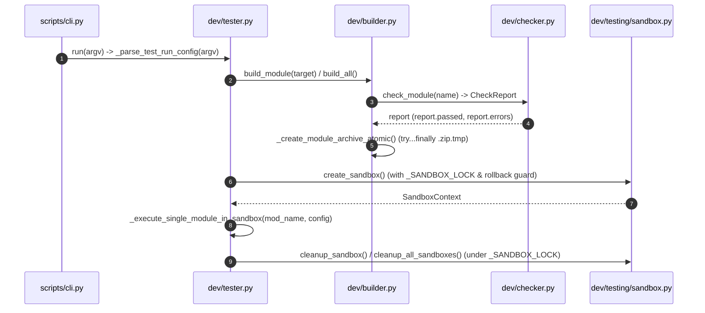

# 架構設計說明書 (Architecture Design)

> 功能名稱：sub_02_dev_code_optimization  
> 建立日期：2026-10-31  
> 所屬主計畫：2026_10_30_1641_code_optimize  
> 狀態：Confirmed  
> 模型：Gemini 4 Argon (Low)  

> 模板版本：v1.2  

---

## 1. 模組架構分層與職責邊界 (Layered Architecture)

```text
+-----------------------------------------------------------------------+
|                        scripts/cli.py (CLI Router)                    |
|  - Thin command dispatchers (create/check/build/release/test/bump_*)  |
|  - Standardized CmdBags normalization & option forwarding             |
+-----------------------------------+-----------------------------------+
                                    |
        +---------------------------+---------------------------+
        |                           |                           |
        v                           v                           v
+---------------+           +---------------+           +---------------+
| dev/checker   |           | dev/builder   |           | dev/releaser  |
| - CheckReport |<----------| - Builder     |<----------| - Releaser    |
| - Checker     |           | - _create_    |           | - resolve_    |
| - Stateless   |           |   module_     |           |   module_dep_ |
|   AST helpers |           |   archive_    |           |   order()     |
+-------+-------+           |   atomic()    |           +-------+-------+
        ^                   +-------+-------+                   |
        |                           ^                           |
        +-------------+-------------+-------------+-------------+
                      |                           |
                      v                           v
              +---------------------------------------+
              |         dev/tester.py (Tester)        |
              |  - _TestRunConfig                     |
              |  - _execute_single_module_in_sandbox  |
              +-------------------+-------------------+
                                  |
                                  v
+-----------------------------------------------------------------------+
|                     dev/testing/* (Testing SDK)                       |
|  - sandbox.py     : SandboxProvisioner (Locked lifecycle & rollback)  |
|  - runner.py      : TestDiscovery, TestRunner, ASCIIReportFormatter   |
|  - case.py        : YSCBTestCase (Public uri scope & vfs assertions)  |
|  - contract.py    : BaseModuleContractTestCase, make_contract_suite   |
|  - requirement.py : Requirement (Canonical flags), @require           |
+-----------------------------------------------------------------------+
                                  |
                                  v
+-----------------------------------------------------------------------+
|                   core (vfs, uri, semver, commands, events)           |
+-----------------------------------------------------------------------+
```

---

## 2. 核心資料流與循序圖 (Data Flow & Sequence Diagram)



---

## 3. 受影響檔案與新建檔案清單 (Impacted & New Files Inventory)

| 檔案路徑 | 類型 | 職責與變更說明 |
| :--- | :---: | :--- |
| `ys_codebase/source/dev/dev/checker.py` | Modify | 移除 `CheckReport` tuple 解包方法與空 `__init__`；移除 `def process(args)` 與 `"ISOLATE_SANDBOX"` 舊分支；拆解 `_check_cli_compliance` 與 `_check_test_classes` 為模組級純函式；全面改用 `core.vfs`。 |
| `ys_codebase/source/dev/dev/builder.py` | Modify | 抽取 `_create_module_archive_atomic` 並加上 `.zip.tmp` `try...finally` 清理；改用 `report.passed` / `report.errors`；移除非壓縮目錄清理與未引用匯入；全面改用 `core.vfs`。 |
| `ys_codebase/source/dev/dev/releaser.py` | Modify | 刪除 `ReleasePipeline`、`ReleaseVersionExistsError`、`VersionRollbackError` 與 `skip_tests` 參數；抽取 `resolve_module_dependency_order` 純函式；改用 `report.passed` 與 `core.vfs`。 |
| `ys_codebase/source/dev/dev/scaffold.py` | Modify | 移除空 `__init__`、未使用匯入與 `create_module` 之 `author`/`desc` 參數；全面改用 `core.vfs`。 |
| `ys_codebase/source/dev/dev/tester.py` | Modify | 移除空 `__init__` 與 `"host_cli"`/`"performance"`/`"stress"` 分支；引入 `_TestRunConfig` 與 `_execute_single_module_in_sandbox` 消除單模與平行執行重複邏輯；同步更新 `adapt_build_pip_dependencies` 調用。 |
| `ys_codebase/source/dev/dev/testing/__init__.py` | Modify | 移除內部類別 `BaseModuleContractTestCase` 的公開匯出，收斂 `__all__`。 |
| `ys_codebase/source/dev/dev/testing/requirement.py` | Modify | 物理刪除 `Requirement.HOST_CLI`、`PERFORMANCE`、`STRESS` 枚舉別名。 |
| `ys_codebase/source/dev/dev/testing/runner.py` | Modify | 移除 `filter_suite` 之 `active_types` 參數與 `"host_cli"`/`"performance"`/`"stress"` 分支；全面改用 `core.vfs`。 |
| `ys_codebase/source/dev/dev/testing/case.py` | Modify | 移除空 `tearDownClass` 與未引用匯入；將 `create_mock_package` 預設版號改為 `"1.0.0.0"`；改用 `uri` 公開 getter/setter 與 `core.vfs`。 |
| `ys_codebase/source/dev/dev/testing/contract.py` | Modify | 改用 `report.passed`/`report.errors` 與 `core.vfs`；提取 `_get_manifest_uri` 輔助。 |
| `ys_codebase/source/dev/dev/testing/sandbox.py` | Modify | 移除 `adapt_build_pip_dependencies` 之 `quiet` 參數；`cleanup_all_sandboxes` 全程加 `_SANDBOX_LOCK`；`create_sandbox` 加入異常回滾清理並拆解為 4 個階段方法；全面改用 `core.vfs`。 |
| `ys_codebase/source/dev/scripts/cli.py` | Modify | 簡化 `_normalize_bags`、將 `alias_map_skip` 收斂為私有 `_should_skip_alias` 與共用 `_build_tester_argv`；全面改用 `core.vfs`。 |
| `ys_codebase/source/dev/tests/test_checker.py` | Modify | 將測試用假模組之 `def process(args)` 全面升級為合規 `def hello(cmd_bags)` 處理函式，並使用 `vfs`。 |
| `ys_codebase/source/dev/tests/test_release_pipeline.py` | Modify | 移除 `ReleasePipeline` 匯入，統一使用 `Releaser`。 |
| `ys_codebase/source/dev/tests/test_case.py` | Modify | 移除對已刪除之 `Requirement.PERFORMANCE` 與 `Requirement.HOST_CLI` 別名的斷言。 |
| `ys_codebase/source/dev/tests/test_sandbox.py` | Modify | 移除 `adapt_build_pip_dependencies` 傳入之 `quiet=True` 參數，並同步調整 `vfs`/`uri` mock。 |
| `ys_codebase/source/dev/tests/test_scaffold.py` | Modify | 將 `create_module(mod_name, desc=...)` 更新為 `description=...`。 |

---

## 4. 架構決策記錄 (Architecture Decision Records)

- **[P02:DR-01] `CheckReport` 單一物件契約 (`M-03`)**：廢除 `CheckReport.__iter__/__getitem__/__len__` 二元組解包，強制所有呼叫端透過 `report.passed`、`report.errors`、`report.warnings` 具名屬性存取，消除型別歧義。
- **[P02:DR-02] `Checker` CLI 處理函式契約純化 (`M-11`)**：移除 `def process(args)` 舊制回退分支；若模組未宣告 `contributes/core.json`，`scripts/cli.py` 仍須宣告至少一個非 `_` 開頭且非 `main` 的頂層命令函式（如 `def hello(cmd_bags)`）。
- **[P02:DR-03] `SandboxProvisioner` 原子建置與鎖對稱保護 (`F-01`)**：`create_sandbox` 在分配目錄並寫入 `_ACTIVE_SANDBOXES` 後，將所有檔案複製、venv 投影與事件廣播包入 `try...except`，一旦失敗立即呼叫 `cleanup_sandbox(ctx.sandbox_dir, force=True)` 確保零孤兒沙盒殘留。
