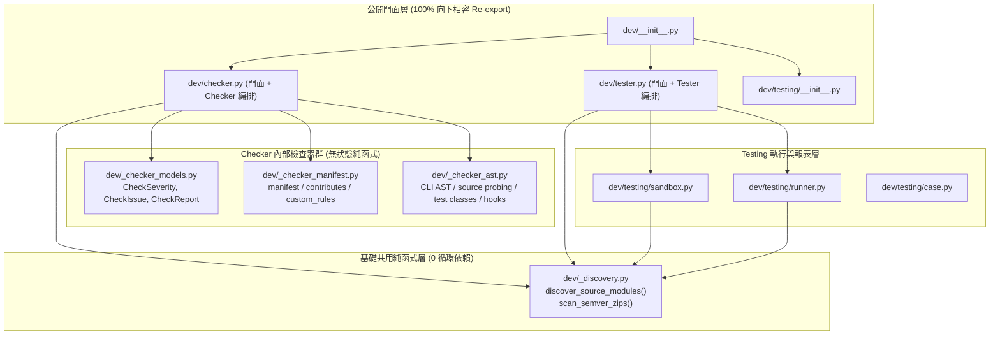

# 技術調研報告：Dev 模組業務代碼五維度靜態診斷與無損重構處方箋 (R03_code_optimization_audit.md)

> 調研主題：Dev 模組（`ys_codebase/source/dev/`，排除 `tests/`）五維度靜態診斷與 `S1~S6` 無損重構規劃  
> 建立日期：2026-10-31  
> 所屬主計畫：2026_10_30_1641_code_optimize / sub_02_dev_code_optimization  
> 狀態：Concluded  
> 調研狀態：Concluded  
> 模型：Gemini 4 Argon (Low)  
> 模板版本：v1.2  

---

## 1. 背景與調研目標 (Background & Objectives)

### 1.1 定錨基準與範圍摘要
- **檢視範圍**：**單一模組 (`Module Scope`)** —— `ys_codebase/source/dev/`（涵蓋 `scripts/cli.py`、`dev/*.py` 與 `dev/testing/*.py` 共 12 個生產業務 Python 檔案，總計 `4,193` LOC；排除 `ys_codebase/source/dev/tests/`）。
- **生命週期模式**：同時代碼盤點涵蓋 **`Mode B：維護期 / 嚴守向下相容`**（保護所有公開匯出 API、CLI 契約與跨模組引用）與 **`Mode A：收斂期 / 允許破壞性清理`**（針對嚴格查證 `0` 外部跨模組調用之純內部工具函式與私有結構直接執行破壞性收斂，零容忍保留內部轉發垃圾）。
- **現行測試基線狀態**：對應 `ys_codebase/source/dev/tests/` 下共 7 個測試套件（`test_scaffold.py`、`test_checker.py`、`test_builder.py`、`test_release_pipeline.py`、`test_tester.py`、`test_case.py`、`test_sandbox.py`），驗證指令為 `python yscb.py dev test dev --quiet`。

### 1.2 模組檔案規模盤點表
| 檔案路徑 (`ys_codebase/source/dev/...`) | 行數 (LOC) | 核心職責概述 | 結構健康度初評 |
| :--- | :---: | :--- | :---: |
| `dev/checker.py` | 1,133 | 8 步模組靜態合規檢查管線、AST 語法/反模式掃描、Contributes 與 Custom Rules 檢驗 | 🔴 **P0 God File / God Class** |
| `dev/tester.py` | 880 | `dev test` / `op-mksb` / `op-test` 調度器、多進程沙盒併發執行與報表聚合 | 🔴 **P0 God File / 長方法與雙重解析** |
| `dev/testing/sandbox.py` | 585 | 虛擬沙盒配置 (`SandboxProvisioner`)、`.venv` 跨平台零拷貝投影、Mock 套件生成 | 🟡 **P1 長方法與重複樣板** |
| `dev/testing/runner.py` | 395 | 測試探索 (`TestDiscovery`)、Suite 過濾 (`filter_suite`)、輸出攔截與 ASCII 報表格式化 | 🟡 **P1 耦合副作用與流串流重複** |
| `scripts/cli.py` | 378 | `dev` 模組 CLI 路由入口、`CmdBags` 容錯正規化與子命令分派 | 🟡 **P1 CLI 參數轉換重複** |
| `dev/testing/case.py` | 318 | `YSCBTestCase` 測試基類、沙盒生命週期掛載、Mock Source 建立與斷言輔助 | 🟡 **P1 `setUp` 探索邏輯深層巢狀** |
| `dev/releaser.py` | 288 | 3-Gate 發布預檢、Kahn DAG 拓撲排序批次發布、`release-git` 四步本地流水線 | 🟡 **P1 假性實例方法與 I/O 重複** |
| `dev/builder.py` | 284 | `.build.zip` 與 `.release.zip` 原子打包、3-Revision 滑動窗口清理与 `index.json` 維護 | 🟡 **P1 假性實例方法與 Zip 走訪重複** |
| `dev/scaffold.py` | 135 | `dev create` 模組骨架與模板生成 (`Scaffolder`) | 🟢 **P2 硬編碼長字串模板** |
| `dev/testing/requirement.py` | 62 | `Requirement` 旗標列舉、`@require` 裝飾器與網路探測 | 🟢 **Pass (局部 P2 魔術常數)** |
| `dev/testing/contract.py` | 58 | 動態合成模組標準合約測試套件 (`BaseModuleContractTestCase`, `make_contract_suite`) | 🟢 **Pass** |
| `dev/__init__.py` & `dev/testing/__init__.py` | 41 / 22 | PEP 562 延遲載入匯出門面與 `dev.testing` 公開 SDK 匯出 | 🟢 **Pass** |

### 1.3 契約邊界與內部工具函式查驗表 (`Contract & Helper Verification`)

經 `knowledge-db` 全空間調用圖譜 (`callers` / `search --space=source`) 雙重嚴格查驗：

| 分類層級 | 符號清單 (`檔案:符號`) | 外部跨模組引用查驗結果 | 重構處置原則 (`Mode A` / `Mode B` 共通或分流) |
| :--- | :--- | :--- | :--- |
| **第一層：對外公開契約與跨模組入口** *(強制門面保護)* | • `dev/__init__.py`: `Scaffolder`, `Checker`, `Builder`, `Tester`, `Releaser`, `testing` • `dev/testing/__init__.py`: `Requirement`, `require`, `is_network_available`, `SandboxContext`, `SandboxProvisioner`, `YSCBTestCase`, `make_contract_suite`, `TestRunner`, `TestDiscovery`, `ASCIIReportFormatter`, `filter_suite` • `dev/checker.py`: `CheckSeverity`, `CheckIssue`, `CheckReport`, `discover_source_modules` • `dev/releaser.py`: `CyclicDependencyError`, `resolve_module_dependency_order` • `dev/testing/case.py`: `SecurityError` • `scripts/cli.py`: `create`, `check`, `build`, `test`, `release`, `release_check`, `release_git`, `bump_major`, `bump_minor`, `bump_patch`, `bump_revision`, `op_mksb`, `op_test` • `contributes/_format.json`: `custom_checks` (`fn(name, real_dir, report)` 簽名契約) | 供微內核 CLI 路由 (`core.commands`)、全系統各模組 `tests/` 測試套件、以及外部模組 `custom_checks` 擴充點調用。 | **`Mode B` 強制門面保護**：維持公開類別/函式名稱、方法簽名、回傳型別與異常語意 100% 相容；若執行 `S6` 物理拆檔，必須於 `dev/checker.py`、`dev/tester.py`、`dev/__init__.py` 或 `dev/testing/__init__.py` 透過門面重匯出（Facade Re-export）保持原路徑可匯入。 |
| **第二層：經嚴格查驗 `0` 外部跨模組調用之純內部工具函式與私有結構** *(直接破壞性收斂)* | • `scripts/cli.py`: `_normalize_bags`, `_get_short_to_canonical_pairs`, `_should_skip_alias`, `_build_tester_argv`, `_handle_bump` • `dev/checker.py`: `_extract_ast_tokens`, `_collect_declared_cli_commands`, `_audit_cli_script_ast`, `_check_require_decorator_node`, `_method_has_none_requirement`, `_method_calls_mark_passed`, `_verify_test_class_isolation_and_marks`, 以及 `Checker._check_*` (8 個私有方法) • `dev/builder.py`: `DEV_BUILD_IGNORES`, `RELEASE_IGNORES`, `_should_ignore`, `_create_module_archive_atomic`, `Builder._load_module_ignores`, `Builder._update_build_index`, `Builder._update_release_index` • `dev/releaser.py`: `_extract_manifest_dependencies`, `Releaser._run_git_cmd` • `dev/tester.py`: `safe_print`, `_TestRunConfig`, `_parse_test_run_config`, `_extract_test_cases_from_suite`, `_record_test_failure_entry`, `Tester._print_usage`, `Tester._run_op_mksb`, `Tester._run_op_test`, `Tester._execute_single_module_in_sandbox`, `Tester._run_test`, `Tester._run_parallel_test`, `Tester._run_single_module_worker`, `Tester._handle_post_test_sync` • `dev/testing/runner.py`: `get_test_category`, `OutputCapturer`, `_format_failure_entries`, `SafeStreamWriter` • `dev/testing/sandbox.py`: `SandboxProvisioner._sort_zip_filenames_by_semver`, `_find_latest_build_zip`, `_sweep_sandboxes`, `_unlink_projected_venv`, `_project_venv`, `_allocate_sandbox_root`, `_deploy_target_and_dependency_modules`, `_provision_core_and_config`, `_link_virtual_environment` | 經 `knowledge-db callers` 全空間檢索驗證：**`0` 外部跨模組生產代碼引用**（100% 僅於 `dev` 模組內部或 `dev/tests/` 單測中使用）。 | **直接執行破壞性收斂（`Mode A` 與 `Mode B` 皆然）**：直接重構簽名、剝離無狀態方法、合併同構重複函式或遷移至內部子模組，並同步更新 `dev` 模組內部調用點，**嚴禁在內部保留無意義的轉發包裝層**。 |

---

## 2. 核心分析與評估 (Core Analysis & Evaluation)

### 2.1 五維度病灶匯總統計
- **`P0（高危破窗 / 巨型檔案與架構腐化）`**：**3 項**
- **`P1（結構耦合 / 可維護性阻礙）`**：**11 項**
- **`P2（局部異味 / 可讀性打磨）`**：**4 項**

### 2.2 `D1 ~ D5` 完整病灶座標表

| 編號 | 檔案路徑 : 行號區間 | 維度 | 嚴重度 | 具體結構病徵 (Structural Symptoms) | 建議策略 |
| :---: | :--- | :---: | :---: | :--- | :---: |
| **F-01** | `dev/checker.py:1-1133` | `D1` | **P0** | **巨型破窗檔案與無狀態 God Class (`1,133` LOC)**：單一檔案同時塞入資料模型 (`CheckSeverity`, `CheckIssue`, `CheckReport`)、模組探索工具 (`discover_source_modules`)、AST 輔助函式、以及涵蓋 8 個正交領域（Manifest、Contributes、檔案結構、CLI AST、源碼反模式、Test 類別、Hook 腳本、Docs 污染、Custom Rules）的 `Checker` 類別。且 `Checker` 的 8 個 `_check_*` 方法**完全未讀寫任何 `self` 實例屬性**（100% 假性實例方法）。 | `S1`, `S2`, `S6` |
| **F-02** | `dev/tester.py:1-880` (`_run_op_test:250-493`) | `D1` `D3` | **P0** | **巨型調度器與 244 行超長程序 (`_run_op_test`)**：`tester.py` 達 `880` LOC；其中 `Tester._run_op_test` 單一方法長達 **244 行**，混雜「沙盒環境安全守門」、「手寫 `while` 迴圈 CLI 參數解析（38 行）」、「目標模組推導与探索」、「逐模組 Suite 執行與 `Contract/Custom/4-Tier/UNKNOWN` 計數分類（85 行）」、「失敗條目格式化」、「JSON 報表寫出」與「終端渲染」共 7 個抽象層級。 | `S1`, `S2`, `S5`, `S6` |
| **F-03** | `scripts/cli.py:14-107` `dev/tester.py:60-148` `dev/tester.py:265-327` | `D3` `D4` | **P0** | **CLI 參數三階段反序列化與三重手寫解析反模式**：`core.commands` 已將命令列解析為強型別 `CmdBags`，但 `cli.py:_build_tester_argv` 將 `CmdBags` 降級序列化回 `List[str]`，傳入 `tester.py:_parse_test_run_config` 進行**第一次手寫 `while` 迴圈解析**並過濾重建 `clean_argv: List[str]`，接著在 `_run_op_test`（或子進程）中又進行**第二次幾乎完全重複的 `while` 迴圈解析**（重複解析 `-q`, `-a`, `-v`, `--keep-sandbox`, `--logical`, `--env`, `--workflow`, `--perf`, `--type`, `--target`, `-k/--pattern`），極易在新增旗標時發生漏轉發或行為不一致。 | `S3`, `S4`, `S5` |
| **F-04** | `dev/checker.py:293-432` `dev/checker.py:470-619` | `D3` | **P1** | **深層巢狀與超長校驗方法**：`_check_manifest`（140 行，含 `optional` 欄位 6 層縮排巢狀 `if-else-for-if-else-if`）與 `_check_core_injection`（150 行，混雜 `_format.json` 元校驗、跨模組 Schema 解析、`locales` 相依性版本檢查與錯誤收集，縮排達 6 層）。 | `S1`, `S4` |
| **F-05** | `dev/checker.py:801-886` | `D1` `D3` | **P1** | **`_check_source_files` 6 層箭頭型巢狀 (Arrow Anti-pattern)**：`os.walk` $\to$ `for f` $\to$ `ast.walk` $\to$ `isinstance(Constant)` $\to$ `if name not in ("dev", "core")` $\to$ `if "module.source://"` 連續 6 層縮排，且 AST 載入與錯誤轉 `CheckIssue(SYNTAX)` 的樣板在 `_check_cli_compliance` (L723-736)、`_check_source_files` (L813-837)、`_check_test_classes` (L896-908)、`_check_sandbox_hooks` (L923-947) **重複出現 4 次**。 | `S3`, `S4` |
| **F-06** | `dev/checker.py:1008-1098` | `D3` `D4` | **P1** | **`_check_custom_rules` 動態載入邏輯臃腫（91 行）**：單一方法內混雜 `code.func://` / `mod:fn` / `mod.fn` 三種 URI 格式拆解、`donor` 模組路徑推導、`sys.path` 暫態污染與還原、以及 `resolve_callable` / `importlib` 雙重分派，縮排達 5 層。 | `S1`, `S3` |
| **F-07** | `dev/tester.py:564-846` | `D1` `D3` | **P1** | **單模組執行 (`_run_test`) 與平行執行 (`_run_parallel_test`) 結構性重複**：兩方法重複實作了「前置 `Builder` 建置檢查與錯誤輸出 (L582-598 vs L672-682)」、「沙盒清理 vs `prune_sandboxes` 保留判斷 (L639-653 vs L785-790 & L827-837)」以及「測試後 `--sync` 同步觸發」，且 `Tester` 類別中除調度外的所有方法均無實例狀態 (`self`) 依賴。 | `S2`, `S3` |
| **F-08** | `dev/tester.py:17-42` `dev/testing/runner.py:350-371` | `D2` `D3` | **P1** | **Windows 編碼容錯輸出邏輯跨檔重複**：`tester.py:safe_print` 與 `runner.py:SafeStreamWriter` 各自獨立實作了針對 Windows `cp950` / `UnicodeEncodeError` 的 `encode(enc, errors="replace").decode(...)` 降級寫入邏輯，未收斂為單一內部工具。 | `S3` |
| **F-09** | `dev/testing/sandbox.py:38-121` `dev/testing/case.py:178-255` `dev/scaffold.py:23-134` | `D3` | **P1** | **模組骨架與 Mock 套件生成樣板三處重複**：`SandboxContext.create_mock_package`、`YSCBTestCase.create_mock_source_module` 與 `Scaffolder.create_module` 各自硬編碼並重複撰寫了生成 `manifest.json`、`scripts/cli.py` (`hello` 命令 + `guard_dispatch`)、`contributes/_manifest.md` 與 `contributes/core.json` 的字典與字串樣板。 | `S3`, `S5` |
| **F-10** | `dev/testing/sandbox.py:253-317` `dev/testing/sandbox.py:416-493` | `D1` `D3` | **P1** | **`SandboxProvisioner` 長方法與深層巢狀**：`adapt_build_pip_dependencies`（65 行，含 5 層 `with zipfile` / `with open` 巢狀讀取 `manifest.json`）與 `_deploy_target_and_dependency_modules`（78 行，混合宿主 `.modules` 複製、`.build` zip 解壓覆蓋、全部已部署模組 `manifest.json` 重掃描與 `source/` 樹拷貝共 4 個階段，縮排達 5 層）。 | `S1`, `S4` |
| **F-11** | `dev/testing/runner.py:90-160` | `D1` `D4` | **P1** | **`TestDiscovery.build_suite_for_module` 混雜全域副作用与巢狀驗證**：在探索階段直接刪除 `sys.modules` 中的 `tests*` 與目標模組快取、篡改 `sys.path`、甚至在磁碟上自動寫入缺失的 `tests/__init__.py`（隱式 I/O 副作用），並在內部定義遞迴函式 `_validate_test_types`。 | `S1`, `S2` |
| **F-12** | `dev/testing/case.py:68-127` | `D1` `D3` | **P1** | **`YSCBTestCase.setUp` 混雜環境備份與沙盒目錄向上走訪探索（60 行）**：`setUp` 同時負責環境快照備份、`@require(ISOLATED_SANDBOX)` 解析、以及當 `YSCB_SANDBOX_DIR` 未命中時沿父目錄 `while` 迴圈向上探測 `host_env` / `mock_provider` 的複雜路徑啟發式推導（縮排達 5 層）。 | `S1`, `S4` |
| **F-13** | `dev/builder.py:105-284` `dev/releaser.py:83-169` | `D1` `D3` | **P1** | **`Builder` 與 `Releaser` 假性實例方法與版本掃描重複**：`Builder._load_module_ignores`, `_update_build_index`, `_update_release_index` 與 `Releaser._run_git_cmd` 均未讀寫 `self` 狀態；且掃描目錄下 `*.zip` 並以 `semver.parse_semver` + `functools.cmp_to_key(semver.compare_semver)` 排序的邏輯在 `builder.py` (L131-136, L167-181, L189-192)、`releaser.py` (L141-151) 與 `sandbox.py` (L114, L132-151) **重複出現 6 次**。 | `S2`, `S3` |
| **F-14** | `dev/checker.py:1104-1133` `dev/releaser.py:17-18` `dev/builder.py:16` `dev/testing/runner.py:10` `dev/testing/sandbox.py:17` | `D2` | **P1** | **基礎探索函式 `discover_source_modules` 寄居於巨型 `checker.py` 造成跨模組扇入耦合**：`builder.py`、`releaser.py`、`runner.py`、`sandbox.py` 與 `cli.py` 僅為了取得 `source/` 下的模組名稱清單，全部必須 import 高達 1,133 行的 `dev.checker`（連帶載入 `ast`、`core.validator` 等重型依賴）。 | `S2`, `S6` |
| **F-15** | `dev/checker.py` / `dev/builder.py` / `dev/testing/sandbox.py` | `D5` | **P2** | **VFS 抽象與原生 `os.path` / `open` 混用不一致**：在同一方法內（如 `releaser.py:release_check` 先用 `vfs.exists("module.release://...")` 後又 `uri.resolve` 轉 `os.listdir`；`checker.py` 先 `vfs.exists(src_uri)` 後全改用 `open(os.path.join(...))`）混用兩套檔案存取介面。考量 AST 解析與 Zip 打包需實體路徑屬合理邊界，但讀取 JSON manifest 可統一收斂輔助函式。 | `S3` |
| **F-16** | `dev/tester.py:647, 789` `dev/testing/sandbox.py:218, 403` `dev/testing/requirement.py:30-32` | `D5` | **P2** | **散落魔術常數 (Magic Literals)**：沙盒保留上限在不同位置硬編碼為 `max_keep=3` (`tester.py:647`, `sandbox.py:218`) 與 `max_keep=8` (`tester.py:789`, `sandbox.py:403`)；`builder.py:182` 硬編碼 `items[3:]`（3-Revision 窗口）；`requirement.py:30` 硬編碼探測 URL `"https://raw.githubusercontent.com"` 與 `timeout=1.5`；`runner.py:234` 硬編碼截斷行數 `20` / `10` / `5`。 | `S5` |
| **F-17** | `dev/tester.py:348-477` `dev/tester.py:720-776` | `D4` | **P2** | **測試報告與模組統計結果使用鬆散裸字典 (`Dict[str, Any]`) 跨階段組裝**：`_run_op_test` 與 `_run_parallel_test` 手動維護擁有 10+ 個欄位的 `report_data` 與 `modules` 裸字典，並在兩處重複編寫累加邏輯。 | `S5` |
| **F-18** | `scripts/cli.py:19-43, 70-81` | `D3` | **P2** | **CLI 短長選項映射表雙重維護**：`_normalize_bags` 內的 `alias_map` (L23-43) 與 `_get_short_to_canonical_pairs` (L72-81) 重複定義了相同的短長旗標映射關係。 | `S3`, `S5` |

針對上述 `D1~D5` 病灶，遵循「四大防過度設計紅線（100% 行為與錯誤語意等價、禁止設計模式狂熱、禁止奈米函式、自我解釋命名）」，制定以下 `S1~S6` 具體手術方案：

### 3.1 `S6`：正交職責之物理模組拆分與門面重匯出 (`Orthogonal Module Splitting`)

為徹底解決 **F-01 (`checker.py` 1,133 行)**、**F-02 (`tester.py` 880 行)** 與 **F-14 (`discover_source_modules` 高耦合扇入)**，執行受控物理拆分，並於原入口維持 100% 門面重匯出（Facade Re-export）：

1. **抽離輕量基礎探索與 SemVer 掃描模組 (`dev/_discovery.py`)**：
   - 將 `discover_source_modules(target, require_manifest)` 從 `checker.py` 下沉至 `dev/_discovery.py`，同時在 `dev/checker.py` 保留 `from dev._discovery import discover_source_modules` 重匯出（維持外部相容）。
   - 將 `builder.py`、`releaser.py`、`runner.py`、`sandbox.py` 內部對 `discover_source_modules` 的匯入改指到 `dev._discovery`，切斷它們對 1,133 行 `checker.py` 的重型依賴（解決 **F-14**）。
   - 於 `dev/_discovery.py` 提供共用純函式 `list_sorted_version_zips(dir_path: str) -> List[Tuple[semver.VersionTuple, str, str]]`，一舉收斂 `builder.py`、`releaser.py` 與 `sandbox.py` 中重複 6 次的 `.zip` 版本解析與排序樣板（解決 **F-13**）。
2. **拆分 `dev/checker.py` (1,133 LOC $\to$ 主幹 `~220` LOC + 2 個內部子模組)**：
   - `dev/checker.py` 保留 `CheckSeverity`, `CheckIssue`, `CheckReport`, `Checker`, `discover_source_modules` 作為公開契約門面与 8 步管線編排器。
   - 將 Manifest / Pip Dependencies / Contributes Schema / Custom Rules 檢驗剝離至 `dev/_check_manifest_contributes.py`。
   - 將通用 AST 解析安全包裝器 (`_parse_python_ast_safely`)、CLI AST 合規、Source Probing 反模式、Test Classes 與 Sandbox Hooks 檢驗剝離至 `dev/_check_ast_rules.py`。

### 3.2 `S1` & `S2`：業務階段拆解與無狀態純函式剝離 (`Stage Decomposition & Stateless Extraction`)

1. **`Tester._run_op_test` (244 LOC $\to$ 4 個清晰業務階段，主幹降至 `~45` LOC)**（解決 **F-02**）：
   - **階段 1**：`_verify_sandbox_execution_guard() -> bool`（驗證 `YSCB_TEST_SANDBOX == "1"` 與工作目錄合法性）。
   - **階段 2**：統一使用強型別 `_TestRunConfig`（合併 `_parse_test_run_config` 與 `_run_op_test` 的參數解析，徹底消除 `_run_op_test` 內 65 行的重複 `while` 迴圈）。
   - **階段 3**：`_execute_module_test_suite(mod_name: str, runner: TestRunner, cfg: _TestRunConfig) -> _ModuleTestMetrics`（封裝單一模組之 `build_suite_for_module`、`run_suite`、`Contract/Custom/4-Tier/UNKNOWN` 分類計數與失敗項目提取）。
   - **階段 4**：`_finalize_and_emit_test_report(report_data: Dict[str, Any], cfg: _TestRunConfig) -> int`（負責 `--report-json` 寫檔與 `ASCIIReportFormatter` 終端輸出）。
2. **`Checker` 8 大檢查方法無狀態化與階段拆解**（解決 **F-01, F-04, F-05, F-06**）：
   - **無狀態剝離 (`S2`)**：`Checker` 內所有 `_check_*` 方法完全不讀寫 `self`，全數轉為模組級純函式（由 `Checker.check_module` 依序調用）。
   - **`_check_core_injection` (150 LOC) 拆解 (`S1`)**：拆為 `_validate_contributes_format_schema(contrib_dir, report)`、`_validate_single_contributes_file(name, real_dir, fname, report)` 與 `_validate_core_locales_contract(name, real_dir, c_data, val_res, report)`。
   - **`_check_custom_rules` (91 LOC) 拆解 (`S1`)**：將「解析 `checker_func` 字串並於獨立 `sys.path` 上下文載入 Callable」提取為純函式 `_resolve_custom_checker_callable(c_func: str) -> Callable`。
3. **`SandboxProvisioner` 與 `YSCBTestCase` 階段拆解**（解決 **F-10, F-11, F-12**）：
   - `SandboxProvisioner._deploy_target_and_dependency_modules` (78 LOC)：提取 `_copy_host_installed_modules(sandbox_modules_dir)`、`_overlay_latest_build_packages(sandbox_modules_dir)` 與 `_build_installed_modules_registry(sandbox_modules_dir, prov_uri)` 三個具名階段輔助函式。
   - `YSCBTestCase.setUp` (60 LOC)：將向上走訪目錄尋找 `host_env` 的 22 行啟發式邏輯提取為無狀態純函式 `_resolve_active_sandbox_dir() -> str`。
   - `TestDiscovery.build_suite_for_module` (71 LOC)：將清理 `sys.modules` 與重設 `sys.path` 的環境隔離準備提取為 `_prepare_module_test_import_path(module_name: str, src_real: str)`，並將 `_validate_test_types` 提升為模組級純函式。
4. **`Builder` 與 `Releaser` 無狀態輔助方法剝離 (`S2`)**（解決 **F-13**）：
   - 將 `Builder._load_module_ignores`, `Builder._update_build_index`, `Builder._update_release_index` 與 `Releaser._run_git_cmd` 轉為 `@staticmethod` 或模組級純函式，明確表達其不依賴亦不變異實例狀態之本質。

### 3.3 `S3`：跨方法同構模式聚合與樣板抽離 (`Isomorphic Pattern Aggregation`)

1. **AST 安全解析樣板合一**（解決 **F-05**）：
   - 於 `checker` 提取 `_parse_ast_or_report(file_path: str, display_rel_path: str, report: CheckReport) -> Optional[ast.Module]`，統一處理檔案讀取、`SyntaxError` 含行號報錯與一般 `Exception` 報錯，消除 `_check_cli_compliance`、`_check_source_files`、`_check_test_classes` 與 `_check_sandbox_hooks` 4 處重複的 `try...except SyntaxError...except Exception` 樣板（精簡約 75 行重複代碼）。
2. **單模組與多模組平行測試前後置管線合一**（解決 **F-07**）：
   - 於 `tester.py` 提取 `_prebuild_target_modules(target_mod: Optional[str], is_all: bool, is_nested: bool, quiet_mode: bool) -> bool` 與 `_finalize_sandbox_lifecycle(all_passed: bool, keep_sandbox: bool, is_all: bool, sandbox_dir: str, ...)`，消除 `_run_test` 與 `_run_parallel_test` 之間的重複建置與沙盒清理分支。
3. **Windows 安全字元串流輸出合一**（解決 **F-08**）：
   - 將 `SafeStreamWriter` 與 `safe_print` 統一收斂於 `dev/testing/runner.py`（`safe_print` 直接委派或共用同一套 encoding fallback 輔助函式），由 `tester.py` 匯入使用，消除跨檔重複實作。

### 3.4 `S4` & `S5`：控制流扁平化与結構化資料契約 (`Guard Clauses & Structured Contracts`)

1. **消除雙重 CLI 參數迴圈與統一 `_TestRunConfig` (`S4` + `S5`)**（解決 **F-03, F-18**）：
   - 在 `scripts/cli.py` 將短長選項映射定義為單一常數字典 `_SHORT_TO_CANONICAL_OPTS`，由 `_normalize_bags` 與 `_should_skip_alias` 共用。
   - 在 `dev/tester.py` 擴充 `_TestRunConfig` 結構化欄位（納入 `report_json_path`, `quiet_report`, `test_type`, `pattern`, `target`, `contract_only`, `run_all`），由單一解析函式 `_parse_test_run_config(argv)` 一次性完成解析，供 `_run_test` 與 `_run_op_test` 直接讀取強型別屬性，徹底消滅 `_run_op_test` 內部的第二座 60 行手寫 `while` 解析狀態機。
2. **拉平 `_check_source_files` 與 `_check_manifest` 深層縮排 (`S4`)**（解決 **F-04, F-05**）：
   - 以衛語句 (`if not isinstance(node, ast.Constant) or not isinstance(node.value, str): continue`、`if name in ("dev", "core") or is_test_file: return`) 將 `_check_source_files` 的 AST 檢查提取為 `_inspect_ast_constant_probing(node, name, rel_p, is_test_file, report)`，使最大縮排深度由 **6 層降至 3 層**。
   - 將 `_check_manifest` 中對 `optional` 欄位的深層校驗提取為 `_check_optional_dependencies( m_data, report)` 並改用衛語句提前 `continue`，縮排由 **6 層降至 3 層**。
3. **集中管理魔術常數 (`S5`)**（解決 **F-16**）：
   - 於 `dev/testing/sandbox.py` 定義具名常數 `DEFAULT_SANDBOX_KEEP_SINGLE = 3`、`DEFAULT_SANDBOX_KEEP_PARALLEL = 8`；於 `dev/builder.py` 定義 `RELEASE_SLIDING_WINDOW_SIZE = 3`；於 `dev/testing/requirement.py` 定義 `DEFAULT_PROBE_URL = "https://raw.githubusercontent.com"` 與 `DEFAULT_PROBE_TIMEOUT = 1.5`。

---

## 3. 結論 (Conclusion)

### 3.1 預期量化改善指標預估 (Projected Before / After Metrics)

| 量化指標 (Metric) | 重構前基線 (Before) | 目標重構後 (After 預估) | 結構改善說明 |
| :--- | :---: | :---: | :--- |
| **最大單一檔案行數 (`dev/checker.py`)** | `1,133 LOC` | `~220 LOC` *(主門面)* | 透過 `S6` 拆分為門面編排器 + `_discovery.py` + 2 個專業檢查子模組 |
| **次大單一檔案行數 (`dev/tester.py`)** | `880 LOC` | `~520 LOC` | 透過 `S1/S3/S5` 消除重複 CLI 解析與重複前後置管線 |
| **最大單一函式行數 (`Tester._run_op_test`)** | `244 LOC` | `~45 LOC` (-81%) | 透過 `S1` 拆解為守門、配置解析、單模組執行計數、報表輸出 4 階段 |
| **最大控制流縮排深度 (`checker.py` / `sandbox.py`)** | `6 層` | `≤ 3 層` (-3 層) | 透過 `S4` 衛語句反轉與 AST 節點檢查函式提取 |
| **重複 AST 載入 / SemVer Zip 掃描樣板數** | `4 處` / `6 處` | `1 處` / `1 處` | 透過 `S3` 聚合為 `_parse_ast_or_report` 與 `list_sorted_version_zips` |

### 4.2 推薦流轉出口與風險評估
- **推薦流轉出口**：**出口 ①（立即原地升級實作 — `Full Track` 子計畫）**。
- **軌道判定依據**：本模組重構涉及 `checker.py` 與 `tester.py` 兩大核心檔案之階段拆解（`S1`）、無狀態邏輯剝離（`S2`）、跨檔樣板收斂（`S3`）與內部子模組拆分（`S6`），預計總修改規模 `> 100` 行，同時維持所有對外 Public API 與 CLI 契約 100% 向下相容（`Mode B` 門面重匯出 + 內部工具函式 `Mode A` 破壞性收斂）。
- **建議實施批次**：
  1. **Batch 1（基礎抽離與 `checker` 重構）**：建立 `dev/_discovery.py`、`dev/_check_manifest_contributes.py`、`dev/_check_ast_rules.py`，重構 `dev/checker.py`、`dev/builder.py`、`dev/releaser.py`，執行 `dev test dev -k "checker or builder or release"` 驗證。
  2. **Batch 2（`tester`、`cli` 與 `dev/testing` 重構）**：統一 `_TestRunConfig` 解析、拆解 `Tester._run_op_test`、收斂 `SafeStreamWriter`/`safe_print` 與 `sandbox.py`/`runner.py`/`case.py` 深層巢狀，執行全量 `python yscb.py dev check dev` 與 `python yscb.py dev test dev --all-types --quiet` 完成 100% 無損驗收。
