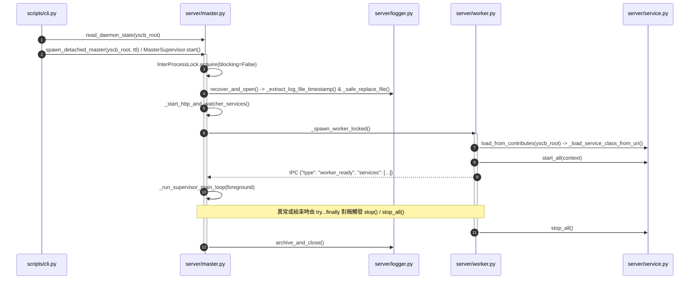

# 架構設計說明書 (Architecture Design)

> 功能名稱：sub_03_server_code_optimization  
> 建立日期：2026-10-31  
> 所屬主計畫：2026_10_30_1641_code_optimize  
> 狀態：Confirmed  
> 模型：Gemini 4 Argon (Low)  

> 模板版本：v1.2  

---

## 1. 模組架構分層與職責邊界 (Layered Architecture)

```text
ys_codebase/source/server/
├── scripts/
│   └── cli.py               # CLI 控制面板層：解析 start/stop/status/reload 參數，複用 master 狀態/啟動/格式化純函式
├── server/
│   ├── __init__.py          # 輕量套件門面：零飢渴匯入、零硬編碼過時版本號
│   ├── config.py            # 組態正規化層：ServerConfig.load(override_dict) 雙層組態載入與布林/數值防禦轉型
│   ├── master.py            # 守護進程與 HTTP 控制平面：MasterSupervisor、DispatcherHTTPHandler 及跨檔共用純函式
│   ├── worker.py            # 常駐預熱執行平面：WarmWorker 階段化命令執行、IPC 雙向串流與 worker_main 對稱生命週期
│   ├── service.py           # 背景服務管理層：BaseServiceWorker 契約、ServiceManager 與 _load_service_class_from_uri
│   ├── watcher.py           # 模組異動偵測層：ModulesWatcher 與 _scan_modules_dir 快照比對
│   ├── logger.py            # 即時日誌與崩潰恢復層：ServerLogger、_extract_log_file_timestamp 與 _safe_replace_file
│   └── streamer.py          # 終端輸出防抖多工層：DebouncedIOStreamer 與 _StreamProxy
└── tests/
    ├── test_server.py       # 核心守護進程、Worker、Watcher 與 Service 整合測試
    ├── test_server_config.py# 組態載入與 CLI 啟動覆蓋邏輯單元測試
    └── test_server_logging.py# 日誌即時寫入、Console 鏡像、滾動保留與崩潰恢復單元測試
```

---

## 2. 核心資料流與循序圖 (Data Flow & Sequence Diagram)



---

## 3. 受影響檔案與新建檔案清單 (Impacted & New Files Inventory)

| 檔案路徑 | 類型 | 職責與變更說明 |
| :--- | :---: | :--- |
| `ys_codebase/source/server/server/__init__.py` | Modify | 移除頂層 7 個內部類別飢渴匯入與過時 `__version__ = "1.0.0"` (`M-01`) |
| `ys_codebase/source/server/server/config.py` | Modify | 移除 `ServerConfig.load` 未使用的 `workspace_root` 參數 (`M-02`) |
| `ys_codebase/source/server/server/logger.py` | Modify | 補齊 `import sys` / `import shutil`、統一引用 `START_BANNER_PREFIX`、抽取 `_extract_log_file_timestamp` 與 `_safe_replace_file` (`M-09`, `F-01`, `F-05`) |
| `ys_codebase/source/server/server/master.py` | Modify | 移除 `stop(force)` 與 `_spawn_worker`、為 `start()` 加上 `try...except` 鎖釋放回滾保護、抽取跨檔共用純函式並完成 `S1/S2` 階段拆解 (`M-03`, `M-05`, `M-06`, `F-02`~`F-04`, `F-06`) |
| `ys_codebase/source/server/server/worker.py` | Modify | 預初始化 `worker = None`、刪除 `_is_running` 死屬性與冗餘變數賦值、將 `execute_task` 拆解為環境準備與串流派發子方法 (`M-10`, `M-11`, `F-02`, `F-06`) |
| `ys_codebase/source/server/server/service.py` | Modify | 移除 `stop_all(timeout_sec)` 與舊版 Schema 相容分支（`provider`/`entry`/`id`/`code.func://`），剝離 `_load_service_class_from_uri` (`M-04`, `M-07`, `M-11`) |
| `ys_codebase/source/server/server/watcher.py` | Modify | 簡化 `_notify_change` 與 `_has_changed`，剝離無狀態 `_scan_modules_dir` (`M-08`, `M-11`) |
| `ys_codebase/source/server/scripts/cli.py` | Modify | 移除重複之 `_read_daemon_state`、Detached Master 啟動命令組裝與格式化邏輯，改用 `master.py` 共用純函式並拆解 `status` 面板渲染 (`M-06`, `M-11`, `F-04`) |
| `ys_codebase/source/server/tests/test_server.py` | Modify | 同步更新 `_spawn_worker` mock 點與新增資源釋放保護驗證 |
| `ys_codebase/source/server/tests/test_server_config.py` | Modify | 同步更新 `read_daemon_state` patch 目標與 `ServerConfig.load()` 簽名驗證 |
| `ys_codebase/source/server/tests/test_server_logging.py` | Modify | 新增 `echo_console=True` 時 `write_raw` 鏡像輸出至 `sys.stdout` 且不拋出 `NameError` 之回歸測試 |

---

## 4. 架構決策記錄 (Architecture Decision Records)

- **[P02:DR-01] 以 `server/master.py` 作為 Daemon 狀態與跨平台啟動輔助函式之單一真理來源 (`SSOT`)**：
  - 將原本分散在 `master.py` 與 `scripts/cli.py` 的 `read_daemon_state`、`spawn_detached_master`、`build_fallback_status_payload`、`format_uptime`、`format_watcher_status` 統一收斂於 `server/master.py` 頂層純函式，`scripts/cli.py` 僅負責 CLI 選項解析與終端機輸出，消除雙重維護風險（對應 `FR-05`）。
- **[P02:DR-02] 取得 `daemon.lock` 後之三階段啟動與異常原子回滾**：
  - `MasterSupervisor.start()` 在確認取得 `InterProcessLock` 後，若後續 `_initialize_daemon_environment` 或 `_start_http_and_watcher_services` 發生任何例外，立即於 `except Exception:` 區塊調用 `self.stop()` 完成鎖檔釋放、狀態檔清理與日誌關閉後再向上拋出，確保失敗時零鎖檔殘留（對應 `FR-02`, `EC-01`）。
